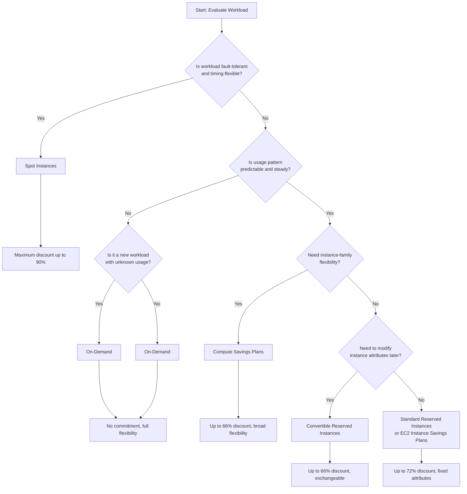
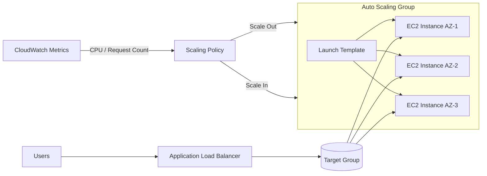

# EC2 Best Practices

EC2 provides the foundational compute layer for virtually every AWS workload, making its configuration a primary driver of cost, performance, and security across the entire account. Misconfigured instances are among the most common sources of cloud waste and vulnerability, so establishing disciplined practices here yields outsized returns.

## Instance Selection

### Instance Type Categories

Choosing the right instance category aligns hardware capabilities with workload demands, preventing both performance bottlenecks and unnecessary spend.

| Category | Prefix | Use Case | Examples |
|----------|--------|----------|----------|
| General Purpose | `m` | Balanced compute, memory, and networking | `m6i.large`, `m7g.xlarge` |
| Compute Optimized | `c` | High-performance processors for compute-intensive workloads | `c6i.xlarge`, `c7g.2xlarge` |
| Memory Optimized | `r` | In-memory databases, real-time analytics | `r6i.xlarge`, `r7g.4xlarge` |
| Storage Optimized | `i`, `d` | Parallel file systems, data warehousing | `i4i.xlarge`, `d3en.12xlarge` |
| Accelerated Computing | `p`, `g`, `inf`, `trn` | GPU/Inference/Training workloads, ML | `p4d.24xlarge`, `inf2.24xlarge`, `trn1.32xlarge` |
| Burstable Performance | `t` | Variable workloads with baseline + burst capability | `t4g.micro`, `t3.medium` |

### Graviton and Nitro

Leveraging Graviton and Nitro infrastructure unlocks significant cost and performance gains while reducing the software overhead that traditionally consumes instance resources.

| Topic | Guidance |
|-------|----------|
| **AWS Graviton (arm64)** | Prefer Graviton-based instances (e.g., `m7g`, `c7g`, `r7g`, `t4g`) for supported workloads — typically better price-performance than equivalent `x86` instances; requires arm64-compatible AMIs/binaries |
| **AWS Nitro System** | Many current-generation instance families use the Nitro System. Verify the selected instance type; Nitro offloads networking, storage, management, and security functions to dedicated hardware and a lightweight hypervisor |
| **Nitro Enclaves** | Use for isolated, attestable compute environments to process highly sensitive data (e.g., PII, keys) |

### Right-Sizing Guidelines

A systematic right-sizing process prevents the common trap of over-provisioning "just to be safe," which can quietly inflate monthly bills by 30-40%.

| Step | Action | Tool |
|------|--------|------|
| 1 | Review a representative period that includes peaks and business cycles | CloudWatch metrics and application telemetry |
| 2 | Review over- and under-provisioning recommendations | AWS Compute Optimizer |
| 3 | Validate CPU, memory, network, EBS, latency, and queue-depth constraints against workload SLOs | CloudWatch alarms and load tests |
| 4 | Test candidate instance types in non-production and model cost | AWS Pricing Calculator |
| 5 | Migrate using AMI copy or stop/start with new type | AWS Console / CLI |

---

## Purchasing Options

Matching the purchasing model to your workload profile is the single largest lever for reducing EC2 costs, with savings ranging from zero to 90% depending on commitment and flexibility trade-offs.

| Option | Commitment | Discount | Flexibility | Best For |
|--------|-----------|----------|-------------|----------|
| **On-Demand** | None | 0% | Full — stop, terminate, change anytime | Short-term, unpredictable workloads |
| **Savings Plans (Compute)** | 1 or 3 years | Up to 66% | High — instance family, region, OS, tenancy flexible; covers EC2, Fargate, Lambda | Steady-state, predictable usage |
| **Savings Plans (EC2 Instance)** | 1 or 3 years | Up to 72% | Medium — fixed instance family/Region, but size, OS, and tenancy can change | Predictable usage within a family and Region |
| **Reserved Instances (Standard)** | 1 or 3 years | Up to 72% | Low — matching attributes; Regional Linux/Unix shared-tenancy RIs have size/AZ flexibility, while Zonal RIs reserve capacity | Long-running, well-understood EC2 usage |
| **Reserved Instances (Convertible)** | 1 or 3 years | Up to 66% | Medium — modify instance attributes | Long-term with potential changes |
| **Spot Instances** | None | Up to 90% | Low — can be interrupted | Fault-tolerant, flexible timing |

### Purchasing Decision Matrix

This matrix maps common workload patterns to the optimal purchasing strategy, helping teams avoid over-committing on unpredictable workloads or under-committing on steady-state ones.

| Workload Type | Recommended Option | Reason |
|---------------|-------------------|--------|
| Production (steady state) | Savings Plans or Reserved | Maximum savings with commitment |
| Batch / Data Processing | Spot Instances | Maximum discount, interruptible |
| Development / Testing | On-Demand or Spot | Flexibility, low cost |
| New workloads (unknown usage) | On-Demand | No commitment until pattern is clear |
| High-priority production | On-Demand + Savings Plans | Blend of reliability and savings |

---

## Security Hardening

### IMDS (Instance Metadata Service)

The instance metadata service is a frequent attack vector for credential theft, so hardening IMDS access is one of the highest-impact security controls for any EC2 deployment.

| Setting | Value | Description |
|---------|-------|-------------|
| IMDS Version | **v2 only** | Require session-oriented IMDSv2 as defense in depth against several metadata-access attack paths |
| Hop Limit | `1` for direct host access; commonly `2` for containers | A limit of `1` can break container access. Use the smallest value that supports the workload and block metadata access for containers that do not need it |
| Token Requirement | **Required** | IMDSv2 requires session token |

### Security Checklist

These controls address the most common EC2 misconfigurations identified in security audits, reducing the attack surface across identity, network, and data layers.

| Area | Best Practice | Implementation |
|------|--------------|----------------|
| **IAM Roles** | Use instance profiles, never embed credentials | Attach IAM role to EC2 |
| **Security Groups** | Least privilege, no `0.0.0.0/0` on sensitive ports | Restrict ingress/egress rules |
| **SSH Access** | Use Session Manager instead of SSH | Systems Manager Session Manager |
| **Patch Management** | Automated patching via SSM Patch Manager | Maintenance windows |
| **Encryption** | EBS volumes encrypted at rest | Enable default encryption |
| **Key Pairs** | Use key pairs only when necessary; rotate regularly | EC2 Key Pair management |
| **User Data** | Never store secrets in user data scripts | Use SSM Parameter Store / Secrets Manager |

### Security Group Rules

Security groups function as a stateful firewall at the instance level, and overly permissive rules are the leading cause of unauthorized EC2 exposure in production environments.

| Rule Type | Direction | Protocol | Best Practice |
|-----------|-----------|----------|---------------|
| Web Server | Inbound | TCP/443 | Allow from `0.0.0.0/0` (HTTPS only) |
| Web Server | Inbound | TCP/80 | Redirect to HTTPS |
| Admin Access | Inbound | TCP/22 | Restrict to specific IP ranges |
| Database | Inbound | TCP/3306 | Restrict to application SG only |
| All Traffic | Outbound | All | Restrict to required destinations |

---

## Performance Optimization

### EBS Volume Selection

Storage bottlenecks are often invisible until they cause application timeouts, so selecting a volume type that matches the workload's I/O pattern is critical for both performance and cost efficiency.

| Volume Type | Code | IOPS | Throughput | Use Case |
|-------------|------|------|------------|----------|
| **gp3** | `gp3` | Up to 80,000 (independently provisioned) | Up to 2,000 MiB/s | General-purpose SSD; limits depend on the attached instance and Region |
| **gp2** | `gp2` | Up to 16,000 (size-dependent) | Up to 250 MiB/s | Previous general-purpose generation; evaluate migration to gp3 |
| **io2 Block Express** | `io2` | Up to 256,000 | Up to 4,000 MiB/s | Mission-critical, sustained IOPS and sub-millisecond latency; Nitro is required for the highest limits |
| **st1** | `st1` | Up to 500 with 1 MiB I/O | Up to 500 MiB/s | Large, frequently accessed sequential workloads; not bootable |
| **sc1** | `sc1` | Up to 250 with 1 MiB I/O | Up to 250 MiB/s | Cold sequential workloads; not bootable |

### EBS Best Practices

These practices address the most common storage-related performance and security gaps, particularly around encryption posture and legacy volume migration.

| Practice | Description |
|----------|-------------|
| Evaluate **gp3** instead of gp2 | Independent IOPS/throughput scaling and typically lower baseline storage pricing; compare current Regional pricing and workload performance |
| Enable **EBS encryption** | Use AWS-managed or customer-managed KMS keys |
| Use **EBS fast snapshot restore** | Reduce first-access latency for restored volumes |
| Monitor **Burst Balance** | For gp2 only (gp3 has no burst credits) |
| Enable **default encryption** | Account-level setting for all new volumes |

### Network Optimization

Network configuration directly impacts inter-instance latency, data transfer costs, and the ability to keep traffic off the public internet — all of which affect both performance and security.

| Feature | Description | Recommendation |
|---------|-------------|----------------|
| **Enhanced Networking** | SR-IOV-based, higher bandwidth | Enabled by default on Nitro instances |
| **Placement Groups** | Control instance placement | Cluster for low latency, Spread for high availability |
| **VPC Endpoints** | Private service access | Use for S3, DynamoDB, and other supported services |
| **Traffic Mirroring** | Copy network traffic | For security analysis and troubleshooting |

---

## Auto Scaling

### Launch Configuration vs Launch Template

Using launch templates instead of legacy launch configurations unlocks versioning, default selection, and compatibility with modern Auto Scaling features that launch configurations no longer support.

| Feature | Launch Configuration | Launch Template |
|---------|---------------------|-----------------|
| Versioning | No | Yes |
| Default Selection | No | Yes |
| Current availability | Accounts created on or after October 1, 2024 cannot create launch configurations | Supported for current Auto Scaling features |
| **Recommendation** | **Legacy; migrate existing Auto Scaling groups** | **Use launch templates for new and updated workloads** |

### Auto Scaling Group Settings

Misconfigured ASG boundaries and health checks are a leading cause of either failed scale-out events or unnecessary instance churn, so these parameters require careful calibration against actual application behavior.

| Parameter | Recommendation | Reason |
|-----------|---------------|--------|
| Min Size | Derive from the availability objective; commonly at least 2 across AZs for an HA service | Preserve required capacity during instance/AZ failure and maintenance |
| Max Size | Based on capacity planning | Prevent runaway scaling |
| Desired Capacity | Match current load | Baseline capacity |
| Default instance warmup | Measure application initialization time | Prevent startup metrics from distorting target tracking and step scaling |
| Scaling cooldown | Mainly for simple scaling | Prefer target tracking or step scaling; they use instance warmup rather than simple-scaling cooldown behavior |
| Health Check Type | Add ELB/VPC Lattice checks when they represent application health; retain EC2 status checks | Replace instances that are reachable at the host layer but unhealthy to the service |
| Health Check Grace Period | Measure application bootstrap time | Avoid replacing a healthy instance before startup completes |

### Scaling Policies

Selecting the wrong scaling policy leads to either sluggish response to traffic spikes or aggressive flapping that wastes money and degrades user experience.

| Policy Type | Description | Best For |
|-------------|-------------|----------|
| **Target Tracking** | Maintain target metric value | CPU, memory, request count |
| **Step Scaling** | Different adjustments per threshold | Variable load patterns |
| **Simple Scaling** | Fixed adjustment followed by a cooldown | Legacy/simple cases; AWS recommends target tracking or step scaling instead |
| **Scheduled Scaling** | Pre-defined schedule | Predictable traffic patterns |
| **Predictive Scaling** | ML-based forecast | Repeating patterns |

---

## Lifecycle Management

### Instance State Management

Understanding the data persistence implications of each action prevents accidental data loss and ensures the right recovery strategy is applied for each scenario.

| Action | When to Use | Considerations |
|--------|-------------|----------------|
| **Stop/Start** | Maintenance, cost saving | Data on EBS preserved; instance store (ephemeral) data is LOST |
| **Hibernate** | Preserve RAM state and resume processes | Must be enabled at launch; requires a supported AMI/type and an encrypted EBS root volume large enough for RAM. Instance-store data is lost |
| **Terminate** | Permanent removal | All ephemeral data lost |
| **Reboot** | Application recovery | Faster than stop/start |

### AMI Management

Stale AMIs accumulate unpatched vulnerabilities and unnecessary storage costs, while inconsistent base images cause configuration drift across environments.

| Practice | Description |
|----------|-------------|
| Use **Golden AMIs** | Pre-configured, hardened base images |
| Implement **AMI rotation** | Regular rebuilds with latest patches |
| Use **Packer** | Automated, version-controlled AMI builds |
| Tag **all AMIs** | Track creation date, purpose, version |
| Clean up **old AMIs** | Reduce storage costs, security risk |

---

## Monitoring

### Key CloudWatch Metrics

These metrics are the earliest signals of capacity problems, security incidents, and cost anomalies, making them essential for any operational runbook.

| Metric | Threshold | Action |
|--------|-----------|--------|
| `CPUUtilization` | Workload-specific SLO/headroom threshold | Correlate with latency, queue depth, throttling, and scaling metrics before changing size |
| `StatusCheckFailed` | > 0 | Investigate system/instance status |
| `NetworkIn` / `NetworkOut` | Baseline deviation | Security review, capacity planning |
| EBS volume metrics such as `VolumeQueueLength`, latency, throughput, and IOPS | SLO or provisioned-limit risk | EBS performance review |
| `CPUCreditBalance` (burstable instances) | Depletion trend | Review Unlimited-mode charges or choose a non-burstable/right-sized instance |

---

## Cross-Service Integration

EC2 rarely operates in isolation; integrating it with the right AWS services automates routine operations, closes security gaps, and reduces the manual effort required to maintain a healthy fleet.

| Service | Integration | Purpose |
|---------|------------|---------|
| Systems Manager | Patch Manager, State Manager, Session Manager | Centralized management, secure access |
| CloudWatch | Custom metrics, logs, alarms | Monitoring and alerting |
| Auto Scaling | Launch templates, scaling policies | Automatic capacity management |
| ELB | Target groups, health checks | Load distribution |
| CloudTrail | API activity logging | Audit and compliance |
| Config | Resource compliance | Continuous compliance monitoring |

---

## Authoritative references

- [Amazon EBS volume types](https://docs.aws.amazon.com/ebs/latest/userguide/ebs-volume-types.html)
- [Configure EC2 instance metadata options](https://docs.aws.amazon.com/AWSEC2/latest/UserGuide/configuring-instance-metadata-options.html)
- [EC2 hibernation prerequisites](https://docs.aws.amazon.com/AWSEC2/latest/UserGuide/hibernating-prerequisites.html)
- [Auto Scaling launch configurations and migration guidance](https://docs.aws.amazon.com/autoscaling/ec2/userguide/launch-configurations.html)
- [Set the default instance warmup](https://docs.aws.amazon.com/autoscaling/ec2/userguide/ec2-auto-scaling-default-instance-warmup.html)
