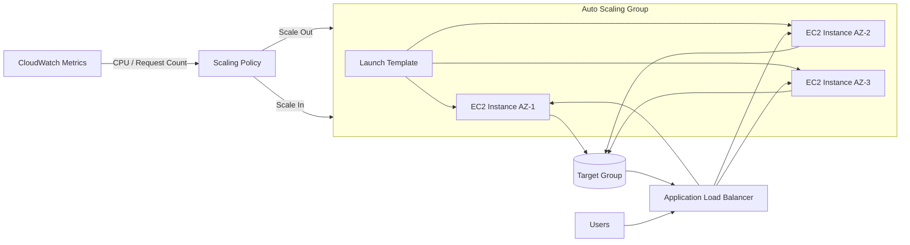

# EC2 Best Practices

## Instance Selection

### Instance Type Categories

| Category | Prefix | Use Case | Examples |
|----------|--------|----------|----------|
| General Purpose | `m` | Balanced compute, memory, and networking | `m6i.large`, `m7g.xlarge` |
| Compute Optimized | `c` | High-performance processors for compute-intensive workloads | `c6i.xlarge`, `c7g.2xlarge` |
| Memory Optimized | `r` | In-memory databases, real-time analytics | `r6i.xlarge`, `r7g.4xlarge` |
| Storage Optimized | `i`, `d` | Parallel file systems, data warehousing | `i4i.xlarge`, `d3en.12xlarge` |
| Accelerated Computing | `p`, `g`, `inf`, `trn` | GPU/Inference/Training workloads, ML | `p4d.24xlarge`, `inf2.24xlarge`, `trn1.32xlarge` |
| Burstable Performance | `t` | Variable workloads with baseline + burst capability | `t4g.micro`, `t3.medium` |

### Graviton and Nitro

| Topic | Guidance |
|-------|----------|
| **AWS Graviton (arm64)** | Prefer Graviton-based instances (e.g., `m7g`, `c7g`, `r7g`, `t4g`) for supported workloads — typically better price-performance than equivalent `x86` instances; requires arm64-compatible AMIs/binaries |
| **AWS Nitro System** | Virtually all current-generation instances run on the Nitro hypervisor, providing dedicated Nitro Cards for networking/storage/security, minimal virtualization overhead, and hardware-enforced isolation |
| **Nitro Enclaves** | Use for isolated, attestable compute environments to process highly sensitive data (e.g., PII, keys) |

### Right-Sizing Guidelines

| Step | Action | Tool |
|------|--------|------|
| 1 | Review CPU, memory, network utilization over 14-30 days | CloudWatch Metrics |
| 2 | Identify over-provisioned instances (utilization < 25%) | Compute Optimizer |
| 3 | Identify under-provisioned instances (utilization > 80%) | CloudWatch Alarms |
| 4 | Test candidate instance types in non-production | AWS Instance Calculator |
| 5 | Migrate using AMI copy or stop/start with new type | AWS Console / CLI |

---

## Purchasing Options

| Option | Commitment | Discount | Flexibility | Best For |
|--------|-----------|----------|-------------|----------|
| **On-Demand** | None | 0% | Full — stop, terminate, change anytime | Short-term, unpredictable workloads |
| **Savings Plans (Compute)** | 1 or 3 years | Up to 66% | High — instance family, region, OS, tenancy flexible; covers EC2, Fargate, Lambda | Steady-state, predictable usage |
| **Savings Plans (EC2 Instance)** | 1 or 3 years | Up to 72% | Low — specific instance family/region | Predictable, specific instance needs |
| **Reserved Instances (Standard)** | 1 or 3 years | Up to 72% | Low — specific instance type/region/tenancy | Long-running, fixed instance types |
| **Reserved Instances (Convertible)** | 1 or 3 years | Up to 66% | Medium — modify instance attributes | Long-term with potential changes |
| **Spot Instances** | None | Up to 90% | Low — can be interrupted | Fault-tolerant, flexible timing |

### Purchasing Decision Matrix

| Workload Type | Recommended Option | Reason |
|---------------|-------------------|--------|
| Production (steady state) | Savings Plans or Reserved | Maximum savings with commitment |
| Batch / Data Processing | Spot Instances | Maximum discount, interruptible |
| Development / Testing | On-Demand or Spot | Flexibility, low cost |
| New workloads (unknown usage) | On-Demand | No commitment until pattern is clear |
| High-priority production | On-Demand + Savings Plans | Blend of reliability and savings |

---

## Security Hardening

### IMDS (Instance Metadata Service)

| Setting | Value | Description |
|---------|-------|-------------|
| IMDS Version | **v2 only** | v1 is vulnerable to SSRF attacks |
| Hop Limit | `1` | Prevents access from within containers |
| Token Requirement | **Required** | IMDSv2 requires session token |

### Security Checklist

| Area | Best Practice | Implementation |
|------|--------------|----------------|
| **IAM Roles** | Use instance profiles, never embed credentials | Attach IAM role to EC2 |
| **Security Groups** | Least privilege, no `0.0.0.0/0` on sensitive ports | Restrict ingress/egress rules |
| **SSH Access** | Use Session Manager instead of SSH | Systems Manager Session Manager |
| **Patch Management** | Automated patching via SSM Patch Manager | Maintenance windows |
| **Encryption** | EBS volumes encrypted at rest | Enable default encryption |
| **Key Pairs** | Use key pairs only when necessary; rotate regularly | EC2 Key Pair management |
| **User Data** | Never store secrets in user data scripts | Use SSM Parameter Store / Secrets Manager |

### Security Group Rules

| Rule Type | Direction | Protocol | Best Practice |
|-----------|-----------|----------|---------------|
| Web Server | Inbound | TCP/443 | Allow from `0.0.0.0/0` (HTTPS only) |
| Web Server | Inbound | TCP/80 | Redirect to HTTPS |
| Admin Access | Inbound | TCP/22 | Restrict to specific IP ranges |
| Database | Inbound | TCP/3306 | Restrict to application SG only |
| All Traffic | Outbound | All | Restrict to required destinations |

---

## Performance Optimization

### EBS Volume Selection

| Volume Type | Code | IOPS | Throughput | Use Case |
|-------------|------|------|------------|----------|
| **gp3** | `gp3` | Up to 16,000 (independent) | Up to 1,000 MB/s | General purpose, default choice |
| **gp2** | `gp2` | Up to 16,000 (size-dependent) | Up to 250 MB/s | Legacy, migrate to gp3 |
| **io2 Block Express** | `io2` | Up to 256,000 | Up to 4,000 MB/s | Mission-critical, low-latency |
| **io2** | `io2` | Up to 64,000 | Up to 1,000 MB/s | Critical databases |
| **st1** | `st1` | Up to 500 | Up to 500 MB/s | Throughput-optimized, big data |
| **sc1** | `sc1` | Up to 125 | Up to 500 MB/s | Cold, infrequently accessed data |

### EBS Best Practices

| Practice | Description |
|----------|-------------|
| Prefer **gp3** over gp2 | Independent IOPS/throughput scaling, 20% cheaper |
| Enable **EBS encryption** | Use AWS-managed or customer-managed KMS keys |
| Use **EBS fast snapshot restore** | Reduce first-access latency for restored volumes |
| Monitor **Burst Balance** | For gp2 only (gp3 has no burst credits) |
| Enable **default encryption** | Account-level setting for all new volumes |

### Network Optimization

| Feature | Description | Recommendation |
|---------|-------------|----------------|
| **Enhanced Networking** | SR-IOV-based, higher bandwidth | Enabled by default on Nitro instances |
| **Placement Groups** | Control instance placement | Cluster for low latency, Spread for high availability |
| **VPC Endpoints** | Private service access | Use for S3, DynamoDB, and other supported services |
| **Traffic Mirroring** | Copy network traffic | For security analysis and troubleshooting |

---

## Auto Scaling

### Launch Configuration vs Launch Template

| Feature | Launch Configuration | Launch Template |
|---------|---------------------|-----------------|
| Versioning | No | Yes |
| Default Selection | No | Yes |
| Multiple Block Devices | Limited | Full support |
| IAM Instance Profile | ARN only | Name or ARN |
| User Data | Base64-encoded only | Raw or Base64 |
| **Recommendation** | **Legacy** | **Always use Launch Templates** |

### Auto Scaling Group Settings

| Parameter | Recommendation | Reason |
|-----------|---------------|--------|
| Min Size | At least 2 | High availability across AZs |
| Max Size | Based on capacity planning | Prevent runaway scaling |
| Desired Capacity | Match current load | Baseline capacity |
| Scale-Out Cooldown | 60-300 seconds | Prevent rapid scaling cycles |
| Scale-In Cooldown | 300-600 seconds | Allow traffic to stabilize |
| Health Check Type | ELB (preferred) | More accurate than EC2 status |
| Health Check Grace Period | 300 seconds | Allow application startup |

### Scaling Policies

| Policy Type | Description | Best For |
|-------------|-------------|----------|
| **Target Tracking** | Maintain target metric value | CPU, memory, request count |
| **Step Scaling** | Different adjustments per threshold | Variable load patterns |
| **Simple Scaling** | Fixed adjustment per alarm | Basic use cases |
| **Scheduled Scaling** | Pre-defined schedule | Predictable traffic patterns |
| **Predictive Scaling** | ML-based forecast | Repeating patterns |

---

## Lifecycle Management

### Instance State Management

| Action | When to Use | Considerations |
|--------|-------------|----------------|
| **Stop/Start** | Maintenance, cost saving | Data on EBS preserved; instance store (ephemeral) data is LOST |
| **Hibernate** | Preserve RAM state | Requires instance store volume, limited instance types |
| **Terminate** | Permanent removal | All ephemeral data lost |
| **Reboot** | Application recovery | Faster than stop/start |

### AMI Management

| Practice | Description |
|----------|-------------|
| Use **Golden AMIs** | Pre-configured, hardened base images |
| Implement **AMI rotation** | Regular rebuilds with latest patches |
| Use **Packer** | Automated, version-controlled AMI builds |
| Tag **all AMIs** | Track creation date, purpose, version |
| Clean up **old AMIs** | Reduce storage costs, security risk |

---

## Monitoring

### Key CloudWatch Metrics

| Metric | Threshold | Action |
|--------|-----------|--------|
| `CPUUtilization` | > 80% for 5 min | Scale out or right-size up |
| `StatusCheckFailed` | > 0 | Investigate system/instance status |
| `NetworkIn` / `NetworkOut` | Baseline deviation | Security review, capacity planning |
| `DiskReadOps` / `DiskWriteOps` | Baseline deviation | EBS performance review |
| `CreditBalance` (T-series) | < 20% | Consider instance upgrade |

---

## Cross-Service Integration

| Service | Integration | Purpose |
|---------|------------|---------|
| Systems Manager | Patch Manager, State Manager, Session Manager | Centralized management, secure access |
| CloudWatch | Custom metrics, logs, alarms | Monitoring and alerting |
| Auto Scaling | Launch templates, scaling policies | Automatic capacity management |
| ELB | Target groups, health checks | Load distribution |
| CloudTrail | API activity logging | Audit and compliance |
| Config | Resource compliance | Continuous compliance monitoring |
