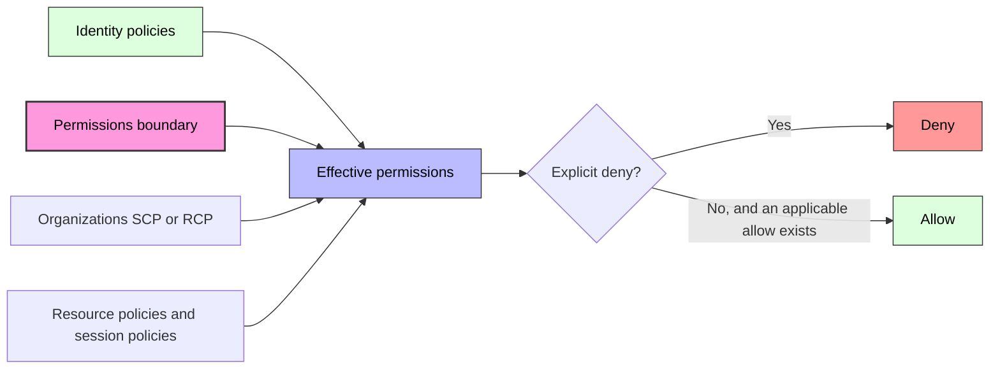
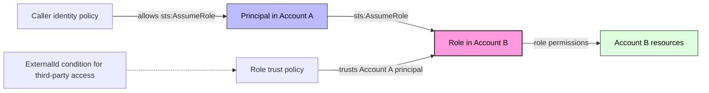

# IAM Best Practices

## Core Principles

### Least Privilege Framework

| Principle | Description | Implementation |
|-----------|-------------|----------------|
| **Least Privilege** | Grant only permissions required for the task | Use permission policies, not AdministratorAccess |
| **Permission Boundaries** | Set maximum permissions an entity can receive | IAM permission boundaries on roles/users |
| **Just-in-Time Access** | Time-bounded elevation when needed | IAM Identity Center with a temporary elevated-access workflow, or a vetted external identity governance system |
| **Regular Review** | Audit and remove unused permissions | IAM Access Analyzer, credential reports |

### Permission Strategy

| Entity Type | Use Case | Best Practice |
|-------------|----------|---------------|
| **IAM Users** | Exceptional human or workload cases requiring long-term credentials | Prefer IAM Identity Center or federation for people and IAM roles/temporary credentials for workloads |
| **IAM Roles** | Temporary access for services, users, apps | **Preferred** - assume role with sts:AssumeRole |
| **IAM Groups** | Permission management for users | Assign policies to groups, not individual users |
| **AWS STS** | Temporary security credentials | Short-lived tokens for cross-account access |

---

## MFA Enforcement

### MFA Requirements

| Scope | Requirement | Implementation |
|-------|-------------|----------------|
| **Root user** | **AWS-required** | Register a passkey/security key where possible; all standalone, management, and member account root users must configure MFA unless member root credentials are centrally removed |
| **IAM Users** | **Strongly recommended** | Prefer federation; where IAM users remain, require MFA for console access and sensitive actions |
| **Privileged access** | **Strongly recommended** | Enforce MFA in the identity provider/Identity Center. Use `aws:MultiFactorAuthPresent` only where the request context supports it |
| **CI/CD Roles** | Not required | Machine-to-machine, use IAM roles |
| **Service Roles** | Not required | EC2, Lambda, etc. use role assumption |

### MFA Condition Keys

| Condition Key | Description | Example |
|--------------|-------------|---------|
| aws:MultiFactorAuthPresent | Requires MFA for the request | Bool: true |
| aws:MultiFactorAuthAge | Time since MFA authentication | NumericLessThan: 3600 |

---

## Role Design

### Trust Policies

| Trusted Entity | Use Case | Example |
|---------------|----------|---------|
| **AWS Service** | EC2, Lambda, ECS assume role | Service: ec2.amazonaws.com |
| **AWS Account** | Cross-account access | AWS: arn:aws:iam::123456789012:root |
| **IAM User/Role** | Specific user/role assumption | AWS: arn:aws:iam::123456789012:role/RoleName |
| **External ID** | Third-party access with extra security | Condition: sts:ExternalId |
| **Federated User** | SAML/OIDC identity providers | Federated: arn:aws:iam::account:saml-provider/Provider |

### Session Duration

| Session | Default | Configurable Range / Limit | Recommendation |
|---------|---------|----------------------------|----------------|
| **IAM role assumed through STS** | 1 hour when `DurationSeconds` is omitted | The role's maximum session duration is configurable from 1-12 hours; `AssumeRole*` requests can generally ask for 15 minutes up to that maximum | Use the shortest duration needed; role chaining is capped at 1 hour |
| **SAML or web-identity role session** | 1 hour when a duration is not supplied | 15 minutes up to the role's configured maximum (at most 12 hours), subject to the identity-provider assertion/token | Prefer purpose-built federation such as IAM Identity Center or Amazon Cognito where applicable |
| **IAM Identity Center account role session** | 1 hour | 1-12 hours per permission set | Use shorter sessions for sensitive environments and just-in-time elevated access |

Do not treat all temporary credentials as having the same lifetime. Other STS operations differ: for example, `GetFederationToken` and IAM-user `GetSessionToken` can issue credentials for up to 36 hours, while credentials requested with root user credentials are limited to one hour.

---

## Policy Best Practices

### Policy Structure

| Element | Description | Best Practice |
|---------|-------------|---------------|
| **Action** | API operations allowed | Use specific actions, not wildcard |
| **Resource** | ARNs of affected resources | Use specific ARNs, not wildcard |
| **Effect** | Allow or Deny | Explicit Deny for critical protections |
| **Condition** | When policy applies | IP, MFA, time, tag conditions |
| **Sid** | Statement identifier | Descriptive names for auditing |

### Common Condition Keys

| Condition Key | Example operator | Use Case |
|--------------|------|----------|
| aws:SourceIp | IpAddress | Restrict by IP range |
| aws:SourceVpc | StringEquals | Restrict to VPC |
| aws:PrincipalOrgID | StringEquals | Restrict to organization |
| aws:RequestTag/key-name | StringEquals | Enforce required tags on resource creation |
| aws:RequestedRegion | StringEquals | Restrict regions |
| aws:MultiFactorAuthPresent | Bool | Require MFA |
| aws:TokenIssueTime | DateGreaterThan / DateLessThan | Constrain access by when temporary credentials were issued |

### Guardrail Policies

| Policy Name | Purpose | Description |
|-------------|---------|-------------|
| **Deny Billing Changes** | Prevent cost surprises | Deny billing console and API access |
| **Deny Region Access** | Comply with data residency | Deny actions in restricted regions |
| **Enforce Tagging** | Required tags on resource creation | aws:RequestTag conditions |
| **Restrict root usage** | Prevent routine root activity | Centrally secure/remove member root credentials where appropriate; alert on root activity. SCPs don't affect the management account root user |
| **Deny Unencrypted S3** | Enforce encryption | Deny S3 PUT without encryption headers |

---

## AWS IAM Identity Center

### Comparison: IAM Users vs Identity Center

| Feature | IAM Users | IAM Identity Center |
|---------|-----------|--------------------------|
| **Password Management** | Per-user, manual | Centralized, SSO |
| **MFA** | Per-user configuration | Centralized enforcement |
| **Access Assignment** | IAM groups/policies | Permission sets on roles |
| **Temporary elevated access** | Custom role-assumption workflow | Integrate a supported temporary elevated-access workflow; it is not implicit in every permission-set assignment |
| **Audit Trail** | CloudTrail | Access report + CloudTrail |
| **External IdP** | SAML federation configured in IAM | External identity source support varies: SAML 2.0 for authentication and SCIM for provisioning are common patterns |
| **Recommendation** | **Avoid for humans** | **Use for all human access** |

### Permission Sets

| Concept | Description |
|---------|-------------|
| **Permission Set** | Reusable collection of IAM policies |
| **Assignment** | Links user/group to permission set to AWS account |
| **Session Duration** | Configurable per permission set (1-12 hours) |
| **Inline Policies** | Attached directly to permission set |
| **Managed Policies** | AWS or customer managed policies |

---

## Access Management for Services

### Service-Linked Roles

| Service | Role Purpose | Auto-Created |
|---------|-------------|--------------|
| **Auto Scaling** | Manage EC2 instances | Yes |
| **Elastic Load Balancing** | Describe/modify instances | Yes |
| **RDS** | Manage DB instances | Yes |
| **ECS** | Manage tasks and containers | Yes |
| **CloudFormation** | Uses caller credentials or a user-supplied service role; some features use service-linked roles | Not a general auto-created execution role |

### Cross-Account Access Patterns

| Pattern | Description | Use Case |
|---------|-------------|----------|
| **Role Assumption** | Account A assumes role in Account B | Centralized access management |
| **External ID** | Additional verification token | Third-party vendor access |
| **Organization SCPs** | Service Control Policies | Guardrails across accounts |
| **RAM Sharing** | Resource Access Manager | Share subnets, transit gateways |

> The diagram is conceptual. Resource-based policies, role sessions, permissions boundaries, SCPs/RCPs, and explicit denies interact differently by principal and request context; use the IAM policy-evaluation rules for an exact decision.

---

## Credential Management

### Credential Types

| Type | Lifetime | Use Case | Rotation |
|------|----------|----------|----------|
| **Access Keys** | Long-lived until deactivated/deleted | Exceptional workloads outside AWS that cannot federate | Replace with temporary credentials; otherwise rotate on a risk-based schedule and immediately after exposure |
| **STS credentials** | API- and caller-dependent (from 15 minutes to as much as 36 hours) | Temporary access | Auto-expire; request only the duration needed |
| **SSO Tokens** | Session duration | Console, CLI via SSO | Auto-expire |
| **Web Identity Tokens** | Provider-dependent | Mobile/web apps | Auto-expire |

### Credential Rotation Checklist

| Action | Frequency | Tool |
|--------|-----------|------|
| Replace long-lived access keys | As soon as practical | IAM roles, IAM Roles Anywhere, web identity federation, or another temporary-credential mechanism |
| Disable unused keys | Monthly | Credential report |
| Remove inactive users | Quarterly | IAM Access Advisor |
| Review root key usage | Monthly | CloudTrail |
| Audit policy attachments | Quarterly | IAM Access Analyzer |

---

## AWS Organizations & SCPs

SCPs set the maximum available permissions for principals in member accounts; they do not grant permissions. They do not restrict the management account, and they do not restrict service-linked roles.

### SCP Types

| Type | Description | Use Case |
|------|-------------|----------|
| **Allow List SCP** | Explicitly allow specific services/actions | Restrict to approved services only |
| **Deny List SCP** | Deny specific services/actions | Block dangerous operations |
| **Baseline SCP** | Applied to all accounts | Organization-wide guardrails |

### Common SCP Patterns

| SCP | Purpose | Actions Affected |
|-----|---------|-----------------|
| **Deny IAM Changes** | Prevent privilege escalation | iam:DeleteUser, iam:AttachPolicy |
| **Deny Region Access** | Data sovereignty | All actions in non-approved regions |
| **Deny Service Termination** | Prevent accidental deletion | ec2:TerminateInstances, rds:DeleteDBInstance |
| **Deny Public S3** | Prevent data exposure | Prefer account-level S3 Block Public Access plus narrowly scoped policy guardrails; action-only denies cannot reliably classify every public policy |
| **Deny Key Deletion** | Protect encryption | kms:ScheduleKeyDeletion |

---

## Monitoring & Auditing

| Tool | Purpose | Frequency |
|------|---------|-----------|
| **CloudTrail** | API call logging | Continuous |
| **IAM Access Analyzer** | Find unused permissions | Weekly review |
| **Credential Report** | List all users and key status | Monthly |
| **Access Advisor** | Service access history | Per-user review |
| **AWS Config Rules** | IAM policy compliance | Continuous |

### Key CloudTrail Events to Monitor

| Event | Concern | Action |
|-------|---------|--------|
| `ConsoleLogin` with `Failure` | Brute force attempt | Alert, block IP |
| `CreateAccessKey` | New credential creation | Verify authorization |
| `AttachUserPolicy` with `AdministratorAccess` | Privilege escalation | Alert immediately |
| `DeleteUser` | Account removal | Verify authorization |
| `PutUserPolicy` | Inline policy change | Review policy content |
| `AssumeRole` | Role assumption | Verify source and purpose |

---

## Authoritative references

- [Security best practices in IAM](https://docs.aws.amazon.com/IAM/latest/UserGuide/best-practices.html)
- [MFA for the AWS account root user](https://docs.aws.amazon.com/IAM/latest/UserGuide/enable-mfa-for-root.html)
- [Policy evaluation logic](https://docs.aws.amazon.com/IAM/latest/UserGuide/reference_policies_evaluation-logic.html)
- [IAM role maximum session duration](https://docs.aws.amazon.com/IAM/latest/UserGuide/id_roles_update-role-settings.html)
- [IAM Identity Center account session duration](https://docs.aws.amazon.com/singlesignon/latest/userguide/howtosessionduration.html)
- [AWS STS temporary credential duration comparison](https://docs.aws.amazon.com/IAM/latest/UserGuide/id_credentials_temp_request.html)
- [Service control policy effects](https://docs.aws.amazon.com/organizations/latest/userguide/orgs_manage_policies_scps.html)
- [Temporary elevated access with IAM Identity Center](https://docs.aws.amazon.com/singlesignon/latest/userguide/temporary-elevated-access.html)
