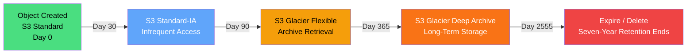
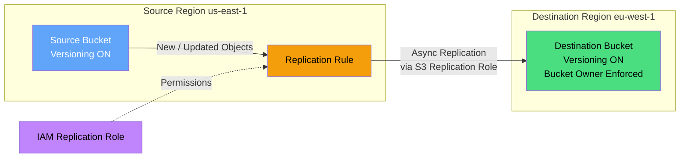

# S3 Best Practices

Amazon S3 is the foundational object storage service for AWS, providing durable, scalable, and cost-effective storage for virtually any workload. Understanding S3's features and trade-offs is essential because storage decisions directly impact security posture, application performance, and cloud spend. This guide consolidates the most important considerations so teams can make informed choices rather than defaulting to the simplest option.

## Storage Classes

### Storage Class Comparison

Choosing the right storage class is the single biggest lever for balancing cost against access requirements. Picking the wrong class can silently overcharge you for rarely accessed data or introduce unacceptable retrieval latency.

| Storage Class | Access | Minimum storage duration | Minimum billable object size | Important cost/resilience consideration | Use Case |
|--------------|--------|--------------------------|------------------------------|-----------------------------------------|----------|
| **S3 Standard** | Milliseconds | None | None | Multi-AZ; no retrieval fee | Active data, frequent access |
| **S3 Intelligent-Tiering** | Milliseconds for automatic low-latency tiers; archived optional tiers require restore | None | None | Per-object monitoring fee; objects smaller than 128 KB stay in Frequent Access and are not monitored | Unknown/changing access patterns |
| **S3 Standard-IA** | Milliseconds | 30 days | 128 KB | Retrieval fee; multi-AZ | Infrequent access, rapid retrieval |
| **S3 One Zone-IA** | Milliseconds | 30 days | 128 KB | Retrieval fee; not resilient to loss of its AZ | Non-critical, recreatable data |
| **S3 Glacier Instant Retrieval** | Milliseconds | 90 days | 128 KB | Retrieval fee | Rarely accessed archives needing immediate access |
| **S3 Glacier Flexible Retrieval** | Minutes to hours after restore | 90 days | Not applicable; 40 KB metadata overhead per object | Restore and retrieval charges | Archives with asynchronous retrieval |
| **S3 Glacier Deep Archive** | Hours after restore | 180 days | Not applicable; 40 KB metadata overhead per object | Restore and retrieval charges | Long-term compliance and cold storage |
| **S3 Express One Zone** | Consistent single-digit milliseconds | None | None | Directory bucket in one selected AZ | High-request-rate, latency-sensitive workloads that tolerate single-AZ placement |

### Storage Class Selection Matrix

This decision matrix maps your workload's access patterns to the most appropriate storage class, removing guesswork from capacity planning. Use it during architecture design to avoid costly retrofits when access patterns differ from initial assumptions.

| Access Frequency | Retrieval Time | Data Criticality | Recommended Class |
|-----------------|---------------|-----------------|-------------------|
| Multiple times/day | Immediate | High | S3 Standard |
| Unknown / variable | Immediate | High | S3 Intelligent-Tiering |
| Once/month | Milliseconds | High | S3 Standard-IA |
| Once/month | Milliseconds | Low | S3 One Zone-IA |
| Once/year | Minutes | High | S3 Glacier Flexible |
| Once/year | Hours | High | S3 Glacier Deep Archive |
| High-frequency, low-latency | Single-digit milliseconds | Medium | S3 Express One Zone |

---

## Data Lifecycle Policies

Automating data movement across storage classes prevents costs from spiraling as objects age and access patterns change. Without lifecycle policies, data accumulates in expensive tiers indefinitely.

### Lifecycle Rules

The following schedule is an illustrative seven-year log-retention policy. Choose transitions and expiration from access patterns, recovery needs, regulatory retention, and minimum-storage-duration charges.

| Action | Transition Target | Days After Creation | Description |
|--------|------------------|---------------------|-------------|
| Transition | S3 Standard-IA | 30 | Move infrequently accessed data |
| Transition | S3 Glacier Flexible | 90 | Archive older data |
| Transition | S3 Glacier Deep Archive | 365 | Long-term retention |
| Expire | — | 2555 | Delete after the seven-year retention period |
| Abort Incomplete Multipart Upload | — | 7 | Clean up failed uploads |

### Lifecycle Policy Example

```json
{
  "Rules": [
    {
      "ID": "archive-and-expire",
      "Status": "Enabled",
      "Filter": { "Prefix": "logs/" },
      "Transitions": [
        { "Days": 30, "StorageClass": "STANDARD_IA" },
        { "Days": 90, "StorageClass": "GLACIER" },
        { "Days": 365, "StorageClass": "DEEP_ARCHIVE" }
      ],
      "Expiration": { "Days": 2555 }
    },
    {
      "ID": "abort-incomplete-uploads",
      "Status": "Enabled",
      "Filter": { "Prefix": "" },
      "AbortIncompleteMultipartUpload": { "DaysAfterInitiation": 7 }
    }
  ]
}
```



---

## Security

S3 is frequently the target of misconfiguration-based data breaches, making security controls non-negotiable. Each control addresses a distinct attack vector, and layering them provides defense in depth.

### Bucket Policies

| Security Control | Implementation | Priority |
|-----------------|----------------|----------|
| **Block all public access** | Enable S3 Block Public Access at account level | CRITICAL |
| **Encrypt all data** | S3 automatically applies SSE-S3 to new uploads; use bucket default SSE-KMS/DSSE-KMS when key control or audit requirements call for it | CRITICAL |
| **Enforce HTTPS** | Deny `aws:SecureTransport` = false | HIGH |
| **Restrict by IP/VPC** | `aws:SourceIp`, `aws:sourceVpc` conditions | HIGH |
| **Versioning** | Enable where recovery from overwrite/deletion or replication is required; add lifecycle rules for noncurrent versions | HIGH |
| **MFA Delete** | Enable for sensitive buckets | MEDIUM |
| **Access Logging** | Enable for audit compliance | MEDIUM |

### Encryption Options

Encryption choices affect not only data-at-rest protection but also key management overhead, audit capability, and feature compatibility. Select based on compliance requirements and how much control you need over cryptographic keys.

| Method | Key Management | Cost/performance consideration | Use Case |
|--------|---------------|--------------------------------|----------|
| **SSE-S3 (S3 Managed)** | AWS manages keys | Automatic baseline encryption with no additional encryption charge | Default, general use |
| **SSE-KMS / DSSE-KMS** | AWS KMS keys and key policies | KMS pricing and quotas apply; consider S3 Bucket Keys for SSE-KMS request reduction | Key-policy control, audit, or dual-layer requirements |
| **SSE-C (Customer Provided)** | Customer supplies the key on every request | Customer must retain keys and use HTTPS; unavailable for several S3 features | Specialized external key custody |
| **Client-Side Encryption** | Application encrypts before upload | Application key lifecycle and compute/feature tradeoffs | End-to-end application-controlled encryption |

### Access Control Methods

Different access control mechanisms operate at different scopes, and understanding their boundaries prevents permission gaps and overly broad access. Using the right mechanism for each scenario keeps policies manageable and auditable.

| Method | Scope | Granularity | Best For |
|--------|-------|-------------|----------|
| **IAM Policies** | Account-level | User/role/permission | Cross-account access, broad policies |
| **Bucket Policies** | Bucket-level | Resource/action/condition | Public access, VPC restrictions |
| **ACLs** | Object/bucket-level | Read/write/ownership | Legacy, migrate to bucket policies |
| **Presigned URLs** | Object-level, time-limited | Read/write, expiration | Temporary, direct access |
| **S3 Access Points** | Bucket-level | Network, policy, VPC | Simplified data access management |

---

## Performance Optimization

S3 performance is not automatic — request patterns, object sizes, and network paths all influence throughput and latency. Proactive tuning prevents bottlenecks that cascade into application-level issues.

### Request Performance

| Technique | Description | Impact |
|-----------|-------------|--------|
| **S3 Transfer Acceleration** | Uses AWS edge locations and the AWS global network for long-distance transfers | Benchmark with the S3 speed comparison tool; benefit depends on path and workload |
| **S3 Express One Zone** | Consistent single-digit millisecond access | Up to 10x faster than S3 Standard for supported latency-sensitive workloads |
| **Multipart Upload** | Parallel upload of large objects | Faster uploads, retry resilience |
| **Parallel GET Requests** | Multiple concurrent requests | Higher aggregate throughput |
| **S3 Batch Operations** | Bulk operations on objects | Automated large-scale tasks |

### Object Size Guidelines

Object size determines which upload mechanisms are available and which storage classes are cost-effective. Misaligned object sizes can trigger unexpected charges or block uploads entirely.

| Object Size | Recommendation |
|-------------|---------------|
| < 100 MB | Standard PUT |
| 100 MB - 5 GB | Multipart upload recommended |
| > 5 GB | Multipart upload required |
| High-frequency small objects | Consider S3 Express One Zone |

### Request Rate Limits

Understanding rate limits per prefix prevents throttling under load and informs key naming strategies. While S3 auto-scales, bursty workloads concentrated on a few keys can still hit baseline ceilings.

| Operation | Baseline Rate (per prefix) | Notes |
|-----------|---------------------------|-------|
| PUT/COPY/POST/DELETE | 3,500/sec | Automatically scales higher; add prefixes to parallelize further |
| GET/HEAD | 5,500/sec | Automatically scales higher; add prefixes to parallelize further |
| **Optimization** | Use multiple prefixes to parallelize | S3 auto-partitions by prefix (since 2018); random hashed prefixes are no longer required for performance, only for spreading load across many prefixes |

---

## Data Consistency

Knowing the consistency guarantees is critical for designing applications that read back their own writes or rely on listing accuracy. S3's strong consistency model simplifies many patterns, but edge cases still exist.

| Operation | Consistency Model | Notes |
|-----------|------------------|-------|
| **READ after WRITE** | **Strong consistency** | Since December 2020 |
| **READ after LIST** | **Strong consistency** | Since December 2020 |
| **DELETE** | Strong consistency | Object immediately unavailable |
| **List operations** | Strong consistency | All prefixes and objects |

---

## Replication

Replication is the backbone of disaster recovery and data sovereignty requirements, but it has prerequisites and limitations that must be planned for upfront. Configuring it reactively leaves a gap of unprotected data until catch-up replication completes.

### Replication Types

| Type | Direction | Latency | Use Case |
|------|-----------|---------|----------|
| **Cross-Region (CRR)** | One region → another | Minutes | Disaster recovery, compliance |
| **Same-Region (SRR)** | One bucket → another | Minutes | Data segregation, workload optimization |
| **One-way** | Source → Destination | Minutes | Standard replication |
| **Multi-Region Access Point** | Routes requests to one or more Regional buckets | Depends on routing and bucket health | Global endpoint and active-active or failover routing; it does not replicate data by itself |

### Replication Requirements

Missing any prerequisite silently breaks replication, leaving teams unaware of the gap until a failure occurs. Verify each requirement before relying on replication for business continuity.

| Requirement | Description |
|-------------|-------------|
| Enable **versioning** | Required on both source and destination |
| **S3 Replication Role** | IAM role with required permissions |
| **Object ownership** | Prefer `Bucket owner enforced`; use replica-owner override only for legacy ACL requirements |
| **Encryption** | SSE-KMS and DSSE-KMS objects require explicit replication configuration and KMS permissions |
| **Existing objects** | Live replication covers new writes after configuration; use S3 Batch Replication for existing objects |
| **Object size** | Subject to the S3 object maximum of 5 TB |



---

## Cost Optimization

S3 costs are multi-dimensional, and optimizing one dimension (storage) can inflate another (retrieval or request charges). A holistic view prevents local optimizations that increase total spend.

| Strategy | Description | Potential Savings |
|----------|-------------|-------------------|
| **Intelligent-Tiering** | Automatic transitions based on observed access | Compare monitoring fees and object sizes with expected tier savings |
| **Lifecycle policies** | Policy-driven transitions and expiration | Model minimum-duration, retrieval, request, and metadata charges before transitioning |
| **S3 Storage Lens** | Account-wide metrics and recommendations | Data-driven optimization |
| **Clean up orphaned objects** | Remove unused data, old versions | Varies |
| **Right-size Transfer Acceleration** | Enable only after performance and Regional price evaluation | Avoid acceleration charges where the measured benefit is insufficient |
| **Reduce request counts** | Batch operations, pagination | Per-request costs |

### Cost drivers

S3 pricing varies by Region, storage class, request category, retrieval amount, data transfer path, object count, and optional features. Do not compare storage price alone: minimum-duration charges, per-object metadata, retrieval, early deletion, replication, and KMS request charges can dominate small-object or short-lived workloads. Use the [S3 pricing page](https://aws.amazon.com/s3/pricing/) and AWS Pricing Calculator for the deployment Region.

---

## Data Recovery

Recovery options trade off between protection level, operational overhead, and restore speed. Choosing the right combination depends on your RPO/RTO targets and whether threats are accidental or malicious.

| Feature | Description | RPO | RTO |
|---------|-------------|-----|-----|
| **Versioning** | Keep multiple versions of objects | Depends on versioning state and lifecycle; it is not an independent backup | Usually immediate for an existing version |
| **Object Lock** | WORM retention or legal hold on versioned objects | Depends on versioning and retention configuration | Usually immediate for an existing version |
| **Replication** | Asynchronous copies in another bucket | Non-zero and workload-dependent; S3 Replication Time Control provides an SLA for most objects within 15 minutes | Application- and failover-process-dependent |
| **S3 Batch Operations** | Restore from copies | N/A | Hours |
| **AWS Backup** | Centralized backup management | Configurable | Configurable |

### Object Lock Modes

The two lock modes serve different threat models — governance protects against operational mistakes, while compliance defends against determined adversaries, including privileged users.

| Mode | Description | Use Case |
|------|-------------|----------|
| **Governance** | Objects protected from deletion/overwrite; users with `s3:BypassGovernanceRetention` permission can override | Protect against accidental deletion |
| **Compliance** | Objects can't be deleted by anyone, including root | Regulatory compliance (SEC, HIPAA) |

---

## Cross-Service Integration

S3 rarely operates in isolation; understanding how it connects to other AWS services unlocks event-driven architectures, analytics pipelines, and global content delivery. Knowing the integration points helps design systems that leverage the broader AWS ecosystem.

| Service | Integration | Purpose |
|---------|------------|---------|
| CloudFront | Origin for CDN | Global content delivery |
| Lambda | S3 event notifications | Event-driven processing |
| Glue | Data catalog, ETL | Data lake, analytics |
| Athena | Query S3 data directly | Ad-hoc SQL analytics |
| Lambda@Edge | CloudFront edge logic | Dynamic content at edge |
| Transfer Family | SFTP/FTPS to S3 | Secure file transfer |
| Macie | Data discovery & protection | PII detection, classification |

---

## Authoritative references

- [S3 storage classes](https://docs.aws.amazon.com/AmazonS3/latest/userguide/storage-class-intro.html)
- [S3 performance guidelines](https://docs.aws.amazon.com/AmazonS3/latest/userguide/optimizing-performance.html)
- [S3 replication requirements and considerations](https://docs.aws.amazon.com/AmazonS3/latest/userguide/replication-requirements.html)
- [S3 Multi-Region Access Points](https://docs.aws.amazon.com/AmazonS3/latest/userguide/MultiRegionAccessPoints.html)
- [Protecting data with versioning](https://docs.aws.amazon.com/AmazonS3/latest/userguide/Versioning.html)
