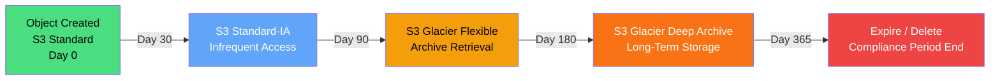
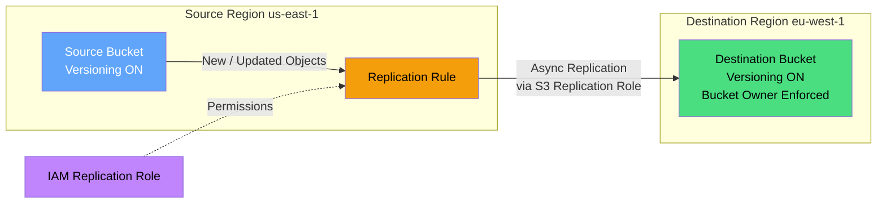

# S3 Best Practices

## Storage Classes

### Storage Class Comparison

| Storage Class | Retrieval | Min Storage | Min Object Size | Monthly Cost (per GB) | Use Case |
|--------------|-----------|-------------|-----------------|----------------------|----------|
| **S3 Standard** | Immediate | None | None | $0.023 | Active data, frequent access |
| **S3 Intelligent-Tiering** | Automatic | None | None | $0.023 + $0.0025 monitoring | Unknown/changing access patterns |
| **S3 Standard-IA** | Milliseconds | 30 days | 128 KB | $0.0125 | Infrequent access, rapid retrieval |
| **S3 One Zone-IA** | Milliseconds | 30 days | 128 KB | $0.01 | Non-critical, recreatable data |
| **S3 Glacier Instant** | Milliseconds | 90 days | 128 KB | $0.004 | Archives, rapid retrieval needed |
| **S3 Glacier Flexible** | Minutes to hours | 90 days | 128 KB | $0.0035 | Archives, flexible retrieval |
| **S3 Glacier Deep Archive** | 12-48 hours | 180 days | None | $0.00099 | Long-term compliance, cold storage |
| **S3 Express One Zone** | Sub-millisecond | None | None | $0.03/GB + data I/O fee | High-performance, low-latency apps (uses directory buckets) |

### Storage Class Selection Matrix

| Access Frequency | Retrieval Time | Data Criticality | Recommended Class |
|-----------------|---------------|-----------------|-------------------|
| Multiple times/day | Immediate | High | S3 Standard |
| Unknown / variable | Immediate | High | S3 Intelligent-Tiering |
| Once/month | Milliseconds | High | S3 Standard-IA |
| Once/month | Milliseconds | Low | S3 One Zone-IA |
| Once/year | Minutes | High | S3 Glacier Flexible |
| Once/year | Hours | High | S3 Glacier Deep Archive |
| High-frequency, low-latency | Sub-millisecond | Medium | S3 Express One Zone |

---

## Data Lifecycle Policies

### Lifecycle Rules

| Action | Transition Target | Days After Creation | Description |
|--------|------------------|---------------------|-------------|
| Transition | S3 Standard-IA | 30 | Move infrequently accessed data |
| Transition | S3 Glacier Flexible | 90 | Archive older data |
| Transition | S3 Glacier Deep Archive | 180 | Long-term retention |
| Expire | — | 365 | Delete after compliance period |
| Abort Incomplete Multipart Upload | — | 7 | Clean up failed uploads |

### Lifecycle Policy Example

```json
{
  "Rules": [
    {
      "ID": "archive-and-expire",
      "Status": "Enabled",
      "Filter": { "Prefix": "logs/" },
      "Transitions": [
        { "Days": 30, "StorageClass": "STANDARD_IA" },
        { "Days": 90, "StorageClass": "GLACIER" },
        { "Days": 365, "StorageClass": "DEEP_ARCHIVE" }
      ],
      "Expiration": { "Days": 2555 }
    },
    {
      "ID": "abort-incomplete-uploads",
      "Status": "Enabled",
      "Filter": { "Prefix": "" },
      "AbortIncompleteMultipartUpload": { "DaysAfterInitiation": 7 }
    }
  ]
}
```



---

## Security

### Bucket Policies

| Security Control | Implementation | Priority |
|-----------------|----------------|----------|
| **Block all public access** | Enable S3 Block Public Access at account level | CRITICAL |
| **Encrypt all data** | Default encryption with KMS | CRITICAL |
| **Enforce HTTPS** | Deny `aws:SecureTransport` = false | HIGH |
| **Restrict by IP/VPC** | `aws:SourceIp`, `aws:sourceVpc` conditions | HIGH |
| **Versioning** | Enable on all buckets | HIGH |
| **MFA Delete** | Enable for sensitive buckets | MEDIUM |
| **Access Logging** | Enable for audit compliance | MEDIUM |

### Encryption Options

| Method | Key Management | Cost | Performance | Use Case |
|--------|---------------|------|-------------|----------|
| **SSE-S3 (S3 Managed)** | AWS manages keys | No extra cost | Best | Default, general use |
| **SSE-KMS (KMS Managed)** | AWS KMS, audit trail | $1/key/month + API calls | Slight overhead | Compliance, audit requirements |
| **SSE-C (Customer Provided)** | Customer manages keys | No extra cost | Slight overhead | Strict key control |
| **Client-Side Encryption** | Customer manages keys | No extra cost | Application overhead | Maximum control |

### Access Control Methods

| Method | Scope | Granularity | Best For |
|--------|-------|-------------|----------|
| **IAM Policies** | Account-level | User/role/permission | Cross-account access, broad policies |
| **Bucket Policies** | Bucket-level | Resource/action/condition | Public access, VPC restrictions |
| **ACLs** | Object/bucket-level | Read/write/ownership | Legacy, migrate to bucket policies |
| **Presigned URLs** | Object-level, time-limited | Read/write, expiration | Temporary, direct access |
| **S3 Access Points** | Bucket-level | Network, policy, VPC | Simplified data access management |

---

## Performance Optimization

### Request Performance

| Technique | Description | Impact |
|-----------|-------------|--------|
| **S3 Transfer Acceleration** | CloudFront edge-optimized uploads | 5-50% faster cross-region uploads |
| **S3 Express One Zone** | Sub-millisecond latency | 10-100x faster for frequent access |
| **Multipart Upload** | Parallel upload of large objects | Faster uploads, retry resilience |
| **Parallel GET Requests** | Multiple concurrent requests | Higher aggregate throughput |
| **S3 Batch Operations** | Bulk operations on objects | Automated large-scale tasks |

### Object Size Guidelines

| Object Size | Recommendation |
|-------------|---------------|
| < 100 MB | Standard PUT |
| 100 MB - 5 GB | Multipart upload recommended |
| > 5 GB | Multipart upload required |
| High-frequency small objects | Consider S3 Express One Zone |

### Request Rate Limits

| Operation | Baseline Rate (per prefix) | Notes |
|-----------|---------------------------|-------|
| PUT/COPY/POST/DELETE | 3,500/sec | Automatically scales higher; add prefixes to parallelize further |
| GET/HEAD | 5,500/sec | Automatically scales higher; add prefixes to parallelize further |
| **Optimization** | Use multiple prefixes to parallelize | S3 auto-partitions by prefix (since 2018); random hashed prefixes are no longer required for performance, only for spreading load across many prefixes |

---

## Data Consistency

| Operation | Consistency Model | Notes |
|-----------|------------------|-------|
| **READ after WRITE** | **Strong consistency** | Since December 2020 |
| **READ after LIST** | **Strong consistency** | Since December 2020 |
| **DELETE** | Strong consistency | Object immediately unavailable |
| **List operations** | Strong consistency | All prefixes and objects |

---

## Replication

### Replication Types

| Type | Direction | Latency | Use Case |
|------|-----------|---------|----------|
| **Cross-Region (CRR)** | One region → another | Minutes | Disaster recovery, compliance |
| **Same-Region (SRR)** | One bucket → another | Minutes | Data segregation, workload optimization |
| **One-way** | Source → Destination | Minutes | Standard replication |
| **Multi-Region Access Point** | Global → nearest region | Milliseconds | Global low-latency access |

### Replication Requirements

| Requirement | Description |
|-------------|-------------|
| Enable **versioning** | Required on both source and destination |
| **S3 Replication Role** | IAM role with required permissions |
| **Object ownership** | Set to `Bucket owner enforced` on destination |
| **Encryption** | Destination bucket must have compatible encryption |
| **Size limit** | No limit on object size |



---

## Cost Optimization

| Strategy | Description | Potential Savings |
|----------|-------------|-------------------|
| **Intelligent-Tiering** | Automatic class transitions | 20-70% on variable access patterns |
| **Lifecycle policies** | Manual transitions to cheaper classes | 50-95% on archived data |
| **S3 Storage Lens** | Account-wide metrics and recommendations | Data-driven optimization |
| **Clean up orphaned objects** | Remove unused data, old versions | Varies |
| **Right-size Transfer Acceleration** | Only enable where needed | $0.021/GB transferred |
| **Reduce request counts** | Batch operations, pagination | Per-request costs |

### Cost by Operation

| Operation | Standard | IA | Glacier |
|-----------|----------|----|---------|
| GET (per 1,000) | $0.0004 | $0.0065 | $0.01-0.50 |
| PUT (per 1,000) | $0.005 | $0.0065 | $0.05 |
| LIST (per 1,000) | $0.000004 | $0.000004 | $0.000004 |
| Storage (per GB/month) | $0.023 | $0.0125 | $0.00099-0.0035 |
> **Note:** Prices are us-east-1 standard region estimates and subject to change. Always check current AWS pricing. |

---

## Data Recovery

| Feature | Description | RPO | RTO |
|---------|-------------|-----|-----|
| **Versioning** | Keep multiple versions of objects | 0 (all versions kept) | Immediate |
| **Object Lock** | WORM compliance, tamper-proof | 0 | Immediate |
| **Replication** | Cross-region copies | Minutes | Minutes |
| **S3 Batch Operations** | Restore from copies | N/A | Hours |
| **AWS Backup** | Centralized backup management | Configurable | Configurable |

### Object Lock Modes

| Mode | Description | Use Case |
|------|-------------|----------|
| **Governance** | Objects protected from deletion/overwrite; users with `s3:BypassGovernanceRetention` permission can override | Protect against accidental deletion |
| **Compliance** | Objects can't be deleted by anyone, including root | Regulatory compliance (SEC, HIPAA) |

---

## Cross-Service Integration

| Service | Integration | Purpose |
|---------|------------|---------|
| CloudFront | Origin for CDN | Global content delivery |
| Lambda | S3 event notifications | Event-driven processing |
| Glue | Data catalog, ETL | Data lake, analytics |
| Athena | Query S3 data directly | Ad-hoc SQL analytics |
| Lambda@Edge | CloudFront edge logic | Dynamic content at edge |
| Transfer Family | SFTP/FTPS to S3 | Secure file transfer |
| Macie | Data discovery & protection | PII detection, classification |
