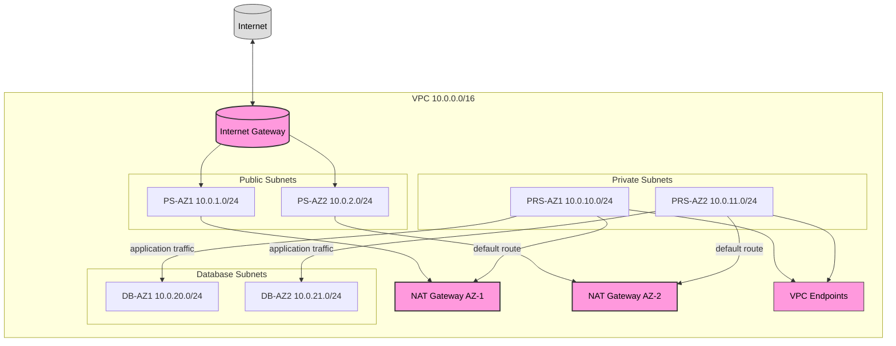
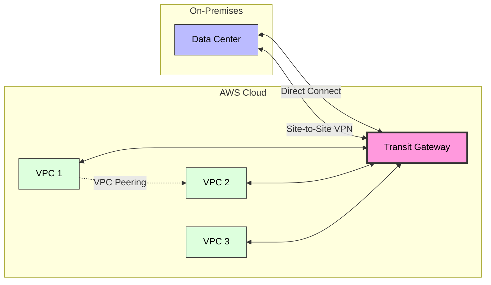

# VPC Best Practices

## Network Architecture

### Recommended VPC Design

| Component | Recommendation | CIDR Example |
|-----------|---------------|--------------|
| **VPC CIDR** | Size from forecast address demand, service scaling behavior, hybrid connectivity, and non-overlap requirements; use VPC IPAM for organizational allocation | 10.0.0.0/16 is an example, not a universal default |
| **Public Subnets** | One per used AZ where internet-facing load balancers or NAT gateways require them | Example: 10.0.1.0/24, 10.0.2.0/24 |
| **Private application subnets** | At least two AZs for workloads with an HA requirement; leave growth headroom | Example: 10.0.10.0/24, 10.0.11.0/24 |
| **Isolated data subnets** | No default route to an internet gateway; size for database ENIs, failover, and growth | Example: 10.0.20.0/24, 10.0.21.0/24 |
| **IPv6** | Plan dual-stack or IPv6-only subnets where supported to reduce IPv4 pressure | VPC IPv6 CIDRs and `/64` subnets are common AWS-assigned patterns |

### Subnet Sizing

| CIDR | Usable Hosts | Use Case |
|------|-------|----------|
| /28 | 11 | Smallest supported IPv4 subnet; use only after accounting for service ENIs, scaling, and failover |
| /27 | 27 | Small deployments |
| /26 | 59 | Medium deployments |
| /25 | 123 | Large deployments |
| /24 | 251 | Common example, not a universal default |
| /23 | 507 | High-density deployments |
| /22 | 1019 | Very large deployments |

> **Note:** AWS reserves 5 IPs in each subnet (network address, VPC router, DNS, future use, and broadcast address), and /28 is the smallest subnet AWS allows.

---

## Connectivity Options

### Internet Access

| Component | Purpose | Placement |
|-----------|---------|-----------|
| **Internet Gateway (IGW)** | Direct (non-NAT) two-way internet access for resources with public IPs | One per VPC, horizontally scaled and highly available |
| **NAT Gateway** | Outbound internet for private subnets | One per AZ in public subnet |
| **NAT Instance** | Self-managed option for specialized filtering, port forwarding, or low-throughput cases; requires patching, scaling, and failover design | Public subnet with source/destination checks disabled and a public/Elastic IP |

### VPC Peering

| Feature | Description |
|---------|-------------|
| **Same Region** | Connect VPCs in same region |
| **Cross Region** | Connect VPCs across regions |
| **Different Accounts** | Peer VPCs owned by different AWS accounts |
| **No Transitive Peering** | Peering connections are not transitive |
| **No Overlapping CIDRs** | CIDR blocks must not overlap |

### AWS Transit Gateway

| Feature | Description | Benefit |
|---------|-------------|---------|
| **Hub-and-Spoke** | Centralized connectivity model | Simplifies VPC management |
| **Route Table Propagation** | Automatic route sharing | Reduces manual routing |
| **Transitive Routing** | Traffic flows through hub | Eliminates peering mesh |
| **Inter-Region Peering** | Connect TGWs across regions | Global network fabric |
| **On-Premises Connect** | Direct Connect gateway with a transit virtual interface and Transit Gateway association | Hybrid cloud integration |

### Connectivity Comparison

| Method | Latency | Bandwidth | Use Case |
|--------|---------|-----------|----------|
| **VPC Peering** | Low | Up to VPC limit | Simple, 1-to-1 connections |
| **Transit Gateway** | Regional hub path | Up to 100 Gbps in each direction per VPC attachment per AZ by default | Hub-and-spoke, many VPCs |
| **Direct Connect** | Dedicated network path; latency depends on locations and carrier path | Dedicated ports at 1, 10, 100, or 400 Gbps; hosted options vary | Predictable hybrid connectivity |
| **Site-to-Site VPN** | Internet-path dependent | Standard tunnels up to 1.25 Gbps; Large Bandwidth Tunnels up to 5 Gbps where supported; ECMP can scale aggregate throughput | Rapid or backup hybrid connectivity |
| **Client VPN** | Low-Medium | Per-user | Remote worker access |
| **AWS VPN CloudHub** | Low-Medium | Hub-and-spoke VPN | Multiple sites via VPN |

---

## Security Groups

### Security Group Best Practices

| Practice | Description |
|----------|-------------|
| **Use SG references** | Reference other SGs instead of IP ranges |
| **Understand defaults** | A new custom security group has no inbound rules and an allow-all outbound rule. The VPC default security group also allows inbound traffic from itself |
| **Named SGs** | Use descriptive names (e.g., `web-allow-https`) |
| **Minimal rules** | Fewest rules necessary |
| **Audit regularly** | Review and remove unused rules |
| **SG modifications take effect immediately** | No instance restart required for rule changes |

### Common SG Configurations

| Resource | Inbound Rules | Outbound Rules |
|----------|--------------|----------------|
| **Web Server (ALB)** | TCP/443 from 0.0.0.0/0, TCP/80 from 0.0.0.0/0 | All to private app SG |
| **Application Server** | TCP/8080 from ALB SG | TCP/5432 to DB SG; TCP/443 to explicitly required destinations (routes separately determine the network path) |
| **Database** | TCP/5432 from app SG only | Restrict only if the engine/agents do not require broader egress; security groups do not target an internet gateway |
| **Bastion Host** | TCP/22 from corporate IP only | All to private subnets |
| **Batch Worker** | None (or from coordinator SG) | TCP/443 to S3 VPC endpoint |

---

## AWS Network Firewall & Gateway Load Balancer

| Component | Purpose | Placement |
|-----------|---------|-----------|
| **AWS Network Firewall** | Stateful, managed IDS/IPS and traffic filtering (domain, protocol, signature-based rules) | Dedicated inspection subnet/VPC, typically routed via Transit Gateway |
| **Gateway Load Balancer (GWLB)** | Transparently insert third-party virtual appliances (firewalls, IDS/IPS) inline | Centralized inspection VPC, paired with GWLB endpoints in spoke VPCs |
| **Centralized Inspection Architecture** | Route inter-VPC/internet traffic through a shared inspection VPC | Combine with Transit Gateway for hub-and-spoke traffic inspection |

---

## Network ACLs

### NACL vs Security Group

| Feature | Security Group | Network ACL |
|---------|---------------|-------------|
| **Level** | Instance level | Subnet level |
| **Stateful** | Yes (return traffic auto-allowed) | No (explicit rules needed) |
| **Rules** | Allow only | Allow and Deny |
| **Scope** | Specific instances | All instances in subnet |
| **Rule Numbers** | No ordering | Ordered by rule number |
| **Defaults** | Custom SG: no inbound, allow-all outbound; default SG also allows inbound from itself | Default NACL allows all; a new custom NACL denies all until rules are added |

### NACL Rule Design

| Rule # | Type | Protocol | Port | Action | Purpose |
|--------|------|----------|------|--------|---------|
| 100 | HTTPS | TCP | 443 | Allow | Inbound HTTPS |
| 200 | HTTP | TCP | 80 | Allow | Inbound HTTP |
| 300 | Ephemeral | TCP | 1024-65535 | Allow | Return traffic |
| `*` | All Traffic | All | All | Deny | Implicit final rule; cannot be removed |

NACLs are stateless, so define corresponding outbound rules and the client/server ephemeral-port ranges actually used by the operating systems and load balancers. The sample above is illustrative, not a complete production rule set.

---

## DNS & DHCP

### VPC DNS Settings

| Setting | Value | Description |
|---------|-------|-------------|
| **enableDnsSupport** | **true** | Required for DNS resolution in VPC |
| **enableDnsHostnames** | **true** | Instances get DNS hostnames |

### Private Hosted Zones

| Feature | Description |
|---------|-------------|
| **Association** | Link to one or more VPCs |
| **Resolution** | Only resolves within associated VPCs |
| **Use Case** | Internal domain names (e.g., `app.internal`) |
| **Integration** | Works with Route 53 Resolver |

---

## VPC Endpoints

### Interface Endpoints (PrivateLink)

| Service | Endpoint Type | Cost | Use Case |
|---------|--------------|------|----------|
| S3 | Gateway | Free | Private S3 access |
| DynamoDB | Gateway | Free | Private DynamoDB access |
| Lambda | Interface | $ per hour + data | Private Lambda invocation |
| SNS/SQS | Interface | $ per hour + data | Private messaging |
| Secrets Manager | Interface | $ per hour + data | Private secret retrieval |
| KMS | Interface | $ per hour + data | Private key operations |

### Endpoint Best Practices

| Practice | Description |
|----------|-------------|
| **Use Gateway endpoints** for S3/DynamoDB | Free, high performance |
| **Deploy interface endpoints in required AZs** | Use one endpoint ENI per required AZ and enable private DNS where supported; gateway endpoints are route-table targets rather than per-AZ ENIs |
| **Restrict with policies** | Limit accessible resources |
| **Use PrivateLink** | Access third-party services privately |
| **Monitor with CloudWatch** | Track endpoint metrics |

---

## Flow Logs

### Flow Log Configuration

| Setting | Recommendation | Reason |
|---------|---------------|--------|
| **Log Level** | ACCEPT and REJECT | Full visibility |
| **Destination** | S3 or CloudWatch Logs | Storage and analysis |
| **Traffic Type** | ALL | Capture all traffic |
| **Max Aggregation Interval** | Choose 1 or 10 minutes where supported | Match detection latency, volume, and cost requirements; actual aggregation can be shorter under some conditions |
| **Destination encryption** | Configure CloudWatch Logs or S3 encryption and least-privilege delivery permissions | Flow Logs has no standalone "TLS encryption" toggle |

### Flow Log Analysis

| Use Case | Tool | Description |
|----------|------|-------------|
| **Security monitoring** | GuardDuty | GuardDuty analyzes an independent VPC flow-log event stream; enabling customer VPC Flow Logs is not required for GuardDuty |
| **Custom analysis** | Athena | SQL queries on flow log data |
| **Near-real-time alerts** | CloudWatch Logs metric filters and alarms, or a Logs subscription processing path | Detect selected log patterns; use Logs Insights for interactive queries and analysis |
| **Visualization** | QuickSight | Traffic dashboards |

---

## Multi-AZ and Multi-Region

### High Availability Design

| Component | Single AZ | Multi-AZ | Multi-Region |
|-----------|-----------|----------|--------------|
| **Availability** | Depends on component placement | Can tolerate an AZ failure when every dependency is designed across AZs | Can tolerate selected Regional failures only with tested cross-Region data and traffic failover |
| **Cost** | Lowest | Medium | Highest |
| **Complexity** | Low | Medium | High |
| **RTO** | Workload-specific | Workload-specific | Workload-specific |
| **RPO** | Determined by data service | Determined by data service and replication mode | Determined by cross-Region replication and consistency mode |

### Disaster Recovery Strategies

| Strategy | RTO | RPO | Cost | Complexity |
|----------|-----|-----|------|------------|
| **Backup & Restore** | Usually the longest; measure restore and rebuild | Backup/replication-point dependent | Lowest | Low |
| **Pilot Light** | Workload-specific; infrastructure and capacity must scale during recovery | Data replication/backup dependent | Low | Medium |
| **Warm Standby** | Workload-specific; pre-provisioned capacity reduces scale-up time | Data replication mode dependent | Medium | Medium |
| **Multi-Site Active-Active** | Potentially shortest when routing and dependencies are healthy | Consistency/replication mode dependent; not inherently zero | Highest | High |

---

## CIDR Planning

### Private IP Ranges (RFC 1918)

| Range | CIDR | Total IPv4 Addresses |
|-------|------|-------------|
| 10.0.0.0 - 10.255.255.255 | /8 | 16,777,216 |
| 172.16.0.0 - 172.31.255.255 | /12 | 1,048,576 |
| 192.168.0.0 - 192.168.255.255 | /16 | 65,536 |

### Overlap Avoidance

| Scenario | Risk | Solution |
|----------|------|----------|
| VPC peering with overlapping CIDRs | Not allowed | Use different CIDR ranges |
| Direct Connect with on-prem overlap | Route conflicts | Renumber the overlapping network or design an explicit NAT/address-translation architecture; Transit Gateway does not resolve overlapping CIDRs |
| Multiple accounts in Organization | Planning complexity | Centralized IPAM |

### AWS IP Address Manager (IPAM)

| Feature | Description |
|---------|-------------|
| **Centralized pooling** | Manage IP address pools across accounts |
| **Automatic CIDR allocation** | Assign non-overlapping CIDRs to VPCs |
| **Hierarchical pools** | Organization > Region > Account structure |
| **Overlap detection** | Prevent CIDR conflicts proactively |
| **Public IP management** | Track and manage public IP addresses |

---

## Authoritative references

- [VPC subnet sizing](https://docs.aws.amazon.com/vpc/latest/userguide/subnet-sizing.html)
- [NAT gateway basics and AZ resiliency](https://docs.aws.amazon.com/vpc/latest/userguide/nat-gateway-basics.html)
- [Security group rules](https://docs.aws.amazon.com/vpc/latest/userguide/security-group-rules.html)
- [Network ACL rules](https://docs.aws.amazon.com/vpc/latest/userguide/nacl-rules.html)
- [Transit Gateway quotas](https://docs.aws.amazon.com/vpc/latest/tgw/transit-gateway-quotas.html)
- [Site-to-Site VPN tunnel bandwidth](https://docs.aws.amazon.com/vpn/latest/s2svpn/VPNTunnels.html)
