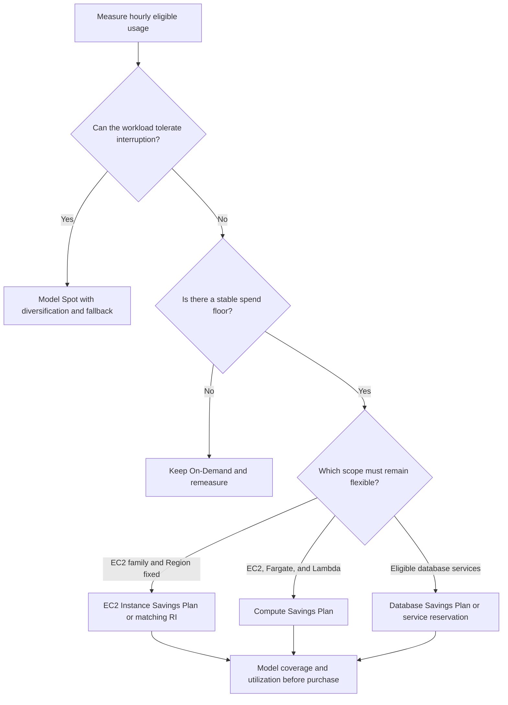
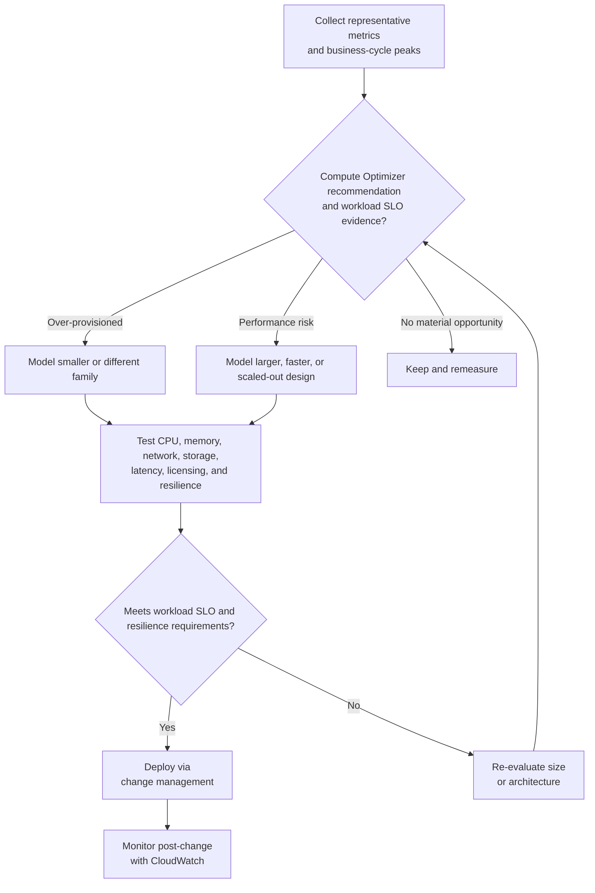

# Cost Optimization Guide

## Pricing Models

### Compute Pricing

| Model | Commitment | Discount | Flexibility | Best For |
|-------|-----------|----------|-------------|----------|
| **On-Demand** | None | 0% | Full | Short-term, unpredictable |
| **Savings Plans (Compute)** | 1 or 3 years | Up to 66% | High | Any EC2/Fargate/Lambda |
| **EC2 Instance Savings Plans** | 1 or 3 years | Up to 72% | Medium | Specific instance family in one Region |
| **Savings Plans (Database)** | 1 or 3 years | Up to 35% | High across eligible database usage | Aurora, RDS, DynamoDB, ElastiCache, DocumentDB, Neptune, Keyspaces, Timestream, DMS, and OpenSearch Service eligibility as documented |
| **Savings Plans (SageMaker AI)** | 1 or 3 years | Up to 64% | High within eligible SageMaker AI usage | Steady SageMaker AI compute usage |
| **EC2 Reserved Instances** | 1 or 3 years | Up to 72% | Attribute-bound; some Regional Linux/Unix shared-tenancy RIs have instance-size flexibility | Stable EC2 usage matching the RI's Region, platform, tenancy, family, and other applicable attributes |
| **Spot Instances** | None | Up to 90% | Low | Fault-tolerant, flexible |
| **Dedicated Hosts** | On-Demand or reservation options | Low | Dedicated physical server | Licensing, tenancy, or compliance requirements; verify eligible discounts and dedicated fees |

### Graviton (ARM-Based) Instances

| Aspect | Detail |
|--------|--------|
| **Price-performance gain** | Up to 40% better price-performance vs. comparable current-gen x86 instances |
| **Direct cost savings** | Family, generation, Region, and software dependent; benchmark current On-Demand rates and throughput rather than assuming equal sizes are equivalent |
| **Supported services** | EC2, RDS, ElastiCache, OpenSearch Service, EMR, Lambda (arm64) |
| **Stacks with** | Savings Plans, Reserved Instances, and Spot for compounded savings |
| **Migration effort** | Low for interpreted/managed runtimes (Lambda, Java, Python, Node.js); recompilation needed for native binaries |

### Storage Pricing

Storage cannot be compared on a per-GB rate alone. Model capacity, IOPS/throughput, requests, minimum storage duration, retrieval, object metadata, snapshots/backups, replication, and data transfer for the deployment Region. Use the [AWS Pricing Calculator](https://calculator.aws/) and current service pricing pages; rates in examples become stale and differ by Region and tier.

---

## Right-Sizing

### Assessment Process

| Step | Action | Tool |
|------|--------|------|
| 1 | Collect utilization data (14-30 days) | CloudWatch |
| 2 | Identify over-provisioned resources | Compute Optimizer |
| 3 | Identify under-provisioned resources | CloudWatch Alarms |
| 4 | Test candidate sizes | Non-production environment |
| 5 | Implement changes | Change management process |
| 6 | Monitor post-change | CloudWatch |

### Right-Sizing by Service

| Service | Metric | Over-Provisioned | Under-Provisioned |
|---------|--------|-----------------|-------------------|
| EC2 | CPU, memory agent metrics, network/EBS throughput, latency, queue depth, credits, licenses | Resources remain idle through representative peaks | SLO breaches, saturation, throttling, or insufficient burst headroom |
| RDS | DB load/waits, CPU, memory/swap, connections, latency/queue depth, storage/I/O | Low load with excess instance/storage capacity after failover headroom | Query/lock bottleneck or sustained resource pressure; fix queries before blindly scaling |
| Lambda | Duration, errors/throttles, `MaxMemoryUsed`, concurrency, cold starts, cost per transaction | Lower memory or architecture improves tested cost without hurting SLO | More memory can also add CPU and reduce duration; use Lambda Power Tuning or equivalent testing |
| EBS | IOPS, throughput, latency, queue length, burst balance, instance EBS limits | Provisioned performance materially exceeds measured need | Approaching volume or instance limits, rising latency, or credit exhaustion |
| DynamoDB | Consumed capacity, throttles, latency, warm/maximum throughput, table class | Provisioned capacity remains unused after auto-scaling design | Throttles/SLO impact, hot keys, or reactive scaling that cannot absorb peaks |

---

## Reserved Instances & Savings Plans

### Coverage Analysis

| Metric | Target | Current | Action |
|--------|--------|---------|--------|
| **Savings Plans coverage** | Organization-defined based on the durable usage floor and risk appetite | Measure | Purchase only after scenario analysis |
| **RI coverage** | Organization-defined for matching stable service/instance usage | Measure | Avoid double-covering usage already covered by Savings Plans |
| **Spot utilization** | Maximize for batch | Measure | Increase if low |
| **On-Demand ratio** | Preserve enough flexibility for growth, migrations, and uncertainty | Measure | Treat as intentional risk capacity, not automatically waste |

### Purchase Strategy

| Workload | Recommended | Term | Payment |
|----------|------------|------|---------|
| Base load (steady) | Model Savings Plans and/or service reservations | Compare 1 and 3 years | Compare no/partial/all upfront using effective rate and cash constraints |
| Predictable growth | Layer commitments over time | Prefer shorter/lower initial coverage when forecast risk is material | Re-evaluate recommendations regularly |
| Batch processing | Spot Instances | N/A | N/A |
| Development | On-Demand | N/A | N/A |
| Testing | Spot + On-Demand | N/A | N/A |
| New workloads | On-Demand | N/A | N/A |

---

## Tagging Strategy

### Required Tags

| Tag | Purpose | Example |
|-----|---------|---------|
| **CostCenter** | Financial tracking | `CC-12345` |
| **Environment** | Env classification | `prod`, `dev`, `staging` |
| **Owner** | Team responsibility | `team-platform` |
| **Project** | Project association | `project-alpha` |
| **Application** | App identification | `web-frontend` |
| **Compliance** | Regulatory needs | `pci`, `hipaa` |

### Tag Enforcement

| Method | Description |
|--------|-------------|
| **Service Control Policies** | Deny selected create APIs when documented request-tag conditions are absent; tag-on-create support varies by service/action |
| **AWS Config Rules** | Detect noncompliant tags and optionally trigger remediation; Config is not preventive by itself |
| **CloudFormation** | Propagate stack tags to supported resources; not every resource supports propagation |
| **CDK/Terraform** | Provider-level default tags |
| **Tag policies** | Standardize allowed tag keys/values and report compliance; enforcement support depends on resource type and mode |

Activate required user-defined cost allocation tags in Billing; merely attaching a resource tag does not make it appear retroactively in cost allocation reports.

---

## Storage Optimization

### S3 Lifecycle Policies

| Storage Class | Access Pattern | Cost considerations | Retrieval Time |
|--------------|---------------|---------------------|----------------|
| **S3 Standard** | Frequent access | Storage, requests, transfer | Milliseconds |
| **S3 Intelligent-Tiering** | Unknown/changing | Monitoring fee per eligible object; optional archive tiers | Milliseconds for low-latency tiers; restore for optional archive tiers |
| **S3 Standard-IA** | Infrequent, multi-AZ | 30-day minimum, 128 KB minimum billable size, retrieval fee | Milliseconds |
| **S3 One Zone-IA** | Infrequent, recreatable | Same duration/size concepts as Standard-IA; single-AZ resilience | Milliseconds |
| **S3 Glacier Instant Retrieval** | Rare access needing immediate reads | 90-day minimum, 128 KB minimum billable size, retrieval fee | Milliseconds |
| **S3 Glacier Flexible Retrieval** | Archive | 90-day minimum, per-object metadata, restore/retrieval charges | Minutes to hours after restore |
| **S3 Glacier Deep Archive** | Long-term archive | 180-day minimum, per-object metadata, restore/retrieval charges | Hours after restore |

### EBS Optimization

| Strategy | Description | Potential Savings |
|----------|-------------|-------------------|
| **Evaluate gp3 over gp2** | Independent IOPS/throughput and typically lower baseline price | Region/workload-dependent |
| **Right-size volumes** | Delete unused volumes; EBS volumes cannot be shrunk in place, so migrate data to a smaller volume after validation | Workload-dependent |
| **Snapshot lifecycle** | Automate retention policies while preserving recovery/compliance objectives | Workload-dependent |
| **Delete unattached volumes** | Cleanup orphaned volumes | 100% of waste |
| **Use instance store** | Temporary data, high I/O | Free with instance |

---

## Network Cost Optimization

### Data Transfer Costs

| Transfer Type | Charging dimensions | Optimization |
|---------------|---------------------|--------------|
| **Internet out** | Service, source Region, destination, tier, and free allowance | Evaluate CloudFront, compression, protocol, and response size |
| **Cross-AZ** | Service-specific processing and data transfer on one or both sides | Remove accidental hairpins/chattiness; preserve required AZ resilience |
| **Cross-Region** | Source/destination services and Regions; managed replication may price differently | Replicate only required data and compress/batch where supported |
| **VPC peering / Transit Gateway / PrivateLink** | Architecture-specific hourly and per-GB processing charges | Compare total paths and operational scale; Transit Gateway is not automatically cheaper than peering |
| **Direct Connect** | Port-hour, data transfer, provider/cross-connect, and possible gateway charges | Select capacity and resiliency from measured demand |

### Network Optimization

| Strategy | Description | Potential Savings |
|----------|-------------|-------------------|
| **CloudFront caching** | Reduce origin fetches and potentially internet transfer cost | Model cacheability, request fees, invalidations, and hit ratio |
| **VPC Endpoints** | Avoid NAT/internet gateway | Data transfer costs |
| **Transit Gateway** | Centralize large connectivity estates | Operational simplicity; compare attachment and processing charges with peering/Cloud WAN |
| **NAT architecture** | One NAT gateway per AZ avoids cross-AZ dependency; centralized egress reduces gateway count but can add TGW/cross-AZ cost and blast radius | Model full path and availability requirement |
| **S3 Transfer Acceleration** | Evaluate vs CloudFront | Transfer costs |

---

## Database Cost Optimization

### RDS Optimization

| Strategy | Description | Potential Savings |
|----------|-------------|-------------------|
| **Match availability to requirements** | Use Multi-AZ when the environment's availability/recovery objective requires it, regardless of the `prod` label | Avoid unnecessary standby capacity without weakening required resilience |
| **Right-size instances** | Match compute, memory, storage/I/O, licenses, and replica count to workload | Workload-dependent |
| **Reserved DB instances / Database Savings Plans** | Compare matching reservations with the broader eligible database-spend commitment | Offering- and usage-dependent |
| **Storage auto scaling** | Prevent storage exhaustion; it does not shrink already allocated storage | Reliability, not automatic savings |
| **Snapshot retention** | Automate cleanup | Storage costs |

### DynamoDB Optimization

| Strategy | Description | Potential Savings |
|----------|-------------|-------------------|
| **On-Demand capacity** | Variable workloads | No over-provisioning |
| **Provisioned with autoscaling** | Predictable workloads | Tune target utilization and scheduled capacity from measured demand |
| **DAX caching** | Reduce read capacity | Read costs |
| **TTL for time-series** | Auto-expire old data | Storage costs |
| **Point-in-time recovery** | Set the 1-35 day recovery period from business RPO/compliance needs; DynamoDB PITR pricing does not vary with that retention length | Continuous-backup storage; shortening the recovery period does not reduce PITR charges |

---

## Monitoring & Governance

### Cost Monitoring

| Tool | Purpose | Frequency |
|------|---------|-----------|
| **AWS Cost Explorer** | Visualize costs | Weekly |
| **Cost Anomaly Detection** | Unexpected spend patterns | Evaluated regularly from billing data; not a real-time control plane or hard spend limit |
| **Budgets** | Spend limits | Monthly |
| **Tag Editor / cost allocation tags** | Resource-tag inventory and billing allocation | Monthly |
| **Cost Optimization Hub / Compute Optimizer** | Consolidated optimization opportunities and resource recommendations | Weekly or aligned to change cadence |
| **Trusted Advisor** | Best practices | Continuous |

### Cost Allocation

| Report | Purpose | Granularity |
|--------|---------|-------------|
| **Data Exports CUR 2.0** | Recommended detailed cost and usage export | Hourly, daily, or monthly; resource-level fields depend on configuration/service |
| **Tag-based allocation** | Team/project costs | By tag value |
| **Service breakdown** | Service spending | By service |
| **Region breakdown** | Regional spending | By region |
| **Linked accounts** | Multi-account costs | By account |

---

## Automation

### Automated Optimization

| Automation | Tool | Schedule |
|------------|------|----------|
| **Stop/start dev resources** | EventBridge Scheduler / Lambda | Daily/weekends |
| **Snapshot cleanup** | Lifecycle policies | Daily |
| **Right-sizing recommendations** | Compute Optimizer | Weekly |
| **Unused resource cleanup** | AWS Config/Lambda | Monthly |
| **Savings Plans analysis** | Cost Explorer recommendations and Purchase Analyzer | Review regularly; purchases require deliberate financial approval because commitments cannot be changed after purchase |
| **Tag enforcement** | AWS Config rules | Continuous |

### Cost Governance

| Practice | Description |
|----------|-------------|
| **Showback/Chargeback** | Allocate costs to teams |
| **Budget approvals** | Require approval for large spends |
| **Resource limits** | Service quotas to prevent runaway costs |
| **Cost reviews** | Monthly cross-team cost reviews |
| **Optimization backlog** | Track cost improvement tickets |

---

## Authoritative references

- [AWS Well-Architected Cost Optimization Pillar](https://docs.aws.amazon.com/wellarchitected/latest/cost-optimization-pillar/welcome.html)
- [Savings Plans types and eligible scope](https://docs.aws.amazon.com/savingsplans/latest/userguide/plan-types.html)
- [AWS Compute Optimizer rightsizing methodology](https://docs.aws.amazon.com/compute-optimizer/latest/ug/what-is-compute-optimizer.html)
- [AWS Data Exports and CUR 2.0](https://docs.aws.amazon.com/cur/latest/userguide/what-is-data-exports.html)
- [Activating cost allocation tags](https://docs.aws.amazon.com/awsaccountbilling/latest/aboutv2/activating-tags.html)
- [AWS Cost Anomaly Detection](https://docs.aws.amazon.com/cost-management/latest/userguide/manage-ad.html)
