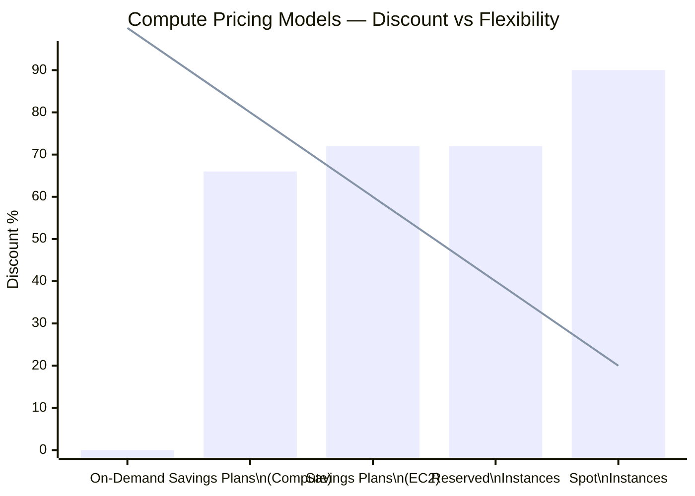
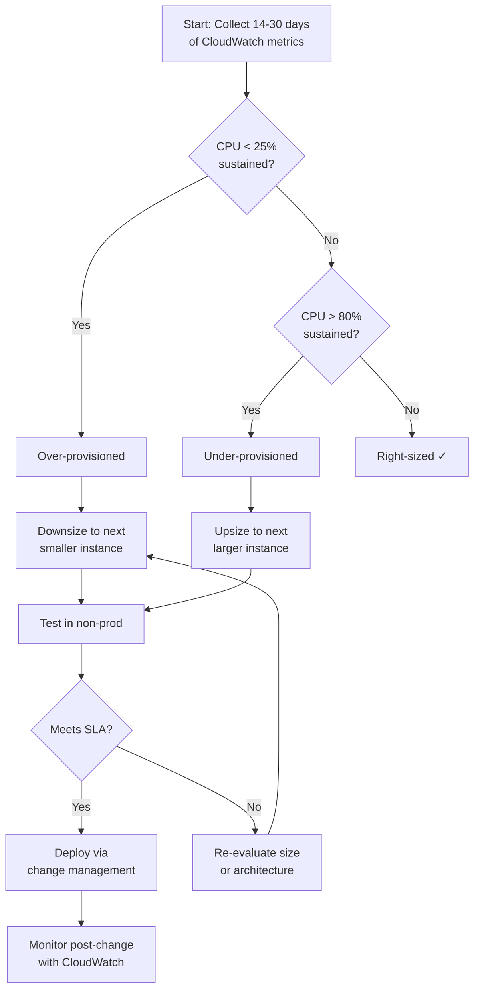

# Cost Optimization Guide

## Pricing Models

### Compute Pricing

| Model | Commitment | Discount | Flexibility | Best For |
|-------|-----------|----------|-------------|----------|
| **On-Demand** | None | 0% | Full | Short-term, unpredictable |
| **Savings Plans (Compute)** | 1 or 3 years | Up to 66% | High | Any EC2/Fargate/Lambda |
| **Savings Plans (EC2)** | 1 or 3 years | Up to 72% | Medium | Specific instance family |
| **Reserved Instances** | 1 or 3 years | Up to 72% | Low | Specific instance type |
| **Spot Instances** | None | Up to 90% | Low | Fault-tolerant, flexible |
| **Dedicated Hosts** | 1 or 3 years | Up to 60% | Low | Compliance, licensing |

### Storage Pricing

| Service | On-Demand | Reserved/Savings | Spot |
|---------|-----------|-----------------|------|
| EBS gp3 | $0.08/GB/mo | $0.08/GB/mo | N/A |
| EBS io2 | $0.125/GB/mo | $0.125/GB/mo | N/A |
| S3 Standard | $0.023/GB/mo | N/A | N/A |
| S3 IA | $0.0125/GB/mo | N/A | N/A |
| S3 Glacier Flexible | $0.0035/GB/mo | N/A | N/A |
| EFS Standard | $0.30/GB/mo | N/A | N/A |
| EFS One Zone | $0.10/GB/mo | N/A | N/A |

---

## Right-Sizing

### Assessment Process

| Step | Action | Tool |
|------|--------|------|
| 1 | Collect utilization data (14-30 days) | CloudWatch |
| 2 | Identify over-provisioned resources | Compute Optimizer |
| 3 | Identify under-provisioned resources | CloudWatch Alarms |
| 4 | Test candidate sizes | Non-production environment |
| 5 | Implement changes | Change management process |
| 6 | Monitor post-change | CloudWatch |

### Right-Sizing by Service

| Service | Metric | Over-Provisioned | Under-Provisioned |
|---------|--------|-----------------|-------------------|
| EC2 | CPUUtilization | < 25% sustained | > 80% sustained |
| RDS | CPUUtilization | < 25% sustained | > 80% sustained |
| RDS | FreeableMemory | > 80% | < 10% |
| Lambda | Duration vs Timeout | Timeout > 5x duration | Timeout < 1.2x duration |
| Lambda | Memory vs Utilization | Memory > 2x needed | Memory < needed |
| EBS | VolumeReadOps/WriteOps, BurstBalance | < 30% of provisioned | > 80% of provisioned |
| DynamoDB | Read/Write Capacity | < 30% utilized | > 80% utilized |

---

## Reserved Instances & Savings Plans

### Coverage Analysis

| Metric | Target | Current | Action |
|--------|--------|---------|--------|
| **Savings Plans coverage** | > 70% of steady-state | Measure | Increase if low |
| **RI coverage** | > 70% of steady-state | Measure | Increase if low |
| **Spot utilization** | Maximize for batch | Measure | Increase if low |
| **On-Demand ratio** | < 30% of total | Measure | Reduce if high |

### Purchase Strategy

| Workload | Recommended | Term | Payment |
|----------|------------|------|---------|
| Base load (steady) | Savings Plans | 3 years | All upfront |
| Predictable growth | Savings Plans | 1 year | Partial upfront |
| Batch processing | Spot Instances | N/A | N/A |
| Development | On-Demand | N/A | N/A |
| Testing | Spot + On-Demand | N/A | N/A |
| New workloads | On-Demand | N/A | N/A |

---

## Tagging Strategy

### Required Tags

| Tag | Purpose | Example |
|-----|---------|---------|
| **CostCenter** | Financial tracking | `CC-12345` |
| **Environment** | Env classification | `prod`, `dev`, `staging` |
| **Owner** | Team responsibility | `team-platform` |
| **Project** | Project association | `project-alpha` |
| **Application** | App identification | `web-frontend` |
| **Compliance** | Regulatory needs | `pci`, `hipaa` |

### Tag Enforcement

| Method | Description |
|--------|-------------|
| **Service Control Policies** | Organization-level tag requirements |
| **AWS Config Rules** | Enforce tags on resources |
| **CloudFormation** | Default tags for stacks |
| **CDK/Terraform** | Provider-level default tags |
| **Lambda remediation** | Auto-tag untagged resources |

---

## Storage Optimization

### S3 Lifecycle Policies

| Storage Class | Access Pattern | Cost | Retrieval Time |
|--------------|---------------|------|----------------|
| **S3 Standard** | Frequent access | $0.023/GB/mo | Milliseconds |
| **S3 Intelligent-Tiering** | Unknown/changing | $0.023/GB/mo | Milliseconds |
| **S3 Standard-IA** | Infrequent access | $0.0125/GB/mo | Milliseconds |
| **S3 One Zone-IA** | Infrequent, non-critical | $0.01/GB/mo | Milliseconds |
| **S3 Glacier Instant** | Archive, instant access | $0.004/GB/mo | Milliseconds |
| **S3 Glacier Flexible** | Archive, hours access | $0.0035/GB/mo | Hours |
| **S3 Glacier Deep** | Archive, days access | $0.00099/GB/mo | 12 hours |

### EBS Optimization

| Strategy | Description | Potential Savings |
|----------|-------------|-------------------|
| **gp3 over gp2** | Lower base cost, independent IOPS | Up to 20% |
| **Right-size volumes** | Delete unused, shrink oversized | 30-50% |
| **Snapshot lifecycle** | Automate retention policies | 40-60% |
| **Delete unattached volumes** | Cleanup orphaned volumes | 100% of waste |
| **Use instance store** | Temporary data, high I/O | Free with instance |

---

## Network Cost Optimization

### Data Transfer Costs

| Transfer Type | Price | Optimization |
|---------------|-------|--------------|
| **Internet out** | $0.09/GB (first 10 TB) | CloudFront caching |
| **Cross-AZ** | $0.01/GB | Co-locate resources |
| **Cross-Region** | $0.02/GB | Reduce replication |
| **VPC peering** | $0.01/GB | Transit Gateway |
| **Direct Connect** | Port + data fees | Bundle commits |

### Network Optimization

| Strategy | Description | Potential Savings |
|----------|-------------|-------------------|
| **CloudFront caching** | Reduce origin transfers | 50-90% data transfer |
| **VPC Endpoints** | Avoid NAT/internet gateway | Data transfer costs |
| **Transit Gateway** | Centralize VPC connectivity | Peering complexity/cost |
| **NAT Gateway sharing** | One per AZ, not per subnet | NAT Gateway costs |
| **S3 Transfer Acceleration** | Evaluate vs CloudFront | Transfer costs |

---

## Database Cost Optimization

### RDS Optimization

| Strategy | Description | Potential Savings |
|----------|-------------|-------------------|
| **Multi-AZ for prod only** | Single-AZ for dev/test | 50% DB cost |
| **Right-size instances** | Match to workload | 30-50% |
| **Reserved instances** | 1 or 3 year terms | Up to 72% |
| **Storage auto-scaling** | Avoid over-provisioning | Storage costs |
| **Snapshot retention** | Automate cleanup | Storage costs |

### DynamoDB Optimization

| Strategy | Description | Potential Savings |
|----------|-------------|-------------------|
| **On-Demand capacity** | Variable workloads | No over-provisioning |
| **Provisioned with autoscaling** | Predictable workloads | 60-70% |
| **DAX caching** | Reduce read capacity | Read costs |
| **TTL for time-series** | Auto-expire old data | Storage costs |
| **Point-in-time recovery** | Disable for non-critical | Backup storage |

---

## Monitoring & Governance

### Cost Monitoring

| Tool | Purpose | Frequency |
|------|---------|-----------|
| **AWS Cost Explorer** | Visualize costs | Weekly |
| **Cost Anomaly Detection** | Unexpected spikes | Real-time |
| **Budgets** | Spend limits | Monthly |
| **Tags Editor** | Tag analysis | Monthly |
| **Rightsizing recommendations** | Optimization opportunities | Monthly |
| **Trusted Advisor** | Best practices | Continuous |

### Cost Allocation

| Report | Purpose | Granularity |
|--------|---------|-------------|
| **Cost and Usage Report** | Detailed line items | Hourly, per resource |
| **Tag-based allocation** | Team/project costs | By tag value |
| **Service breakdown** | Service spending | By service |
| **Region breakdown** | Regional spending | By region |
| **Linked accounts** | Multi-account costs | By account |

---

## Automation

### Automated Optimization

| Automation | Tool | Schedule |
|------------|------|----------|
| **Stop/start dev resources** | EventBridge Scheduler / Lambda | Daily/weekends |
| **Snapshot cleanup** | Lifecycle policies | Daily |
| **Right-sizing recommendations** | Compute Optimizer | Weekly |
| **Unused resource cleanup** | AWS Config/Lambda | Monthly |
| **Savings Plans purchase** | Cost Explorer | Quarterly |
| **Tag enforcement** | AWS Config rules | Continuous |

### Cost Governance

| Practice | Description |
|----------|-------------|
| **Showback/Chargeback** | Allocate costs to teams |
| **Budget approvals** | Require approval for large spends |
| **Resource limits** | Service quotas to prevent runaway costs |
| **Cost reviews** | Monthly cross-team cost reviews |
| **Optimization backlog** | Track cost improvement tickets |
