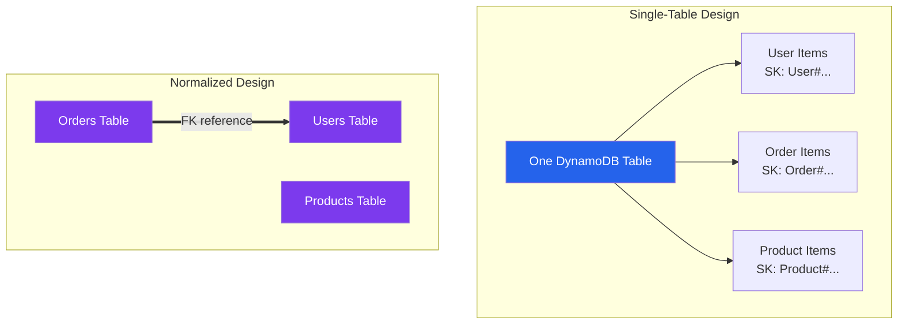
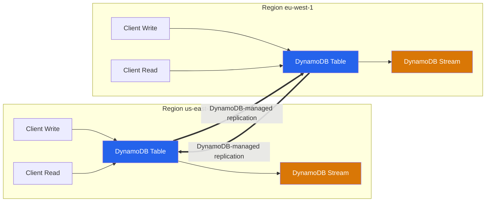

# DynamoDB Best Practices

## Data Modeling

### Design Patterns

| Pattern | Description | Use Case |
|---------|-------------|----------|
| **Single-Table Design** | Co-locate related entity items around explicitly modeled access patterns | Reduce request fan-out and support transactional/item-collection access; it is not automatically best for every workload |
| **Normalized Design** | Separate tables with references | Independent scaling, clear boundaries |
| **Denormalized Design** | Duplicate data to avoid joins | Read-heavy, reduce query complexity |
| **Aggregate Pattern** | Collection of items under one PK | User profile with multiple attributes |
| **Collection Table Pattern** | Multiple entity types in one table | Multi-entity application data |
| **Index Pattern** | Duplicate data with different access patterns | Multiple query patterns on same data |

### Key Schema Design

| Key Type | Purpose | Constraints | Best Practice |
|----------|---------|-------------|---------------|
| **Partition key** | Determines logical item collection and physical distribution | 1-2,048 bytes | High-cardinality, evenly distributed access |
| **Sort key** | Orders items within a partition-key value | 1-1,024 bytes | Enables range and begins-with key conditions |
| **Composite Key** | HK + RK combination | Both required for queries | Design for query patterns first |

### Partition Key Selection

| Characteristic | Good Partition Key | Bad Partition Key |
|---------------|-------------------|-------------------|
| **Cardinality** | High (many distinct values) | Low (few distinct values) |
| **Distribution** | Even across values | Hot partitions on few values |
| **Growth** | Unbounded or slow growth | Time-based (date, hour) |
| **Examples** | UserID, OrderID, UUID | Status, Type, Date |

---

## Capacity Modes

### On-Demand vs Provisioned

| Feature | On-Demand | Provisioned |
|---------|-----------|-------------|
| **Pricing** | Per read/write request unit actually consumed | Provisioned RCU/WCU-hours; requests above available capacity can be throttled rather than billed as "overage" |
| **Scaling** | Automatic within table/account quotas and warm-throughput behavior | Manual, scheduled, or Application Auto Scaling |
| **Burst** | No burst needed | Burst from unused capacity |
| **Predictability** | Variable cost | Predictable cost |
| **Best For** | Unpredictable, spiky workloads | Steady, predictable workloads |
| **Cost comparison** | Often attractive for new, unpredictable, or spiky traffic | Often attractive for steady, forecastable traffic; calculate with actual item sizes, consistency, peaks, headroom, and current Regional rates |

> On-demand tables instantly support previously reached traffic and up to twice the previous peak. A jump beyond twice the previous peak within 30 minutes can throttle; pre-warm or ramp traffic gradually. Configurable maximum throughput and account/table quotas can also cap traffic.

### Auto Scaling

| Setting | Recommendation | Reason |
|---------|---------------|--------|
| **Min Capacity** | Cover the normal trough and known scale-out delay | Avoid throttling before Application Auto Scaling reacts |
| **Max Capacity** | Cover tested peak plus operational headroom and account quotas | Bound cost without blocking legitimate peak traffic |
| **Target Utilization** | Start from the console default of 70%, then tune with load tests | Lower targets provide more burst headroom at higher idle cost |
| **Scheduled scaling** | Pre-scale known peaks | Target tracking is reactive and cannot absorb every abrupt spike |
| **Scaling policy** | Target tracking | Simple, effective |

---

## Global Secondary Indexes (GSIs)

### GSI Design

| Consideration | Recommendation |
|---------------|----------------|
| **Number of GSIs** | Add only for defined access patterns; default quota is 20 per table and can be adjustable |
| **Number of LSIs** | Max 5 per table, must be defined at table creation |
| **Sparse indexes** | Only index items that need the query pattern |
| **Projected attributes** | Use `INCLUDE` or `KEYS_ONLY` to reduce cost |
| **Partition key** | Different from table PK for different access patterns |
| **Sort key** | Enable range queries and filtering |

### Projection Types

| Type | Description | Cost Impact | Use Case |
|------|-------------|-------------|----------|
| **ALL** | All attributes projected | Highest | Need all data from index |
| **KEYS_ONLY** | Only key attributes | Lowest | Get item key, then fetch full item |
| **INCLUDE** | Specific non-key attributes | Medium | Need specific attributes from index |

---

## Performance Optimization

### Read Optimization

| Technique | Description | Impact |
|-----------|-------------|--------|
| **BatchGetItem** | Fetch up to 100 items or 16 MB per call | Reduce network round trips; retry `UnprocessedKeys` with exponential backoff |
| **Parallel requests** | Multiple concurrent Gets | Higher aggregate throughput |
| **DAX (DynamoDB Accelerator)** | Write-through and item/query caches for compatible eventually consistent reads | Microsecond cache hits; validate operation, consistency, and Region support |
| **ProjectionExpression** | Return only needed attributes | Can reduce response payload, but does not reduce read capacity consumed because billing uses item size before projection |
| **Consistent reads** | Only when necessary | Eventually consistent is cheaper/faster |

### Write Optimization

| Technique | Description | Impact |
|-----------|-------------|--------|
| **BatchWriteItem** | Put/delete up to 25 items per call | Reduce round trips; it is not transactional and callers must retry `UnprocessedItems` |
| **TransactWriteItems** | Atomic multi-item writes | Consistency across items |
| **Parallel writes** | Different partition keys | Higher aggregate throughput |
| **Time-to-Live (TTL)** | Auto-expire items | Reduce storage cost |
| **PutItem vs UpdateItem** | Choose for semantics and conditional-write needs | `UpdateItem` does not inherently save WCUs: write capacity is based on the larger item size before or after the update |

### Hot Partition Avoidance

| Symptom | Cause | Solution |
|---------|-------|----------|
| `ProvisionedThroughputExceededException` | Single partition overload | Redesign partition key |
| High latency/throttling for one item collection | Skewed partition-key access | Write-shard the partition key where the access pattern can query/aggregate shards; a sort-key suffix alone does not distribute writes |
| Uneven capacity usage | Skewed data distribution | Use UUID, hash prefix |
| Write throttling on a specific item | Hot item updates | Use sharded counters, aggregation, buffering, or a different write model; `UpdateItem` alone does not remove a hot key |

---

## DAX (DynamoDB Accelerator)

### DAX Features

| Feature | Description |
|---------|-------------|
| **In-memory caching** | Sub-millisecond read latency |
| **Cache coherence** | Writes made through DAX update its item cache; writes made directly to DynamoDB can remain cached until TTL expiry |
| **Cluster mode** | Multi-node for high availability |
| **Supported operations** | Cacheable reads: `GetItem`, `BatchGetItem`, `Query`, and `Scan`. DAX also supports documented write-through and transactional APIs, but passes strongly consistent and transactional reads through to DynamoDB |
| **TTL** | Configurable per-item cache duration |

### DAX Sizing

| Node Type | Relative Capacity | Use Case |
|-----------|--------------------|----------|
| **dax.r6g.large** | Baseline | Small workloads |
| **dax.r6g.xlarge** | ~2x large | Medium workloads |
| **dax.r6g.2xlarge** | ~4x large | Large workloads |
| **dax.r6g.4xlarge** | ~8x large | Very large workloads |

> Memory per node type scales with the underlying R6g instance size; check current values on the [DynamoDB pricing page](https://aws.amazon.com/dynamodb/pricing) before sizing. A DAX cluster supports 1 primary + up to 10 read replicas (max 11 nodes); use at least 3 nodes across different AZs for production fault tolerance.

---

## Security

### Encryption

| Feature | Description |
|---------|-------------|
| **Encryption at rest** | AWS-managed or KMS key |
| **Encryption in transit** | Use HTTPS/TLS for DynamoDB API calls; require TLS on clients and endpoints |
| **DAX encryption** | Configure encryption at rest and in transit when the cluster is created; these settings cannot be enabled later on an existing cluster |

### Access Control

| Method | Description |
|---------|-------------|
| **IAM Policies** | Fine-grained table, index, and attribute-level access |
| **Resource-level permissions** | Specific table and GSI ARNs |
| **Condition keys** | `dynamodb:Attributes`, `dynamodb:LeadingKeys`, `dynamodb:Select`, and other documented keys |
| **VPC endpoints** | Use a DynamoDB gateway endpoint for private routing from a VPC; apply endpoint and IAM policies together |

### IAM Policy Conditions

| Condition Key | Description |
|--------------|-------------|
| `dynamodb:Attributes` | Restrict attributes that a request can access; pair with `dynamodb:Select` as documented |
| `dynamodb:LeadingKeys` | Restrict partition-key values for fine-grained access |
| `dynamodb:Select` | Restrict result-selection behavior |
| `dynamodb:ReturnConsumedCapacity` | Control whether callers request consumed-capacity details |

---

## Streams & Triggers

### Stream View Types

| Type | Description | Use Case |
|------|-------------|----------|
| **KEYS_ONLY** | Only key attributes | Minimal data, key lookup needed |
| **NEW_IMAGE** | Entire item after update | Processing updated state |
| **OLD_IMAGE** | Entire item before update | Audit, rollback |
| **NEW_AND_OLD_IMAGES** | Both before and after | Change detection, diff |

### Lambda Triggers

| Setting | Recommendation |
|---------|---------------|
| **Batch size** | Match to processing capacity |
| **Parallelization** | Enable for faster processing |
| **Retry** | Configure retry on failure |
| **Destination** | Send failures to SQS/S3 |
| **Tumbling window** | Batch records by time window |

---

## Cost Optimization

| Strategy | Description | Potential Savings |
|----------|-------------|-------------------|
| **Switch to On-Demand** | For unpredictable workloads | Eliminate over-provisioning |
| **Right-size provisioned** | Match capacity and auto-scaling settings to actual usage | Workload-dependent |
| **Reduce GSIs** | Remove unused indexes | Per-GB storage + WCU cost |
| **TTL for expiring data** | Auto-delete old items | Storage reduction |
| **Projection optimization** | KEYS_ONLY or INCLUDE | GSI storage reduction |
| **DAX for read-heavy** | Cache compatible eventually consistent reads | Can reduce reads reaching DynamoDB; include DAX node/cluster cost and cache-miss traffic in the model |
| **Standard-IA table class** | Use where storage cost dominates request cost | Lower storage price and higher read/write price; calculate against current Regional pricing |
| **Archive to S3** | Export cold/infrequently accessed data (S3 export or on-demand backup export) | Storage cost reduction |

### Table Classes

| Table Class | Storage Cost | Throughput Cost | Best For |
|-------------|-------------|------------------|----------|
| **DynamoDB Standard** | Higher | Lower | Default; most workloads |
| **DynamoDB Standard-IA** | Lower | Higher | Storage-dominant, infrequently accessed tables; evaluate current price ratios by Region |

### Cost Components

Model table and GSI read/write units, table-class storage, backup/PITR storage, Streams reads, change-data capture, exports/imports, global-table replicated writes and replica storage, DAX, and applicable data transfer. Prices and free-tier treatment vary; confirm the deployment Region on the [DynamoDB pricing page](https://aws.amazon.com/dynamodb/pricing/).

---

## Backup & Recovery

| Method | RPO | RTO | Cost | Use Case |
|--------|-----|-----|------|----------|
| **On-Demand Backup** | Point-in-time | Minutes | Storage only | Manual snapshots, retained until explicitly deleted |
| **Continuous backup / PITR** | Restore to any second in a configured 1-35 day recovery period; latest restorable time is typically about five minutes behind current time | Workload- and table-size-dependent restore to a new table | Charged by continuous-backup storage; verify current pricing | Operational recovery from accidental writes/deletes |
| **DynamoDB Global Tables** | Depends on consistency mode and application routing | Application/failover dependent | Replicated writes and storage in replica Regions; DynamoDB does not charge cross-Region transfer for global-table replication | Multi-Region, multi-active design |

---

## Global Tables

### Multi-Region Replication

| Feature | Description |
|---------|-------------|
| **Active-Active** | Read/write in all regions |
| **Consistency modes** | Multi-Region eventual consistency (MREC, default) or multi-Region strong consistency (MRSC, selected at creation and subject to topology/feature constraints) |
| **Conflict resolution** | MREC and multi-account global tables use asynchronous replication with last-writer-wins; MRSC provides strongly consistent multi-Region operations |
| **Replication latency** | Monitor `ReplicationLatency`; do not encode a sub-second assumption into correctness or RPO calculations |
| **Capacity configuration** | Billing mode and replica/index configuration are coordinated as a global table; provisioned auto scaling is managed across replicas rather than as unrelated tables |

### Global Table Considerations

| Consideration | Recommendation |
|---------------|----------------|
| **Write conflicts** | Design to minimize cross-region writes to same item |
| **Consistency** | MREC cross-Region replication is eventual; use MRSC only when its stronger semantics and topology constraints fit the workload |
| **Cost** | Data replicated to all regions |
| **TTL** | MREC TTL settings synchronize across replicas; MRSC global tables do not support TTL |
| **Streams** | DynamoDB Streams can be enabled on global-table replicas; consumers must handle replicated changes and possible duplicate processing |

---

## Monitoring

### Key Metrics

| Metric | Warning | Critical |
|--------|---------|----------|
| `ConsumedReadCapacityUnits` | Trend against provisioned/maximum throughput and forecast headroom | Sustained risk to workload SLO or configured limit |
| `ConsumedWriteCapacityUnits` | Trend against provisioned/maximum throughput and forecast headroom | Sustained risk to workload SLO or configured limit |
| `ReadThrottleEvents` | Any unexpected event | Sustained throttling or SLO impact |
| `WriteThrottleEvents` | Any unexpected event | Sustained throttling or SLO impact |
| `AccountMaxReadCapacityUtilization` | Trend toward account quota | Forecast or current quota exhaustion risk |
| `AccountMaxWriteCapacityUtilization` | Trend toward account quota | Forecast or current quota exhaustion risk |
| `SuccessfulRequestLatency` | Deviation from operation-specific baseline | Breach of the application latency SLO; this service metric excludes client/network time |

---

## Authoritative references

- [DynamoDB constraints](https://docs.aws.amazon.com/amazondynamodb/latest/developerguide/Constraints.html)
- [DynamoDB on-demand capacity mode](https://docs.aws.amazon.com/amazondynamodb/latest/developerguide/on-demand-capacity-mode.html)
- [Projection expressions and read capacity](https://docs.aws.amazon.com/amazondynamodb/latest/developerguide/Expressions.ProjectionExpressions.html)
- [How DynamoDB Accelerator works](https://docs.aws.amazon.com/amazondynamodb/latest/developerguide/DAX.concepts.html)
- [Point-in-time recovery](https://docs.aws.amazon.com/amazondynamodb/latest/developerguide/Point-in-time-recovery.html)
- [DynamoDB global tables](https://docs.aws.amazon.com/amazondynamodb/latest/developerguide/GlobalTables.html)
- [Fine-grained access control](https://docs.aws.amazon.com/amazondynamodb/latest/developerguide/specifying-conditions.html)
