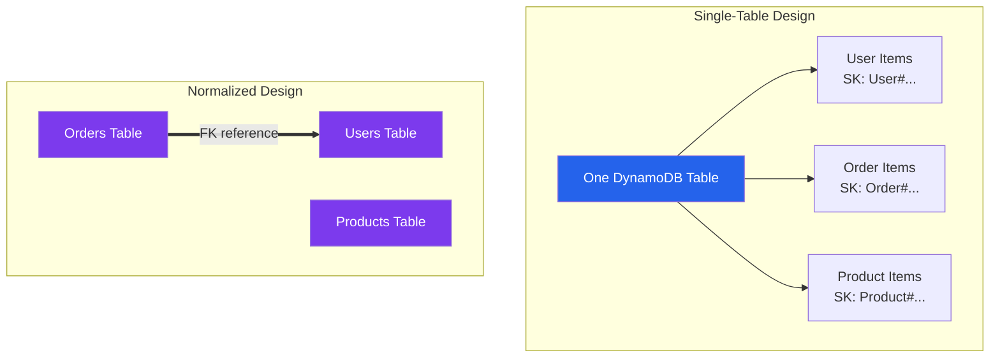
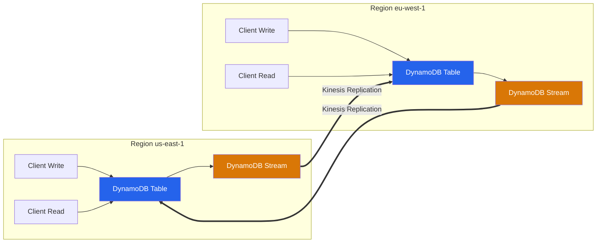

# DynamoDB Best Practices

## Data Modeling

### Design Patterns

| Pattern | Description | Use Case |
|---------|-------------|----------|
| **Single-Table Design** | All related data in one table | Maximize throughput, simplify queries |
| **Normalized Design** | Separate tables with references | Independent scaling, clear boundaries |
| **Denormalized Design** | Duplicate data to avoid joins | Read-heavy, reduce query complexity |
| **Aggregate Pattern** | Collection of items under one PK | User profile with multiple attributes |
| **Collection Table Pattern** | Multiple entity types in one table | Multi-entity application data |
| **Index Pattern** | Duplicate data with different access patterns | Multiple query patterns on same data |

### Key Schema Design

| Key Type | Purpose | Constraints | Best Practice |
|----------|---------|-------------|---------------|
| **Partition Key (HK)** | Determines partition placement | Max 2048 bytes | High-cardinality, evenly distributed |
| **Sort Key (RK)** | Orders items within partition | Max 2048 bytes | Enables range queries, filtering |
| **Composite Key** | HK + RK combination | Both required for queries | Design for query patterns first |

### Partition Key Selection

| Characteristic | Good Partition Key | Bad Partition Key |
|---------------|-------------------|-------------------|
| **Cardinality** | High (many distinct values) | Low (few distinct values) |
| **Distribution** | Even across values | Hot partitions on few values |
| **Growth** | Unbounded or slow growth | Time-based (date, hour) |
| **Examples** | UserID, OrderID, UUID | Status, Type, Date |

---

## Capacity Modes

### On-Demand vs Provisioned

| Feature | On-Demand | Provisioned |
|---------|-----------|-------------|
| **Pricing** | Per-request ($0.00065/100 RCU, $0.00065/100 WCU) | Per-hour capacity + overage |
| **Scaling** | Automatic, unlimited | Manual or auto-scaling |
| **Burst** | No burst needed | Burst from unused capacity |
| **Predictability** | Variable cost | Predictable cost |
| **Best For** | Unpredictable, spiky workloads | Steady, predictable workloads |
| **Cost Break-even** | — | ~70% of provisioned capacity utilized |

### Auto Scaling

| Setting | Recommendation | Reason |
|---------|---------------|--------|
| **Min Capacity** | 1.2x baseline load | Headroom for normal variation |
| **Max Capacity** | 3-5x peak load | Handle traffic spikes |
| **Target Utilization** | 60-70% | Balance cost and performance |
| **Scale-out cooldown** | 60 seconds | Prevent rapid scaling |
| **Scale-in cooldown** | 300 seconds | Allow traffic to settle |
| **Scaling policy** | Target tracking | Simple, effective |

---

## Global Secondary Indexes (GSIs)

### GSI Design

| Consideration | Recommendation |
|---------------|----------------|
| **Number of GSIs** | Start with 2-3, add as needed |
| **Sparse indexes** | Only index items that need the query pattern |
| **Projected attributes** | Use `INCLUDE` or `KEYS_ONLY` to reduce cost |
| **Partition key** | Different from table PK for different access patterns |
| **Sort key** | Enable range queries and filtering |

### Projection Types

| Type | Description | Cost Impact | Use Case |
|------|-------------|-------------|----------|
| **ALL** | All attributes projected | Highest | Need all data from index |
| **KEYS_ONLY** | Only key attributes | Lowest | Get item key, then fetch full item |
| **INCLUDE** | Specific non-key attributes | Medium | Need specific attributes from index |

---

## Performance Optimization

### Read Optimization

| Technique | Description | Impact |
|-----------|-------------|--------|
| **BatchGetItem** | Fetch up to 100 items or 16 MB | Reduce request count |
| **Parallel requests** | Multiple concurrent Gets | Higher aggregate throughput |
| **DAX (DynamoDB Accelerator)** | In-memory caching | 10x read performance, lower cost |
| **ProjectionExpression** | Fetch only needed attributes | Lower latency, lower cost |
| **Consistent reads** | Only when necessary | Eventually consistent is cheaper/faster |

### Write Optimization

| Technique | Description | Impact |
|-----------|-------------|--------|
| **BatchWriteItem** | Write up to 25 items per batch | Reduce request count |
| **TransactWriteItems** | Atomic multi-item writes | Consistency across items |
| **Parallel writes** | Different partition keys | Higher aggregate throughput |
| **Time-to-Live (TTL)** | Auto-expire items | Reduce storage cost |
| **PutItem vs UpdateItem** | Put for new, Update for partial | Wasted WCU on full replaces |

### Hot Partition Avoidance

| Symptom | Cause | Solution |
|---------|-------|----------|
| `ProvisionedThroughputExceededException` | Single partition overload | Redesign partition key |
| High latency on specific queries | Hot sort key values | Add random suffix, use DAX |
| Uneven capacity usage | Skewed data distribution | Use UUID, hash prefix |
| Write throttling on specific items | Hot item writes | Use UpdateItem with counters |

---

## DAX (DynamoDB Accelerator)

### DAX Features

| Feature | Description |
|---------|-------------|
| **In-memory caching** | Sub-millisecond read latency |
| **Automatic cache invalidation** | Writes update cache automatically |
| **Cluster mode** | Multi-node for high availability |
| **Supported operations** | GetItem, BatchGetItem, Query |
| **TTL** | Configurable per-item cache duration |

### DAX Sizing

| Node Type | Memory | Use Case |
|-----------|--------|----------|
| **dax.r6g.large** | 5.1 GB | Small workloads |
| **dax.r6g.xlarge** | 19 GB | Medium workloads |
| **dax.r6g.2xlarge** | 39 GB | Large workloads |
| **dax.r6g.4xlarge** | 126 GB | Very large workloads |

---

## Security

### Encryption

| Feature | Description |
|---------|-------------|
| **Encryption at rest** | AWS-managed or KMS key |
| **Encryption in transit** | TLS/SSL required |
| **Pipelining** | Supported with encryption |
| **DAX encryption** | At rest with KMS |

### Access Control

| Method | Description |
|---------|-------------|
| **IAM Policies** | Fine-grained table, index, and attribute-level access |
| **Resource-level permissions** | Specific table and GSI ARNs |
| **Condition keys** | ddb:Attributes, ddb:MaxCapacity |
| **VPC endpoints** | PrivateLink for DynamoDB |

### IAM Policy Conditions

| Condition Key | Description |
|--------------|-------------|
| `ddb:Attributes` | Restrict to specific attributes |
| `ddb:MaxCapacity` | Limit batch operation size |
| `ddb:LeadingKeys` | Restrict to specific partition keys |
| `ddb:requestOperation` | Restrict to specific operations |

---

## Streams & Triggers

### Stream View Types

| Type | Description | Use Case |
|------|-------------|----------|
| **KEYS_ONLY** | Only key attributes | Minimal data, key lookup needed |
| **NEW_IMAGE** | Entire item after update | Processing updated state |
| **OLD_IMAGE** | Entire item before update | Audit, rollback |
| **NEW_AND_OLD_IMAGES** | Both before and after | Change detection, diff |

### Lambda Triggers

| Setting | Recommendation |
|---------|---------------|
| **Batch size** | Match to processing capacity |
| **Parallelization** | Enable for faster processing |
| **Retry** | Configure retry on failure |
| **Destination** | Send failures to SQS/S3 |
| **Tumbling window** | Batch records by time window |

---

## Cost Optimization

| Strategy | Description | Potential Savings |
|----------|-------------|-------------------|
| **Switch to On-Demand** | For unpredictable workloads | Eliminate over-provisioning |
| **Right-size provisioned** | Match to actual usage | 20-50% |
| **Reduce GSIs** | Remove unused indexes | Per-GB storage + WCU cost |
| **TTL for expiring data** | Auto-delete old items | Storage reduction |
| **Projection optimization** | KEYS_ONLY or INCLUDE | GSI storage reduction |
| **DAX for read-heavy** | Cache frequent reads | Lower RCU consumption |
| **Archive to S3** | Export cold data via DynamoDB Data Pipeline | Storage cost reduction |

### Cost Components

| Component | On-Demand Cost | Provisioned Cost |
|-----------|---------------|-----------------|
| **Read (per 100 K RCUs)** | $0.065 per 100K consumed | $0.065 per provisioned RCU-hour |
| **Write (per 100 K WCUs)** | $0.065 per 100K consumed | $0.065 per provisioned WCU-hour |
| **Storage (per GB/month)** | $0.25 | $0.25 |
| **GSI storage (per GB/month)** | $0.25 | $0.25 |
| **Data transfer (per GB)** | $0.09/region | $0.09/region |

---

## Backup & Recovery

| Method | RPO | RTO | Cost | Use Case |
|--------|-----|-----|------|----------|
| **On-Demand Backup** | Point-in-time | Minutes | Storage only | Manual snapshots |
| **Continuous Backup** | Up to 35 days | Minutes | Included | Point-in-time recovery (up to 35 days) |
| **PITR** | 1 second | Minutes | Included | Precise recovery |
| **DynamoDB Global Tables** | Near-zero | Seconds | 2x storage + transfer | Multi-region active-active |

---

## Global Tables

### Multi-Region Replication

| Feature | Description |
|---------|-------------|
| **Active-Active** | Read/write in all regions |
| **Conflict resolution** | Last-writer-wins (LWW) |
| **Replication latency** | Typically < 1 second |
| **Auto-scaling** | Independent per region |
| **Capacity mode** | Independent per region |

### Global Table Considerations

| Consideration | Recommendation |
|---------------|----------------|
| **Write conflicts** | Design to minimize cross-region writes to same item |
| **Eventual consistency** | Cross-region reads are eventually consistent |
| **Cost** | Data replicated to all regions |
| **TTL** | Must be consistent across regions |
| **Streams** | Not available on global tables |

---

## Monitoring

### Key Metrics

| Metric | Warning | Critical |
|--------|---------|----------|
| `ConsumedReadCapacity` | > 70% of provisioned | > 90% of provisioned |
| `ConsumedWriteCapacity` | > 70% of provisioned | > 90% of provisioned |
| `ReadThrottleEvents` | > 0 | > 10/min |
| `WriteThrottleEvents` | > 0 | > 10/min |
| `AccountMaxReadCapacityUtilization` | > 70% | > 90% |
| `AccountMaxWriteCapacityUtilization` | > 70% | > 90% |
| `Latency` (ms) | > 10ms | > 50ms |
| `SuccessfulRequestLatency` | > 20ms p99 | > 100ms p99 |
