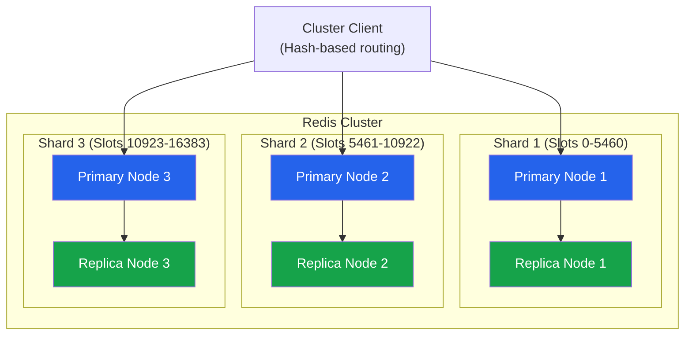
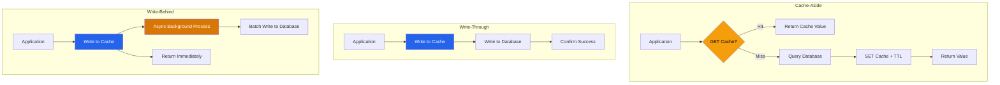

# ElastiCache Best Practices

## Engine Selection

### Redis vs Memcached

| Feature | Redis | Memcached |
|---------|-------|-----------|
| **Data structures** | Strings, lists, sets, sorted sets, hashes, streams | Strings, binary blobs |
| **Persistence** | RDB snapshots, AOF | None (ephemeral only) |
| **High Availability** | Multi-AZ with automatic failover | No built-in HA |
| **Clustering** | Sharding with replication | Sharding only |
| **Pub/Sub** | Yes | No |
| **Transactions** | MULTI/EXEC | No |
| **Lua scripting** | Yes | No |
| **Streams** | Yes (message queuing) | No |
| **Memory model** | Rich data types | Simple key-value |
| **Best for** | Sessions, leaderboards, caching, queues | Simple caching, distributed cache |

### Use Case Selection

| Use Case | Recommended Engine | Reason |
|----------|-------------------|--------|
| Session store | Redis | Persistence, replication |
| Leaderboard | Redis | Sorted sets |
| Simple caching | Either | Memcached simpler, Redis more features |
| Message queue | Redis | Streams, pub/sub |
| Real-time analytics | Redis | Data structures, aggregation |
| Geospatial | Redis | Geospatial commands |
| Rate limiting | Redis | Atomic operations, sorted sets |
| High-throughput cache | Memcached | Simpler, multi-threaded |

---

## Node Types

### Instance Classes

| Class | Generation | vCPU | Memory | Use Case |
|-------|-----------|------|--------|----------|
| cache.t4g.micro | Graviton 2 | 2 | 1 GB | Dev/test, small workloads |
| cache.t4g.medium | Graviton 2 | 2 | 4 GB | Small production |
| cache.r6g.large | Graviton 2 | 2 | 16 GB | Memory-optimized |
| cache.r6g.xlarge | Graviton 2 | 4 | 32 GB | Medium workloads |
| cache.r6g.2xlarge | Graviton 2 | 8 | 64 GB | Large workloads |
| cache.r7g.xlarge | Graviton 3 | 4 | 32 GB | Next-gen memory |
| cache.r7g.4xlarge | Graviton 3 | 16 | 128 GB | Very large workloads |

### Sizing Guidelines

| Metric | Calculation | Recommendation |
|--------|-------------|----------------|
| **Dataset size** | Working set that fits in memory | Target 70-80% memory utilization |
| **Network capacity** | Requests/sec x avg payload | Monitor NetworkIn/NetworkOut |
| **CPU utilization** | Complex operations, serialization | Keep below 70% |
| **Connections** | Max connections per node | Monitor ConnectedOperations |

---

## Redis Architecture

### Deployment Modes

| Mode | Description | Use Case |
|------|-------------|----------|
| **Redis (Redis)** | Single node or Multi-AZ | Simplicity, HA |
| **Redis Cluster Mode** | Sharded, auto-resharding | Large datasets, high throughput |
| **Memcached** | Multi-node, application-managed sharding | Simple caching |

### Cluster Mode

| Feature | Description |
|---------|-------------|
| **Shards (Nodes Groups)** | Independent partitions of data |
| **Automatic resharding** | Add/remove shards without downtime |
| **Cross-slot operations** | Not supported (design keys carefully) |
| **Hash tags** | Force related keys to same slot |
| **Max shards** | 1,024 per cluster |

### Multi-AZ Configuration

| Setting | Description | Recommendation |
|---------|-------------|----------------|
| **Auto-failover** | Enable for HA | Always enable in production |
| **Number of replicas** | 1-5 per shard | Minimum 1 for HA |
| **Availability zones** | Automatic placement | Spread across AZs |
| **Preferred maintenance window** | Patching window | Low-traffic period |

---

## Performance Tuning

### Redis-Specific Tuning

| Parameter | Description | Recommendation |
|-----------|-------------|----------------|
| maxmemory-policy | Eviction policy | allkeys-lru for caches, noeviction for sessions |
| maxmemory | Memory limit | Set to 70-80% of node memory |
| timeout | Client connection timeout | 300 seconds |
| tcp-keepalive | Keep-alive interval | 300 seconds |
| hz | Redis background tasks frequency | 10 (default), increase for faster cleanup |
| activedefrag | Active defragmentation | Enable for large datasets |

### Connection Management

| Technique | Description | Benefit |
|-----------|-------------|---------|
| **Connection pooling** | Reuse connections | Reduce connection overhead |
| **Pipelining** | Send multiple commands without waiting | Higher throughput |
| **Cluster client** | Client-side routing | Transparent sharding |
| **Read replicas** | Route reads to replicas | Scale read throughput |
| **Client-side caching** | Cache in application memory | Reduce cache requests |

### Latency Optimization

| Factor | Impact | Mitigation |
|--------|--------|------------|
| **Network distance** | Higher latency | Place in same AZ as application |
| **Large values** | Higher serialization time | Compress, chunk large values |
| **Complex operations** | CPU-bound | Simplify data structures |
| **Eviction** | Memory pressure | Right-size, tune eviction policy |
| **AOF rewrite** | I/O spike | Schedule during low traffic |

---

## Persistence

### Redis Persistence Options

| Method | RPO | Performance Impact | Use Case |
|--------|-----|-------------------|----------|
| **RDB (snapshot)** | Last snapshot | Fork overhead | Point-in-time recovery |
| **AOF (append-only file)** | Last write (everysec) | Disk I/O on writes | Minimal data loss |
| **Both RDB + AOF** | Last write | Combined overhead | Maximum durability |
| **None** | None | None | Ephemeral cache only |

### Persistence Recommendations

| Scenario | RDB | AOF | Reason |
|----------|-----|-----|--------|
| **Cache (data can be rebuilt)** | Disabled | Disabled | No persistence needed |
| **Session store** | Enabled (hourly) | Enabled (everysec) | Balance durability and performance |
| **Critical data** | Enabled (frequent) | Enabled (everysec) | Maximum durability |
| **Leaderboard** | Enabled (daily) | Disabled | Accept some data loss |

---

## Security

### Security Checklist

| Control | Implementation | Priority |
|---------|---------------|----------|
| **VPC placement** | Private subnets only | CRITICAL |
| **Encryption at rest** | Enable with KMS | CRITICAL |
| **Encryption in transit** | TLS/SSL required | HIGH |
| **Auth token** | Set Redis password | HIGH |
| **Security groups** | Restrict to application SGs | HIGH |
| **Parameter group** | Disable dangerous commands | MEDIUM |
| **IAM auth** | Use IAM for ElastiCache API | MEDIUM |
| **Transit encryption** | Auth-enabled for TLS | HIGH |

### Dangerous Commands to Disable

| Command | Risk | Action |
|---------|------|--------|
| FLUSHDB | Delete all keys in database | Disable in parameter group |
| FLUSHALL | Delete all keys in all databases | Disable in parameter group |
| KEYS | Block server during execution | Disable, use SCAN instead |
| DEBUG | Debug commands | Disable in production |
| CONFIG | Modify runtime config | Disable in production |

---

## Monitoring

### Key Metrics

| Metric | Warning | Critical | Description |
|--------|---------|----------|-------------|
| CurrConnections | > 70% max | > 90% max | Active connections |
| FreeableMemory | < 20% | < 10% | Available memory |
| UsedMemoryBytes | > 70% max | > 85% max | Memory utilization |
| CPUUtilization | > 70% | > 90% | CPU usage |
| GetHitRate (Memcached) / CacheHits (Redis) | < 80% | < 50% | Cache hit ratio (metric name varies by engine) |
| GetLatencyUs | > 1,000 us | > 5,000 us | Read latency |
| SetLatencyUs | > 1,000 us | > 5,000 us | Write latency |
| NetworkOut | Baseline + 2σ | Baseline + 3σ | Outbound traffic |
| ReplicationLag | > 1 sec | > 10 sec | Replica lag (Redis) |
| SwapUsage | > 0 | > 10% | Swap usage (bad sign) |

### Cache Hit Rate Analysis

| Hit Rate | Assessment | Action |
|----------|-----------|--------|
| > 95% | Excellent | Optimal cache usage |
| 80-95% | Good | Monitor for trends |
| 50-80% | Fair | Review cache strategy, TTLs |
| < 50% | Poor | Cache thrashing, review architecture |

---

## Cost Optimization

| Strategy | Description | Potential Savings |
|----------|-------------|-------------------|
| **Right-sizing** | Match node type to workload | 20-50% |
| **Reserved Nodes** | 1 or 3-year commitment | Up to 70% |
| **Savings Plans** | Compute commitment | Up to 65% |
| **Graviton nodes** | ARM-based instances | 20% better price/performance |
| **Reduce replicas** | Minimum needed for HA | Per-node cost |
| **Tuning hit rate** | Higher hit rate = fewer source queries | Indirect DB cost savings |
| **Sharding** | Add/remove shards to distribute load | Growing datasets |

---

## Data Consistency Patterns

### Cache-Aside Pattern

| Step | Action | Description |
|------|--------|-------------|
| 1 | Check cache | GET key from ElastiCache |
| 2 | Cache hit | Return cached value |
| 3 | Cache miss | Query database |
| 4 | Populate cache | SET key with DB value + TTL |
| 5 | Return value | Return to application |

### Write-Through Pattern

| Step | Action | Description |
|------|--------|-------------|
| 1 | Write to cache | SET key in ElastiCache |
| 2 | Write to database | Persist to source of truth |
| 3 | Return result | Confirm write success |

### Pattern Comparison

| Pattern | Read Performance | Write Performance | Consistency | Complexity |
|---------|-----------------|-------------------|-------------|------------|
| **Cache-Aside** | Good (after first miss) | Good | Eventual | Low |
| **Write-Through** | Excellent | Slower writes | Stronger | Medium |
| **Write-Behind** | Excellent | Fast writes | Eventual | High |
| **Read-Through** | Excellent | Good | Medium | Medium |

---

## Cross-Service Integration

| Service | Integration | Purpose |
|---------|------------|---------|
| Lambda | ElastiCache client | Serverless caching |
| MSK | Redis Streams consumer | Message processing |
| CloudWatch | Metrics, alarms | Monitoring |
| Systems Manager | Parameter Store for config | Centralized configuration |
| Secrets Manager | Auth token management | Secure credential storage |
