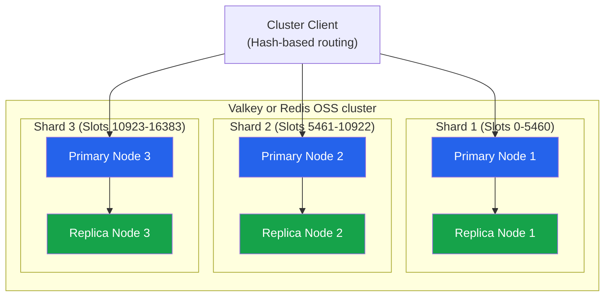
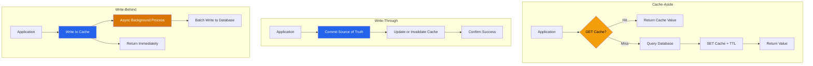

# ElastiCache Best Practices

## Engine Selection

> **Engine naming note:** Amazon ElastiCache supports **Valkey**, **Redis OSS**, and **Memcached**. AWS recommends evaluating the newest supported engine release; current ElastiCache documentation includes Valkey 9.x while Redis OSS support ends at 7.1. Valkey is the normal default for new Redis-compatible workloads, but verify client and feature compatibility before migration.

### Valkey/Redis OSS vs Memcached

| Feature | Valkey / Redis OSS | Memcached |
|---------|-------|-----------|
| **Data structures** | Strings, lists, sets, sorted sets, hashes, streams | Strings, binary blobs |
| **Backup/durability options** | Managed snapshots for node-based caches; newer Valkey versions also offer documented durability features with specific constraints | Node-based Memcached is ephemeral; serverless backup support differs |
| **High Availability** | Multi-AZ with automatic failover | No built-in HA |
| **Clustering** | Sharding with replication | Sharding only |
| **Serverless option** | Yes (ElastiCache Serverless) | Yes (ElastiCache Serverless) |
| **Pub/Sub** | Yes | No |
| **Transactions** | MULTI/EXEC | No |
| **Lua scripting** | Yes | No |
| **Streams** | Yes (message queuing) | No |
| **Memory model** | Rich data types | Simple key-value |
| **Best for** | Sessions, leaderboards, caching, queues | Simple caching, distributed cache |

### Use Case Selection

| Use Case | Recommended Engine | Reason |
|----------|-------------------|--------|
| Session store | Valkey / Redis OSS | Replication, TTLs, and access controls; still design for documented failover/data-loss behavior |
| Leaderboard | Valkey / Redis OSS | Sorted sets |
| Simple caching | Either | Memcached simpler, Valkey more features |
| Message queue | Valkey / Redis OSS | Streams, pub/sub |
| Real-time analytics | Valkey / Redis OSS | Data structures, aggregation |
| Geospatial | Valkey / Redis OSS | Geospatial commands |
| Rate limiting | Valkey / Redis OSS | Atomic operations, sorted sets |
| High-throughput cache | Memcached | Simpler, multi-threaded |
| Unpredictable/spiky workloads | ElastiCache Serverless (Valkey, Redis OSS, or Memcached) | Removes node/shard planning and scales automatically; still size quotas, maximum data, ECPU controls, and cost expectations |

---

## Node Types

### Instance Classes

| Class | Generation | vCPU | Memory (approx.) | Use Case |
|-------|-----------|------|--------|----------|
| cache.t4g.micro | Graviton 2 | 2 | 0.5 GiB | Dev/test, small workloads |
| cache.t4g.medium | Graviton 2 | 2 | ~3.1 GiB | Small production |
| cache.r6g.large | Graviton 2 | 2 | ~13 GiB | Memory-optimized |
| cache.r6g.xlarge | Graviton 2 | 4 | ~26 GiB | Medium workloads |
| cache.r6g.2xlarge | Graviton 2 | 8 | ~53 GiB | Large workloads |
| cache.r7g.xlarge | Graviton 3 | 4 | ~26 GiB | Next-gen memory |
| cache.r7g.4xlarge | Graviton 3 | 16 | ~106 GiB | Very large workloads |

> Exact usable memory and supported node types vary by engine, version, and Region. Verify current values in the [ElastiCache node type documentation](https://docs.aws.amazon.com/AmazonElastiCache/latest/dg/CacheNodes.SupportedTypes.html) before capacity planning. For variable or hard-to-predict workloads, consider **ElastiCache Serverless** instead of manually selecting node types.

### Sizing Guidelines

| Metric | Calculation | Recommendation |
|--------|-------------|----------------|
| **Dataset size** | Working set plus replication, fragmentation, buffers, and backup/failover headroom | Alarm on `DatabaseMemoryUsagePercentage`, evictions, and `FreeableMemory`; validate with load tests rather than a universal percentage |
| **Network capacity** | Requests/sec x avg payload | Monitor NetworkIn/NetworkOut |
| **CPU utilization** | Commands, data structures, and serialization | Monitor `EngineCPUUtilization` for Valkey/Redis OSS and host `CPUUtilization`; set workload-specific SLO thresholds |
| **Connections** | Clients, pools, and reconnect storms | Monitor `CurrConnections`, new connections, rejected connections, and documented node limits |

---

## Valkey / Redis OSS Architecture

### Deployment Modes

| Mode | Description | Use Case |
|------|-------------|----------|
| **Cluster Mode Disabled** | Single shard, primary + up to 5 replicas, Multi-AZ | Simplicity, HA, smaller datasets |
| **Cluster Mode Enabled** | Sharded, auto-resharding | Large datasets, high throughput |
| **ElastiCache Serverless** | Fully managed, scales capacity automatically, no node/shard management | Unpredictable or spiky workloads, minimal ops overhead |
| **Memcached** | Multi-node, application-managed sharding | Simple caching |

### Cluster Mode

| Feature | Description |
|---------|-------------|
| **Shards (Nodes Groups)** | Independent partitions of data |
| **Online resharding** | Add/remove shards while serving traffic on supported versions; test latency and capacity impact |
| **Cross-slot operations** | Not supported (design keys carefully) |
| **Hash tags** | Force related keys to same slot |
| **Node/shard quota** | Default: 90 nodes per cluster-mode-enabled cluster. An approved increase can allow up to 500 total nodes or 500 shards (with no replicas) on supported Valkey/Redis OSS versions; replicas reduce the possible shard count |

### Multi-AZ Configuration

| Setting | Description | Recommendation |
|---------|-------------|----------------|
| **Auto-failover** | Promote a replica after primary failure | Enable for production workloads that require HA; cluster mode enabled requires it |
| **Number of replicas** | 1-5 per shard | Minimum 1 for HA |
| **Availability zones** | Automatic placement | Spread across AZs |
| **Preferred maintenance window** | Patching window | Low-traffic period |

---

## Performance Tuning

### Valkey/Redis OSS-Specific Tuning

| Parameter | Description | Recommendation |
|-----------|-------------|----------------|
| `maxmemory-policy` | Eviction policy | Choose from workload semantics: an all-keys policy for a rebuildable cache, or `noeviction` only when callers correctly handle OOM errors; serverless uses service-defined settings |
| `reserved-memory-percent` / available memory | Service and engine overhead | Do not set `maxmemory` from total node RAM. Use ElastiCache-supported parameters and memory metrics for the selected engine/version |
| `timeout` and keepalive | Idle client handling and failure detection | Tune client and server behavior together; defaults differ between node-based and serverless caches |
| Active defragmentation | Memory fragmentation | Validate supported parameters and engine behavior; newer versions may let ElastiCache defragment automatically when operationally necessary |

### Connection Management

| Technique | Description | Benefit |
|-----------|-------------|---------|
| **Connection pooling** | Reuse connections | Reduce connection overhead |
| **Pipelining** | Send multiple commands without waiting | Higher throughput |
| **Cluster client** | Client-side routing | Transparent sharding |
| **Read replicas** | Route reads to replicas | Scale read throughput |
| **Client-side caching** | Cache in application memory | Reduce cache requests |

### Latency Optimization

| Factor | Impact | Mitigation |
|--------|--------|------------|
| **Network distance** | Higher latency | Keep clients in the same Region, spread clients/caches for HA, and measure the latency/cross-AZ-cost tradeoff rather than forcing every client into one AZ |
| **Large values** | Higher serialization time | Compress, chunk large values |
| **Complex operations** | CPU-bound | Simplify data structures |
| **Eviction** | Memory pressure | Right-size, tune eviction policy |
| **Snapshots, resharding, failover** | Resource pressure or reconnect spike | Preserve headroom, use backoff/jitter, and test maintenance and failure events |

---

## Backup and Durability

ElastiCache is primarily a cache, not a system of record. Node-based Valkey/Redis OSS supports managed snapshots and restore into a new cache. Replication and Multi-AZ reduce downtime but do not by themselves provide a zero-data-loss guarantee. Do not describe ElastiCache as offering user-managed RDB+AOF durability: persistence controls and availability depend on the ElastiCache engine/version, and serverless parameters are service-managed.

| Requirement | Guidance |
|-------------|----------|
| Rebuildable cache | Treat the source database/object store as authoritative; test cache warm-up and stampede protection |
| Sessions or other state | Define acceptable RPO, enable supported backups/replication, and test failover plus restore. Consider a durable database if losing acknowledged writes is unacceptable |
| Zero-data-loss failover | Evaluate the documented Multi-AZ transactional-log durability available in supported newer Valkey versions, including its Region/version and Global Datastore constraints |
| Cross-Region recovery | Global Datastore replication is asynchronous; monitor lag and run planned/unplanned failover exercises |

---

## Security

### Security Checklist

| Control | Implementation | Priority |
|---------|---------------|----------|
| **VPC placement** | Private subnets only | CRITICAL |
| **Encryption at rest** | Enable with KMS | CRITICAL |
| **Encryption in transit** | TLS/SSL required | HIGH |
| **Authentication and authorization** | Prefer RBAC user groups; all serverless caches require RBAC. IAM authentication is supported for compatible Valkey/Redis OSS versions and requires TLS | HIGH |
| **Security groups** | Restrict to application SGs | HIGH |
| **Parameter group** | Disable dangerous commands | MEDIUM |
| **IAM control plane** | Use IAM least privilege for ElastiCache API operations | MEDIUM |

### Dangerous Commands to Disable

| Command | Risk | Action |
|---------|------|--------|
| FLUSHDB | Delete all keys in database | Deny with RBAC ACLs and, for supported node-based versions, block/rename in a custom parameter group |
| FLUSHALL | Delete all keys in all databases | Deny with RBAC ACLs and, for supported node-based versions, block/rename in a custom parameter group |
| KEYS | Can block the engine over a large keyspace | Deny for application users; use cursor-based `SCAN` where appropriate |
| DEBUG | Administrative/debug operations | Deny for application users |
| CONFIG | Runtime configuration access | Deny for application users; manage supported settings through ElastiCache parameter groups |

---

## Monitoring

### Key Metrics

| Metric | Warning | Critical | Description |
|--------|---------|----------|-------------|
| `CurrConnections`, `NewConnections` | Baseline deviation | Approaching documented limit or reconnect storm | Active/new connections |
| `DatabaseMemoryUsagePercentage`, `FreeableMemory` | Reduced headroom | Evictions, OOM risk, or workload SLO impact | Engine and host memory pressure |
| `EngineCPUUtilization`, `CPUUtilization` | Baseline/SLO deviation | Sustained saturation | Engine thread and host CPU |
| `CacheHits`, `CacheMisses` | Hit ratio below workload target | Source-store overload or latency SLO impact | Derive hit ratio; do not use a universal percentage |
| Command latency metrics such as `GetTypeCmdsLatency` / `SetTypeCmdsLatency` | Baseline deviation | Latency SLO impact | Use engine-appropriate metric names and units |
| `ReplicationLag` | Above tested recovery/failover tolerance | RPO or failover objective at risk | Replica lag for Valkey/Redis OSS |
| `Evictions`, `SwapUsage` | Unexpected non-zero or trend | Sustained data churn/performance impact | Memory pressure indicators |

### Cache Hit Rate Analysis

There is no service-wide "good" cache-hit ratio. Establish a target from source-load reduction, end-to-end latency, object popularity, negative caching, and freshness requirements. Segment hits/misses by operation and key family; a high ratio can still hide a hot miss path or stale-data problem.

---

## Cost Optimization

| Strategy | Description | Potential Savings |
|----------|-------------|-------------------|
| **Right-sizing** | Match node type, shard count, replicas, and headroom to workload | Workload-dependent |
| **Reserved Nodes** | 1 or 3-year node commitment where an offering matches stable usage | Compare current offering and utilization |
| **Database Savings Plans** | Spend commitment that can apply to eligible ElastiCache and other database usage | Up to 35% according to current Savings Plans documentation; model overlap with reservations |
| **Graviton nodes** | Benchmark supported ARM-based node families | Compare current price/performance for the workload |
| **Choose Valkey over Redis OSS** | Valkey pricing is lower than other supported engines for equivalent nodes/Serverless | Lower per-node and Serverless cost |
| **Reduce replicas** | Minimum needed for HA | Per-node cost |
| **Tuning hit rate** | Higher hit rate = fewer source queries | Indirect DB cost savings |
| **Sharding** | Add/remove shards to distribute load | Growing datasets |
| **ElastiCache Serverless** | Pay only for consumed cache/ECPUs | Avoids over-provisioning for spiky/unknown workloads |

---

## Data Consistency Patterns

### Cache-Aside Pattern

| Step | Action | Description |
|------|--------|-------------|
| 1 | Check cache | GET key from ElastiCache |
| 2 | Cache hit | Return cached value |
| 3 | Cache miss | Query database |
| 4 | Populate cache | SET key with DB value + TTL |
| 5 | Return value | Return to application |

### Write-Through Pattern

| Step | Action | Description |
|------|--------|-------------|
| 1 | Write source of truth | Commit the durable database write |
| 2 | Update or invalidate cache | Apply a versioned/idempotent cache update only after the durable commit, or use a transactional outbox/change stream |
| 3 | Return result | Define failure handling so cache and source cannot silently diverge |

### Pattern Comparison

| Pattern | Read Performance | Write Performance | Consistency | Complexity |
|---------|-----------------|-------------------|-------------|------------|
| **Cache-Aside** | Good (after first miss) | Good | Eventual | Low |
| **Write-Through** | Excellent | Slower writes | Stronger | Medium |
| **Write-Behind** | Excellent | Fast writes | Eventual | High |
| **Read-Through** | Excellent | Good | Medium | Medium |

---

## Cross-Service Integration

| Service | Integration | Purpose |
|---------|------------|---------|
| Lambda | ElastiCache client | Serverless caching |
| MSK | Redis Streams consumer | Message processing |
| CloudWatch | Metrics, alarms | Monitoring |
| Systems Manager | Parameter Store for config | Centralized configuration |
| Secrets Manager | Auth token management | Secure credential storage |

---

## Global Datastore & Serverless

| Feature | Description |
|---------|-------------|
| **Global Datastore** | Asynchronous cross-Region replication for supported node-based Valkey/Redis OSS clusters. It supports one primary and up to two secondary Regions, requires the same account, and does not make RPO zero; test failover and monitor lag |
| **ElastiCache Serverless** | Automatically scales compute and data storage for Valkey, Redis OSS, or Memcached; uses TLS and engine-specific serverless limits/settings, so verify client compatibility and quotas |

---

## Authoritative references

- [Choosing an ElastiCache engine](https://docs.aws.amazon.com/AmazonElastiCache/latest/dg/SelectEngine.html)
- [ElastiCache engine versions](https://docs.aws.amazon.com/AmazonElastiCache/latest/dg/engine-versions.html)
- [Working with shards and quotas](https://docs.aws.amazon.com/AmazonElastiCache/latest/dg/Shards.html)
- [Valkey and Redis OSS configuration and limits](https://docs.aws.amazon.com/AmazonElastiCache/latest/dg/RedisConfiguration.html)
- [ElastiCache IAM authentication](https://docs.aws.amazon.com/AmazonElastiCache/latest/dg/auth-iam.html)
- [Global Datastore prerequisites and limitations](https://docs.aws.amazon.com/AmazonElastiCache/latest/dg/Redis-Global-Datastores-Getting-Started.html)
