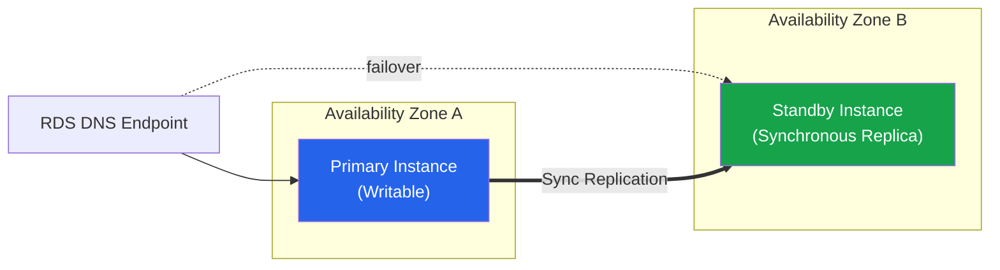
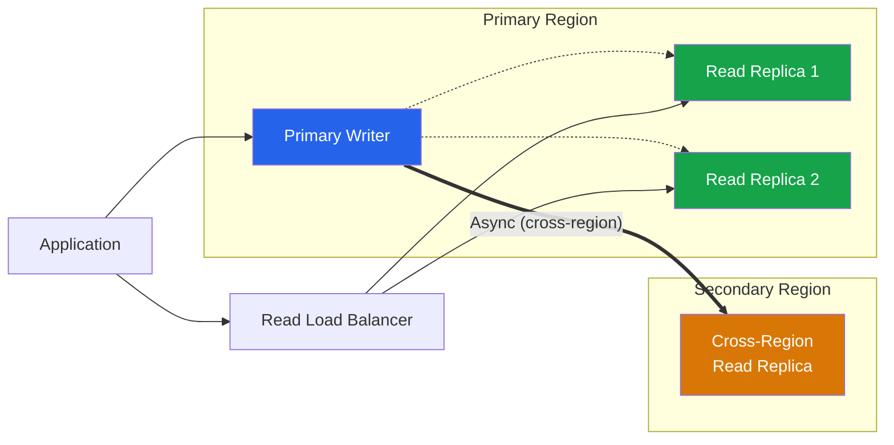

# RDS Best Practices

## Engine Selection

### Engine Comparison

| Engine | Type | Use Case | Managed Alternative |
|--------|------|----------|-------------------|
| **Amazon Aurora** | MySQL/PostgreSQL compatible | High performance, enterprise | Aurora Serverless v2 |
| **MySQL** | Open-source relational | General purpose, wide compatibility | — |
| **PostgreSQL** | Open-source relational | Complex queries, extensions, JSON | — |
| **MariaDB** | MySQL fork | Compatibility with MySQL apps | — |
| **Oracle** | Commercial relational | Enterprise, legacy applications | — |
| **SQL Server** | Commercial relational | Microsoft ecosystem, .NET apps | — |

### Aurora Features

| Feature | Aurora MySQL | Aurora PostgreSQL | Benefit |
|---------|-------------|-------------------|---------|
| **Cluster volume** | Automatically grows up to 256 TiB on Aurora MySQL 3.10+; earlier supported versions have a 128 TiB maximum | Automatically grows up to 256 TiB on Aurora PostgreSQL 17.5+, 16.9+, and 15.13+; earlier supported versions have a 128 TiB maximum | Shared distributed storage; maximum and availability can vary for specialized Aurora configurations |
| **Storage replication** | Six copies across three AZs with quorum-based writes | Six copies across three AZs with quorum-based writes | Engine replicas share the cluster volume; this is separate from cross-Region replication |
| **Read Replicas** | Up to 15 Aurora Replicas | Up to 15 Aurora Replicas | Read scaling |
| **Writer topology** | One writer per standard cluster | One writer per standard cluster | Aurora Global Database provides cross-Region reads/disaster recovery, not general multi-writer semantics |
| **Serverless v2** | Yes | Yes | Auto-scaling compute |
| **Global Database** | Yes | Yes | Cross-region replication |

---

## Instance Sizing

### Instance Classes

| Profile | Examples | Use Case | Selection note |
|---------|----------|----------|----------------|
| Burstable | `db.t4g` and supported newer families | Development, test, and workloads with a low CPU baseline | Monitor CPU credits and Unlimited-mode charges; not a default for sustained production load |
| General purpose | `db.m7g`, `db.m8g`, and x86 equivalents where supported | Balanced compute and memory | Availability depends on engine, version, Region, and deployment topology |
| Memory optimized | `db.r7g`, `db.r8g`, `db.x2g` families where supported | Large working sets and memory-intensive databases | Benchmark price/performance and extension/licensing compatibility |
| Local-NVMe Multi-AZ cluster classes | Families ending in `d` where explicitly supported | RDS Multi-AZ DB clusters that use local storage architecture | Do not infer support from the similarly named EC2 family; check the RDS class matrix |

### Sizing Guidelines

| Metric | Under-Provisioned | Healthy | Over-Provisioned |
|--------|-------------------|---------|-----------------|
| **CPU and DB load** | Sustained saturation or runnable load above tested capacity | Sufficient SLO headroom through peaks/failover | Consistently idle after representative peaks |
| **Memory and swap** | Falling `FreeableMemory`, swap activity, or OOM risk | Stable working set with failover/maintenance headroom | Large unused memory after buffer-cache behavior is understood |
| **Read/write I/O** | Latency/queueing or approach to storage/instance limits | Within tested latency and throughput objectives | Provisioned IOPS/throughput materially above observed need |
| **Connections** | Pool or engine connection exhaustion risk | Pool bounded with headroom for failover/reconnect | Oversized instance should not be inferred from low connections alone |

---

## Backup & Recovery

### Backup Options

| Method | RPO | RTO | Storage Cost | Retention |
|--------|-----|-----|-------------|-----------|
| **Automated backups and PITR** | Restore within the configured retention period; RDS uploads transaction logs approximately every five minutes | Restore creates a new DB instance/cluster; time depends on data, engine, and storage initialization | Backup storage beyond the free allocation is charged | 0-35 days for RDS DB instances; production systems normally use a nonzero period |
| **Manual DB snapshot** | State captured when the snapshot is taken | Restore creates a new DB instance/cluster | Incremental snapshot storage is billed | Retained until deleted |
| **Aurora continuous backup/PITR** | Restore to a point in the configured backup retention period | New cluster; lazy loading can affect performance after restore | Aurora backup pricing/free allocation rules apply | 1-35 days |

### Backup Best Practices

| Practice | Description |
|----------|-------------|
| **Enable automated backups** | Minimum 7-day retention |
| **Set backup window** | During low-traffic period |
| **Test restores regularly** | Validate backup integrity |
| **Cross-region snapshots** | Disaster recovery copies |
| **Snapshot scheduling** | Prefer AWS Backup or RDS automated backups; use custom automation only for requirements those services cannot meet |
| **Encryption** | Enable KMS encryption on all snapshots |

---

## High Availability

### Multi-AZ Deployments

| Feature | Single-AZ | Multi-AZ DB Instance (one standby) | Multi-AZ DB Cluster (two readable standbys) |
|---------|-----------|----------|-----------------|
| **Standby** | None | One synchronous standby (not readable) | Two readable standby instances in separate AZs |
| **Failover Time** | N/A | Typically 60-120 seconds | Typically under 35 seconds |
| **Read Traffic** | Primary only | Standby not for reads | Both standbys can serve reads |
| **Cost** | One instance | Primary plus standby resources | Three DB instances plus applicable storage/I/O; calculate by engine and Region |
| **Use Case** | Dev/test | Production | Critical production, read scaling + fast failover |

### Read Replicas

| Type | Replication | Latency | Use Case |
|------|-------------|---------|----------|
| **In-region Read Replica** | Asynchronous | Milliseconds to seconds | Read scaling |
| **Cross-region Read Replica** | Asynchronous | Seconds to minutes | Disaster recovery, global reads |
| **Aurora Replica** | Shares the distributed cluster volume; replica apply/cache lag can still occur | Usually low, workload-dependent | Read scaling and failover target |

### Read Replica Guidelines

| Parameter | Recommendation |
|-----------|---------------|
| **Number of replicas** | Start with 2-3, scale based on read load |
| **Instance size** | Size for replica read load and replication apply rate; an undersized replica can accumulate lag |
| **Monitoring** | Track replication lag continuously |
| **Promotion** | Test failover procedures regularly |

---

## Performance Tuning

### Parameter Group Tuning

| Parameter | Purpose | Recommendation |
|-----------|---------|----------------|
| **max_connections** | Maximum concurrent connections | Based on application needs + connection pooling |
| **innodb_buffer_pool_size** | InnoDB data/cache buffer | Start with the RDS engine-family default; change only after measuring working set, memory pressure, and restart/failover behavior |
| **shared_buffers** (PostgreSQL) | Shared memory for caching | Use the RDS default formula as a baseline and load-test any override |
| **effective_cache_size** (PostgreSQL) | Planner estimate, not an allocation | Estimate combined database and OS cache; validate query-plan changes |
| **maintenance_work_mem** | Per-maintenance-operation memory | Bound concurrent maintenance memory; avoid a universal GiB value |
| **work_mem** | Per sort/hash operation, potentially many allocations per connection/query | Tune from query plans and concurrency; connection pooling is often required before increasing it |

### CloudWatch Database Insights

| Feature | Description |
|---------|-------------|
| **Top SQL** | Identify most resource-intensive queries |
| **Load Chart** | Database load over time |
| **Wait Events** | Identify bottlenecks (CPU, I/O, locks) |
| **Fleet and instance dashboards** | Correlate database load, waits, SQL, host metrics, and events |
| **Modes** | Standard for core monitoring; Advanced for longer retention and advanced analysis where supported |

> The standalone Performance Insights console experience reached end of life on July 31, 2026 and redirects to CloudWatch Database Insights. The Performance Insights API remains available. Review Standard versus Advanced mode and Region/engine support.

### Query Optimization

| Technique | Description | Impact |
|-----------|-------------|--------|
| **Proper indexing** | Cover measured query patterns while accounting for write/storage overhead | Workload-dependent; verify with execution plans and production-like data |
| **Query plans** | Use EXPLAIN to analyze execution | Identify full table scans |
| **Connection pooling** | RDS Proxy (managed) or application-level pooling | Reduce connection overhead, faster failover for apps |
| **Query caching** | Application-level result caching | Reduce repeated queries |
| **Partitioning** | Split large tables by range/hash | Improve query performance |

---

## Security

### Security Checklist

| Control | Implementation | Priority |
|---------|---------------|----------|
| **VPC placement** | Private subnets only | CRITICAL |
| **Encryption at rest** | KMS encryption enabled | CRITICAL |
| **Encryption in transit** | SSL/TLS required | HIGH |
| **IAM DB Authentication** | Consider for supported MariaDB, MySQL, and PostgreSQL versions; tokens last 15 minutes for connection authentication, while established sessions can continue | HIGH |
| **Security groups** | Restrict to application SGs | HIGH |
| **Parameter group** | Disable weak ciphers, enforce SSL | HIGH |
| **Audit logging** | Enable general/query logs | MEDIUM |
| **Automatic patching** | Enable minor version upgrades | MEDIUM |

### IAM Authentication

| Feature | Description |
|---------|-------------|
| **IAM DB Auth** | Use IAM credentials instead of passwords |
| **Token lifetime** | 15 minutes |
| **IAM policy** | rds-db:connect action on DB ARN |
| **Support** | MySQL, PostgreSQL, MariaDB |

---

## Cost Optimization

| Strategy | Description | Potential Savings |
|----------|-------------|-------------------|
| **Reserved DB instances** | 1 or 3-year billing discount matched by Region, engine, and class attributes | Compare current offerings and expected utilization |
| **Database Savings Plans** | Flexible database-spend commitment across eligible services/usage | Up to 35% according to current Savings Plans documentation; model overlap with reservations |
| **Right-sizing** | Match instance, storage, I/O, replicas, and licensing to workload | Workload-dependent |
| **Aurora Serverless v2** | Scale ACUs within configured minimum/maximum | Useful for variable workloads; compare minimum capacity, I/O, and feature constraints |
| **Storage auto scaling** | Prevent allocated-storage exhaustion | Reliability feature, not a mechanism that shrinks storage or automatically reduces cost |
| **Snapshot lifecycle** | Automate old snapshot deletion | Varies |
| **Graviton instances** | Benchmark supported ARM-based DB classes and verify engine/extensions | Workload- and generation-dependent price/performance |

### Storage Types

| Type | Description | Use Case |
|------|-------------|----------|
| **Magnetic** | Legacy, low performance | Legacy systems only |
| **GP2** | General purpose SSD | Older deployments |
| **GP3** | General-purpose SSD with configurable performance; baseline/scaling rules vary by engine and allocated storage | Evaluate as the normal general-purpose option where supported |
| **Provisioned IOPS (io2)** | High-performance SSD (io1 is legacy, use io2) | I/O-intensive workloads |

---

## Patching & Maintenance

| Setting | Recommendation | Reason |
|---------|---------------|--------|
| **Auto minor version upgrade** | Enabled | Security patches applied automatically |
| **Maintenance window** | Low-traffic period | Minimize disruption |
| **Major version upgrade** | During planned maintenance | Test in non-production first |
| **Blue/Green deployments** | Use for supported MariaDB, MySQL, and PostgreSQL changes after checking limitations | Switchover downtime is typically under one minute, not zero |

### Blue/Green Deployment

| Phase | Action | Downtime |
|-------|--------|----------|
| 1 | Create green environment (new version) | None |
| 2 | Validate green environment | None |
| 3 | Switch traffic to green | Brief (DNS/connection) |
| 4 | Monitor green environment | None |
| 5 | Revert to blue if issues | Brief |

---

## Monitoring

### Key Metrics

| Metric | Warning Threshold | Critical Threshold |
|--------|-------------------|-------------------|
| `CPUUtilization` | Deviation from tested baseline | Sustained saturation plus DB-load/SLO impact |
| `FreeableMemory`, swap metrics | Declining headroom | Memory pressure, swapping, or OOM risk |
| `ReadLatency`, `WriteLatency`, queue depth | Baseline/SLO deviation | Sustained latency or queueing that breaches the workload SLO |
| `DatabaseConnections` | Approaching tested pool/engine capacity | Connection exhaustion or refusal risk |
| `ReplicaLag` and engine-specific lag metrics | Above normal apply delay | RPO, read-freshness, or failover objective at risk |
| `BurstBalance` (gp2 and burst-based storage where applicable) | Sustained depletion trend | Credit exhaustion risk; migrate/tune storage as supported |

### Enhanced Monitoring

| Feature | Interval | Use Case |
|---------|----------|----------|
| **CloudWatch RDS metrics** | Typically 60-second periods for most metrics | Service-level instance/storage/engine signals |
| **Enhanced Monitoring** | Configurable 1, 5, 10, 15, 30, or 60 seconds | OS process and host metrics delivered to CloudWatch Logs |
| **CloudWatch Database Insights** | Continuous collection with mode-specific features/retention | Database load and query/wait analysis |
| **Database logs** | Engine/configuration dependent | Slow-query, error, audit, and engine diagnostics; manage retention and sensitive data |

---

## Authoritative references

- [Amazon RDS best practices](https://docs.aws.amazon.com/AmazonRDS/latest/UserGuide/CHAP_BestPractices.html)
- [Amazon Aurora storage limits](https://docs.aws.amazon.com/AmazonRDS/latest/AuroraUserGuide/CHAP_Limits.html#RDS_Limits.FileSize.Aurora)
- [RDS Multi-AZ DB cluster deployments](https://docs.aws.amazon.com/AmazonRDS/latest/UserGuide/multi-az-db-clusters-concepts.html)
- [RDS automated backups](https://docs.aws.amazon.com/AmazonRDS/latest/UserGuide/USER_WorkingWithAutomatedBackups.html)
- [IAM database authentication](https://docs.aws.amazon.com/AmazonRDS/latest/UserGuide/UsingWithRDS.IAMDBAuth.html)
- [CloudWatch Database Insights](https://docs.aws.amazon.com/AmazonCloudWatch/latest/monitoring/Database-Insights.html)
- [RDS Blue/Green Deployments](https://docs.aws.amazon.com/AmazonRDS/latest/UserGuide/blue-green-deployments.html)
