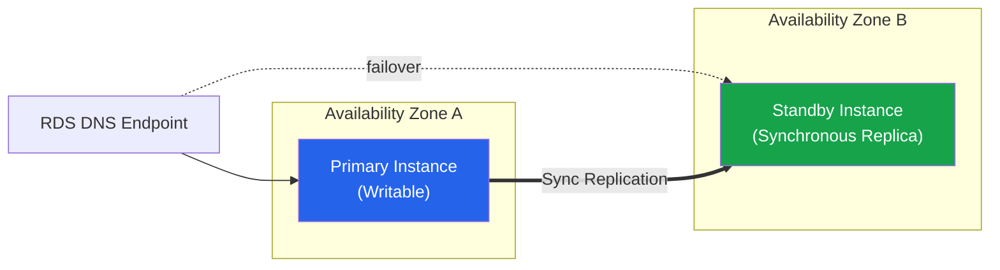
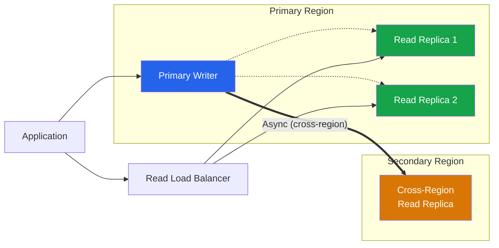

# RDS Best Practices

## Engine Selection

### Engine Comparison

| Engine | Type | Use Case | Managed Alternative |
|--------|------|----------|-------------------|
| **Amazon Aurora** | MySQL/PostgreSQL compatible | High performance, enterprise | Aurora Serverless v2 |
| **MySQL** | Open-source relational | General purpose, wide compatibility | — |
| **PostgreSQL** | Open-source relational | Complex queries, extensions, JSON | — |
| **MariaDB** | MySQL fork | Compatibility with MySQL apps | — |
| **Oracle** | Commercial relational | Enterprise, legacy applications | — |
| **SQL Server** | Commercial relational | Microsoft ecosystem, .NET apps | — |

### Aurora Features

| Feature | Aurora MySQL | Aurora PostgreSQL | Benefit |
|---------|-------------|-------------------|---------|
| **Storage** | Auto-scaling up to 128 TB | Auto-scaling up to 128 TB | No provisioning needed |
| **Replication** | 6x async, no I/O impact | Synchronous within cluster | High durability |
| **Read Replicas** | Up to 15 Aurora Replicas | Up to 15 Aurora Replicas | Read scaling |
| **Multi-Master** | Deprecated (not available for new clusters) | No | Legacy active-active option; use Aurora Global Database or standard replicas instead |
| **Serverless v2** | Yes | Yes | Auto-scaling compute |
| **Global Database** | Yes | Yes | Cross-region replication |

---

## Instance Sizing

### Instance Classes

| Class | Generation | vCPU Range | Memory Range | Use Case |
|-------|-----------|-----------|--------------|----------|
| **db.t4g** | Graviton 2 | 2-8 | 1-32 GB | Burstable, dev/test |
| **db.m6g** | Graviton 2 | 2-64 | 8-256 GB | General purpose |
| **db.r6g** | Graviton 2 | 4-64 | 32-512 GB | Memory-intensive |
| **db.x2gd** | Graviton 2, local NVMe | 4-64 | 32-512 GB | High I/O, caching |
| **db.m7g** | Graviton 3 | 2-48 | 8-192 GB | Next-gen general purpose |
| **db.r7g** | Graviton 3 | 4-48 | 32-384 GB | Next-gen memory-optimized |

### Sizing Guidelines

| Metric | Under-Provisioned | Healthy | Over-Provisioned |
|--------|-------------------|---------|-----------------|
| **CPU Utilization** | > 80% sustained | 30-60% | < 10% sustained |
| **Freeable Memory** | < 10% | 20-50% | > 80% |
| **Read IOPS** | Near provisioned max | 40-70% of max | < 10% of max |
| **Write IOPS** | Near provisioned max | 40-70% of max | < 10% of max |
| **Connection Count** | Near max_connections | 30-60% of max | < 10% of max |

---

## Backup & Recovery

### Backup Options

| Method | RPO | RTO | Storage Cost | Retention |
|--------|-----|-----|-------------|-----------|
| **Automated Backups** | 5 min (transaction logs) | Minutes to hours | 1x DB size | 1-35 days |
| **DB Snapshots** | Point-in-time | Minutes to hours | 1x DB size | Indefinite |
| **PITR** | 5 min | Minutes | Included in automated | Within retention |
| **Aurora Backup** | Near-zero | Seconds | Additional | Cluster lifetime |

### Backup Best Practices

| Practice | Description |
|----------|-------------|
| **Enable automated backups** | Minimum 7-day retention |
| **Set backup window** | During low-traffic period |
| **Test restores regularly** | Validate backup integrity |
| **Cross-region snapshots** | Disaster recovery copies |
| **Snapshot scheduling** | Use EventBridge + Lambda for automation |
| **Encryption** | Enable KMS encryption on all snapshots |

---

## High Availability

### Multi-AZ Deployments

| Feature | Single-AZ | Multi-AZ DB Instance (one standby) | Multi-AZ DB Cluster (two readable standbys) |
|---------|-----------|----------|-----------------|
| **Standby** | None | One synchronous standby (not readable) | Two readable standby instances in separate AZs |
| **Failover Time** | N/A | Typically 60-120 seconds | Typically under 35 seconds |
| **Read Traffic** | Primary only | Standby not for reads | Both standbys can serve reads |
| **Cost** | Base | ~2x base | ~3x base |
| **Use Case** | Dev/test | Production | Critical production, read scaling + fast failover |

### Read Replicas

| Type | Replication | Latency | Use Case |
|------|-------------|---------|----------|
| **In-region Read Replica** | Asynchronous | Milliseconds to seconds | Read scaling |
| **Cross-region Read Replica** | Asynchronous | Seconds to minutes | Disaster recovery, global reads |
| **Aurora Read Replica** | Asynchronous, no I/O impact | Milliseconds | High-performance reads |

### Read Replica Guidelines

| Parameter | Recommendation |
|-----------|---------------|
| **Number of replicas** | Start with 2-3, scale based on read load |
| **Instance size** | Same or smaller than primary |
| **Monitoring** | Track replication lag continuously |
| **Promotion** | Test failover procedures regularly |

---

## Performance Tuning

### Parameter Group Tuning

| Parameter | Purpose | Recommendation |
|-----------|---------|----------------|
| **max_connections** | Maximum concurrent connections | Based on application needs + connection pooling |
| **innodb_buffer_pool_size** | InnoDB data/cache buffer | 50-70% of available RAM |
| **shared_buffers** (PostgreSQL) | Shared memory for caching | 25% of available RAM |
| **effective_cache_size** (PostgreSQL) | Planner cache estimate | 50-75% of available RAM |
| **maintenance_work_mem** | Maintenance operations memory | 1-2 GB for large databases |
| **work_mem** | Per-query sort/hash memory | Start with 4-16 MB |

### Performance Insights

| Feature | Description |
|---------|-------------|
| **Top SQL** | Identify most resource-intensive queries |
| **Load Chart** | Database load over time |
| **Wait Events** | Identify bottlenecks (CPU, I/O, locks) |
| **Custom Metrics** | Application-specific metrics |
| **Integration** | Works with CloudWatch, third-party tools |

### Query Optimization

| Technique | Description | Impact |
|-----------|-------------|--------|
| **Proper indexing** | Cover query patterns with indexes | 10-1000x improvement |
| **Query plans** | Use EXPLAIN to analyze execution | Identify full table scans |
| **Connection pooling** | RDS Proxy (managed) or application-level pooling | Reduce connection overhead, faster failover for apps |
| **Query caching** | Application-level result caching | Reduce repeated queries |
| **Partitioning** | Split large tables by range/hash | Improve query performance |

---

## Security

### Security Checklist

| Control | Implementation | Priority |
|---------|---------------|----------|
| **VPC placement** | Private subnets only | CRITICAL |
| **Encryption at rest** | KMS encryption enabled | CRITICAL |
| **Encryption in transit** | SSL/TLS required | HIGH |
| **IAM DB Authentication** | IAM instead of native auth | HIGH |
| **Security groups** | Restrict to application SGs | HIGH |
| **Parameter group** | Disable weak ciphers, enforce SSL | HIGH |
| **Audit logging** | Enable general/query logs | MEDIUM |
| **Automatic patching** | Enable minor version upgrades | MEDIUM |

### IAM Authentication

| Feature | Description |
|---------|-------------|
| **IAM DB Auth** | Use IAM credentials instead of passwords |
| **Token lifetime** | 15 minutes default |
| **IAM policy** | rds-db:connect action on DB ARN |
| **Support** | MySQL, PostgreSQL, MariaDB |

---

## Cost Optimization

| Strategy | Description | Potential Savings |
|----------|-------------|-------------------|
| **Reserved Instances** | 1 or 3-year commitment | Up to 70% |
| **Savings Plans** | Compute commitment | Up to 65% |
| **Right-sizing** | Match instance to workload | 20-50% |
| **Aurora Serverless v2** | Auto-scale based on load | 30-60% for variable workloads |
| **Storage auto-scaling** | Avoid over-provisioned storage | 10-30% |
| **Snapshot lifecycle** | Automate old snapshot deletion | Varies |
| **Graviton instances** | ARM-based, better price/performance | 20% better price/performance |

### Storage Types

| Type | Description | Use Case |
|------|-------------|----------|
| **Magnetic** | Legacy, low performance | Legacy systems only |
| **GP2** | General purpose SSD | Older deployments |
| **GP3** | General purpose SSD, independent IOPS | Default choice |
| **Provisioned IOPS (io2)** | High-performance SSD (io1 is legacy, use io2) | I/O-intensive workloads |

---

## Patching & Maintenance

| Setting | Recommendation | Reason |
|---------|---------------|--------|
| **Auto minor version upgrade** | Enabled | Security patches applied automatically |
| **Maintenance window** | Low-traffic period | Minimize disruption |
| **Major version upgrade** | During planned maintenance | Test in non-production first |
| **Blue/Green deployments** | Use for major upgrades | Zero-downtime upgrades |

### Blue/Green Deployment

| Phase | Action | Downtime |
|-------|--------|----------|
| 1 | Create green environment (new version) | None |
| 2 | Validate green environment | None |
| 3 | Switch traffic to green | Brief (DNS/connection) |
| 4 | Monitor green environment | None |
| 5 | Revert to blue if issues | Brief |

---

## Monitoring

### Key Metrics

| Metric | Warning Threshold | Critical Threshold |
|--------|-------------------|-------------------|
| `CPUUtilization` | > 70% for 5 min | > 90% for 5 min |
| `FreeableMemory` | < 20% | < 10% |
| `ReadLatency` | > 10ms | > 50ms |
| `WriteLatency` | > 10ms | > 50ms |
| `DatabaseConnections` | > 70% of max | > 90% of max |
| `ReplicaLag` | > 1 second | > 10 seconds |
| `BurstBalance` (GP2) | < 20% | < 10% |
| `VolumeReadOps` / `VolumeWriteOps` | Baseline + 2σ | Baseline + 3σ |

### Enhanced Monitoring

| Feature | Interval | Use Case |
|---------|----------|----------|
| **Basic Monitoring** | 15 seconds | Standard metrics |
| **Enhanced Monitoring** | 1 second | Detailed OS-level metrics |
| **Performance Insights** | Continuous | Query-level analysis |
| **OS Metrics** | 15-60 seconds | CPU, memory, disk, network |
