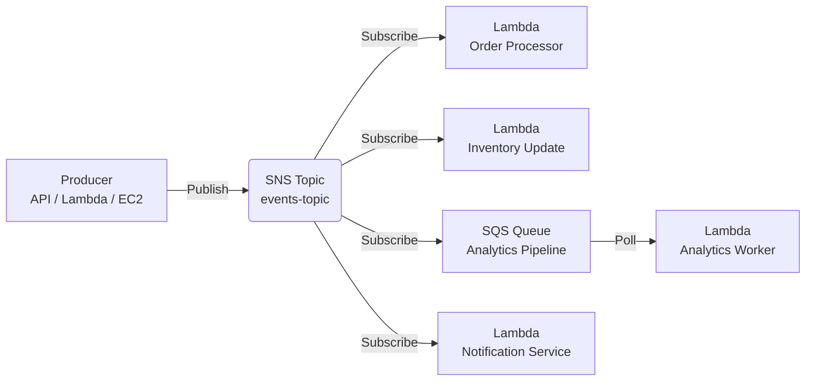
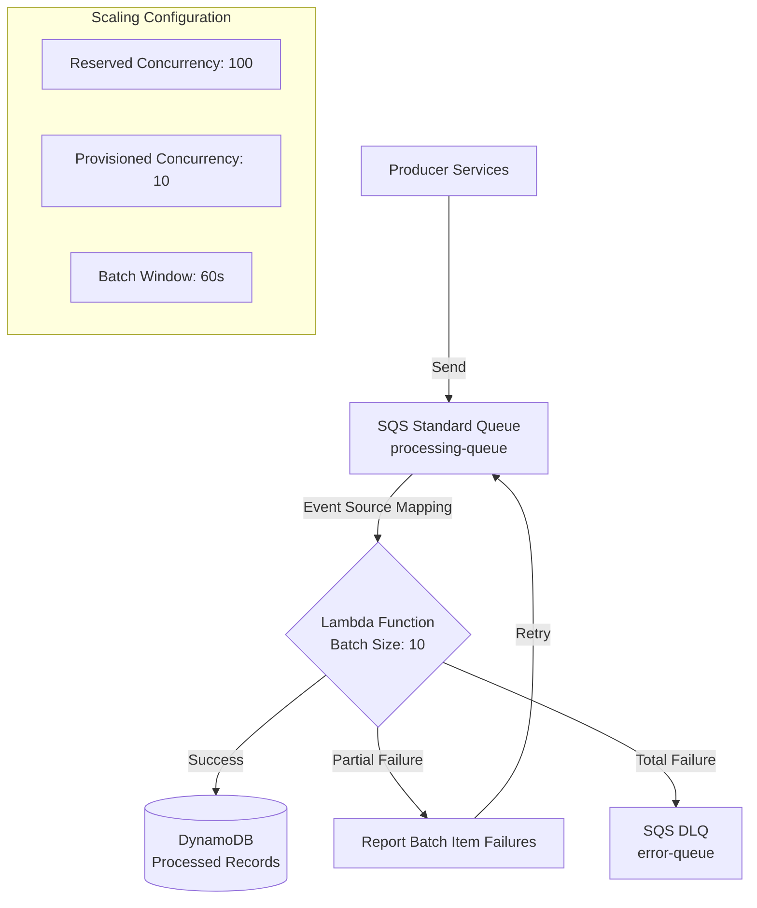
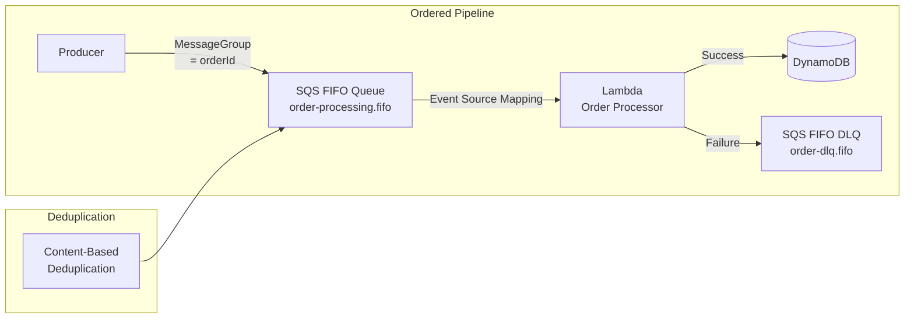
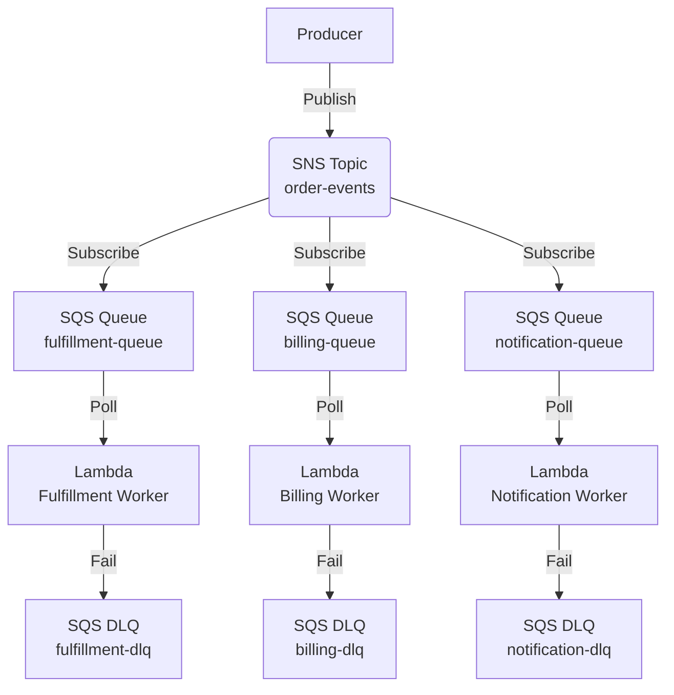
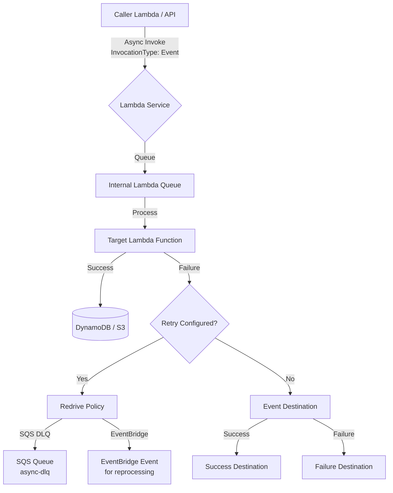
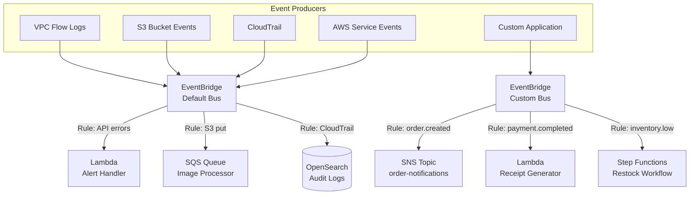
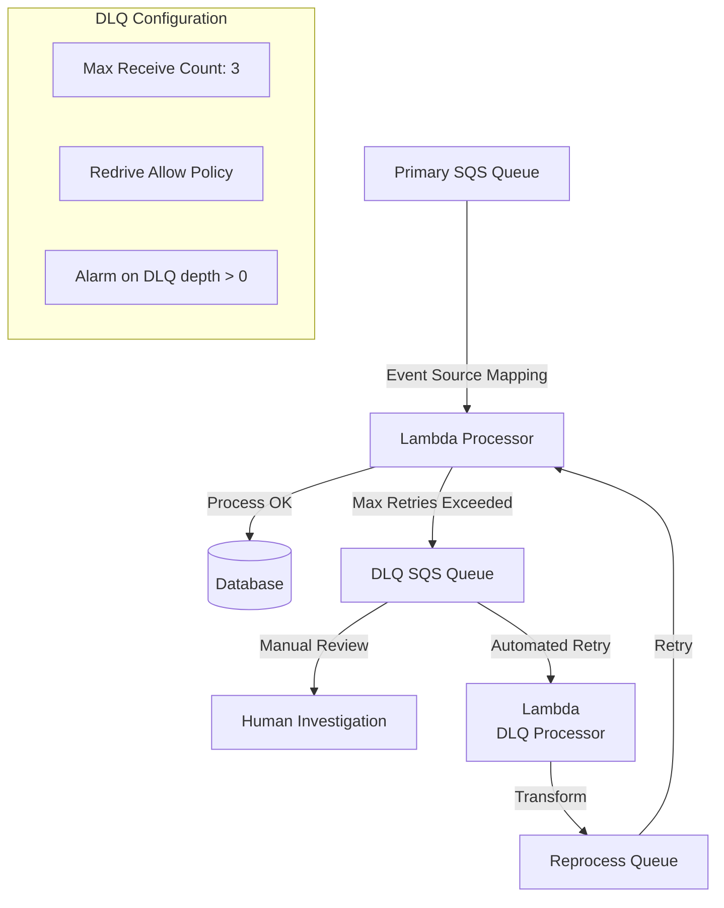

# Event-Driven Architecture Patterns

## Overview

Event-driven architecture (EDA) is a software design pattern where components communicate through the production and consumption of events. AWS provides a robust set of services — Lambda, SNS, SQS, and EventBridge — that form the backbone of enterprise-grade event-driven systems.

---

## Core Services Comparison

| Service | Type | Delivery Guarantee | Ordering | Max Payload | Retention | Use Case |
|---------|------|-------------------|----------|-------------|-----------|----------|
| **SNS** | Pub/Sub (push) | At-least-once | None | 256 KB | N/A (push) | Fan-out, notifications, broadcast |
| **SQS Standard** | Queue (pull) | At-least-once | Best-effort FIFO | 256 KB | 1-14 days | Async processing, decoupling |
| **SQS FIFO** | Queue (pull) | Exactly-once (with Lambda ESM) | Strict FIFO | 256 KB | 1-14 days | Ordered processing, deduplication |
| **EventBridge** | Event bus (push) | At-least-once | None | 256 KB | Configurable (archive) | Event routing, service integration |
| **Kinesis Data Streams** | Stream (pull) | At-least-once | Per shard | 1 MB | 24h-365 days | High-throughput ordered streaming |
| **Lambda** | Compute (trigger) | At-least-once | Depends on trigger | 6 MB (sync) / 128 KB (async) | N/A | Event processing, transformation |

---

## Pattern 1: Basic Pub-Sub Fan-Out

Use when a single event needs to trigger multiple independent downstream processors.



### Decision Criteria

| Factor | Recommendation |
|--------|---------------|
| Number of consumers | 2+ independent consumers |
| Consumer coupling | Loose — consumers don't depend on each other |
| Failure isolation | High — one consumer failure doesn't affect others |
| Cost model | Pay per notification delivered |

### Best Practices

- Set **DeliveryPolicy** with exponential backoff on each SNS subscription
- Use **MessageAttributes** for filtering at the SNS level (filters apply to `MessageAttributes`, not message body)
- Make Lambda consumers **idempotent** — SNS delivers at-least-once (see `03-error-handling-patterns.md` for idempotency patterns)
- Use **Dead-Letter Queues (DLQ)** on each Lambda for failed processing
- HTTP/HTTPS/email subscribers require confirmation; use `RawMessageDelivery` for Lambda/SQS to avoid envelope wrapping

### When NOT to Use

- Don't use when consumers depend on each other's output — use Step Functions instead
- Don't use for high-throughput ordered events — consider Kinesis Data Streams

---

## Pattern 2: SQS Work Queue with Lambda

Use when you need reliable async message processing with backpressure control.



### SQS Event Source Mapping Parameters

| Parameter | Value | Purpose |
|-----------|-------|---------|
| `BatchSize` | 1-10 | Messages per Lambda invocation |
| `MaximumBatchingWindow` | 0-300s | Buffer time for larger batches (longer window = fewer invocations but higher latency) |
| `MaximumConcurrency` | 1-10000 | Parallel Lambda invocations |
| `MaximumRetryAttempts` | 0-10000 | Retries before DLQ |
| `FunctionResponseTypes` | `ReportBatchItemFailures` | Partial batch failure reporting |

### When NOT to Use

- Don't use when real-time processing is required — consider synchronous invocation (see `02-communication-patterns.md`)
- Don't use for events that must be processed exactly once without retries — use FIFO with idempotency

### Provisioned Mode (High-Throughput Workloads)

```
EPS per event poller = min(
    ceiling(1024 / avg_event_size_KB),
    ceiling(10 / avg_function_duration_s) * batch_size,
    min(100, 10 * batch_size)
)

Required pollers = Peak_EPS / EPS_per_poller

Example: For 5 KB messages, 2s Lambda duration, batch size 10:
    EPS per poller = min(204, 50, 100) = 50
    For 500 peak EPS: Required pollers = 500 / 50 = 10
```

| Workload Profile | Min Pollers | Max Pollers | Max Concurrent Invocations |
|-----------------|-------------|-------------|---------------------------|
| Low throughput | 2 | 200 | Scales at default rate |
| Medium throughput | 10 | 1000 | 3x faster scaling |
| High throughput | 100 | 10000 | Up to 1,000 concurrent invocations |

---

## Pattern 3: FIFO Processing Pipeline

Use when strict ordering and exactly-once processing are required.



### FIFO Queue Configuration

| Setting | Value | Effect |
|---------|-------|--------|
| `FifoQueue` | true | Enables FIFO semantics |
| `ContentBasedDeduplication` | true | Uses SHA-256 of message body |
| `MessageGroupId` | Business key | Groups related messages |
| `MessageDeduplicationId` | Unique ID | Prevents duplicate processing |
| Visibility Timeout | 30-600s | Must exceed Lambda timeout |

### Critical Rules

- **Same MessageGroupId** = same consumer instance = strict ordering
- **Different MessageGroupId** = parallel processing = no ordering guarantee
- Lambda concurrency is **limited to 1 per MessageGroupId** in FIFO mode
- Set visibility timeout > Lambda timeout + buffer
- SQS FIFO queue size limit: 256 GB per queue — relevant for backpressure planning

### When NOT to Use

- Don't use when strict ordering isn't required — SQS Standard offers higher throughput
- Don't use for high-volume events with many unique MessageGroupIds — ordering overhead degrades throughput

---

## Pattern 4: SNS to SQS Decoupling

Use when you need fan-out with buffering and independent consumer scaling.



### Why This Pattern?

| Benefit | Description |
|---------|-------------|
| **Independent scaling** | Each SQS queue scales its Lambda independently |
| **Backpressure isolation** | Slow billing doesn't block fulfillment |
| **Redelivery control** | Each queue has its own visibility timeout and retry policy |
| **Consumer flexibility** | Different consumers can use different technologies |

### When NOT to Use

- Don't use when a single consumer can handle all events — direct SNS→Lambda is simpler
- Don't use for low-volume events where SQS cost outweighs buffering benefits

### SNS Filter Policy Example

```json
{
  "event_type": ["order.created", "order.updated"],
  "priority": ["high", "critical"]
}
```

Note: Filter policies match against `MessageAttributes` set at publish time, not the message body.

```json
// Publish with matching MessageAttributes
{
  "Message": "Order created",
  "MessageAttributes": {
    "event_type": { "DataType": "String", "StringValue": "order.created" },
    "priority": { "DataType": "String", "StringValue": "high" }
  }
}
```

---

## Pattern 5: Async Lambda Invocation with Retry

Use when calling Lambda directly without SNS/SQS intermediary.



### Async Invocation Configuration

| Setting | Value | Purpose |
|---------|-------|---------|
| `InvocationType` | `Event` | Fire-and-forget |
| `Qualifier` | Alias/Version | Target specific version |
| `DestinationConfig.OnSuccess` | SQS/EventBridge | Track successful invocations |
| `DestinationConfig.OnFailure` | SQS/EventBridge | Handle failed invocations |
| `MaximumRetryAttempts` | 0-2 | Lambda retries 2 and 5 minutes after failure, then sends to DLQ |
| `MaximumEventAge` | 0-21600s | Discard old events |

### When NOT to Use

- Don't use for requests requiring immediate response — use synchronous invocation
- Don't use for payloads > 128 KB — use SQS or SNS intermediary

---

## Pattern 6: EventBridge Event Router

Use for centralized event routing across AWS services and custom targets.



### EventBridge Rule Types

| Rule Type | Match Strategy | Use Case |
|-----------|---------------|----------|
| **Event pattern** | JSON path matching | AWS service events |
| **Schedule/Cron** | Time-based | Scheduled Lambda invocations |
| **Event pattern + Archive** | Replay historical events | Debugging, reprocessing |

### EventBridge Schema Registry

Use Schema Registry for event contract management, validation, and SDK generation across services.

### When NOT to Use

- Don't use for high-throughput ordered streaming — consider Kinesis Data Streams
- Don't use when simple point-to-point messaging suffices — SQS is simpler and cheaper

### EventBridge Pipes

EventBridge Pipes connects sources (SQS, DynamoDB Streams, Kinesis, API Gateway) directly to destinations (Lambda, SQS, SNS, EventBridge, HTTP) without Lambda. Useful for simple routing without compute overhead.

### Cross-Region Event Routing

EventBridge supports global endpoints for cross-region event replication, enabling multi-region event-driven architectures.

---

## Pattern 7: Dead-Letter Queue (DLQ) Strategy

Every event-driven system needs a DLQ strategy for poison pill handling.



### DLQ Configuration Matrix

| Source | DLQ Target | Redrive Setting | Monitoring |
|--------|-----------|-----------------|------------|
| SQS → Lambda | SQS DLQ | `MaxReceiveCount` = 3 | CloudWatch Alarm |
| SNS → Lambda | SQS DLQ | `MaximumRetryAttempts` = 3 | CloudWatch Alarm |
| Async Lambda | SQS/EventBridge | `DestinationConfig.OnFailure` | CloudWatch Logs |
| EventBridge | Archive + Rule | N/A | Management Events |

### When NOT to Use DLQ

- Don't use DLQ for expected errors — classify and handle in-code (see `03-error-handling-patterns.md`)
- Don't use a single DLQ for all services — use per-service DLQs for easier diagnosis

---

## Anti-Patterns to Avoid

| Anti-Pattern | Problem | Solution |
|-------------|---------|----------|
| **Synchronous Lambda chaining** | Timeout cascades, cold starts multiply | Use SQS or SNS for decoupling |
| **Large SQS batches** | Long Lambda execution, higher memory waste | Batch size 10-100, tune per workload |
| **No DLQ** | Lost messages, silent failures | Always configure DLQ |
| **Non-idempotent handlers** | Duplicate processing causes data corruption | Use idempotency keys, DynamoDB conditional writes |
| **SNS direct to Lambda without DLQ** | Failed invocations are lost | Add SQS buffer or Lambda DLQ |
| **Tight coupling via direct API calls** | Single point of failure, no backpressure | Introduce message queue |
