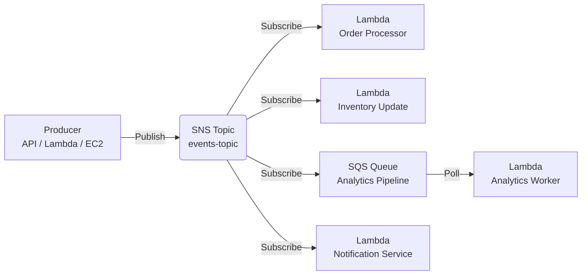
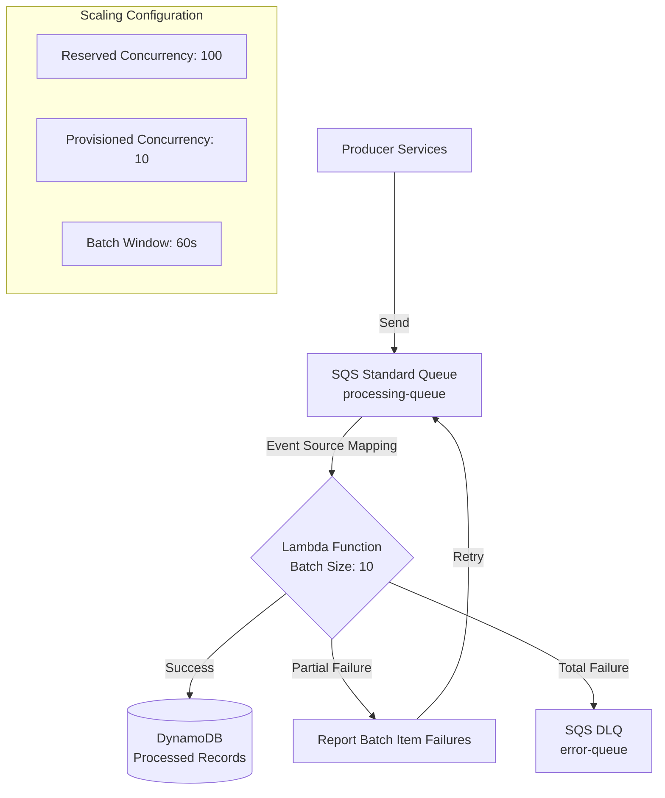
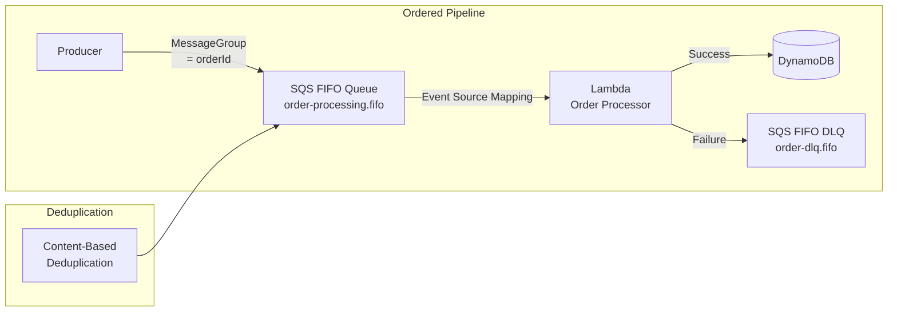
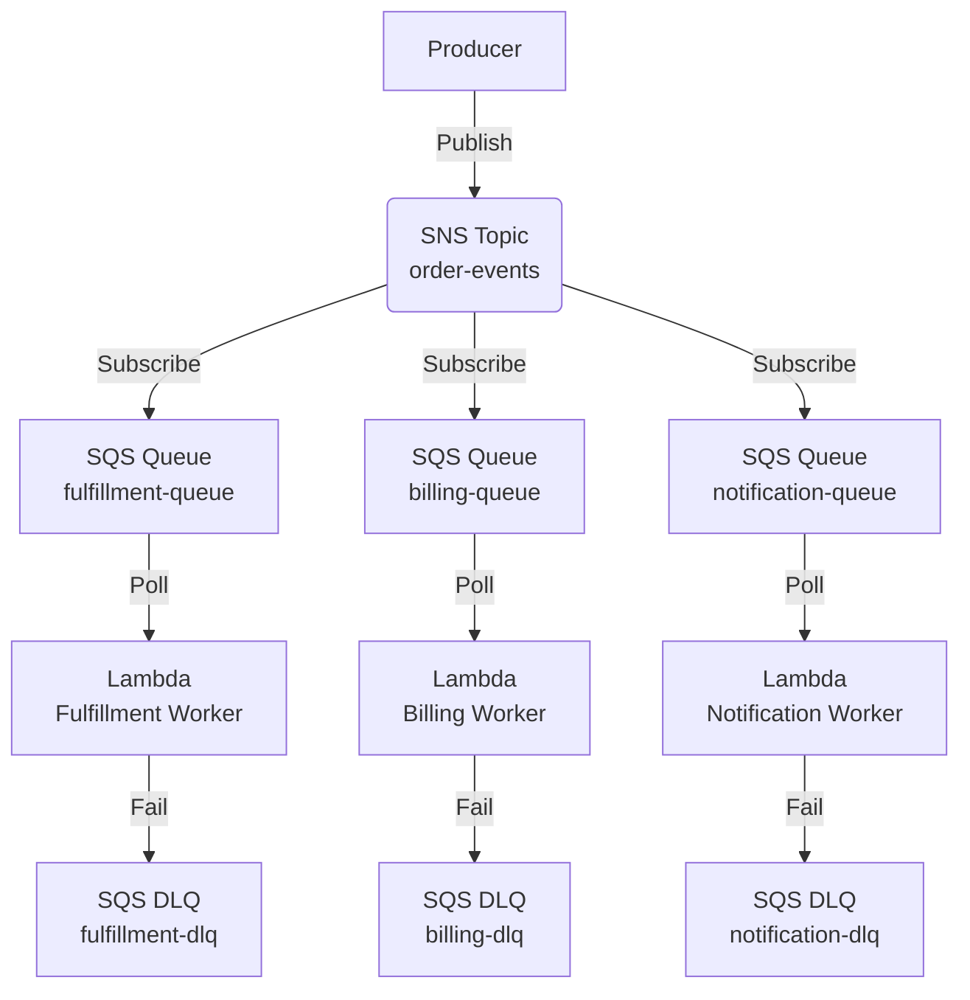
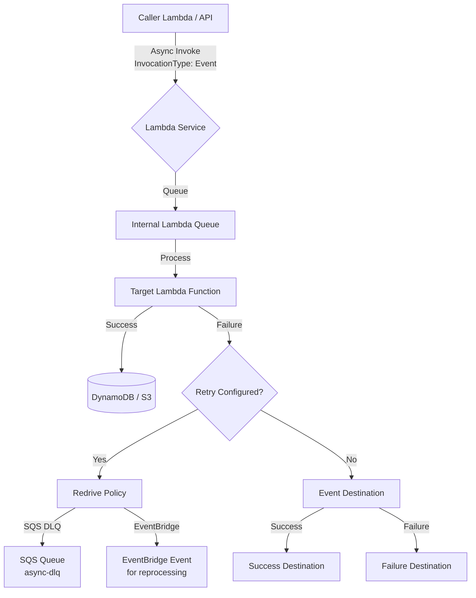
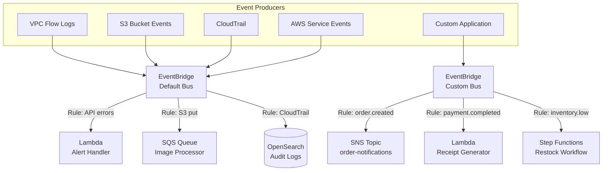
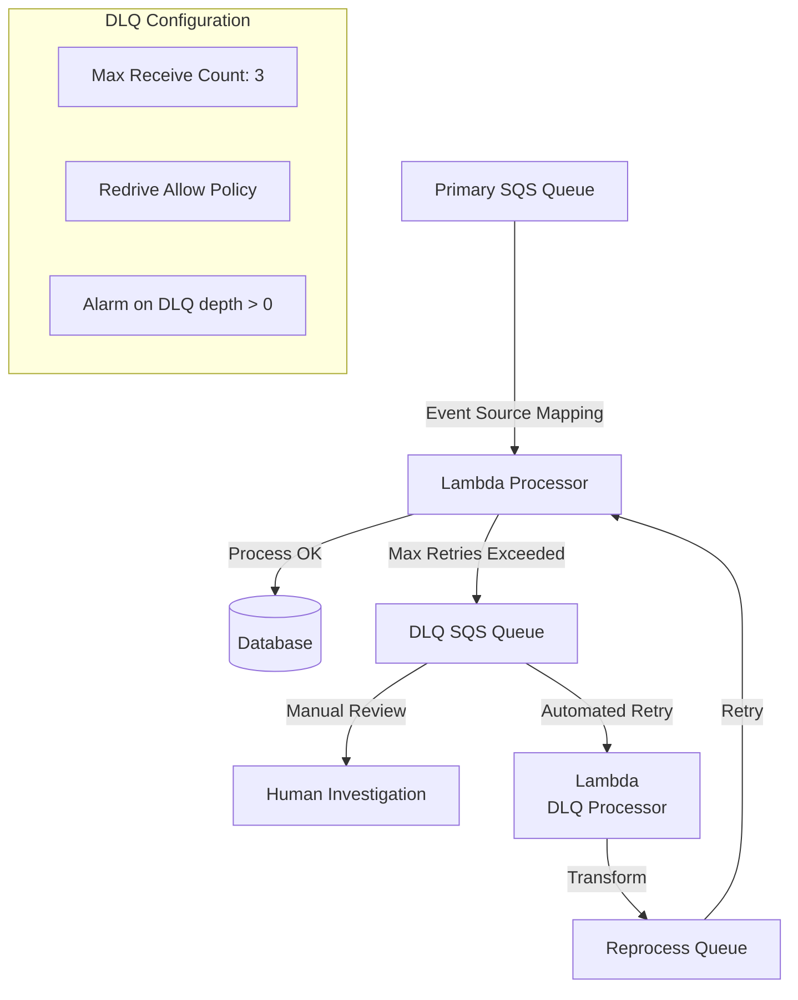

# Event-Driven Architecture Patterns

## Overview

Event-driven architecture (EDA) is a software design pattern where components communicate through the production and consumption of events. AWS provides a robust set of services — Lambda, SNS, SQS, and EventBridge — that form the backbone of enterprise-grade event-driven systems.

---

## Table of Contents

- [Core Services Comparison](#core-services-comparison)
- [Pattern 1: Basic Pub-Sub Fan-Out](#pattern-1-basic-pub-sub-fan-out)
- [Pattern 2: SQS Work Queue with Lambda](#pattern-2-sqs-work-queue-with-lambda)
- [Pattern 3: FIFO Processing Pipeline](#pattern-3-fifo-processing-pipeline)
- [Pattern 4: SNS to SQS Decoupling](#pattern-4-sns-to-sqs-decoupling)
- [Pattern 5: Async Lambda Invocation with Retry](#pattern-5-async-lambda-invocation-with-retry)
- [Pattern 6: EventBridge Event Router](#pattern-6-eventbridge-event-router)
- [Pattern 7: Dead-Letter Queue (DLQ) Strategy](#pattern-7-dead-letter-queue-dlq-strategy)
- [Anti-Patterns to Avoid](#anti-patterns-to-avoid)

---

## Core Services Comparison

Key delivery, ordering, and payload characteristics of the core AWS event-driven services, to help pick the right building block.

| Service | Type | Delivery Guarantee | Ordering | Max Payload | Retention | Use Case |
|---------|------|-------------------|----------|-------------|-----------|----------|
| **SNS** | Pub/Sub (push) | At-least-once | None | 256 KB | N/A (push) | Fan-out, notifications, broadcast |
| **SQS Standard** | Queue (pull) | At-least-once | Best-effort FIFO | 1 MiB (raised from 256 KB, Aug 2025) | 1-14 days | Async processing, decoupling |
| **SQS FIFO** | Queue (pull) | Exactly-once (with Lambda ESM) | Strict FIFO | 1 MiB (raised from 256 KB, Aug 2025) | 1-14 days | Ordered processing, deduplication |
| **EventBridge** | Event bus (push) | At-least-once | None | 1 MB (raised from 256 KB, Jan 2026) | Configurable (archive) | Event routing, service integration |
| **Kinesis Data Streams** | Stream (pull) | At-least-once | Per shard | 1 MB | 24h-365 days | High-throughput ordered streaming |
| **Lambda** | Compute (trigger) | At-least-once | Depends on trigger | 6 MB (sync) / 1 MB (async, raised from 256 KB, Oct 2025) | N/A | Event processing, transformation |

---

## Pattern 1: Basic Pub-Sub Fan-Out

Use when a single event needs to trigger multiple independent downstream processors.



### Why This Pattern?

Without fan-out, a producer that needs three things to happen after an event (update inventory, send a notification, feed analytics) either calls each consumer directly — coupling the producer to every consumer's availability and API — or one "orchestrator" consumer calls the others, becoming a single point of failure. Publishing once to an SNS topic removes that coupling: the producer doesn't know or care how many subscribers exist, new consumers subscribe without any producer change or redeploy, and one subscriber's outage doesn't block delivery to the others.

**Trade-off:** SNS gives no ordering guarantee and at-least-once delivery, so every subscriber must tolerate duplicates and out-of-order arrival. SNS also doesn't buffer — a subscriber that's down when the message is published needs its own DLQ/retry policy to avoid silently losing that delivery.

### Decision Criteria

Signals that indicate this fan-out pattern is the right fit.

| Factor | Recommendation |
|--------|---------------|
| Number of consumers | 2+ independent consumers |
| Consumer coupling | Loose — consumers don't depend on each other |
| Failure isolation | High — one consumer failure doesn't affect others |
| Cost model | Pay per notification delivered |

### Best Practices

- Set **DeliveryPolicy** with exponential backoff on each SNS subscription
- Use **MessageAttributes** for filtering at the SNS level (filters apply to `MessageAttributes`, not message body)
- Make Lambda consumers **idempotent** — SNS delivers at-least-once (see `03-error-handling-patterns.md` for idempotency patterns)
- Use **Dead-Letter Queues (DLQ)** on each Lambda for failed processing
- HTTP/HTTPS/email subscribers require confirmation; use `RawMessageDelivery` for Lambda/SQS to avoid envelope wrapping

### When NOT to Use

- Don't use when consumers depend on each other's output — use Step Functions instead
- Don't use for high-throughput ordered events — consider Kinesis Data Streams

---

## Pattern 2: SQS Work Queue with Lambda

Use when you need reliable async message processing with backpressure control.



### Why This Pattern?

Calling Lambda directly (or any synchronous downstream call) ties the producer's response time to however long processing takes, and a burst of incoming requests either overwhelms the consumer's concurrency or gets rejected outright — there's nothing absorbing the spike. Putting an SQS queue in front of Lambda decouples the producer's send rate from the consumer's processing rate: producers enqueue and move on immediately, and Lambda drains the queue at a pace it controls (via `MaximumConcurrency`, batch size, batching window), turning a traffic spike into a longer, safer processing tail instead of dropped or throttled requests.

**Trade-off:** processing is no longer immediate — callers get eventual completion, not a synchronous result — and queue depth becomes a metric you must monitor, since a queue that grows faster than it drains is a silent backlog rather than a visible error.

### SQS Event Source Mapping Parameters

Key event source mapping settings that control batching, concurrency, and retry behavior between SQS and Lambda.

| Parameter | Value | Purpose |
|-----------|-------|---------|
| `BatchSize` | 1-10 | Messages per Lambda invocation |
| `MaximumBatchingWindow` | 0-300s | Buffer time for larger batches (longer window = fewer invocations but higher latency) |
| `MaximumConcurrency` | 1-10000 | Parallel Lambda invocations |
| Queue `RedrivePolicy.maxReceiveCount` | 1-1000 | Retries before message moves to DLQ (SQS does not support Lambda's `MaximumRetryAttempts` ESM parameter — that applies only to stream sources like Kinesis/DynamoDB Streams) |
| `FunctionResponseTypes` | `ReportBatchItemFailures` | Partial batch failure reporting |

### When NOT to Use

- Don't use when real-time processing is required — consider synchronous invocation (see `02-communication-patterns.md`)
- Don't use for events that must be processed exactly once without retries — use FIFO with idempotency

### Provisioned Mode (High-Throughput Workloads)

```
EPS per event poller = min(
    ceiling(1024 / avg_event_size_KB),
    ceiling(10 / avg_function_duration_s) * batch_size,
    min(100, 10 * batch_size)
)

Required pollers = Peak_EPS / EPS_per_poller

Example: For 5 KB messages, 2s Lambda duration, batch size 10:
    EPS per poller = min(204, 50, 100) = 50
    For 500 peak EPS: Required pollers = 500 / 50 = 10
```

Recommended poller range and concurrency ceiling by workload profile:

| Workload Profile | Min Pollers | Max Pollers | Max Concurrent Invocations |
|-----------------|-------------|-------------|---------------------------|
| Low throughput | 2 | 200 | Scales at default rate |
| Medium throughput | 10 | 1000 | 3x faster scaling |
| High throughput | 100 | 10000 | Up to 1,000 concurrent invocations |

---

## Pattern 3: FIFO Processing Pipeline

Use when strict ordering and exactly-once processing are required.



### Why This Pattern?

SQS Standard and SNS only guarantee at-least-once delivery with best-effort ordering — acceptable for independent events, but not for a sequence of state transitions on the same entity (e.g., "order created" must be applied before "order cancelled" for the same order, or duplicate delivery of "charge card" must not double-charge). Processing those out of order or twice corrupts state rather than just duplicating work. FIFO queues fix this by guaranteeing strict in-order delivery and exactly-once processing within a `MessageGroupId`, so events for the same business key (e.g., order ID) are always applied in the sequence they were sent, exactly once.

**Trade-off:** ordering is enforced by limiting Lambda to one concurrent consumer per `MessageGroupId`, so overall throughput is bounded by how many distinct group IDs you have and FIFO queues have a lower overall throughput ceiling than Standard — don't reach for FIFO unless ordering/dedup is an actual requirement, not just a "safer default."

### FIFO Queue Configuration

Settings that enforce ordering and exactly-once semantics on the queue.

| Setting | Value | Effect |
|---------|-------|--------|
| `FifoQueue` | true | Enables FIFO semantics |
| `ContentBasedDeduplication` | true | Uses SHA-256 of message body |
| `MessageGroupId` | Business key | Groups related messages |
| `MessageDeduplicationId` | Unique ID | Prevents duplicate processing |
| Visibility Timeout | 30-600s | Must exceed Lambda timeout |

### Critical Rules

- **Same MessageGroupId** = same consumer instance = strict ordering
- **Different MessageGroupId** = parallel processing = no ordering guarantee
- Lambda concurrency is **limited to 1 per MessageGroupId** in FIFO mode
- Set visibility timeout > Lambda timeout + buffer
- SQS FIFO in-flight message limit: 120,000 messages per queue (raised from 20,000 in Nov 2024) — relevant for backpressure planning

### When NOT to Use

- Don't use when strict ordering isn't required — SQS Standard offers higher throughput
- Don't use for high-volume events with many unique MessageGroupIds — ordering overhead degrades throughput

---

## Pattern 4: SNS to SQS Decoupling

Use when you need fan-out with buffering and independent consumer scaling.



### Why This Pattern?

Benefits of routing through per-consumer SQS queues instead of delivering directly from SNS.

| Benefit | Description |
|---------|-------------|
| **Independent scaling** | Each SQS queue scales its Lambda independently |
| **Backpressure isolation** | Slow billing doesn't block fulfillment |
| **Redelivery control** | Each queue has its own visibility timeout and retry policy |
| **Consumer flexibility** | Different consumers can use different technologies |

### When NOT to Use

- Don't use when a single consumer can handle all events — direct SNS→Lambda is simpler
- Don't use for low-volume events where SQS cost outweighs buffering benefits

### SNS Filter Policy Example

```json
{
  "event_type": ["order.created", "order.updated"],
  "priority": ["high", "critical"]
}
```

Note: Filter policies match against `MessageAttributes` set at publish time, not the message body.

```json
// Publish with matching MessageAttributes
{
  "Message": "Order created",
  "MessageAttributes": {
    "event_type": { "DataType": "String", "StringValue": "order.created" },
    "priority": { "DataType": "String", "StringValue": "high" }
  }
}
```

---

## Pattern 5: Async Lambda Invocation with Retry

Use when calling Lambda directly without SNS/SQS intermediary.



### Why This Pattern?

A synchronous Lambda invocation blocks the caller until the target finishes, so a slow or failing downstream function directly costs the caller time and money, and a chain of synchronous calls (Lambda → Lambda → Lambda) multiplies timeouts and cold starts across every hop. Asynchronous invocation removes that coupling with no extra infrastructure to stand up: Lambda queues the event internally, retries transient failures for you (twice, with backoff), and lets you route success/failure outcomes to a destination — the caller fires the event and returns immediately.

**Trade-off:** the internal queue is fully managed by AWS and opaque — there's no visibility into its depth and no way to tune batching or concurrency the way you can with an explicit SQS queue — so for high-throughput or bursty workloads where you need backpressure control, use an explicit SQS/SNS intermediary (Pattern 2 or Pattern 4) instead of relying on Lambda's built-in async queue.

### Async Invocation Configuration

Key parameters for controlling retries, event age, and success/failure routing on async Lambda invocations.

| Setting | Value | Purpose |
|---------|-------|---------|
| `InvocationType` | `Event` | Fire-and-forget |
| `Qualifier` | Alias/Version | Target specific version |
| `DestinationConfig.OnSuccess` | SQS/EventBridge | Track successful invocations |
| `DestinationConfig.OnFailure` | SQS/EventBridge | Handle failed invocations |
| `MaximumRetryAttempts` | 0-2 | Lambda retries 2 and 5 minutes after failure, then sends to DLQ |
| `MaximumEventAge` | 0-21600s | Discard old events |

### When NOT to Use

- Don't use for requests requiring immediate response — use synchronous invocation
- Don't use for payloads > 1 MB (current Lambda async invocation limit, raised from 256 KB in Oct 2025) — use SQS or SNS intermediary. Note SNS message size remains capped at 256 KB.

---

## Pattern 6: EventBridge Event Router

Use for centralized event routing across AWS services and custom targets.



### Why This Pattern?

As a system accumulates event producers (AWS services, custom apps) and consumers, hardcoding each producer-to-consumer relationship creates an N×M web of point-to-point integrations — every new consumer means changing producer code, and every producer needs to know about every consumer that cares about its events. EventBridge decouples this: producers publish once to a bus, and declarative rules (not producer code) decide which consumers receive which events based on event content. Consumers are added, removed, or rerouted by changing rules alone, and EventBridge's native integration with 200+ AWS services means many event sources need no custom producer code at all.

**Trade-off:** the extra routing layer makes it harder to trace an event's full path end-to-end without tracing/observability tooling, and rule evaluation adds a small amount of latency versus a direct point-to-point call — not suitable when you need the lowest-latency, simplest possible producer-to-consumer link.

### EventBridge Rule Types

The three ways an EventBridge rule can select and act on events.

| Rule Type | Match Strategy | Use Case |
|-----------|---------------|----------|
| **Event pattern** | JSON path matching | AWS service events |
| **Schedule/Cron** | Time-based | Scheduled Lambda invocations |
| **Event pattern + Archive** | Replay historical events | Debugging, reprocessing |

### EventBridge Schema Registry

Use Schema Registry for event contract management, validation, and SDK generation across services.

### When NOT to Use

- Don't use for high-throughput ordered streaming — consider Kinesis Data Streams
- Don't use when simple point-to-point messaging suffices — SQS is simpler and cheaper

### EventBridge Pipes

EventBridge Pipes connects sources (SQS, DynamoDB Streams, Kinesis, API Gateway) directly to destinations (Lambda, SQS, SNS, EventBridge, HTTP) without Lambda. Useful for simple routing without compute overhead.

### Cross-Region Event Routing

EventBridge supports global endpoints for cross-region event replication, enabling multi-region event-driven architectures.

---

## Pattern 7: Dead-Letter Queue (DLQ) Strategy

Every event-driven system needs a DLQ strategy for poison pill handling.



### Why This Pattern?

Without a DLQ, a message that can never succeed — a "poison pill" caused by malformed data, an unrecoverable bug, or a downstream outage — either retries forever (burning compute and delaying every message behind it in the queue) or gets silently discarded once retries run out, and either way you lose visibility into what failed and why. Routing exhausted messages to a DLQ instead stops them from blocking the healthy flow while preserving them for inspection, alerting, and deliberate reprocessing.

**Trade-off:** a DLQ is only useful if something watches it — it needs its own alarm on queue depth and a defined reprocessing/triage plan, otherwise failures just accumulate silently in a different queue instead of the original one.

### DLQ Configuration Matrix

How dead-letter handling is wired up per event source.

| Source | DLQ Target | Redrive Setting | Monitoring |
|--------|-----------|-----------------|------------|
| SQS → Lambda | SQS DLQ | `MaxReceiveCount` = 3 | CloudWatch Alarm |
| SNS → Lambda | SQS DLQ | `MaximumRetryAttempts` = 3 | CloudWatch Alarm |
| Async Lambda | SQS/EventBridge | `DestinationConfig.OnFailure` | CloudWatch Logs |
| EventBridge | Archive + Rule | N/A | Management Events |

### When NOT to Use DLQ

- Don't use DLQ for expected errors — classify and handle in-code (see `03-error-handling-patterns.md`)
- Don't use a single DLQ for all services — use per-service DLQs for easier diagnosis

---

## Anti-Patterns to Avoid

Common mistakes in event-driven designs and the recommended fix for each.

| Anti-Pattern | Problem | Solution |
|-------------|---------|----------|
| **Synchronous Lambda chaining** | Timeout cascades, cold starts multiply | Use SQS or SNS for decoupling |
| **Large SQS batches** | Long Lambda execution, higher memory waste | Batch size 10-100, tune per workload |
| **No DLQ** | Lost messages, silent failures | Always configure DLQ |
| **Non-idempotent handlers** | Duplicate processing causes data corruption | Use idempotency keys, DynamoDB conditional writes |
| **SNS direct to Lambda without DLQ** | Failed invocations are lost | Add SQS buffer or Lambda DLQ |
| **Tight coupling via direct API calls** | Single point of failure, no backpressure | Introduce message queue |
