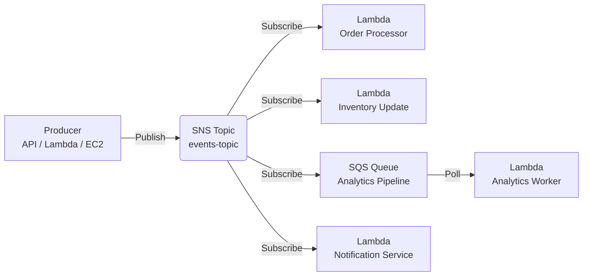
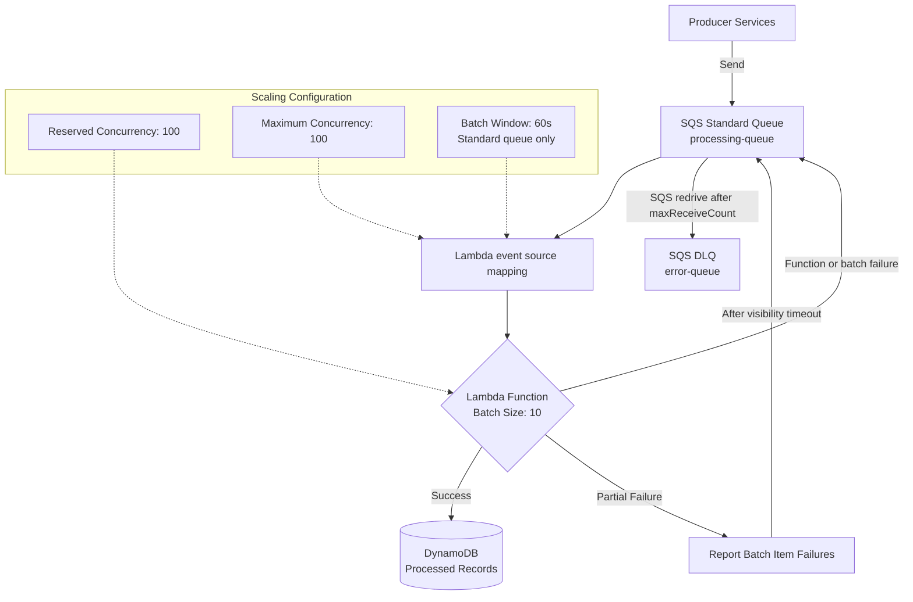
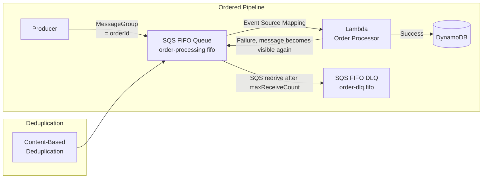
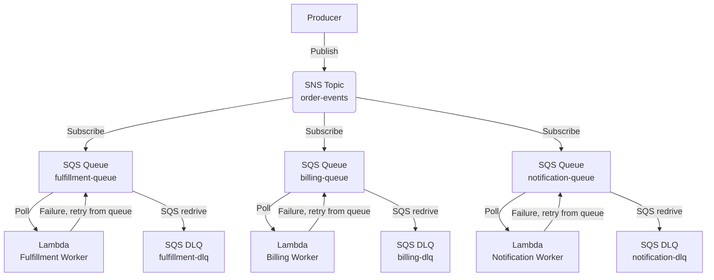
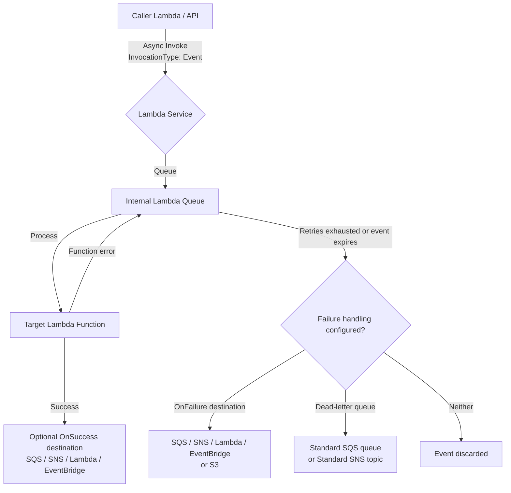
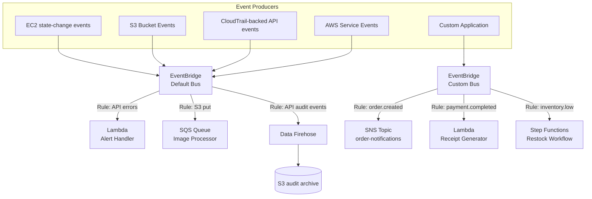
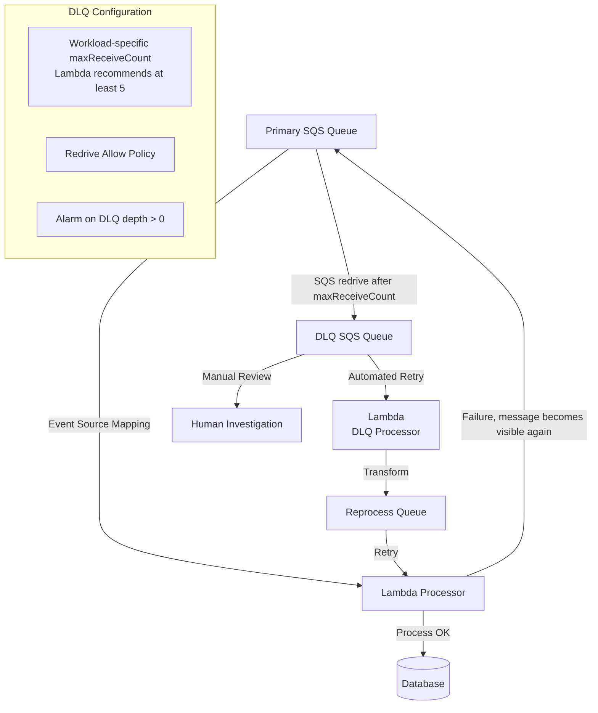

# Event-Driven Architecture Patterns

## Overview

Event-driven architecture (EDA) is a software design pattern where components communicate through the production and consumption of events. AWS provides a robust set of services — Lambda, SNS, SQS, and EventBridge — that form the backbone of enterprise-grade event-driven systems.

---

## Table of Contents

- [Core Services Comparison](#core-services-comparison)
- [Pattern 1: Basic Pub-Sub Fan-Out](#pattern-1-basic-pub-sub-fan-out)
- [Pattern 2: SQS Work Queue with Lambda](#pattern-2-sqs-work-queue-with-lambda)
- [Pattern 3: FIFO Processing Pipeline](#pattern-3-fifo-processing-pipeline)
- [Pattern 4: SNS to SQS Decoupling](#pattern-4-sns-to-sqs-decoupling)
- [Pattern 5: Async Lambda Invocation with Retry](#pattern-5-async-lambda-invocation-with-retry)
- [Pattern 6: EventBridge Event Router](#pattern-6-eventbridge-event-router)
- [Pattern 7: Dead-Letter Queue (DLQ) Strategy](#pattern-7-dead-letter-queue-dlq-strategy)
- [Anti-Patterns to Avoid](#anti-patterns-to-avoid)
- [Authoritative References](#authoritative-references)

---

## Core Services Comparison

Key delivery, ordering, and payload characteristics of the core AWS event-driven services, to help pick the right building block.

| Service | Type | Delivery Guarantee | Ordering | Max Payload | Retention | Use Case |
|---------|------|-------------------|----------|-------------|-----------|----------|
| **SNS Standard** | Pub/Sub (push) | At-least-once | No ordering guarantee | 256 KB | Endpoint-specific retries; optional subscription DLQ | Fan-out, notifications, broadcast |
| **SNS FIFO** | Pub/Sub (push) | At-least-once with five-minute deduplication | Per message group | 256 KB | Optional archive and replay (up to 365 days) | Ordered fan-out to SQS FIFO queues |
| **SQS Standard** | Queue (pull) | At-least-once | Best effort | 1 MiB | 1-14 days | Async processing, decoupling |
| **SQS FIFO** | Queue (pull) | Deduplicated enqueue; Lambda processing remains at-least-once | Per message group | 1 MiB | 1-14 days | Ordered processing, deduplication |
| **EventBridge** | Event bus (push) | At-least-once | No ordering guarantee | Less than 1 MiB total per `PutEvents` request (up to 10 entries) | Optional archive with configurable retention | Event routing, service integration |
| **Kinesis Data Streams** | Stream (pull) | At-least-once | Per shard | 1 MB | 24h-365 days | High-throughput ordered streaming |
| **Lambda** | Compute (trigger) | Depends on invocation source | Depends on trigger | 6 MB (sync) / 1 MB (async) | N/A | Event processing, transformation |

---

## Pattern 1: Basic Pub-Sub Fan-Out

Use when a single event needs to trigger multiple independent downstream processors.



### Why This Pattern?

Without fan-out, a producer that needs three things to happen after an event (update inventory, send a notification, feed analytics) either calls each consumer directly — coupling the producer to every consumer's availability and API — or one "orchestrator" consumer calls the others, becoming a single point of failure. Publishing once to an SNS topic removes that coupling: the producer doesn't know or care how many subscribers exist, new consumers subscribe without any producer change or redeploy, and one subscriber's outage doesn't block delivery to the others.

**Trade-off:** SNS Standard topics provide no ordering guarantee and use at-least-once delivery, so subscribers must tolerate duplicates and out-of-order arrival. A Standard topic is not a durable per-consumer buffer: delivery follows the endpoint-specific retry policy, and a subscription DLQ is needed to retain messages after delivery retries are exhausted. SNS FIFO topics add per-message-group ordering and deduplication, but direct Lambda subscriptions are not supported; fan out through SQS FIFO queues instead.

### Decision Criteria

Signals that indicate this fan-out pattern is the right fit.

| Factor | Recommendation |
|--------|---------------|
| Number of consumers | 2+ independent consumers |
| Consumer coupling | Loose — consumers don't depend on each other |
| Failure isolation | High — one consumer failure doesn't affect others |
| Cost model | Pay per notification delivered |

### Best Practices

- Configure an SNS subscription **redrive policy** with an SQS DLQ; custom delivery policies apply to HTTP/S subscriptions, not Lambda or SQS subscriptions
- Use subscription filter policies with `FilterPolicyScope=MessageAttributes` (default) or `MessageBody` for payload-based filtering
- Make Lambda consumers **idempotent** — SNS delivers at-least-once (see `03-error-handling-patterns.md` for idempotency patterns)
- Configure an SNS subscription DLQ for delivery failures; make the Lambda handler's own processing failures observable with alarms and destinations where applicable
- HTTP/HTTPS/email subscribers require confirmation; raw message delivery is available for SQS and HTTP/S subscriptions, not Lambda subscriptions

### When NOT to Use

- Don't use when consumers depend on each other's output — use Step Functions instead
- Don't use for high-throughput ordered events — consider Kinesis Data Streams

---

## Pattern 2: SQS Work Queue with Lambda

Use when you need reliable async message processing with backpressure control.



### Why This Pattern?

Calling Lambda directly (or any synchronous downstream call) ties the producer's response time to however long processing takes, and a burst of incoming requests either overwhelms the consumer's concurrency or gets rejected outright — there's nothing absorbing the spike. Putting an SQS queue in front of Lambda decouples the producer's send rate from the consumer's processing rate: producers enqueue and move on immediately, and Lambda drains the queue at a pace it controls (via `MaximumConcurrency`, batch size, batching window), turning a traffic spike into a longer, safer processing tail instead of dropped or throttled requests.

**Trade-off:** processing is no longer immediate — callers get eventual completion, not a synchronous result — and queue depth becomes a metric you must monitor, since a queue that grows faster than it drains is a silent backlog rather than a visible error.

### SQS Event Source Mapping Parameters

Key event source mapping settings that control batching, concurrency, and retry behavior between SQS and Lambda.

| Parameter | Value | Purpose |
|-----------|-------|---------|
| `BatchSize` | Standard: up to 10,000; FIFO: up to 10 | Messages per Lambda invocation; a standard-queue batch over 10 requires a batching window of at least 1 second |
| `MaximumBatchingWindowInSeconds` | 0-300 (standard queues only) | Buffer time for larger batches (longer window = fewer invocations but higher latency) |
| `ScalingConfig.MaximumConcurrency` | 2-1,000 | Caps concurrent function instances for this event source mapping; cannot be combined with provisioned mode |
| Queue `RedrivePolicy.maxReceiveCount` | Workload-specific; Lambda recommends at least 5 | Receives before SQS moves a message to the DLQ; SQS event source mappings do not support `MaximumRetryAttempts` |
| `FunctionResponseTypes` | `ReportBatchItemFailures` | Partial batch failure reporting |

### When NOT to Use

- Don't use when real-time processing is required — consider synchronous invocation (see `02-communication-patterns.md`)
- Don't use for events that must be processed exactly once without retries — use FIFO with idempotency

### Provisioned Mode (High-Throughput Workloads)

Provisioned mode allocates dedicated SQS event pollers for workloads with strict latency or scaling requirements and incurs an additional charge. Configure `MinimumPollers` from 2-200 and `MaximumPollers` from 2-2,000. Each poller can handle up to 1 MiB/s, 10 concurrent invokes, or 10 SQS polling API calls per second. Size from measured payload size, function duration, batch size, and peak event rate, then monitor the `ProvisionedPollers` metric. Provisioned mode and `ScalingConfig.MaximumConcurrency` are mutually exclusive.

---

## Pattern 3: FIFO Processing Pipeline

Use when ordered delivery and producer-side deduplication are required. Consumers must still be idempotent.



### Why This Pattern?

SQS Standard provides at-least-once delivery and best-effort ordering — acceptable for independent events, but not for a sequence of state transitions on the same entity. FIFO queues preserve order within a `MessageGroupId` and prevent duplicate messages from being accepted during the deduplication interval. A Lambda event source mapping can still deliver a record more than once, for example when processing succeeds but deletion fails, so side effects such as charging a card must use an idempotency key.

**Trade-off:** ordering is enforced by limiting Lambda to one concurrent consumer per `MessageGroupId`, so overall throughput is bounded by how many distinct group IDs you have and FIFO queues have a lower overall throughput ceiling than Standard — don't reach for FIFO unless ordering/dedup is an actual requirement, not just a "safer default."

### FIFO Queue Configuration

Settings that enforce per-group ordering and producer-side deduplication on the queue.

| Setting | Value | Effect |
|---------|-------|--------|
| `FifoQueue` | true | Enables FIFO semantics |
| `ContentBasedDeduplication` | true | Uses a SHA-256 hash of the message body (not message attributes) during the five-minute deduplication interval |
| `MessageGroupId` | Business key | Groups related messages |
| `MessageDeduplicationId` | Unique ID | Prevents a duplicate enqueue within the five-minute deduplication interval; an explicit ID overrides content-based generation |
| Visibility Timeout | Workload-specific | For Lambda event source mappings, set to at least six times the function timeout plus the batching window |

### Critical Rules

- **Same MessageGroupId** = one batch at a time for that group, in order
- **Different MessageGroupIds** can be processed in parallel; ordering is independent between groups
- Lambda concurrency is capped by the number of active message groups and any configured concurrency limit
- Set the visibility timeout to at least six times the function timeout plus the batching window, and keep the function timeout at or below the queue visibility timeout
- A FIFO DLQ can break the exact order of a workflow; decide whether preserving order or isolating poison messages is more important
- Monitor in-flight messages and verify the applicable FIFO quotas in Service Quotas for each Region and throughput mode

### When NOT to Use

- Don't use when strict ordering isn't required — SQS Standard offers higher throughput
- Don't use FIFO when ordering and producer-side deduplication are not required; many distinct `MessageGroupId` values increase available parallelism, while a small number of hot groups limits it

---

## Pattern 4: SNS to SQS Decoupling

Use when you need fan-out with buffering and independent consumer scaling.



### Why This Pattern?

Benefits of routing through per-consumer SQS queues instead of delivering directly from SNS.

| Benefit | Description |
|---------|-------------|
| **Independent scaling** | Each SQS queue scales its Lambda independently |
| **Backpressure isolation** | Slow billing doesn't block fulfillment |
| **Redelivery control** | Each queue has its own visibility timeout and retry policy |
| **Consumer flexibility** | Different consumers can use different technologies |

### When NOT to Use

- Don't use when a single consumer can handle all events — direct SNS→Lambda is simpler
- Don't use for low-volume events where SQS cost outweighs buffering benefits

### SNS Filter Policy Example

```json
{
  "event_type": ["order.created", "order.updated"],
  "priority": ["high", "critical"]
}
```

Note: Filter policies use `MessageAttributes` by default. Set `FilterPolicyScope=MessageBody` to filter a JSON message payload instead.

```json
// Publish with matching MessageAttributes
{
  "Message": "Order created",
  "MessageAttributes": {
    "event_type": { "DataType": "String", "StringValue": "order.created" },
    "priority": { "DataType": "String", "StringValue": "high" }
  }
}
```

---

## Pattern 5: Async Lambda Invocation with Retry

Use when calling Lambda directly without SNS/SQS intermediary.



### Why This Pattern?

A synchronous Lambda invocation blocks the caller until the target finishes, so a slow or failing downstream function directly costs the caller time and money, and a chain of synchronous calls (Lambda → Lambda → Lambda) multiplies timeouts and cold starts across every hop. Asynchronous invocation removes that coupling with no extra infrastructure to stand up: Lambda queues the event internally, retries transient failures for you (twice, with backoff), and lets you route success/failure outcomes to a destination — the caller fires the event and returns immediately.

**Trade-off:** the internal queue is fully managed by AWS and opaque — there's no visibility into its depth and no way to tune batching or concurrency the way you can with an explicit SQS queue — so for high-throughput or bursty workloads where you need backpressure control, use an explicit SQS/SNS intermediary (Pattern 2 or Pattern 4) instead of relying on Lambda's built-in async queue.

### Async Invocation Configuration

Key parameters for controlling retries, event age, and success/failure routing on async Lambda invocations.

| Setting | Value | Purpose |
|---------|-------|---------|
| `InvocationType` | `Event` | Fire-and-forget |
| `Qualifier` | Alias/Version | Target specific version |
| `DestinationConfig.OnSuccess` | Standard SQS, Standard SNS, Lambda, or EventBridge | Route a record containing invocation details and the response |
| `DestinationConfig.OnFailure` | Standard SQS, Standard SNS, Lambda, EventBridge, or S3 | Route a record after retries are exhausted or the event expires; S3 is failure-only |
| `MaximumRetryAttempts` | 0-2 | For function errors, the default retries occur after approximately 1 minute and then 2 minutes; throttling/system errors use a separate exponential retry schedule |
| `MaximumEventAge` | 60-21,600 seconds | Discard events that are too old to process |

### When NOT to Use

- Don't use for requests requiring immediate response — use synchronous invocation
- Don't use for payloads > 1 MB — store the payload in S3 and pass a reference. SNS remains capped at 256 KB and is not an intermediary for larger payloads.

---

## Pattern 6: EventBridge Event Router

Use for centralized event routing across AWS services and custom targets.



### Why This Pattern?

As a system accumulates event producers (AWS services, custom apps) and consumers, hardcoding each producer-to-consumer relationship creates an N×M web of point-to-point integrations — every new consumer means changing producer code, and every producer needs to know about every consumer that cares about its events. EventBridge decouples this: producers publish once to a bus, and declarative rules (not producer code) decide which consumers receive which events based on event content. Consumers are added, removed, or rerouted by changing rules alone, and integrations with many AWS services mean many event sources need no custom producer code.

**Trade-off:** the extra routing layer makes it harder to trace an event's full path end-to-end without tracing/observability tooling, and rule evaluation adds a small amount of latency versus a direct point-to-point call — not suitable when you need the lowest-latency, simplest possible producer-to-consumer link.

### EventBridge Rules and Archives

Rules select live events; archives are a separate event-bus capability used for later replay.

| Rule Type | Match Strategy | Use Case |
|-----------|---------------|----------|
| **Event pattern** | JSON path matching | AWS service events |
| **Schedule** | Time-based | Prefer EventBridge Scheduler for new scheduled invocations; scheduled rules are a legacy option |

Create an archive on an event bus to retain matching events, then start a replay to send archived events back to the source event bus. Replay is not a rule type.

### EventBridge Schema Registry

Use Schema Registry to discover, catalog, and generate code bindings for event schemas. It does not validate or enforce schema compatibility for events at runtime; producers and consumers must implement that policy separately.

### When NOT to Use

- Don't use for high-throughput ordered streaming — consider Kinesis Data Streams
- Don't use when simple point-to-point messaging suffices — SQS is simpler and cheaper

### EventBridge Pipes

EventBridge Pipes connects supported polling or stream sources such as SQS, DynamoDB Streams, Kinesis, Kafka, and Amazon MQ to supported targets without routing code. Pipes can invoke HTTP endpoints through an EventBridge API Destination; API Gateway is not a pipe source.

### Cross-Region Event Routing

EventBridge global endpoints can route events to a secondary Region during failover and support event replication between paired buses. Configure the endpoint with a Route 53 Application Recovery Controller health check and test the failover behavior; this is not an automatic active-active design.

---

## Pattern 7: Dead-Letter Queue (DLQ) Strategy

Every event-driven system needs an explicit terminal-failure strategy. Use a DLQ when failed events must be retained for inspection or later redrive.



### Why This Pattern?

Without a DLQ, a message that can never succeed — a "poison pill" caused by malformed data, an unrecoverable bug, or a downstream outage — either retries forever (burning compute and delaying every message behind it in the queue) or gets silently discarded once retries run out, and either way you lose visibility into what failed and why. Routing exhausted messages to a DLQ instead stops them from blocking the healthy flow while preserving them for inspection, alerting, and deliberate reprocessing.

**Trade-off:** a DLQ is only useful if something watches it — it needs its own alarm on queue depth and a defined reprocessing/triage plan, otherwise failures just accumulate silently in a different queue instead of the original one.

### DLQ Configuration Matrix

How dead-letter handling is wired up per event source.

| Source | DLQ Target | Redrive Setting | Monitoring |
|--------|-----------|-----------------|------------|
| SQS → Lambda | SQS DLQ | Source queue `RedrivePolicy`; choose `maxReceiveCount` from retry behavior (Lambda recommends at least 5) | SQS age/depth alarms, including DLQ depth |
| SNS → Lambda | SNS subscription redrive policy to SQS | SNS-managed delivery retry policy | CloudWatch Alarm on DLQ |
| Async Lambda | OnFailure: Standard SQS, Standard SNS, Lambda, EventBridge, or S3; alternatively a Standard SQS/SNS DLQ | `DestinationConfig.OnFailure` or `DeadLetterConfig` | `DestinationDeliveryFailures`, function metrics, and destination metrics |
| EventBridge | Same-Region Standard SQS DLQ for failed target delivery | Target `DeadLetterConfig`; archive/replay is separate | `InvocationsSentToDLQ`, `InvocationsFailedToBeSentToDLQ`, and DLQ depth |

### When NOT to Use DLQ

- Don't use DLQ for expected errors — classify and handle in-code (see `03-error-handling-patterns.md`)
- Partition DLQs by owner, failure policy, and access boundary; unrelated workloads should not share a queue merely for convenience

---

## Anti-Patterns to Avoid

Common mistakes in event-driven designs and the recommended fix for each.

| Anti-Pattern | Problem | Solution |
|-------------|---------|----------|
| **Synchronous Lambda chaining** | Timeout cascades, cold starts multiply | Use SQS or SNS for decoupling |
| **Untuned SQS batches** | Long executions or poor throughput | Tune batch size/window from payload size, duration, and failure behavior |
| **No failure destination** | Lost visibility into exhausted retries | Configure a DLQ or on-failure destination where the source supports it |
| **Non-idempotent handlers** | Duplicate processing causes data corruption | Use idempotency keys, DynamoDB conditional writes |
| **SNS direct to Lambda without subscription DLQ** | Delivery failures are discarded after SNS exhausts retries | Add an SNS subscription DLQ or an SQS buffer |
| **Tight coupling via direct API calls** | Single point of failure, no backpressure | Introduce message queue |

## Authoritative References

- [Amazon SNS features and functionality](https://docs.aws.amazon.com/sns/latest/dg/welcome-features.html)
- [Amazon SNS message delivery retries](https://docs.aws.amazon.com/sns/latest/dg/sns-message-delivery-retries.html)
- [Amazon SNS dead-letter queues](https://docs.aws.amazon.com/sns/latest/dg/sns-dead-letter-queues.html)
- [Amazon SNS FIFO message archiving and replay](https://docs.aws.amazon.com/sns/latest/dg/fifo-message-archiving-replay.html)
- [Using Lambda with Amazon SQS](https://docs.aws.amazon.com/lambda/latest/dg/with-sqs.html)
- [Configuring SQS event source mappings](https://docs.aws.amazon.com/lambda/latest/dg/services-sqs-configure.html)
- [Lambda asynchronous invocation destinations and dead-letter queues](https://docs.aws.amazon.com/lambda/latest/dg/invocation-async-retain-records.html)
- [Sending events with EventBridge PutEvents](https://docs.aws.amazon.com/eventbridge/latest/userguide/eb-putevents.html)
- [EventBridge archives and replay](https://docs.aws.amazon.com/eventbridge/latest/userguide/eb-archive.html)
- [EventBridge schemas](https://docs.aws.amazon.com/eventbridge/latest/userguide/eb-schema.html)
- [EventBridge retry policies and dead-letter queues](https://docs.aws.amazon.com/eventbridge/latest/userguide/eb-rule-retry-policy.html)
