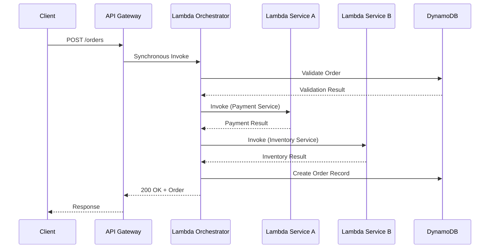
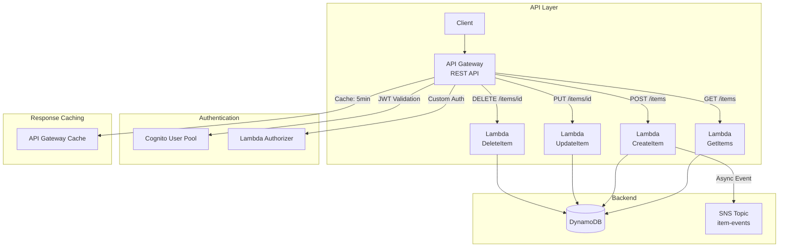
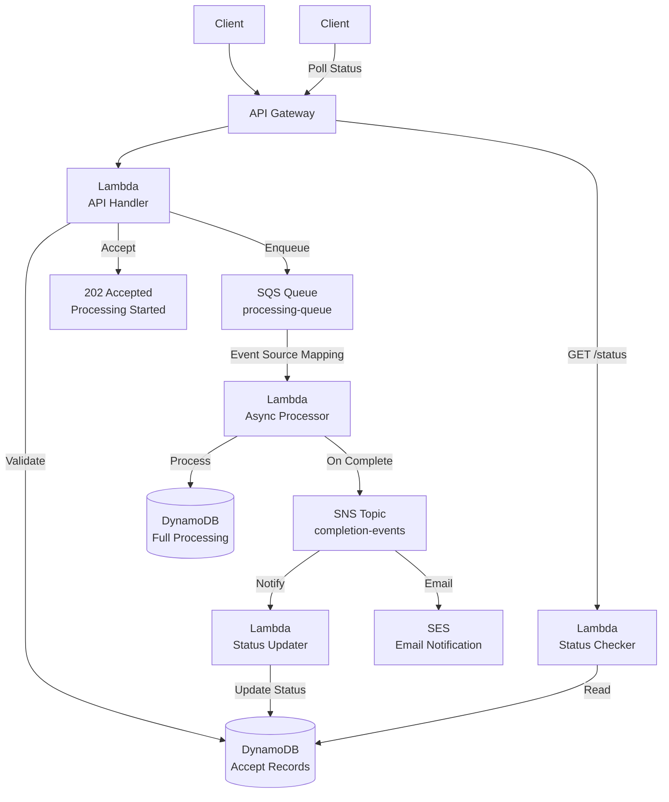
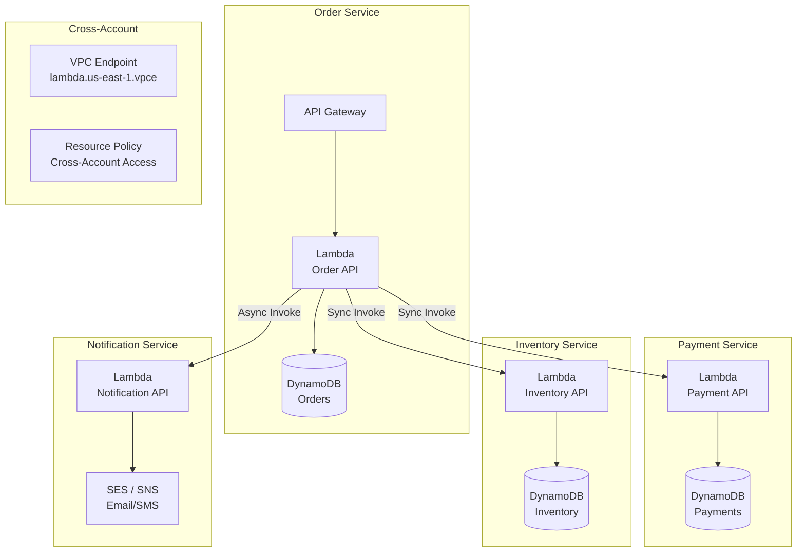
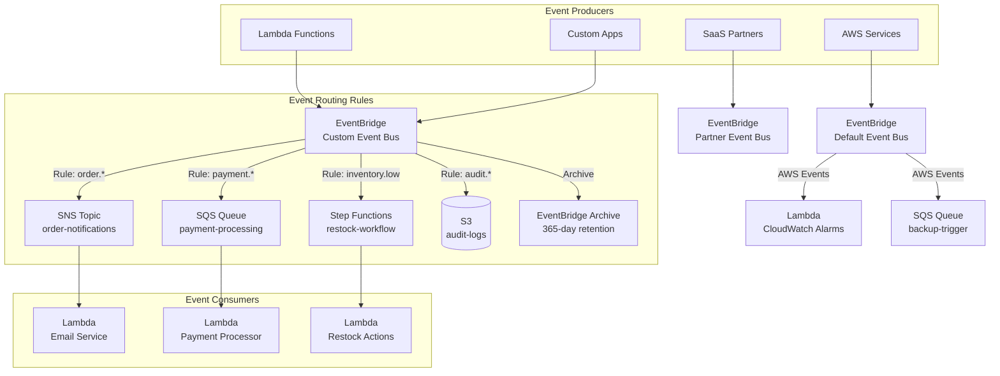
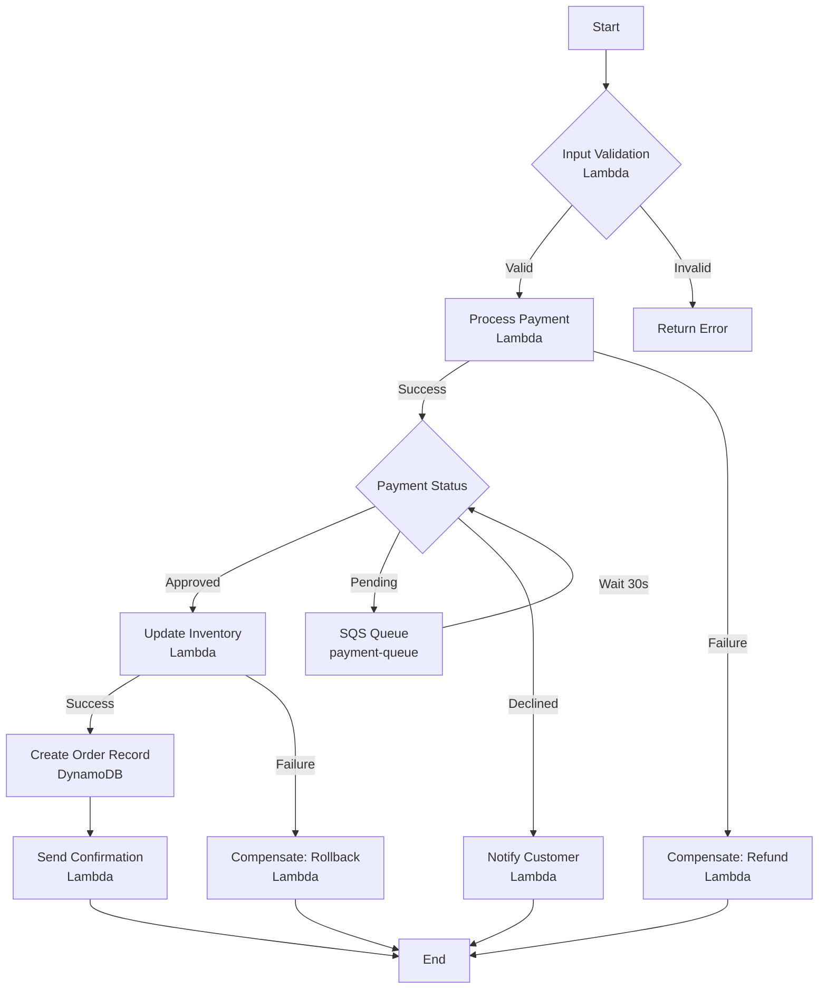
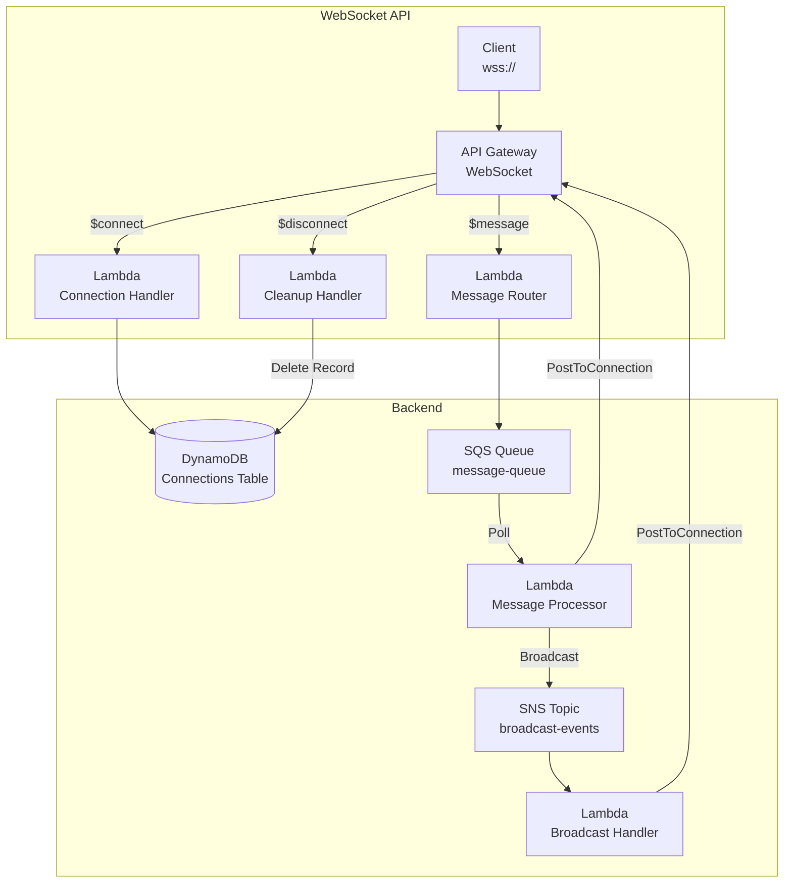

# Serverless Communication Patterns

## Overview

Serverless communication patterns define how Lambda functions, APIs, and event services interact. Choosing the right communication mechanism is critical for building scalable, maintainable, and cost-effective architectures.

---

## Communication Mechanisms Comparison

| Mechanism | Type | Latency | Cost (US East) | Max Payload | Best For |
|-----------|------|---------|----------------|-------------|----------|
| **Synchronous Invoke** | Direct | 10-100ms | $0.20/M invocations | 6 MB | Request-response, real-time |
| **Async Invoke** | Queued | 100ms-1s | $0.20/M invocations | 128 KB | Fire-and-forget |
| **API Gateway REST + Lambda** | HTTP | 50-200ms | $3.50/M calls + Lambda | 10 MB req / 6 MB resp | REST APIs |
| **API Gateway HTTP + Lambda** | HTTP | 30-150ms | $0.35/M calls + Lambda | 10 MB req / 10 MB resp | Lightweight REST APIs |
| **Lambda Function URL** | HTTP | 20-100ms | $0.45/M calls + Lambda | 10 MB | Direct Lambda HTTP |
| **AppSync + Lambda** | GraphQL | 50-200ms | $2.50/M calls + Lambda | 1 MB | GraphQL APIs |
| **SNS → Lambda** | Push | 100ms-1s | $0.60/M + Lambda | 256 KB | Fan-out, notifications |
| **SQS → Lambda** | Pull | 1s-60s | $0.40/M + Lambda | 256 KB | Async processing |
| **EventBridge → Lambda** | Push | 100ms-1s | $1.00/M events | 256 KB | Event routing |
| **Step Functions Standard** | Orchestration | 1s+ | $25/M transitions | 256 KB | Long workflows, human tasks |
| **Step Functions Express** | Orchestration | <1s | $0.25/M executions | 256 KB | Event processing, fast workflows |
| **Lambda-to-Lambda (SDK)** | Direct | 10-50ms | $0.20/M invocations | 6 MB | Service-to-service |

---

## Pattern 1: Synchronous Lambda Invocation Chain

Use when downstream results are required before responding to the client.



### Decision Matrix

| Factor | Sync Chain | Async Alternative |
|--------|-----------|-------------------|
| Client needs immediate result | Use sync | Not applicable |
| Total execution < 15s | Use sync | Not applicable |
| Multiple downstream calls | Risk: timeout cascade | Use SQS/SNS fan-out |
| Error handling complexity | High (manual retries) | Low (built-in retries) |
| Cold start impact | Multiplied across chain | Isolated per service |

### When NOT to Use

- Don't use sync chains deeper than 3 levels — use Step Functions or SQS/SNS fan-out
- Don't use for cross-region calls — latency will cause timeouts

### Timeout Budget Allocation

```
API Gateway timeout: 29s
├── Lambda Orchestrator: 25s
│   ├── Service A: 8s (timeout)
│   ├── Service B: 8s (timeout)
│   └── Buffer: 9s
```

---

## Pattern 2: API Gateway + Lambda REST API

The most common serverless API pattern.



### API Gateway Configuration Best Practices

| Setting | Value | Purpose |
|---------|-------|---------|
| `Throttling` | Per-API + per-method | Protect backend from overload |
| `Usage Plans` | Tier-based rates | API monetization, tiered access |
| `Request Validation` | Body + params | Early error detection |
| `Response Caching` | Stage cache, TTL | Reduce Lambda invocations |
| `WebSocket` | For real-time | Bidirectional communication |
| `Custom Domain` | ACM certificate | Production deployment |
| `Canary Deployments` | Percentage routing | Safe rollouts |

### REST API vs HTTP API

| Feature | REST API | HTTP API |
|---------|----------|----------|
| Cost | $3.50/M calls | $0.35/M calls (10x cheaper) |
| Latency | Higher | Lower |
| Lambda Authorizers | Token + Request | JWT + Lambda |
| WebSocket | Supported | Not supported |
| Canary Deployments | Supported | Not supported |
| Best for | Complex APIs, migration | New APIs, cost-sensitive |

### Lambda Authorizer Types

| Type | Caching | Use Case |
|------|---------|----------|
| **JWT Authorizer** | Built-in | Cognito integration, standard OAuth |
| **Lambda Token Authorizer** | 5-3600s cache | Custom token validation |
| **Lambda Request Authorizer** | 5-3600s cache | Header/body-based auth |
| **IAM Authorizer** | N/A | Service-to-service, CLI access |

---

## Pattern 3: Async Processing with SQS Buffer

Decouple synchronous API from asynchronous backend processing.



### API Response Pattern

```json
{
  "status": "accepted",
  "requestId": "req-12345",
  "estimatedTime": "30s",
  "statusUrl": "/api/v1/requests/req-12345/status",
  "retryAfter": 5
}
```

### SQS Buffer Sizing

| Expected Load | Queue Visibility Timeout | Lambda Batch Size | Max Concurrency | Reserved Concurrency |
|--------------|------------------------|-------------------|-----------------|---------------------|
| Low (<100 msg/s) | 30s | 10 | 10 | 10 (controls fan-out) |
| Medium (100-1000 msg/s) | 60s | 10 | 100 | 100 |
| High (>1000 msg/s) | 300s | 10 | 1000+ | 1000+ |

Note: Reserved Concurrency acts as a flow-control mechanism, limiting backpressure and protecting downstream services.

### Lambda Destinations

Configure on-success/on-failure routing for async invocations to SQS, SNS, EventBridge, or Lambda. Provides reliable delivery without manual error handling code.

### When NOT to Use

- Don't use when client needs immediate confirmation — use synchronous invocation
- Don't use for simple fire-and-forget without tracking — direct async invoke is simpler

---

## Pattern 4: Lambda Service-to-Service Communication

Direct Lambda invocation for internal microservice communication.



### Invocation Types for Service-to-Service

| Scenario | Invocation | Rationale |
|----------|-----------|-----------|
| Need response immediately | Synchronous | Request-response pattern |
| Fire-and-forget | Asynchronous | No response needed |
| Dry run validation | DryRun | Permission testing, no execution |
| Event-driven batch | Event Source Mapping | SQS/DynamoDB trigger |

### Lambda Invocation Example

```python
import boto3

lambda_client = boto3.client('lambda')

# Synchronous invoke
response = lambda_client.invoke(
    FunctionName='payment-service',
    InvocationType='RequestResponse',
    Payload=json.dumps({"orderId": "ORD-001"})
)
result = json.loads(response['Payload'].read())

# Asynchronous invoke
lambda_client.invoke(
    FunctionName='notification-service',
    InvocationType='Event',
    Payload=json.dumps({"orderId": "ORD-001"})
)
```

### When NOT to Use

- Don't use for cross-region communication — use SQS or EventBridge
- Don't use for high-throughput fan-out — use SNS instead

### Resource-Based Policy for Cross-Account

```json
{
  "Version": "2012-10-17",
  "Statement": [
    {
      "Effect": "Allow",
      "Principal": {
        "AWS": "arn:aws:iam::123456789012:root"
      },
      "Action": "lambda:InvokeFunction",
      "Resource": "arn:aws:lambda:us-east-1:111122223333:function:my-function",
      "Condition": {
        "StringEquals": {
          "aws:PrincipalOrgID": "o-ORG_ID"
        }
      }
    }
  ]
}
```

---

## Pattern 5: EventBridge as Central Nervous System

Centralized event routing with event patterns and rules.



### EventBridge Schema Registry

| Feature | Description |
|---------|-------------|
| **Schema Discovery** | Automatic schema detection from events |
| **Schema Validation** | Validate events against registered schemas |
| **Code Generation** | Generate SDK code for event types |
| **Versioning** | Track schema evolution over time |

### When NOT to Use

- Don't use for high-throughput ordered streaming — consider Kinesis Data Streams
- Don't use when simple point-to-point messaging suffices — SQS is simpler and cheaper

---

## Pattern 6: Step Functions Orchestration

For complex multi-step workflows with error handling and state management.



### Step Functions State Types

| State Type | Purpose | Configuration |
|-----------|---------|---------------|
| `Task` | Invoke Lambda, SNS, SQS, etc. | Resource ARN, parameters |
| `Choice` | Conditional branching | Rules with comparisons |
| `Parallel` | Concurrent execution | Branches array |
| `Wait` | Delay execution | Seconds, timestamp, timestampPath |
| `Catch` | Error handling | ErrorEquals, Next |
| `Retry` | Automatic retry | MaxAttempts, BackoffRate, Interval |
| `Succeed` / `Fail` | Terminal states | Output, cause, error |

### When NOT to Use

- Don't use for simple 1-2 step chains — direct Lambda invocation is cheaper and faster
- Don't use Express for workflows needing human tasks or >5 min duration — use Standard

### Step Functions vs Direct Lambda Chaining

| Aspect | Step Functions Standard | Step Functions Express | Lambda Chain |
|--------|----------------------|----------------------|--------------|
| State management | Built-in, visual | Built-in, visual | Manual, code-based |
| Error handling | Declarative catch/retry | Limited catch/retry | Try-catch per function |
| Execution duration | Up to 1 year | Max 5 minutes | Max 15 minutes per Lambda |
| Cost | $25/M transitions | $0.25/M executions | $0.20/M invocations |
| Visibility | Execution history, X-Ray | Execution history | CloudWatch Logs only |
| Human tasks | Supported (Lambda Task Notify) | Not supported | Not supported |
| Best for | Complex workflows, long-running | Event processing, fast workflows | Simple, fast chains |

---

## Pattern 7: WebSocket API with Lambda

Real-time bidirectional communication.



### WebSocket Lifecycle

| Route | Event | Lambda Action |
|-------|-------|--------------|
| `$connect` | Client connects | Store connection ID, authenticate |
| `$message` | Client sends data | Route to appropriate handler |
| `$disconnect` | Client disconnects | Clean up connection record |
| Custom routes | API Gateway routing | Business logic processing |

### When NOT to Use

- Don't use for request-response APIs — HTTP API is simpler and cheaper
- Don't use when clients don't need real-time push — polling or async with callback is simpler

---

## Anti-Patterns to Avoid

| Anti-Pattern | Problem | Solution |
|-------------|---------|----------|
| **Lambda → Lambda sync chain > 3 deep** | Timeout cascade, cold start multiplication | Use Step Functions or SQS |
| **Synchronous calls across regions** | High latency, timeout failures | Use async with SQS |
| **Large payloads in API Gateway** | 10 MB limit, high cost | Upload to S3, pass presigned URL |
| **No circuit breaker** | Cascading failures | Implement circuit breaker pattern |
| **Blocking Lambda on external HTTP** | Timeout risk, thread blocking | Use async, set connection timeouts |
| **Tight coupling between services** | Hard to change, test, deploy | Use events, interfaces |
| **No request correlation ID** | Impossible to trace requests | Pass X-Request-ID through all services |
