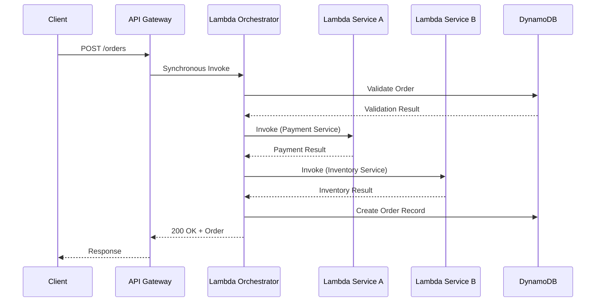
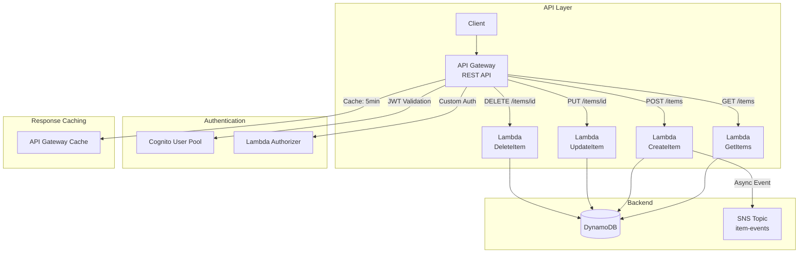
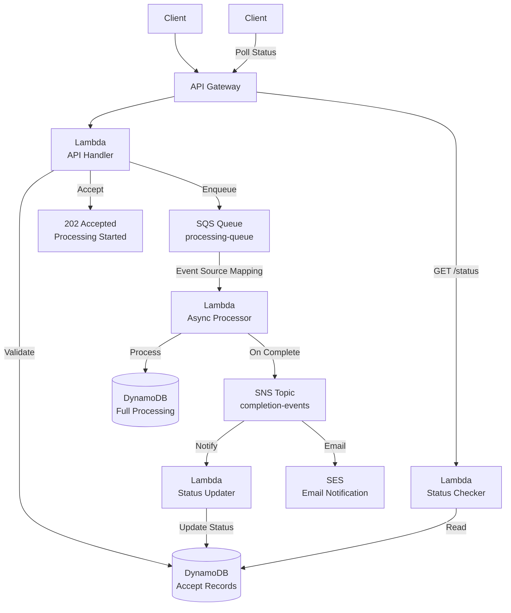
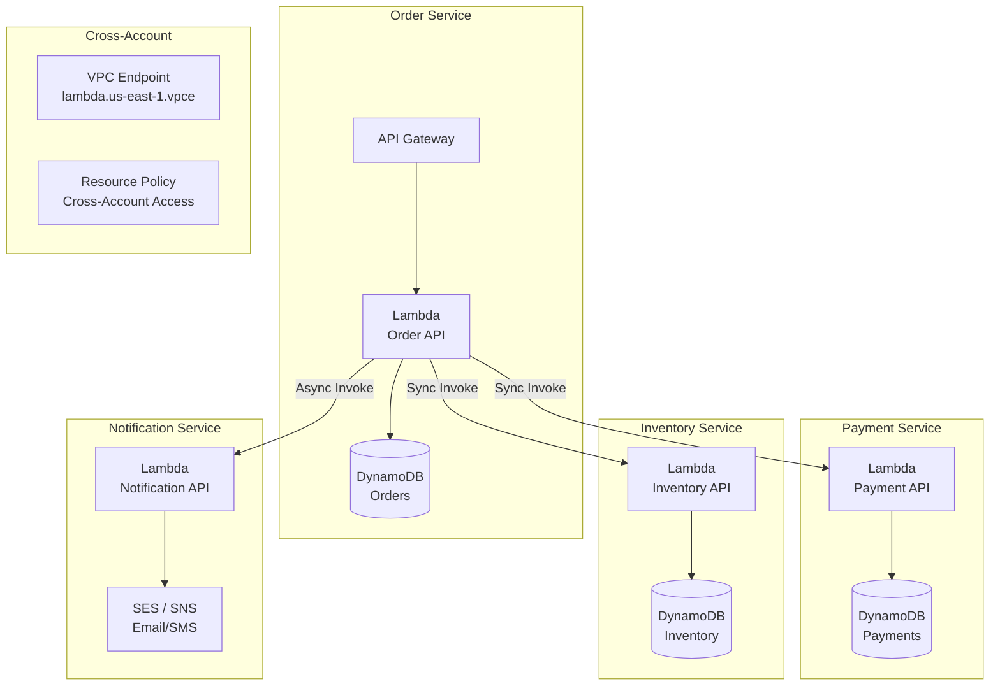
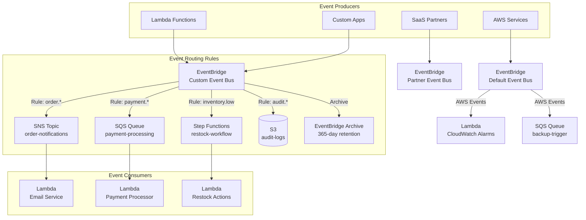
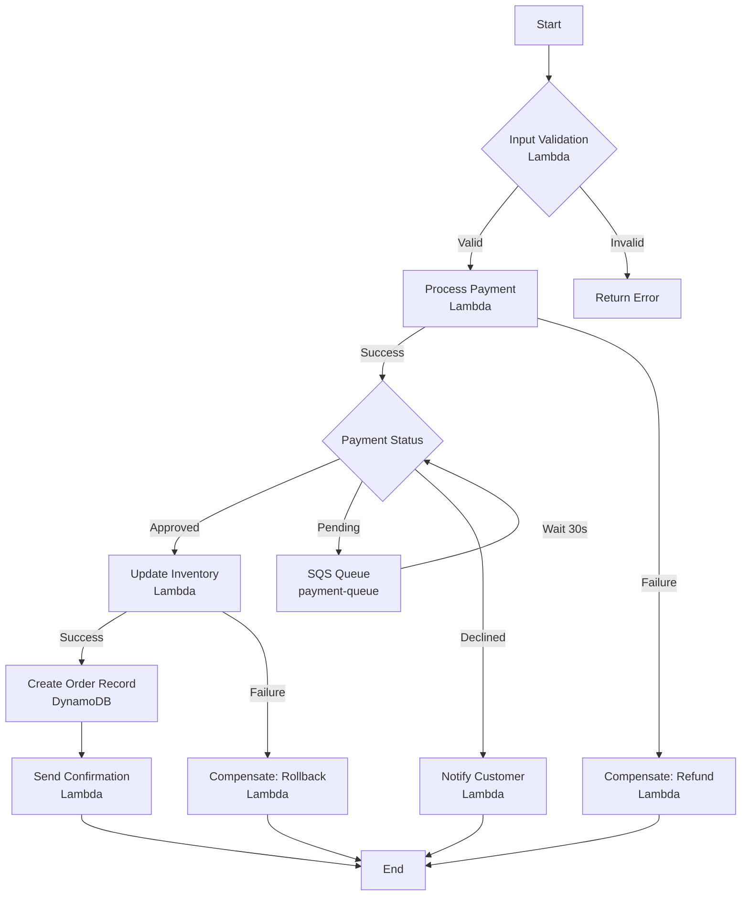
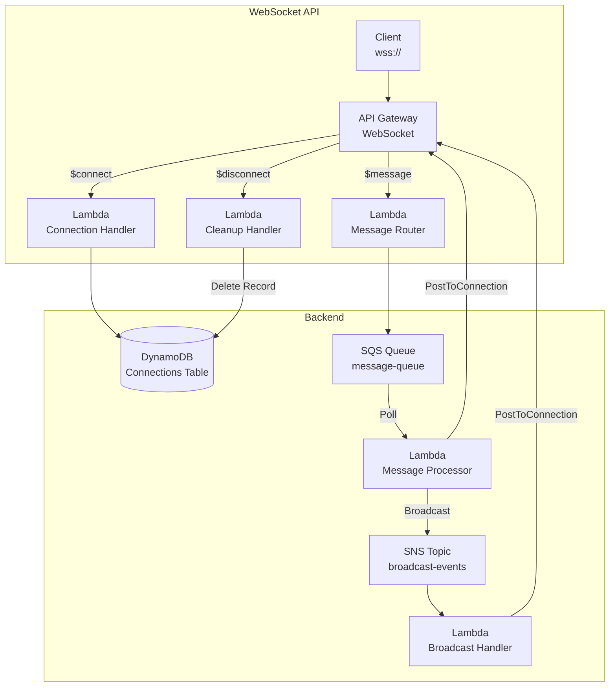

# Serverless Communication Patterns

## Overview

Serverless communication patterns define how Lambda functions, APIs, and event services interact. Choosing the right communication mechanism is critical for building scalable, maintainable, and cost-effective architectures.

---

## Table of Contents

- [Communication Mechanisms Comparison](#communication-mechanisms-comparison)
- [Pattern 1: Synchronous Lambda Invocation Chain](#pattern-1-synchronous-lambda-invocation-chain)
- [Pattern 2: API Gateway + Lambda REST API](#pattern-2-api-gateway--lambda-rest-api)
- [Pattern 3: Async Processing with SQS Buffer](#pattern-3-async-processing-with-sqs-buffer)
- [Pattern 4: Lambda Service-to-Service Communication](#pattern-4-lambda-service-to-service-communication)
- [Pattern 5: EventBridge as Central Nervous System](#pattern-5-eventbridge-as-central-nervous-system)
- [Pattern 6: Step Functions Orchestration](#pattern-6-step-functions-orchestration)
- [Pattern 7: WebSocket API with Lambda](#pattern-7-websocket-api-with-lambda)
- [Anti-Patterns to Avoid](#anti-patterns-to-avoid)

---

## Communication Mechanisms Comparison

Latency, cost, and payload limits across the available serverless communication mechanisms.

| Mechanism | Type | Latency | Cost (US East) | Max Payload | Best For |
|-----------|------|---------|----------------|-------------|----------|
| **Synchronous Invoke** | Direct | 10-100ms | $0.20/M invocations | 6 MB | Request-response, real-time |
| **Async Invoke** | Queued | 100ms-1s | $0.20/M invocations | 1 MB (raised from 256 KB, Oct 2025) | Fire-and-forget |
| **API Gateway REST + Lambda** | HTTP | 50-200ms | $3.50/M calls + Lambda | 10 MB req / 6 MB resp | REST APIs |
| **API Gateway HTTP + Lambda** | HTTP | 30-150ms | $0.35/M calls + Lambda | 10 MB req / 10 MB resp | Lightweight REST APIs |
| **Lambda Function URL** | HTTP | 20-100ms | $0.45/M calls + Lambda | 10 MB | Direct Lambda HTTP |
| **AppSync + Lambda** | GraphQL | 50-200ms | $2.50/M calls + Lambda | 1 MB | GraphQL APIs |
| **SNS → Lambda** | Push | 100ms-1s | $0.60/M + Lambda | 256 KB | Fan-out, notifications |
| **SQS → Lambda** | Pull | 1s-60s | $0.40/M + Lambda | 1 MiB (raised from 256 KB, Aug 2025) | Async processing |
| **EventBridge → Lambda** | Push | 100ms-1s | $1.00/M events | 1 MB (raised from 256 KB, Jan 2026) | Event routing |
| **Step Functions Standard** | Orchestration | 1s+ | $25/M transitions | 256 KB | Long workflows, human tasks |
| **Step Functions Express** | Orchestration | <1s | $0.25/M executions | 256 KB | Event processing, fast workflows |
| **Lambda-to-Lambda (SDK)** | Direct | 10-50ms | $0.20/M invocations | 6 MB | Service-to-service |

---

## Pattern 1: Synchronous Lambda Invocation Chain

Use when downstream results are required before responding to the client.



### Why This Pattern?

When the caller — a person submitting a form, or another service — needs a definitive answer before it can proceed ("was this order accepted," "was the payment approved"), polling or async callbacks add complexity the caller doesn't want. A synchronous chain gets that answer back in a single round trip with the simplest possible programming model: call, wait, get result.

**Trade-off:** every hop's latency, cold start, and failure mode sits on the critical path of the response. A single slow or failing downstream call fails the entire request, and there's no partial progress if step 3 of 4 succeeds but step 4 times out — the deeper the chain, the more fragile it gets.

### Decision Matrix

When to keep a synchronous chain versus switching to an async alternative.

| Factor | Sync Chain | Async Alternative |
|--------|-----------|-------------------|
| Client needs immediate result | Use sync | Not applicable |
| Total execution < 15s | Use sync | Not applicable |
| Multiple downstream calls | Risk: timeout cascade | Use SQS/SNS fan-out |
| Error handling complexity | High (manual retries) | Low (built-in retries) |
| Cold start impact | Multiplied across chain | Isolated per service |

### When NOT to Use

- Don't use sync chains deeper than 3 levels — use Step Functions or SQS/SNS fan-out
- Don't use for cross-region calls — latency will cause timeouts

### Timeout Budget Allocation

```
API Gateway timeout: 29s
├── Lambda Orchestrator: 25s
│   ├── Service A: 8s (timeout)
│   ├── Service B: 8s (timeout)
│   └── Buffer: 9s
```

---

## Pattern 2: API Gateway + Lambda REST API

The most common serverless API pattern.



### Why This Pattern?

A Lambda Function URL works for exposing a single endpoint, but a real API needs request validation, authentication/authorization, throttling, usage tiers, and multiple routes mapped to different functions — reimplementing all of that inside every Lambda is duplicated effort and produces inconsistent behavior across endpoints. API Gateway centralizes those cross-cutting concerns in front of Lambda, so each function only implements its own business logic while auth, throttling, validation, and caching are configured once at the API layer.

**Trade-off:** API Gateway adds its own latency and per-call cost on top of Lambda's, and REST API in particular is markedly more expensive than HTTP API for the same traffic — pick the cheaper HTTP API unless you specifically need REST-only features like WebSocket or canary deployments.

### API Gateway Configuration Best Practices

Key settings to configure on an API Gateway REST API and why each matters.

| Setting | Value | Purpose |
|---------|-------|---------|
| `Throttling` | Per-API + per-method | Protect backend from overload |
| `Usage Plans` | Tier-based rates | API monetization, tiered access |
| `Request Validation` | Body + params | Early error detection |
| `Response Caching` | Stage cache, TTL | Reduce Lambda invocations |
| `WebSocket` | For real-time | Bidirectional communication |
| `Custom Domain` | ACM certificate | Production deployment |
| `Canary Deployments` | Percentage routing | Safe rollouts |

### REST API vs HTTP API

Side-by-side comparison to help choose between API Gateway's two REST-style API types.

| Feature | REST API | HTTP API |
|---------|----------|----------|
| Cost | $3.50/M calls | $0.35/M calls (10x cheaper) |
| Latency | Higher | Lower |
| Lambda Authorizers | Token + Request | JWT + Lambda |
| WebSocket | Supported | Not supported |
| Canary Deployments | Supported | Not supported |
| Best for | Complex APIs, migration | New APIs, cost-sensitive |

### Lambda Authorizer Types

Authorizer options for API Gateway, their caching behavior, and typical use case.

| Type | Caching | Use Case |
|------|---------|----------|
| **JWT Authorizer** | Built-in | Cognito integration, standard OAuth |
| **Lambda Token Authorizer** | 5-3600s cache | Custom token validation |
| **Lambda Request Authorizer** | 5-3600s cache | Header/body-based auth |
| **IAM Authorizer** | N/A | Service-to-service, CLI access |

---

## Pattern 3: Async Processing with SQS Buffer

Decouple synchronous API from asynchronous backend processing.



### Why This Pattern?

Some requests take longer to process than an HTTP client is willing to hold a connection open for (file processing, third-party calls, batch work), but the client still needs confirmation the request was received and a way to check progress. This pattern accepts the request immediately (`202 Accepted`) and does the real work asynchronously behind an SQS buffer, trading "wait for the answer" for "get acknowledged, then poll or get notified" — which scales far better under load because the API layer's response time no longer depends on how long processing takes, and a burst of requests queues up instead of timing out the caller.

**Trade-off:** the client needs a status-checking mechanism (polling endpoint or webhook/notification), and the overall user experience is more complex than a plain synchronous response — only worth the added moving parts when processing time genuinely exceeds what a synchronous call can tolerate.

### API Response Pattern

```json
{
  "status": "accepted",
  "requestId": "req-12345",
  "estimatedTime": "30s",
  "statusUrl": "/api/v1/requests/req-12345/status",
  "retryAfter": 5
}
```

### SQS Buffer Sizing

Recommended queue and Lambda concurrency settings by expected message load.

| Expected Load | Queue Visibility Timeout | Lambda Batch Size | Max Concurrency | Reserved Concurrency |
|--------------|------------------------|-------------------|-----------------|---------------------|
| Low (<100 msg/s) | 30s | 10 | 10 | 10 (controls fan-out) |
| Medium (100-1000 msg/s) | 60s | 10 | 100 | 100 |
| High (>1000 msg/s) | 300s | 10 | 1000+ | 1000+ |

Note: Reserved Concurrency acts as a flow-control mechanism, limiting backpressure and protecting downstream services.

### Lambda Destinations

Configure on-success/on-failure routing for async invocations to SQS, SNS, EventBridge, or Lambda. Provides reliable delivery without manual error handling code.

### When NOT to Use

- Don't use when client needs immediate confirmation — use synchronous invocation
- Don't use for simple fire-and-forget without tracking — direct async invoke is simpler

---

## Pattern 4: Lambda Service-to-Service Communication

Direct Lambda invocation for internal microservice communication.



### Why This Pattern?

In a microservices-style Lambda architecture, one service's function often needs to call another directly — validate a payment, check inventory — without the overhead of standing up API Gateway or a queue for what's a purely internal, low-throughput call. Direct SDK invocation (`lambda.invoke()`) is the lowest-latency, no-extra-infrastructure way to make that call, synchronously or asynchronously, within the same account/region.

**Trade-off:** it creates the same tight coupling as any direct call — the caller hardcodes the callee's function ARN and must have IAM permission to invoke it — so it doesn't scale well to fan-out (use SNS/EventBridge instead) and shouldn't be used across regions, where SQS or EventBridge handle the latency and reliability concerns better.

### Invocation Types for Service-to-Service

Which Lambda invocation type to use depending on the calling scenario.

| Scenario | Invocation | Rationale |
|----------|-----------|-----------|
| Need response immediately | Synchronous | Request-response pattern |
| Fire-and-forget | Asynchronous | No response needed |
| Dry run validation | DryRun | Permission testing, no execution |
| Event-driven batch | Event Source Mapping | SQS/DynamoDB trigger |

### Lambda Invocation Example

```python
import boto3

lambda_client = boto3.client('lambda')

# Synchronous invoke
response = lambda_client.invoke(
    FunctionName='payment-service',
    InvocationType='RequestResponse',
    Payload=json.dumps({"orderId": "ORD-001"})
)
result = json.loads(response['Payload'].read())

# Asynchronous invoke
lambda_client.invoke(
    FunctionName='notification-service',
    InvocationType='Event',
    Payload=json.dumps({"orderId": "ORD-001"})
)
```

### When NOT to Use

- Don't use for cross-region communication — use SQS or EventBridge
- Don't use for high-throughput fan-out — use SNS instead

### Resource-Based Policy for Cross-Account

```json
{
  "Version": "2012-10-17",
  "Statement": [
    {
      "Effect": "Allow",
      "Principal": {
        "AWS": "arn:aws:iam::123456789012:root"
      },
      "Action": "lambda:InvokeFunction",
      "Resource": "arn:aws:lambda:us-east-1:111122223333:function:my-function",
      "Condition": {
        "StringEquals": {
          "aws:PrincipalOrgID": "o-ORG_ID"
        }
      }
    }
  ]
}
```

---

## Pattern 5: EventBridge as Central Nervous System

Centralized event routing with event patterns and rules.



### Why This Pattern?

As the number of internal services, AWS-native events, and third-party SaaS event sources grows, no team can manage that many point-to-point integrations and subscriptions by hand — every new producer or consumer would mean coordinating a change with every counterpart. EventBridge acts as the single hub any producer (internal service, AWS service, SaaS partner) publishes to, and any consumer subscribes to via declarative rules, replacing what would otherwise be dozens of ad hoc, hardcoded integrations with one place to see and manage event flow.

**Trade-off:** centralizing everything through one bus means a misconfigured or overly broad rule can silently misroute events across the whole system, so rule patterns and access control need the same rigor as code — and for very high-throughput ordered streams, EventBridge is still the wrong tool (use Kinesis).

### EventBridge Schema Registry

Capabilities provided by the EventBridge Schema Registry for managing event contracts.

| Feature | Description |
|---------|-------------|
| **Schema Discovery** | Automatic schema detection from events |
| **Schema Validation** | Validate events against registered schemas |
| **Code Generation** | Generate SDK code for event types |
| **Versioning** | Track schema evolution over time |

### When NOT to Use

- Don't use for high-throughput ordered streaming — consider Kinesis Data Streams
- Don't use when simple point-to-point messaging suffices — SQS is simpler and cheaper

---

## Pattern 6: Step Functions Orchestration

For complex multi-step workflows with error handling and state management.



### Why This Pattern?

A workflow with several steps, conditional branches, retries, and compensating actions (e.g., refund the payment if the inventory update fails) quickly becomes unmanageable as nested try/catch blocks spread across chained Lambda functions — state tracking is manual, errors are easy to lose, and there's no way to see where a given execution actually is. Step Functions externalizes that control flow into a declarative state machine: branching, retry/backoff, and error handling become configuration instead of code, and every execution gets a visual history that makes debugging a stuck or failed workflow far faster than grepping CloudWatch Logs across multiple functions.

**Trade-off:** state transitions cost money independently of Lambda invocations (`$25/M transitions` for Standard), and for a workflow that's just 1-2 steps with no branching, that overhead and the added indirection outweigh the benefit — a direct Lambda chain is cheaper and simpler.

### Step Functions State Types

Built-in state types available in a Step Functions state machine definition.

| State Type | Purpose | Configuration |
|-----------|---------|---------------|
| `Task` | Invoke Lambda, SNS, SQS, etc. | Resource ARN, parameters |
| `Choice` | Conditional branching | Rules with comparisons |
| `Parallel` | Concurrent execution | Branches array |
| `Wait` | Delay execution | Seconds, timestamp, timestampPath |
| `Catch` | Error handling | ErrorEquals, Next |
| `Retry` | Automatic retry | MaxAttempts, BackoffRate, Interval |
| `Succeed` / `Fail` | Terminal states | Output, cause, error |

### When NOT to Use

- Don't use for simple 1-2 step chains — direct Lambda invocation is cheaper and faster
- Don't use Express for workflows needing human tasks or >5 min duration — use Standard

### Step Functions vs Direct Lambda Chaining

Trade-offs between orchestrating with Step Functions versus chaining Lambda calls directly.

| Aspect | Step Functions Standard | Step Functions Express | Lambda Chain |
|--------|----------------------|----------------------|--------------|
| State management | Built-in, visual | Built-in, visual | Manual, code-based |
| Error handling | Declarative catch/retry | Limited catch/retry | Try-catch per function |
| Execution duration | Up to 1 year | Max 5 minutes | Max 15 minutes per Lambda |
| Cost | $25/M transitions | $0.25/M executions | $0.20/M invocations |
| Visibility | Execution history, X-Ray | Execution history | CloudWatch Logs only |
| Human tasks | Supported (Lambda Task Notify) | Not supported | Not supported |
| Best for | Complex workflows, long-running | Event processing, fast workflows | Simple, fast chains |

---

## Pattern 7: WebSocket API with Lambda

Real-time bidirectional communication.



### Why This Pattern?

HTTP request-response, even with polling, can't push an update to the client the instant something happens — the client has to keep asking, and its view is always slightly stale, wasting requests when nothing has changed. A WebSocket API keeps a persistent connection open so the server can push data (chat messages, live dashboards, notifications) to the client the moment it's available, with no client-initiated request needed for each update.

**Trade-off:** connections are stateful and must be tracked and cleaned up explicitly (a connections table, `$disconnect` handling), which is more operationally complex than stateless HTTP — reserve WebSocket for cases where real-time push is an actual product requirement, not a nice-to-have.

### WebSocket Lifecycle

The routes triggered at each stage of a WebSocket connection and the Lambda action each performs.

| Route | Event | Lambda Action |
|-------|-------|--------------|
| `$connect` | Client connects | Store connection ID, authenticate |
| `$message` | Client sends data | Route to appropriate handler |
| `$disconnect` | Client disconnects | Clean up connection record |
| Custom routes | API Gateway routing | Business logic processing |

### When NOT to Use

- Don't use for request-response APIs — HTTP API is simpler and cheaper
- Don't use when clients don't need real-time push — polling or async with callback is simpler

---

## Anti-Patterns to Avoid

Common communication mistakes and the fix for each.

| Anti-Pattern | Problem | Solution |
|-------------|---------|----------|
| **Lambda → Lambda sync chain > 3 deep** | Timeout cascade, cold start multiplication | Use Step Functions or SQS |
| **Synchronous calls across regions** | High latency, timeout failures | Use async with SQS |
| **Large payloads in API Gateway** | 10 MB limit, high cost | Upload to S3, pass presigned URL |
| **No circuit breaker** | Cascading failures | Implement circuit breaker pattern |
| **Blocking Lambda on external HTTP** | Timeout risk, thread blocking | Use async, set connection timeouts |
| **Tight coupling between services** | Hard to change, test, deploy | Use events, interfaces |
| **No request correlation ID** | Impossible to trace requests | Pass X-Request-ID through all services |
