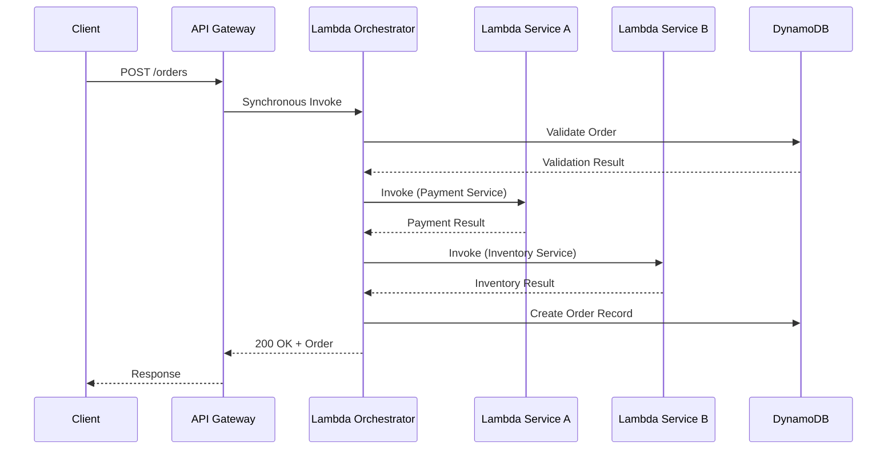
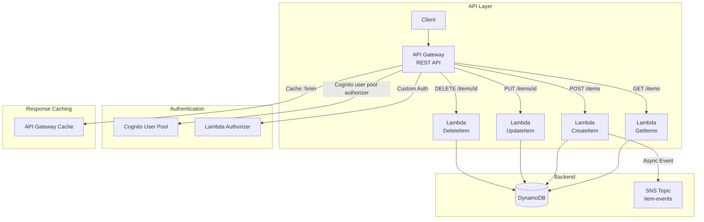
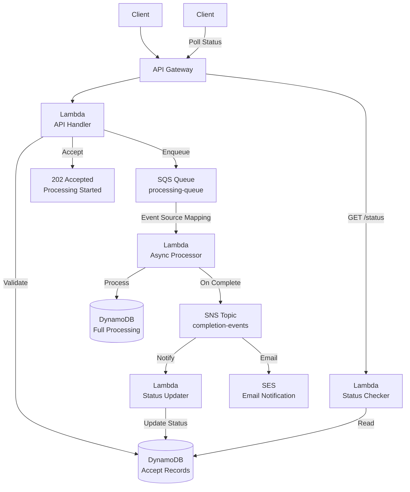
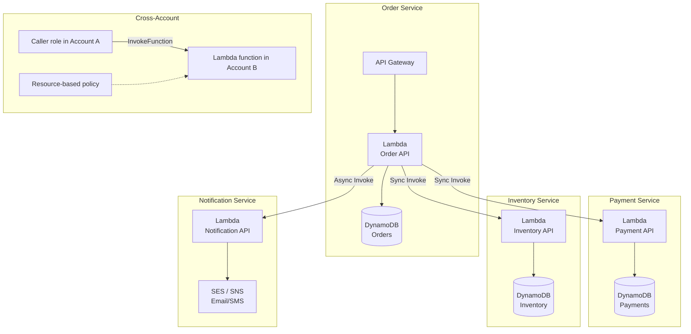
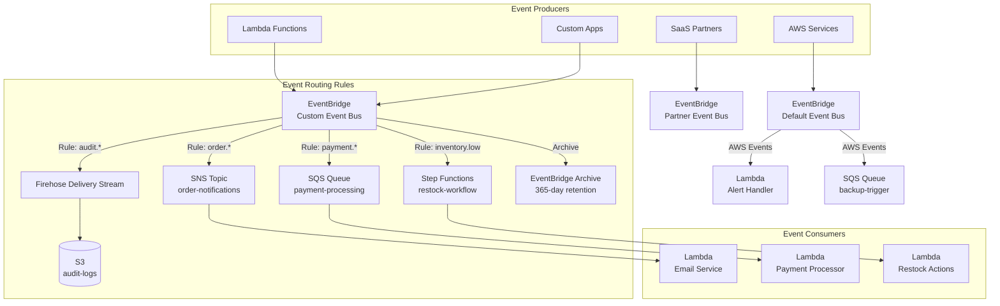
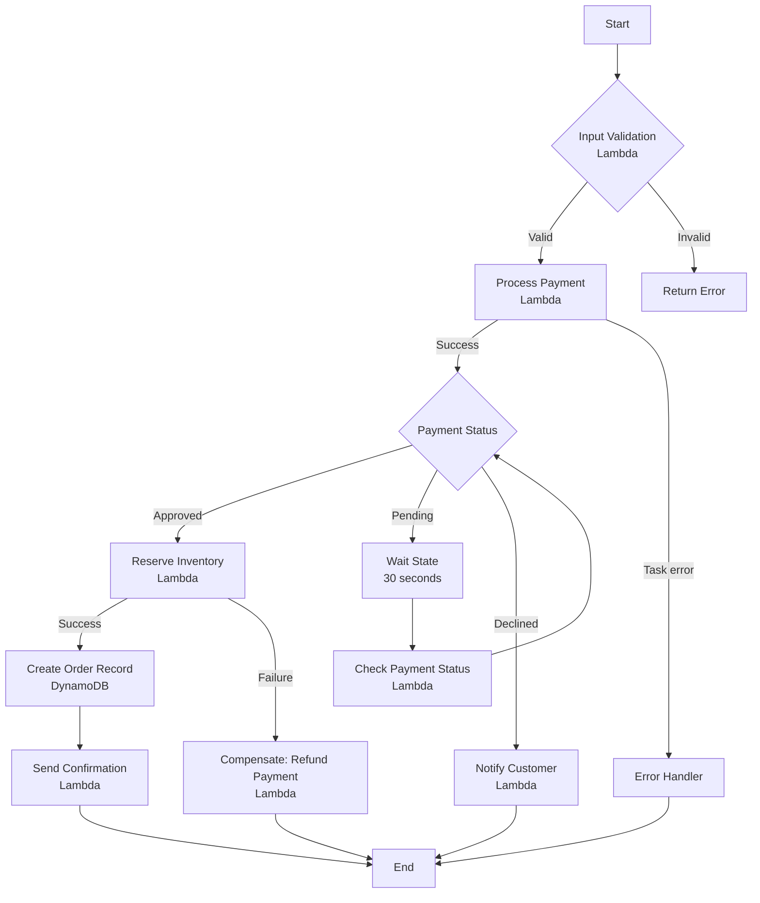
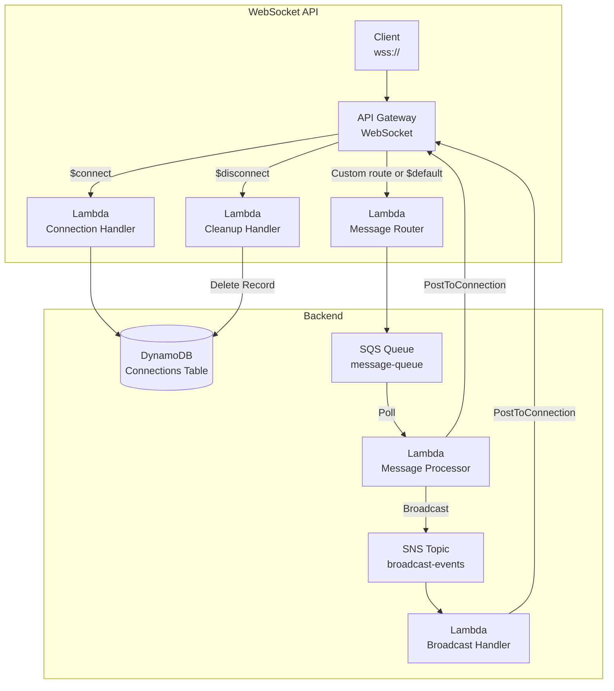

# Serverless Communication Patterns

## Overview

Serverless communication patterns define how Lambda functions, APIs, and event services interact. Choosing the right communication mechanism is critical for building scalable, maintainable, and cost-effective architectures.

---

## Table of Contents

- [Communication Mechanisms Comparison](#communication-mechanisms-comparison)
- [Pattern 1: Synchronous Lambda Invocation Chain](#pattern-1-synchronous-lambda-invocation-chain)
- [Pattern 2: API Gateway + Lambda REST API](#pattern-2-api-gateway--lambda-rest-api)
- [Pattern 3: Async Processing with SQS Buffer](#pattern-3-async-processing-with-sqs-buffer)
- [Pattern 4: Lambda Service-to-Service Communication](#pattern-4-lambda-service-to-service-communication)
- [Pattern 5: EventBridge as Central Nervous System](#pattern-5-eventbridge-as-central-nervous-system)
- [Pattern 6: Step Functions Orchestration](#pattern-6-step-functions-orchestration)
- [Pattern 7: WebSocket API with Lambda](#pattern-7-websocket-api-with-lambda)
- [Anti-Patterns to Avoid](#anti-patterns-to-avoid)
- [Authoritative References](#authoritative-references)

---

## Communication Mechanisms Comparison

Communication style, billing dimensions, and key payload quotas across common serverless mechanisms. Prices vary by Region and tier; use the AWS Pricing Calculator rather than treating a point-in-time example price as an architecture constant.

| Mechanism | Type | Primary Billing Dimensions | Key Payload Quota | Best For |
|-----------|------|----------------------------|-------------------|----------|
| **Synchronous Invoke** | Direct | Lambda requests + duration | 6 MB request/response | Request-response |
| **Async Invoke** | Managed queue | Lambda requests + duration | 1 MB event | Fire-and-forget |
| **API Gateway REST + Lambda** | HTTP | API calls, data transfer, optional cache + Lambda | 10 MB API payload; Lambda buffered response is 6 MB | Feature-rich REST APIs |
| **API Gateway HTTP + Lambda** | HTTP | API calls + data transfer + Lambda | 10 MB API payload; Lambda buffered response is 6 MB | Lower-cost HTTP APIs |
| **Lambda Function URL** | HTTP | Lambda requests + duration; no endpoint surcharge | 6 MB buffered request/response; response streaming has separate quotas | Simple single-function HTTP endpoint |
| **AppSync + Lambda** | GraphQL | Query/data-modification operations, real-time updates, connection minutes + Lambda | 5 MB resolver/function response; 240 KB subscription payload | GraphQL APIs |
| **SNS → Lambda** | Push | Publishes/deliveries + Lambda | 256 KB message | Fan-out, notifications |
| **SQS → Lambda** | Poll | SQS requests + Lambda; provisioned pollers if enabled | 1 MiB message; Lambda batch is capped by invocation payload | Async processing |
| **EventBridge → Lambda** | Push | Custom/partner events + Lambda | 1 MB per `PutEvents` request | Event routing |
| **Step Functions Standard** | Orchestration | State transitions | 256 KiB state input/output | Long workflows, callback tasks |
| **Step Functions Express** | Orchestration | Executions, duration, and memory | 256 KiB state input/output | High-volume, short workflows |
| **Lambda-to-Lambda (SDK)** | Direct | Lambda requests + duration | 6 MB sync / 1 MB async | Tightly coupled service call |

---

## Pattern 1: Synchronous Lambda Invocation Chain

Use when downstream results are required before responding to the client.



### Why This Pattern?

When the caller — a person submitting a form, or another service — needs a definitive answer before it can proceed ("was this order accepted," "was the payment approved"), polling or async callbacks add complexity the caller doesn't want. A synchronous chain gets that answer back in a single round trip with the simplest possible programming model: call, wait, get result.

**Trade-off:** every hop's latency, cold start, and failure mode sits on the critical path of the response. A single slow or failing downstream call fails the entire request, and there's no partial progress if step 3 of 4 succeeds but step 4 times out — the deeper the chain, the more fragile it gets.

### Decision Matrix

When to keep a synchronous chain versus switching to an async alternative.

| Factor | Sync Chain | Async Alternative |
|--------|-----------|-------------------|
| Client needs immediate result | Use sync | Not applicable |
| Execution fits the caller and integration timeout budgets with margin | Use sync | Prefer async when work can outlive the request deadline |
| Multiple downstream calls | Risk: timeout cascade | Use SQS/SNS fan-out |
| Error handling complexity | Caller owns bounded retries and timeout handling | Source-specific retries/DLQs help, but idempotency and terminal-failure handling remain required |
| Cold start impact | Multiplied across chain | Isolated per service |

### When NOT to Use

- Avoid multi-hop synchronous chains when one downstream slowdown can consume the caller's timeout budget; use Step Functions or asynchronous messaging
- Avoid synchronous cross-Region calls on critical paths unless the measured latency and failure model meet the workload's SLO

### Timeout Budget Allocation

```
Caller deadline: derive from the product SLO and API integration quota
├── API and network overhead
├── Orchestrator budget
│   ├── Service A bounded timeout
│   ├── Service B bounded timeout
│   └── Retry budget (only for safe, idempotent operations)
└── Safety margin before the caller deadline
```

---

## Pattern 2: API Gateway + Lambda REST API

The most common serverless API pattern.



### Why This Pattern?

A Lambda Function URL works for exposing a single endpoint, but a real API needs request validation, authentication/authorization, throttling, usage tiers, and multiple routes mapped to different functions — reimplementing all of that inside every Lambda is duplicated effort and produces inconsistent behavior across endpoints. API Gateway centralizes those cross-cutting concerns in front of Lambda, so each function only implements its own business logic while auth, throttling, validation, and caching are configured once at the API layer.

**Trade-off:** API Gateway adds its own latency and per-call cost on top of Lambda's, and REST APIs cost more than HTTP APIs at the entry tier. Prefer an HTTP API unless you need REST-only capabilities such as API keys and usage plans, request validation, response caching, or stage canaries. WebSocket APIs are a separate API Gateway API type, not a REST API feature.

### API Gateway Configuration Best Practices

Key settings to configure on an API Gateway REST API and why each matters.

| Setting | Value | Purpose |
|---------|-------|---------|
| `Throttling` | Per-API + per-method | Protect backend from overload |
| `Usage Plans` | Tier-based rates and quotas | Best-effort per-key throttling and usage tiers; API keys are not authentication or billing |
| `Request Validation` | Body + params | Early error detection |
| `Response Caching` | Stage cache, TTL | Reduce Lambda invocations |
| `Custom Domain` | ACM certificate | Production deployment |
| `Canary Deployments` | Percentage routing | Safe rollouts |

### REST API vs HTTP API

Side-by-side comparison to help choose between API Gateway's two REST-style API types.

| Feature | REST API | HTTP API |
|---------|----------|----------|
| Cost model | Higher entry-tier price per call; optional cache charges | Lower entry-tier price per call; no API Gateway response cache |
| Latency | Higher | Lower |
| Authorization options | IAM, Cognito user pool, Lambda token/request authorizers | IAM, JWT, and Lambda authorizers |
| WebSocket | Separate WebSocket API type | Separate WebSocket API type |
| Canary Deployments | Supported | Not supported |
| Best for | Complex APIs, migration | New APIs, cost-sensitive |

### Lambda Authorizer Types

Authorizer options for API Gateway, their caching behavior, and typical use case.

| Type | Caching | Use Case |
|------|---------|----------|
| **JWT Authorizer (HTTP API)** | No configurable authorizer-result cache; API Gateway caches the issuer's public keys | Cognito/OIDC/OAuth 2.0 JWTs |
| **Lambda Token Authorizer (REST API)** | Configurable result cache | Custom token validation |
| **Lambda Request Authorizer** | Configurable result cache | Headers, query strings, path/stage/context-based authorization |
| **IAM Authorizer** | N/A | Service-to-service, CLI access |

---

## Pattern 3: Async Processing with SQS Buffer

Decouple synchronous API from asynchronous backend processing.



### Why This Pattern?

Some requests take longer to process than an HTTP client is willing to hold a connection open for (file processing, third-party calls, batch work), but the client still needs confirmation the request was received and a way to check progress. This pattern accepts the request immediately (`202 Accepted`) and does the real work asynchronously behind an SQS buffer, trading "wait for the answer" for "get acknowledged, then poll or get notified" — which scales far better under load because the API layer's response time no longer depends on how long processing takes, and a burst of requests queues up instead of timing out the caller.

**Trade-off:** the client needs a status-checking mechanism (polling endpoint or webhook/notification), and the overall user experience is more complex than a plain synchronous response — only worth the added moving parts when processing time genuinely exceeds what a synchronous call can tolerate.

### API Response Pattern

```json
{
  "status": "accepted",
  "requestId": "req-12345",
  "estimatedTime": "30s",
  "statusUrl": "/api/v1/requests/req-12345/status",
  "retryAfter": 5
}
```

### SQS Buffer Sizing

Size the event source mapping from measured workload behavior rather than a fixed messages-per-second tier.

| Sizing input | Guidance |
|--------------|----------|
| Queue visibility timeout | For Lambda, use at least six times the function timeout plus the batching window |
| Batch size and window | Tune from payload size, duration, latency objective, and failure-isolation needs; the complete batch must fit Lambda's invocation payload quota |
| Event-source maximum concurrency | Cap at the downstream system's measured safe throughput and leave headroom for retries |
| Function reserved concurrency | Reserves and caps function concurrency; do not automatically set it equal to event-source maximum concurrency, and preserve enough account concurrency for other functions |
| Backlog signals | Alarm on message age and queue depth relative to the processing-latency SLO, not on a universal count |

There is a durability gap if the API handler writes a status record and then separately enqueues work: either operation can succeed while the other fails. Use a transactional outbox/change stream pattern (for example, a DynamoDB write consumed through DynamoDB Streams) or another idempotent acceptance design, and return `202 Accepted` only after the request has been durably accepted.

### Lambda Destinations

For direct asynchronous Lambda invocation, configure on-success/on-failure destinations to SQS, SNS, EventBridge, Lambda, or (for supported failure destinations) S3. This configuration does not apply to SQS event source mappings; use the source queue's redrive policy and partial batch responses there.

### When NOT to Use

- Don't use when the client needs the completed result in the initial response — use synchronous invocation
- Don't use for simple fire-and-forget without tracking — direct async invoke is simpler

---

## Pattern 4: Lambda Service-to-Service Communication

Direct Lambda invocation for internal microservice communication.



### Why This Pattern?

In a microservices-style Lambda architecture, one service's function often needs to call another directly — validate a payment, check inventory — without standing up API Gateway or a queue for a purely internal, low-throughput call. Direct SDK invocation (`lambda.invoke()`) avoids an intermediary and can be used synchronously or asynchronously within the same account and Region.

**Trade-off:** it creates the same tight coupling as any direct call — the caller identifies the callee and must have IAM permission to invoke it — so it doesn't scale well to fan-out (use SNS/EventBridge instead). For cross-Region calls, measure the latency and failure model against the SLO and prefer an asynchronous regional design when the caller does not need an immediate response.

### Invocation Types for Service-to-Service

Which Lambda invocation type to use depending on the calling scenario.

| Scenario | Invocation | Rationale |
|----------|-----------|-----------|
| Need response immediately | Synchronous | Request-response pattern |
| Fire-and-forget | Asynchronous | No response needed |
| Dry run validation | DryRun | Permission testing, no execution |
| Event-driven batch | Event Source Mapping | SQS/DynamoDB trigger |

### Lambda Invocation Example

```python
import boto3

lambda_client = boto3.client('lambda')

# Synchronous invoke
response = lambda_client.invoke(
    FunctionName='payment-service',
    InvocationType='RequestResponse',
    Payload=json.dumps({"orderId": "ORD-001"})
)
result = json.loads(response['Payload'].read())

# Asynchronous invoke
lambda_client.invoke(
    FunctionName='notification-service',
    InvocationType='Event',
    Payload=json.dumps({"orderId": "ORD-001"})
)
```

### When NOT to Use

- Avoid cross-Region direct calls on critical paths unless measured latency and availability meet the workload SLO; choose EventBridge, SNS, SQS, or regional APIs according to delivery and response requirements
- Don't use for high-throughput fan-out — use SNS instead

### Resource-Based Policy for Cross-Account

```json
{
  "Version": "2012-10-17",
  "Statement": [
    {
      "Effect": "Allow",
      "Principal": {
        "AWS": "arn:aws:iam::123456789012:role/order-service-invoker"
      },
      "Action": "lambda:InvokeFunction",
      "Resource": "arn:aws:lambda:us-east-1:111122223333:function:my-function",
      "Condition": {
        "StringEquals": {
          "aws:PrincipalOrgID": "o-ORG_ID"
        }
      }
    }
  ]
}
```

---

## Pattern 5: EventBridge as Central Nervous System

Centralized event routing with event patterns and rules.



### Why This Pattern?

As the number of internal services, AWS-native events, and third-party SaaS event sources grows, no team can manage that many point-to-point integrations and subscriptions by hand — every new producer or consumer would mean coordinating a change with every counterpart. EventBridge acts as the single hub any producer (internal service, AWS service, SaaS partner) publishes to, and any consumer subscribes to via declarative rules, replacing what would otherwise be dozens of ad hoc, hardcoded integrations with one place to see and manage event flow.

**Trade-off:** centralizing everything through one bus means a misconfigured or overly broad rule can silently misroute events across the whole system, so rule patterns and access control need the same rigor as code — and for very high-throughput ordered streams, EventBridge is still the wrong tool (use Kinesis).

### EventBridge Schema Registry

Capabilities provided by the EventBridge Schema Registry for managing event contracts.

| Feature | Description |
|---------|-------------|
| **Schema Discovery** | Automatic schema detection from events |
| **Code Generation** | Generate SDK code for event types |
| **Versioning** | Track schema evolution over time |

The registry discovers and stores schemas and can generate code bindings, but it does not enforce producer or consumer compatibility at runtime. Add contract validation and compatibility checks to CI/CD when schema guarantees matter.

### When NOT to Use

- Don't use for high-throughput ordered streaming — consider Kinesis Data Streams
- Don't use when simple point-to-point messaging suffices — SQS is simpler and cheaper

---

## Pattern 6: Step Functions Orchestration

For complex multi-step workflows with error handling and state management.



### Why This Pattern?

A workflow with several steps, conditional branches, retries, and compensating actions (e.g., refund the payment if the inventory update fails) quickly becomes unmanageable as nested try/catch blocks spread across chained Lambda functions — state tracking is manual, errors are easy to lose, and there's no way to see where a given execution actually is. Step Functions externalizes that control flow into a declarative state machine: branching, retry/backoff, and error handling become configuration instead of code, and every execution gets a visual history that makes debugging a stuck or failed workflow far faster than grepping CloudWatch Logs across multiple functions.

**Trade-off:** Standard Workflow state transitions are billed independently of Lambda invocations, while Express Workflows are billed by requests, duration, and memory. For a workflow with only one or two simple calls, the added orchestration can outweigh its benefit; compare current Regional pricing and operational requirements.

### Step Functions State Types

Built-in state types available in a Step Functions state machine definition.

| State Type | Purpose | Configuration |
|-----------|---------|---------------|
| `Task` | Invoke Lambda, SNS, SQS, etc. | Resource ARN, parameters |
| `Choice` | Conditional branching | Rules with comparisons |
| `Parallel` | Concurrent execution | Branches array |
| `Wait` | Delay execution | Seconds, timestamp, timestampPath |
| `Retry` / `Catch` fields | Error handling on Task, Parallel, and Map states | ErrorEquals, retry/backoff, fallback `Next` |
| `Succeed` / `Fail` | Terminal states | Output, cause, error |

### When NOT to Use

- Don't use for a trivial one- or two-call flow unless orchestration visibility or retry/state semantics justify it; compare the operational benefit, latency, and current Regional pricing with a direct call
- Don't use Express for workflows needing human tasks or >5 min duration — use Standard

### Step Functions vs Direct Lambda Chaining

Trade-offs between orchestrating with Step Functions versus chaining Lambda calls directly.

| Aspect | Step Functions Standard | Step Functions Express | Lambda Chain |
|--------|----------------------|----------------------|--------------|
| State management | Built-in, visual | Built-in, visual | Manual, code-based |
| Error handling | Declarative `Retry`/`Catch` | Declarative `Retry`/`Catch` | Try-catch per function |
| Execution duration | Up to 1 year | Max 5 minutes | Max 15 minutes per Lambda |
| Cost basis | State transitions | Requests + duration + memory | Lambda requests + duration |
| Visibility | Durable execution history; optional logging/X-Ray | CloudWatch Logs must be enabled for execution history; optional X-Ray | Application logs/traces |
| Callback with task token | Supported | Not supported | Application-managed |
| Best for | Complex workflows, long-running | Event processing, fast workflows | Simple, fast chains |

---

## Pattern 7: WebSocket API with Lambda

Real-time bidirectional communication.



### Why This Pattern?

HTTP request-response, even with polling, can't push an update to the client the instant something happens — the client has to keep asking, and its view is always slightly stale, wasting requests when nothing has changed. A WebSocket API keeps a persistent connection open so the server can push data (chat messages, live dashboards, notifications) to the client the moment it's available, with no client-initiated request needed for each update.

**Trade-off:** connections are stateful and must be tracked and cleaned up explicitly (a connections table, `$disconnect` handling), which is more operationally complex than stateless HTTP — reserve WebSocket for cases where real-time push is an actual product requirement, not a nice-to-have.

### WebSocket Lifecycle

The routes triggered at each stage of a WebSocket connection and the Lambda action each performs.

| Route | Event | Lambda Action |
|-------|-------|--------------|
| `$connect` | Client connects | Store connection ID, authenticate |
| `$default` | No matching route, or no route can be evaluated | Handle fallback or return an error |
| `$disconnect` | Client disconnects | Clean up connection record |
| Custom routes | Client sends data matching the route selection expression | Business logic processing |

The `$disconnect` route is a best-effort notification. Also expire connection records with TTL or periodic cleanup, and remove stale records when `PostToConnection` returns `GoneException`.

### When NOT to Use

- Don't use for request-response APIs — HTTP API is simpler and cheaper
- Don't use when clients don't need real-time push — polling or async with callback is simpler

---

## Anti-Patterns to Avoid

Common communication mistakes and the fix for each.

| Anti-Pattern | Problem | Solution |
|-------------|---------|----------|
| **Multi-hop Lambda sync chain** | Timeout cascade and coupled availability | Use Step Functions or asynchronous messaging |
| **Synchronous calls across regions** | Added latency and a wider failure domain | Prefer EventBridge, SNS, SQS, or regional APIs when an immediate cross-Region response is unnecessary |
| **Large payloads in API Gateway** | 10 MB limit, high cost | Upload to S3, pass presigned URL |
| **Unbounded downstream calls** | Cascading failures and exhausted concurrency | Use bounded connect/read timeouts and retries; add a circuit breaker where repeated failures can cascade |
| **Blocking Lambda on external HTTP** | Timeout and concurrency-exhaustion risk | Reuse connections and set bounded timeouts; use asynchronous processing when the response is not required |
| **Tight coupling between services** | Hard to change, test, deploy | Use events, interfaces |
| **No request correlation ID** | Harder to correlate logs and traces | Propagate a stable correlation or trace ID through supported services |

## Authoritative References

- [AWS AppSync quotas](https://docs.aws.amazon.com/general/latest/gr/appsync.html)
- [Lambda quotas](https://docs.aws.amazon.com/lambda/latest/dg/gettingstarted-limits.html)
- [API Gateway quotas for REST APIs](https://docs.aws.amazon.com/apigateway/latest/developerguide/limits.html)
- [API Gateway usage plans and API keys](https://docs.aws.amazon.com/apigateway/latest/developerguide/api-gateway-api-usage-plans.html)
- [Configuring SQS event source mappings for Lambda](https://docs.aws.amazon.com/lambda/latest/dg/services-sqs-configure.html)
- [Lambda asynchronous invocation destinations](https://docs.aws.amazon.com/lambda/latest/dg/invocation-async-retain-records.html)
- [Choosing a Step Functions workflow type](https://docs.aws.amazon.com/step-functions/latest/dg/choosing-workflow-type.html)
- [API Gateway WebSocket API overview](https://docs.aws.amazon.com/apigateway/latest/developerguide/apigateway-websocket-api-overview.html)
- [WebSocket API routes and integrations](https://docs.aws.amazon.com/apigateway/latest/developerguide/apigateway-websocket-api-routes-integrations.html)
