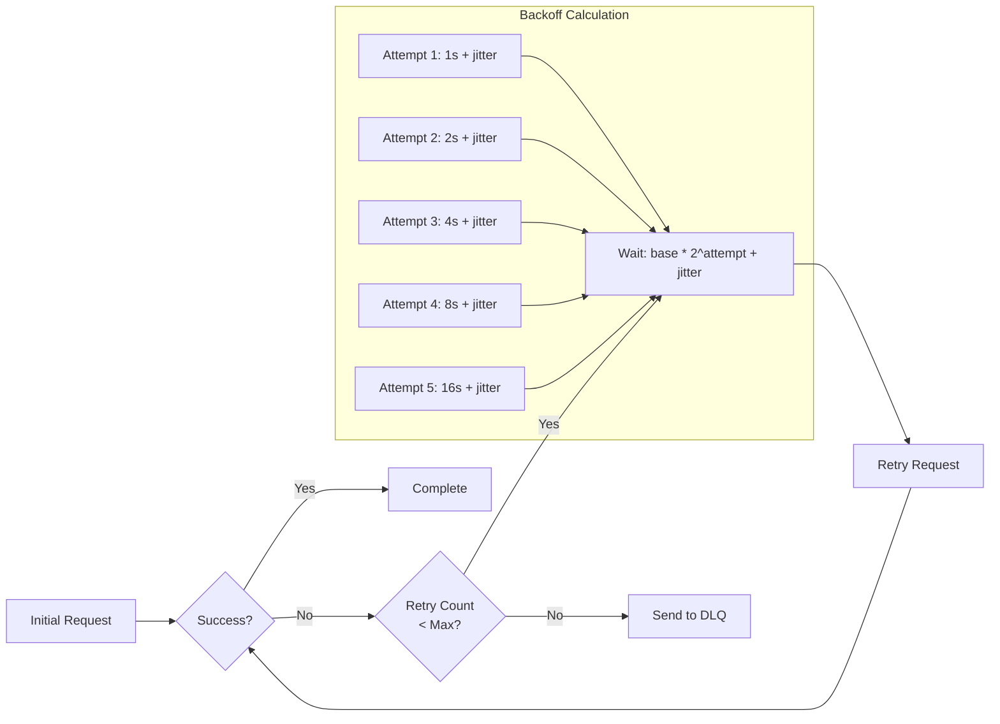
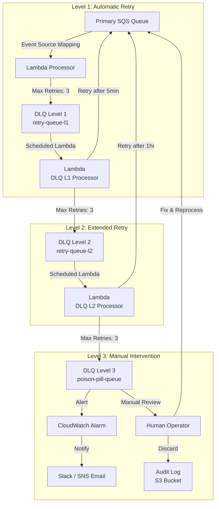
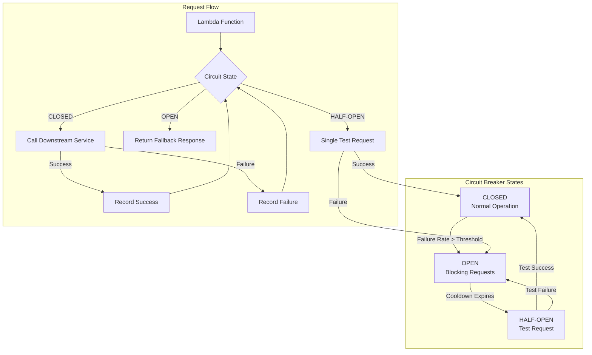
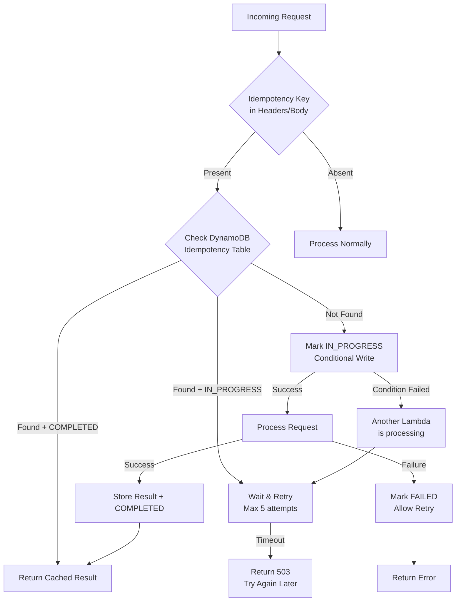
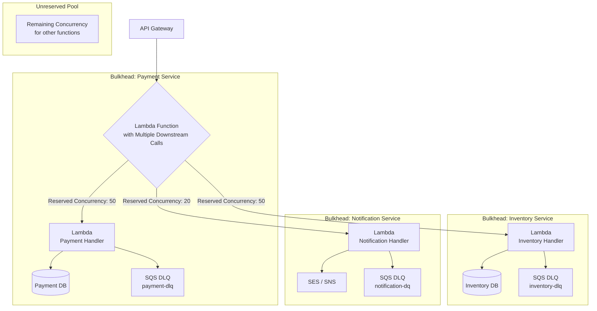
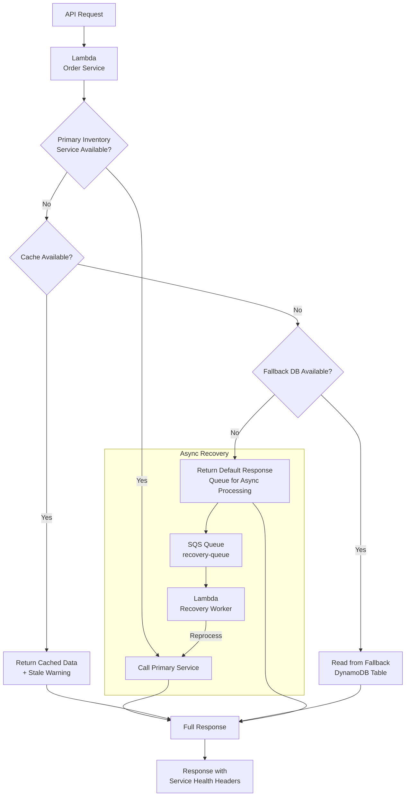
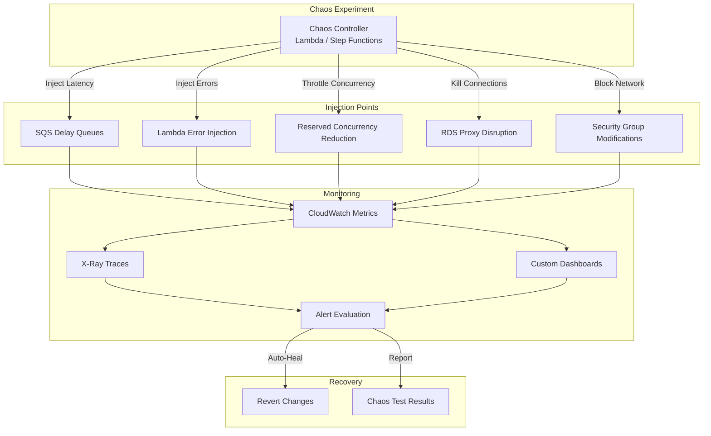

# Error Handling & Resilience Patterns

## Overview

Building resilient serverless architectures requires defense-in-depth error handling across all layers. This document covers retry strategies, circuit breakers, dead-letter queues, and chaos engineering patterns for AWS Lambda, SNS, and SQS.

---

## Table of Contents

- [Retry Strategy Matrix](#retry-strategy-matrix)
- [Pattern 1: Exponential Backoff with Jitter](#pattern-1-exponential-backoff-with-jitter)
- [Pattern 2: Multi-Layer Dead-Letter Queue Strategy](#pattern-2-multi-layer-dead-letter-queue-strategy)
- [Pattern 3: Circuit Breaker Pattern](#pattern-3-circuit-breaker-pattern)
- [Pattern 4: Idempotency Patterns](#pattern-4-idempotency-patterns)
- [Pattern 5: Bulkhead Pattern](#pattern-5-bulkhead-pattern)
- [Pattern 6: Graceful Degradation](#pattern-6-graceful-degradation)
- [Pattern 7: Chaos Engineering for Serverless](#pattern-7-chaos-engineering-for-serverless)
- [Comprehensive Error Handling Checklist](#comprehensive-error-handling-checklist)
- [Anti-Patterns to Avoid](#anti-patterns-to-avoid)

---

## Retry Strategy Matrix

Default and configurable retry behavior for each AWS service that can drive Lambda.

| Service | Retry Mechanism | Default Behavior | Configurable Range |
|---------|----------------|-----------------|-------------------|
| **Lambda Async** | Redrive policy | 0 retries, then DLQ | 0-2 retries |
| **SQS → Lambda** | Event Source Mapping | 10,000 retries (~3 days) | 0-10,000 |
| **SNS → Lambda** | SNS retry | Exponential backoff, ~15 hours | Custom DeliveryPolicy |
| **SNS → SQS** | SNS retry | Exponential backoff | Custom DeliveryPolicy |
| **DynamoDB Stream** | Event Source Mapping | 18,000 retries (~6 hours) | 0-18,000 |
| **EventBridge** | Rule retry | Up to 24h, 185 attempts, exponential backoff + jitter | `MaximumEventAgeInSeconds` (60-86400), `MaximumRetryAttempts` (0-185), Dead-letter target (DLQ) |
| **Step Functions** | Catch/Retry state | No retry unless `Retry` is declared | `MaxAttempts`: 3 default, up to 99,999,999 |
| **API Gateway** | No built-in retry | Returns error | Client-side or Lambda |

---

## Pattern 1: Exponential Backoff with Jitter

The foundation of all retry strategies.



### Why This Pattern?

A naive retry (same delay every time, no randomization) causes two distinct failures. First, fixed-interval retries synchronize: if a downstream service degrades and drops a batch of requests simultaneously, every caller retries at the same fixed offset, hitting the service with another synchronized spike — a thundering herd that can prevent recovery entirely. Second, retrying without backoff wastes invocation time and money hammering a service that needs time to recover (e.g., a database restarting, a throttled API waking up), extending the outage rather than riding it out.

**Trade-off:** exponential backoff trades latency for resilience — a request that fails and retries 5 times can take 30+ seconds to resolve, which is unacceptable in a synchronous, user-facing call path. It's suited to async and queue-driven workloads (SQS, EventBridge, Step Functions) where the caller isn't blocked waiting; for synchronous APIs, cap retries aggressively or fail fast with a fallback instead.

### SNS Delivery Policy

```json
{
  "defaultHealthyRetryPolicy": {
    "minDelayTarget": 1,
    "maxDelayTarget": 20,
    "numNoDelayRetries": 0,
    "numMinDelayRetries": 5,
    "numMaxDelayRetries": 5,
    "backoffFunction": "exponential"
  },
  "throttlePolicy": {
    "maxReceivesPerSecond": 500
  },
  "sicklyRetryPolicy": null
}
```

### Retry Decision Framework

Whether an error should be retried and with what strategy, by error type.

| Error Type | Retry? | Strategy |
|-----------|--------|----------|
| **5xx / Throttling** | Yes | Exponential backoff + jitter |
| **4xx (except 429)** | No | Send to DLQ immediately |
| **Timeout** | Yes | Increase timeout, then retry |
| **Connection Error** | Yes | Quick retry (max 2-3, then DLQ for persistent issues) |
| **Validation Error** | No | Send to DLQ (won't fix on retry) |
| **Idempotency Conflict** | No | Skip or handle in code |

### Cost Considerations

Retries multiply invocation costs. A message retried 10,000 times costs 10,000x a single invocation. Set appropriate retry limits and use DLQs to contain costs. Circuit breakers also add overhead — measure failure rates to tune thresholds.

---

## Pattern 2: Multi-Layer Dead-Letter Queue Strategy

A comprehensive DLQ strategy with escalation levels.



### Why This Pattern?

A single flat DLQ conflates two very different failure modes: transient issues that will succeed if retried later, and poison messages that will never succeed no matter how many times they're replayed (bad schema, missing referenced record, etc.). Without escalation levels, on-call engineers either have to manually inspect every message to tell them apart, or the queue is bulk-reprocessed and the same poison messages fail again, burning invocations and masking the one message that actually needed a human to look at it.

**Trade-off:** each escalation level is its own queue, its own processor Lambda, and its own alarm — three times the infrastructure of a single DLQ, and delayed visibility into failures (a message doesn't reach human review until L1 and L2 retries are exhausted, which can take hours). For low-volume or non-critical queues, a single DLQ with a CloudWatch alarm is often sufficient and this pattern is overkill.

### DLQ Monitoring Alarms

Alarm thresholds and the action to take for each layer of the DLQ escalation chain.

| Metric | Threshold | Action |
|--------|-----------|--------|
| DLQ L1 ApproximateDepth > 0 | Warning | Log alert |
| DLQ L2 ApproximateDepth > 10 | Error | Page on-call |
| DLQ L3 ApproximateDepth > 0 | Critical | Immediate escalation |
| DLQ AgeOfOldestMessage > 1hr | Warning | Investigate |
| Lambda Errors > 10/min | Error | Check logs |

---

## Pattern 3: Circuit Breaker Pattern

Prevent cascading failures when a downstream service is unhealthy.



### Why This Pattern?

Without a circuit breaker, a Lambda function keeps calling a failing or slow downstream dependency on every invocation, and each call waits out its full connection/read timeout before failing. Under concurrent load this ties up Lambda concurrency, database connections (via RDS Proxy), and thread pools purely waiting on a dependency that isn't going to respond — the caller's own resource exhaustion becomes a second outage on top of the original one, and it propagates upstream to whatever called the caller. Retrying blindly (Pattern 1) makes this worse, not better, when the root cause is a hard outage rather than a transient blip.

**Trade-off:** the circuit breaker adds a layer of state (current state, failure counts, timers) that must be shared correctly across concurrent Lambda invocations — in-memory state doesn't persist between executions, so a real implementation needs an external store (DynamoDB, ElastiCache) or relies on the alpha Powertools decorator's per-invocation behavior, adding latency and a dependency of its own. It also means legitimate requests get rejected during the OPEN window even if the downstream service has already recovered, until the next half-open probe succeeds.

### Circuit Breaker Configuration

Tunable parameters that control when the circuit opens, closes, and retests the downstream service.

| Parameter | Value | Purpose |
|-----------|-------|---------|
| `failureThreshold` | 5 | Failures before opening circuit |
| `successThreshold` | 3 | Successes before closing circuit |
| `timeout` | 60s | Cooldown before half-open |
| `monitoringPeriod` | 30s | Window for failure counting |
| `failureRate` | 0.5 | 50% failure rate triggers open |

### AWS Implementation Options

Where to implement circuit breaking depending on the layer and complexity you're willing to take on.

| Approach | Tool | Complexity |
|----------|------|-----------|
| **Application-level** | Powertools Circuit Breaker | Low, in-code |
| **Infrastructure-level** | Step Functions Catch | Medium |
| **Network-level** | ALB health checks + target groups | High |
| **API-level** | API Gateway usage plan throttling | Medium |

### Powertools Circuit Breaker Example

Powertools for AWS Lambda (Python) ships a `circuit_breaker` decorator (currently under the `circuit_breaker_alpha` namespace — pin your Powertools version, as the API may still change before GA):

```python
from aws_lambda_powertools.utilities.circuit_breaker_alpha import circuit_breaker, CircuitBreakerError

@circuit_breaker(failure_threshold=5, recovery_timeout=30)
def call_downstream_service(payload):
    # Call to downstream dependency (HTTP, DB, etc.)
    return downstream_client.invoke(payload)

def lambda_handler(event, context):
    try:
        return call_downstream_service(event)
    except CircuitBreakerError:
        # Circuit is OPEN — return a fallback response instead of calling downstream
        return {"status": "degraded", "message": "Service temporarily unavailable"}
```

### When NOT to Use

- Don't use for errors that won't recover (validation errors) — send to DLQ directly
- Don't use with aggressive thresholds — risk of hiding real failures

---

## Pattern 4: Idempotency Patterns

Critical for at-least-once delivery systems to prevent duplicate processing.



### Why This Pattern?

Every AWS delivery mechanism in the Retry Strategy Matrix above — SQS event source mappings, SNS, EventBridge — guarantees at-least-once delivery, not exactly-once. A consumer will occasionally see the same message twice: because the visibility timeout expired before the Lambda finished processing, because the producer retried after a timed-out acknowledgment it never received, or because a Lambda's DLQ redrive replays a message that actually succeeded. Without an idempotency check, "charge the credit card" or "decrement inventory" executes twice for the same logical request, corrupting state in a way that's hard to detect and hard to reverse after the fact.

**Trade-off:** the idempotency table adds a DynamoDB read/write (and its own latency and cost) to every request, plus the conditional-write logic to avoid a race between two concurrent deliveries of the same message. It only guards against duplicate delivery of the same idempotency key — it does nothing for out-of-order processing of related-but-distinct messages, which needs FIFO ordering (see Design/01) instead.

### Idempotency Table Design

DynamoDB table schema for tracking request state and caching responses.

| Attribute | Type | Purpose |
|-----------|------|---------|
| `idempotency_key` | String (PK) | Unique request identifier |
| `status` | String | IN_PROGRESS / COMPLETED / FAILED |
| `response` | String (JSON) | Cached response for replay |
| `created_at` | Number | Timestamp for TTL |
| `expires_at` | Number | TTL for automatic cleanup |

### Idempotency Key Sources

Common places to derive an idempotency key from, depending on the trigger.

| Source | Example | Use Case |
|--------|---------|----------|
| **Client-generated** | `X-Idempotency-Key: req-123` | API requests, client retries |
| **Message ID** | `messageId` from SQS | Queue processing |
| **Business key** | `orderId: ORD-001` | Domain-specific deduplication |
| **Hash** | `SHA256(payload)` | Content-based deduplication |

---

## Pattern 5: Bulkhead Pattern

Isolate failures to prevent one service from taking down the entire system.



### Why This Pattern?

Lambda concurrency is a shared, account-level (and often stack-level) pool. Without reserved concurrency per downstream integration, a burst of traffic to a low-priority path — say, a notification service having a slow day — can consume all available concurrency and throttle invocations for a critical path like payment processing that shares the same unreserved pool, even though the two have nothing to do with each other functionally. This is the serverless equivalent of one noisy tenant taking down every other tenant on a shared thread pool.

**Trade-off:** reserving concurrency for a service is also a hard ceiling on that service — traffic beyond the reserved amount is throttled even if the rest of the account has capacity to spare, so under-provisioning a bulkhead creates the exact throttling problem the pattern is meant to prevent elsewhere. It also reduces the size of the shared unreserved pool available to everything else, so bulkheads have to be sized deliberately, not applied uniformly to every function.

### Concurrency Allocation Strategy

Reserved concurrency budget per service, prioritized by business criticality.

| Service | Priority | Reserved Concurrency | Rationale |
|---------|----------|---------------------|-----------|
| **Payment Processing** | Critical | 100 | Never starve, financial impact |
| **Order Processing** | High | 50 | Core business logic |
| **Notifications** | Medium | 20 | Important but not blocking |
| **Analytics** | Low | 10 | Can tolerate delays |
| **Unreserved** | Shared | Remaining | Flexibility for spikes |

---

## Pattern 6: Graceful Degradation

Maintain partial functionality when dependencies fail.



### Why This Pattern?

Without graceful degradation, a single failed dependency becomes a total outage: if the order service's only path to inventory data is a direct synchronous call, an inventory service blip returns an error to every caller, even though a slightly stale answer from cache or a fallback table would have been good enough for most requests. Treating every dependency as strictly required — rather than distinguishing "must have fresh data" from "stale data is acceptable" — turns partial, isolated failures into full-system unavailability.

**Trade-off:** serving cached or fallback data means serving wrong or stale data in some cases (a "sold out" item shown as available, a stale price), which shifts the failure mode from visible errors to silent incorrectness that's harder to notice and can have its own business cost. It also requires building and maintaining the cache/fallback path itself, plus the async recovery loop to reconcile once the primary service is back — infrastructure that sits idle until the primary service actually fails.

### Degradation Levels

Fallback tiers a system can drop through as dependencies become unavailable, from full service to maintenance mode.

| Level | Behavior | User Impact |
|-------|----------|-------------|
| **Full** | All services operational | None |
| **Reduced** | Non-critical features disabled | Minor |
| **Degraded** | Cached/stale data returned | Noticeable |
| **Minimal** | Core functionality only | Significant |
| **Maintenance** | Read-only or queued | Maximum |

---

## Pattern 7: Chaos Engineering for Serverless

Proactive resilience testing patterns.



### Why This Pattern?

Retry policies, DLQs, circuit breakers, and graceful degradation are all code paths that, by definition, only run when something is already broken — which in most systems means they run for the first time during a real production incident, with no prior evidence they actually work. A DLQ redrive Lambda with a bug, a circuit breaker threshold that never trips, or a fallback path that itself throws an exception all look fine in normal operation and only surface when the primary path fails, which is the worst possible time to discover it.

**Trade-off:** chaos experiments are themselves a source of risk — injecting real faults (timeouts, throttling, connection kills) into a live or production-like environment can cause the exact outage you're testing resilience against if scoped incorrectly, which is why AWS FIS's stop conditions and blast-radius targeting are load-bearing, not optional. Building and maintaining the experiment catalog and injection tooling is also ongoing work with no feature-facing payoff, so it tends to get deprioritized unless resilience is treated as a first-class requirement.

### Chaos Experiment Catalog

Sample fault-injection experiments, the expected resilient behavior, and how to validate it.

| Experiment | Injection Method | Expected Behavior | Validation |
|-----------|-----------------|------------------|------------|
| **Lambda Timeout** | Reduce timeout to 1s | DLQ receives messages | DLQ depth increases |
| **SQS Queue Full** | Stop consumer Lambda | Queue depth grows | No message loss |
| **DynamoDB Throttling** | Reduce RCUs/WCUs | Retry logic activates | Requests eventually succeed |
| **RDS Connection Limit** | Reduce RDS Proxy pool | Queue backs up | No connection errors leak |
| **Region Failure** | Route 53 failover | Traffic shifts to secondary | Requires pre-warming, DNS TTL tuning |

### AWS Fault Injection Simulator (FIS)

AWS FIS is a managed service for running chaos experiments. Use it instead of manual injection for repeatable, auditable experiments with built-in safety controls (targets, stop conditions, tags).

---

## Comprehensive Error Handling Checklist

### Lambda Function Level

- [ ] Set appropriate timeout (not default 3s)
- [ ] Configure reserved concurrency
- [ ] Implement structured logging with correlation IDs
- [ ] Add try-catch with specific error handling
- [ ] Configure DLQ for async invocations
- [ ] Use Powertools for structured logging and metrics
- [ ] Implement idempotency for SQS/DynamoDB triggers
- [ ] Use `ReportBatchItemFailures` for partial batch failure reporting (SQS → Lambda)
- [ ] Set environment-specific error thresholds

### Infrastructure Level

- [ ] Multi-AZ deployment for all stateful services
- [ ] DLQ on every SQS queue
- [ ] CloudWatch Alarms on error rates
- [ ] X-Ray tracing enabled
- [ ] Log retention policies configured
- [ ] Auto-scaling boundaries set (min/max)
- [ ] VPC endpoints for critical AWS services
- [ ] Backup and recovery tested

### Monitoring & Alerting

Warning and critical thresholds for the key resilience metrics, with the recommended action at each level.

| Metric | Warning | Critical | Action |
|--------|---------|----------|--------|
| Lambda Error Rate | >1% | >5% | Investigate logs |
| Lambda Duration p99 | >70% timeout | >90% timeout | Optimize code |
| SQS Queue Depth | >1000 | >10000 | Scale consumers |
| DLQ Depth | >0 | >100 | Manual review |
| Throttles | >10/min | >100/min | Increase concurrency |
| Cold Starts | >20% | >50% | Provisioned concurrency |
| DynamoDB IteratorAge | >300s | >900s | Scale stream consumers |

---

## Anti-Patterns to Avoid

Common error-handling mistakes and the fix for each.

| Anti-Pattern | Problem | Solution |
|-------------|---------|----------|
| **Swallowing exceptions** | Silent failures, data loss | Log all exceptions, use DLQ |
| **Infinite retries** | Queue buildup, wasted cost | Set max retry attempts |
| **No circuit breaker** | Cascading failures | Implement circuit breaker |
| **Synchronous retries in hot path** | User-facing delays | Use async retry with SQS |
| **Single DLQ for all services** | Hard to diagnose, mixed priorities | Per-service DLQs |
| **No error classification** | Retry errors that won't fix | Classify 4xx vs 5xx |
| **Ignoring cold start latency** | Poor user experience | Provisioned concurrency for critical paths |
