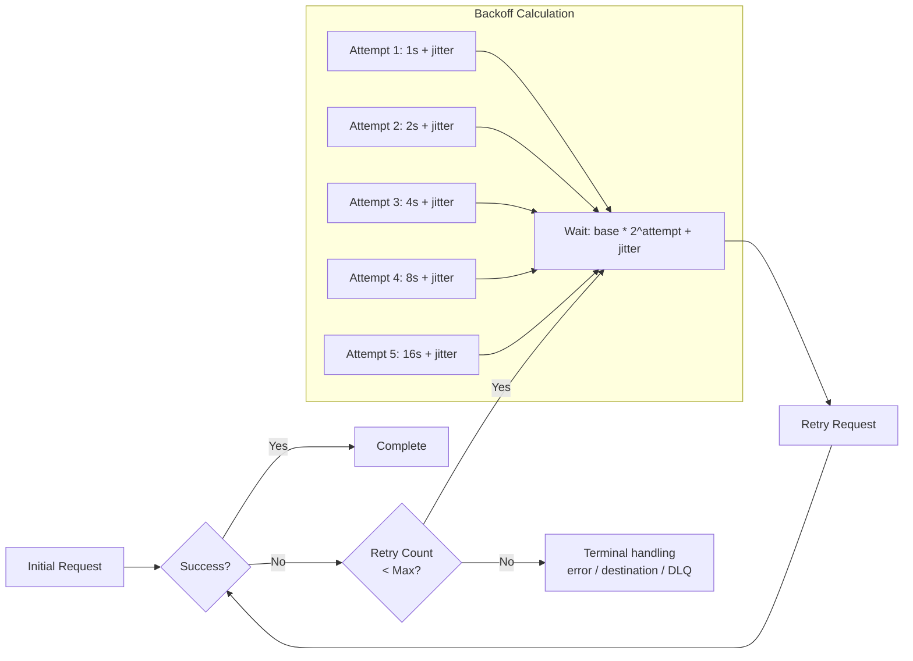
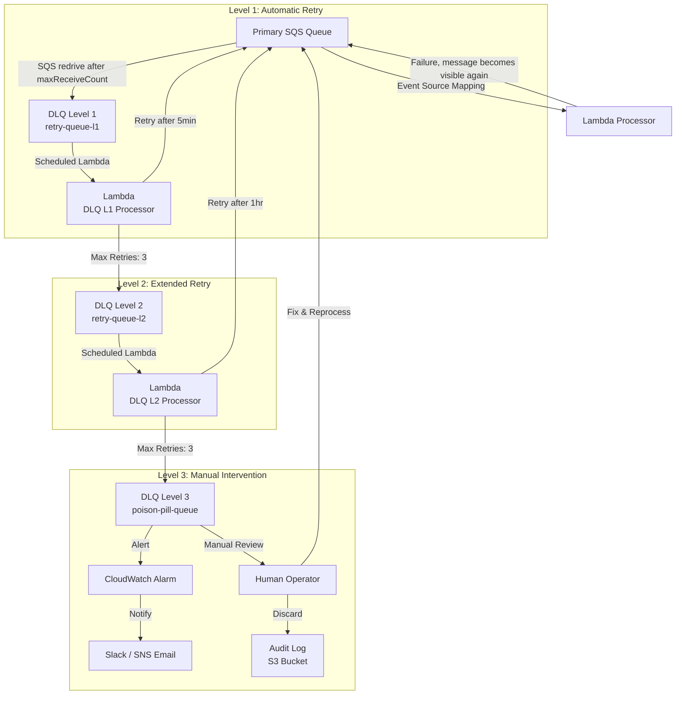
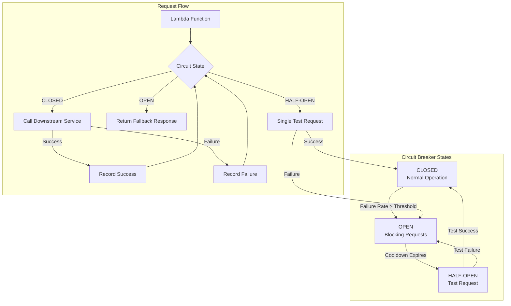
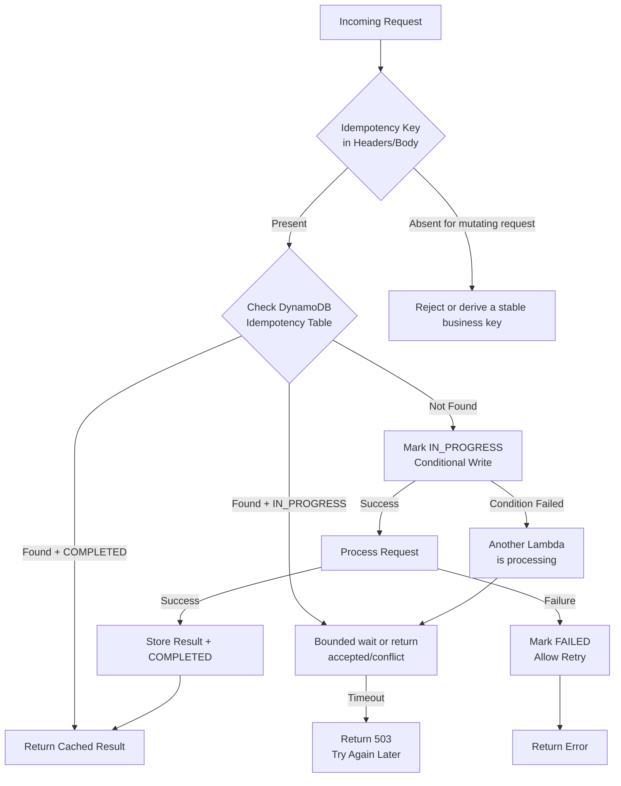
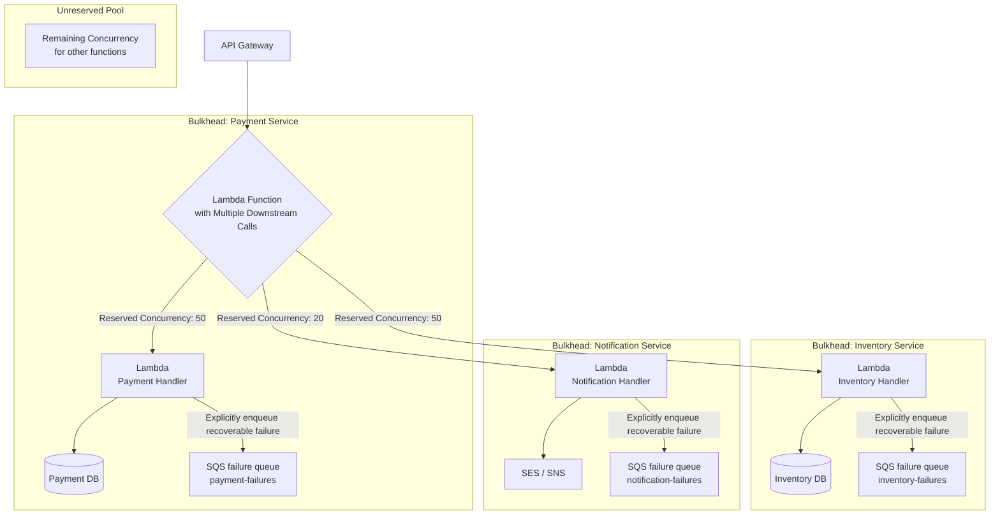
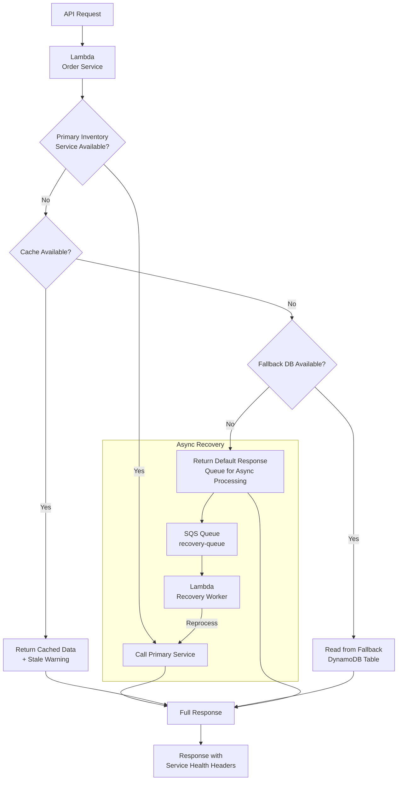
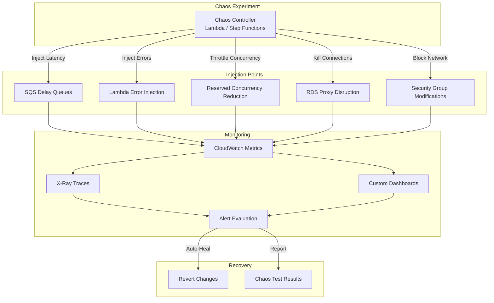

# Error Handling & Resilience Patterns

## Overview

Building resilient serverless architectures requires defense-in-depth error handling across all layers. This document covers retry strategies, circuit breakers, dead-letter queues, and chaos engineering patterns for AWS Lambda, SNS, and SQS.

---

## Table of Contents

- [Retry Strategy Matrix](#retry-strategy-matrix)
- [Pattern 1: Exponential Backoff with Jitter](#pattern-1-exponential-backoff-with-jitter)
- [Pattern 2: Multi-Layer Dead-Letter Queue Strategy](#pattern-2-multi-layer-dead-letter-queue-strategy)
- [Pattern 3: Circuit Breaker Pattern](#pattern-3-circuit-breaker-pattern)
- [Pattern 4: Idempotency Patterns](#pattern-4-idempotency-patterns)
- [Pattern 5: Bulkhead Pattern](#pattern-5-bulkhead-pattern)
- [Pattern 6: Graceful Degradation](#pattern-6-graceful-degradation)
- [Pattern 7: Chaos Engineering for Serverless](#pattern-7-chaos-engineering-for-serverless)
- [Comprehensive Error Handling Checklist](#comprehensive-error-handling-checklist)
- [Anti-Patterns to Avoid](#anti-patterns-to-avoid)
- [Authoritative References](#authoritative-references)

---

## Retry Strategy Matrix

Default and configurable retry behavior for each AWS service that can drive Lambda.

| Service | Retry Mechanism | Default Behavior | Configurable Range |
|---------|----------------|-----------------|-------------------|
| **Lambda Async** | Internal async queue | Two retries for function errors by default; throttling/system errors retry for up to the event-age limit | `MaximumRetryAttempts`: 0-2; event age: up to 6 hours; optional destination/DLQ |
| **SQS → Lambda** | Visibility timeout + SQS redrive policy | Failed messages become visible again; Lambda does not expose a retry-count setting for SQS | Set queue `maxReceiveCount`, retention, visibility timeout, and DLQ |
| **SNS → Lambda/SQS** | SNS endpoint delivery policy | AWS-managed endpoint retries can continue for 100,015 attempts over 23 days for server-side failures | Service-managed; configure a subscription redrive policy to an SQS DLQ |
| **SNS → HTTP/S** | SNS delivery policy | Endpoint-specific retry phases | Custom delivery policy, with total retry time capped at 3,600 seconds |
| **DynamoDB Stream** | Event Source Mapping | Retries until the record expires (24-hour stream retention) by default | `MaximumRetryAttempts`: -1 or 0-10,000; record age and failure destination are configurable |
| **EventBridge** | Rule retry | Up to 24h, 185 attempts, exponential backoff + jitter | `MaximumEventAgeInSeconds` (60-86400), `MaximumRetryAttempts` (0-185), Dead-letter target (DLQ) |
| **Step Functions** | `Retry`/`Catch` fields on supported states | No retry unless a retrier is declared | A retrier defaults to 3 attempts when `MaxAttempts` is omitted; set workload-specific bounds |
| **API Gateway** | No built-in retry | Returns error | Client-side or Lambda |

---

## Pattern 1: Exponential Backoff with Jitter

A common foundation for bounded retry strategies.



### Why This Pattern?

A naive retry (same delay every time, no randomization) causes two distinct failures. First, fixed-interval retries synchronize: if a downstream service degrades and drops a batch of requests simultaneously, every caller retries at the same fixed offset, hitting the service with another synchronized spike — a thundering herd that can prevent recovery entirely. Second, retrying without backoff wastes invocation time and money hammering a service that needs time to recover (e.g., a database restarting, a throttled API waking up), extending the outage rather than riding it out.

**Trade-off:** exponential backoff trades latency for resilience — a request that fails and retries 5 times can take 30+ seconds to resolve, which is unacceptable in a synchronous, user-facing call path. It's suited to async and queue-driven workloads (SQS, EventBridge, Step Functions) where the caller isn't blocked waiting; for synchronous APIs, cap retries aggressively or fail fast with a fallback instead.

### SNS Delivery Policy

```json
{
  "defaultHealthyRetryPolicy": {
    "minDelayTarget": 1,
    "maxDelayTarget": 20,
    "numNoDelayRetries": 0,
    "numMinDelayRetries": 5,
    "numMaxDelayRetries": 5,
    "backoffFunction": "exponential"
  },
  "throttlePolicy": {
    "maxReceivesPerSecond": 500
  },
  "sicklyRetryPolicy": null
}
```

### Retry Decision Framework

Whether an error should be retried and with what strategy, by error type.

| Error Type | Retry? | Strategy |
|-----------|--------|----------|
| **5xx / Throttling** | Yes | Exponential backoff + jitter |
| **Most 4xx** | Usually no | Treat validation/auth errors as terminal; handle explicitly retryable statuses such as 408, 409, and 429 by API contract |
| **Timeout** | Sometimes | Retry only idempotent operations within the remaining deadline; tune connect/read timeouts from measured latency |
| **Connection Error** | Sometimes | Retry idempotent operations with a small capped budget and jitter |
| **Validation Error** | No | Reject synchronously; for asynchronous flows, quarantine or use a DLQ only when investigation or replay is required |
| **Idempotency Conflict** | No | Return the stored result, an accepted/in-progress response, or a contract-appropriate conflict |

### Cost Considerations

Retries multiply request and compute costs and can amplify pressure on a failing dependency. Set bounded retry budgets where the source supports them, use retention/record-age limits and failure destinations, and measure retry volume before tuning thresholds.

---

## Pattern 2: Multi-Layer Dead-Letter Queue Strategy

An illustrative DLQ escalation design. The queue count, retry count, and delay at each level must come from the workload's recovery objective and dependency behavior; many workloads need only one monitored DLQ.



### Why This Pattern?

A single flat DLQ conflates two very different failure modes: transient issues that will succeed if retried later, and poison messages that will never succeed no matter how many times they're replayed (bad schema, missing referenced record, etc.). Without escalation levels, on-call engineers either have to manually inspect every message to tell them apart, or the queue is bulk-reprocessed and the same poison messages fail again, burning invocations and masking the one message that actually needed a human to look at it.

**Trade-off:** each escalation level is its own queue, its own processor Lambda, and its own alarm — three times the infrastructure of a single DLQ, and delayed visibility into failures (a message doesn't reach human review until L1 and L2 retries are exhausted, which can take hours). For low-volume or non-critical queues, a single DLQ with a CloudWatch alarm is often sufficient and this pattern is overkill.

### DLQ Monitoring Alarms

Alarm thresholds and the action to take for each layer of the DLQ escalation chain.

| Metric | Threshold | Action |
|--------|-----------|--------|
| L1 `ApproximateNumberOfMessagesVisible` > 0 | Warning | Log alert |
| L2 `ApproximateNumberOfMessagesVisible` > workload threshold | Error | Page on-call |
| L3 `ApproximateNumberOfMessagesVisible` > 0 | Critical | Immediate escalation |
| `ApproximateAgeOfOldestMessage` exceeds response SLO | Warning | Investigate |
| Lambda errors exceed the workload's error-budget threshold | Error | Check logs, traces, deployments, and dependencies |

---

## Pattern 3: Circuit Breaker Pattern

Prevent cascading failures when a downstream service is unhealthy.



### Why This Pattern?

Without a circuit breaker, a Lambda function keeps calling a failing or slow downstream dependency on every invocation, and each call waits out its full connection/read timeout before failing. Under concurrent load this ties up Lambda concurrency, database connections (via RDS Proxy), and thread pools purely waiting on a dependency that isn't going to respond — the caller's own resource exhaustion becomes a second outage on top of the original one, and it propagates upstream to whatever called the caller. Retrying blindly (Pattern 1) makes this worse, not better, when the root cause is a hard outage rather than a transient blip.

**Trade-off:** the circuit breaker adds state (current state, failure counts, timers) that must be shared correctly across concurrent Lambda execution environments. A purely in-memory library only protects one warm environment; a function-wide breaker needs an external store such as DynamoDB or ElastiCache, which adds latency and another dependency. Legitimate requests can also be rejected during the OPEN window after the downstream service has recovered, until a half-open probe succeeds.

### Circuit Breaker Configuration

Illustrative tunable parameters that control when the circuit opens, closes, and retests the downstream service. Derive real values from measured latency, request volume, error budgets, and recovery time; the example numbers are not AWS defaults.

| Parameter | Value | Purpose |
|-----------|-------|---------|
| `failureThreshold` | 5 | Failures before opening circuit |
| `successThreshold` | 3 | Successes before closing circuit |
| `timeout` | 60s | Cooldown before half-open |
| `monitoringPeriod` | 30s | Window for failure counting |
| `failureRate` | 0.5 | 50% failure rate triggers open |

### Implementation Options and Adjacent Controls

Where to implement circuit breaking depending on the layer and complexity you're willing to take on.

| Approach | Tool | Complexity |
|----------|------|-----------|
| **Application-level** | A maintained language library; use shared state when the breaker must span execution environments | Medium |
| **Proxy/service-mesh level** | Envoy/Istio circuit breaking and outlier detection | Medium-High |
| **Workflow-level (not a breaker)** | Step Functions `Retry`/`Catch` for bounded retries and fallbacks | Medium |
| **Load shedding (not a breaker)** | API Gateway throttling, reserved concurrency, and ALB health checks | Low-Medium |

### Circuit Breaker Sketch

The following is pseudocode: choose a maintained library for the runtime and decide explicitly whether state is local to one execution environment or shared across all invocations.

```text
from your_resilience_library import circuit_breaker, CircuitBreakerOpen

@circuit_breaker(failure_threshold=5, recovery_timeout=30)
def call_downstream_service(payload):
    # Call to downstream dependency (HTTP, DB, etc.)
    return downstream_client.invoke(payload)

def lambda_handler(event, context):
    try:
        return call_downstream_service(event)
    except CircuitBreakerOpen:
        # Circuit is OPEN — return a fallback response instead of calling downstream
        return {"status": "degraded", "message": "Service temporarily unavailable"}
```

### When NOT to Use

- Don't use for errors that won't recover (such as validation errors) — reject them or quarantine asynchronous events when investigation is required
- Don't use with aggressive thresholds — risk of hiding real failures

---

## Pattern 4: Idempotency Patterns

Critical for at-least-once delivery systems to prevent duplicate processing.



### Why This Pattern?

Every AWS delivery mechanism in the Retry Strategy Matrix above — SQS event source mappings, SNS, EventBridge — guarantees at-least-once delivery, not exactly-once. A consumer will occasionally see the same message twice: because the visibility timeout expired before the Lambda finished processing, because the producer retried after a timed-out acknowledgment it never received, or because a Lambda's DLQ redrive replays a message that actually succeeded. Without an idempotency check, "charge the credit card" or "decrement inventory" executes twice for the same logical request, corrupting state in a way that's hard to detect and hard to reverse after the fact.

**Trade-off:** the idempotency table adds a DynamoDB read/write (and its own latency and cost) to every request, plus the conditional-write logic to avoid a race between two concurrent deliveries of the same message. It only guards against duplicate delivery of the same idempotency key — it does nothing for out-of-order processing of related-but-distinct messages, which needs FIFO ordering (see Design/01) instead.

### Idempotency Table Design

DynamoDB table schema for tracking request state and caching responses.

| Attribute | Type | Purpose |
|-----------|------|---------|
| `idempotency_key` | String (PK) | Unique request identifier |
| `status` | String | IN_PROGRESS / COMPLETED / FAILED |
| `response` | String (JSON) | Cached response for replay |
| `created_at` | Number | Audit timestamp |
| `expires_at` | Number | TTL for automatic cleanup |

### Idempotency Key Sources

Common places to derive an idempotency key from, depending on the trigger.

| Source | Example | Use Case |
|--------|---------|----------|
| **Client-generated** | `X-Idempotency-Key: req-123` | API requests, client retries |
| **Message ID** | `messageId` from SQS | Retries of the same SQS message; prefer a producer/business event ID when a message can be republished or redriven as a new message |
| **Business key** | `orderId: ORD-001` | Domain-specific deduplication |
| **Hash** | `SHA256(canonical_payload + operation_scope)` | Content-based deduplication when the payload can be canonicalized and the collision/scope policy is explicit |

---

## Pattern 5: Bulkhead Pattern

Isolate failures to prevent one service from taking down the entire system.



### Why This Pattern?

Lambda concurrency is a shared, account-level (and often stack-level) pool. Without reserved concurrency per downstream integration, a burst of traffic to a low-priority path — say, a notification service having a slow day — can consume all available concurrency and throttle invocations for a critical path like payment processing that shares the same unreserved pool, even though the two have nothing to do with each other functionally. This is the serverless equivalent of one noisy tenant taking down every other tenant on a shared thread pool.

**Trade-off:** reserving concurrency for a service is also a hard ceiling on that service — traffic beyond the reserved amount is throttled even if the rest of the account has capacity to spare, so under-provisioning a bulkhead creates the exact throttling problem the pattern is meant to prevent elsewhere. It also reduces the size of the shared unreserved pool available to everything else, so bulkheads have to be sized deliberately, not applied uniformly to every function.

### Concurrency Allocation Strategy

Illustrative reserved-concurrency budget per service, prioritized by business criticality. Reserved concurrency both reserves capacity for and caps a function; values remain subject to account concurrency and Lambda scaling behavior and must be load-tested.

| Service | Priority | Reserved Concurrency | Rationale |
|---------|----------|---------------------|-----------|
| **Payment Processing** | Critical | 100 | Reserve capacity and cap blast radius for a financially sensitive path |
| **Order Processing** | High | 50 | Core business logic |
| **Notifications** | Medium | 20 | Important but not blocking |
| **Analytics** | Low | 10 | Can tolerate delays |
| **Unreserved** | Shared | Remaining | Flexibility for spikes |

---

## Pattern 6: Graceful Degradation

Maintain partial functionality when dependencies fail.



### Why This Pattern?

Without graceful degradation, a single failed dependency becomes a total outage: if the order service's only path to inventory data is a direct synchronous call, an inventory service blip returns an error to every caller, even though a slightly stale answer from cache or a fallback table would have been good enough for most requests. Treating every dependency as strictly required — rather than distinguishing "must have fresh data" from "stale data is acceptable" — turns partial, isolated failures into full-system unavailability.

**Trade-off:** serving cached or fallback data means serving wrong or stale data in some cases (a "sold out" item shown as available, a stale price), which shifts the failure mode from visible errors to silent incorrectness that's harder to notice and can have its own business cost. It also requires building and maintaining the cache/fallback path itself, plus the async recovery loop to reconcile once the primary service is back — infrastructure that sits idle until the primary service actually fails.

### Degradation Levels

Fallback tiers a system can drop through as dependencies become unavailable, from full service to maintenance mode.

| Level | Behavior | User Impact |
|-------|----------|-------------|
| **Full** | All services operational | None |
| **Reduced** | Non-critical features disabled | Minor |
| **Degraded** | Cached/stale data returned | Noticeable |
| **Minimal** | Core functionality only | Significant |
| **Maintenance** | Read-only or queued | Maximum |

---

## Pattern 7: Chaos Engineering for Serverless

Proactive resilience testing patterns.



### Why This Pattern?

Retry policies, DLQs, circuit breakers, and graceful degradation are all code paths that, by definition, only run when something is already broken — which in most systems means they run for the first time during a real production incident, with no prior evidence they actually work. A DLQ redrive Lambda with a bug, a circuit breaker threshold that never trips, or a fallback path that itself throws an exception all look fine in normal operation and only surface when the primary path fails, which is the worst possible time to discover it.

**Trade-off:** chaos experiments are themselves a source of risk — injecting real faults (timeouts, throttling, connection kills) into a live or production-like environment can cause the exact outage you're testing resilience against if scoped incorrectly, which is why AWS FIS's stop conditions and blast-radius targeting are load-bearing, not optional. Building and maintaining the experiment catalog and injection tooling is also ongoing work with no feature-facing payoff, so it tends to get deprioritized unless resilience is treated as a first-class requirement.

### Chaos Experiment Catalog

Sample fault-injection experiments, the expected resilient behavior, and how to validate it.

| Experiment | Injection Method | Expected Behavior | Validation |
|-----------|-----------------|------------------|------------|
| **Lambda delay/error** | AWS FIS Lambda extension: `invocation-add-delay` or `invocation-error` | Retry/fallback activates | Errors, latency, and failure destination match the hypothesis |
| **SQS consumer outage** | Stop the consumer Lambda within a controlled experiment | Queue depth and message age grow | No message loss and backlog drains after recovery |
| **AWS API throttling** | AWS FIS `inject-api-throttle-error` scoped to a test IAM role and a supported service/API action | Retry budget activates | Backoff occurs without a retry storm |
| **Database connection pressure** | Controlled load test in an isolated environment | Queue/load shedding activates | Borrow timeouts remain bounded and recovery is automatic |
| **Regional recovery** | Execute the tested ARC Region switch or recovery runbook in a game day | Traffic and state move to the recovery Region | Measured RTO/RPO meet the target |

### AWS Fault Injection Simulator (FIS)

AWS FIS is a managed service for repeatable, auditable experiments with targets and CloudWatch-alarm stop conditions. Lambda actions require the AWS FIS managed extension as a layer plus per-Region S3 configuration; response-streaming functions are not supported by that extension.

---

## Comprehensive Error Handling Checklist

### Lambda Function Level

- [ ] Set appropriate timeout (not default 3s)
- [ ] Assess reserved concurrency; configure it when a function needs an isolation guarantee or concurrency cap
- [ ] Implement structured logging with correlation IDs
- [ ] Use language-appropriate, specific error handling and preserve actionable context
- [ ] Configure an on-failure destination or DLQ for async invocations that require failed-event retention
- [ ] Consider Powertools for supported structured logging, metrics, tracing, and idempotency utilities
- [ ] Implement idempotency for queue/stream consumers that perform side effects
- [ ] Use `ReportBatchItemFailures` for partial batch failure reporting (SQS → Lambda)
- [ ] Set environment-specific error thresholds

### Infrastructure Level

- [ ] Select and test Multi-AZ options for stateful services whose availability requirement needs them
- [ ] Monitored DLQ for queues whose exhausted failures need isolation and redrive; assess ordering impact before attaching one to a FIFO workflow
- [ ] CloudWatch Alarms on error rates
- [ ] Enable supported tracing where it materially improves diagnosis
- [ ] Log retention policies configured
- [ ] Auto-scaling boundaries set (min/max)
- [ ] Assess VPC endpoints when private network paths, policy controls, or egress design require them
- [ ] Backup and recovery tested

### Monitoring & Alerting

Derive alarm thresholds from the workload SLO, error budget, traffic baseline, and downstream capacity rather than universal counts.

| Signal | Derive the threshold from | Response |
|--------|---------------------------|----------|
| Lambda errors | Error budget and expected handled-error baseline | Correlate logs/traces with deployments and dependency health |
| Lambda duration percentiles | End-to-end deadline and remaining timeout margin | Identify slow code/dependencies; tune timeout only after understanding the cause |
| SQS message age and queue depth | Maximum acceptable processing latency and measured drain rate | Check consumer errors, concurrency caps, downstream capacity, and producer spikes |
| DLQ visible messages | Failure-retention policy; often any new message warrants notification | Triage ownership and cause, then redrive only after the failure is safe to retry |
| Lambda throttles and concurrency | Function/account quotas, reservations, and downstream safe throughput | Determine whether the constraint is intentional before changing concurrency |
| Cold-start tail latency and provisioned-concurrency spillover | Latency SLO and traffic pattern | Optimize initialization; use provisioned concurrency or SnapStart only when supported and justified by measurements/cost |
| DynamoDB/Kinesis `IteratorAge` | Event-freshness SLO and stream retention | Investigate processing failures, hot partitions, batch settings, and concurrency |

---

## Anti-Patterns to Avoid

Common error-handling mistakes and the fix for each.

| Anti-Pattern | Problem | Solution |
|-------------|---------|----------|
| **Swallowing exceptions** | Silent failures and data loss | Emit structured, sanitized diagnostics and propagate the error to the applicable failure route |
| **Unbounded retries** | Queue buildup, retry storms, and wasted cost | Use a bounded, source-specific retry/redrive policy plus event-age or retention limits |
| **No protection from a failing dependency** | Repeated calls can cascade into concurrency exhaustion | Use bounded timeouts/retries and add a circuit breaker when the dependency's failure mode can cascade |
| **Unbounded synchronous retries in a hot path** | Exhausts the caller's deadline | Permit only a small, idempotent retry budget within the deadline; use async processing when a completed response is unnecessary |
| **Unrelated workloads share one DLQ** | Mixed ownership, access, and recovery policy | Partition DLQs by owner, failure policy, and access boundary |
| **No error classification** | Retries terminal errors or drops transient ones | Classify by the dependency's API contract; some 4xx responses such as 408, 409, or 429 can be retryable |
| **Ignoring cold-start tail latency** | Can violate a latency SLO | Measure first; optimize initialization and consider supported SnapStart or provisioned concurrency when the SLO and cost justify it |

## Authoritative References

- [Lambda retry behavior](https://docs.aws.amazon.com/lambda/latest/dg/invocation-retries.html)
- [Lambda asynchronous invocation error handling](https://docs.aws.amazon.com/lambda/latest/dg/invocation-async-error-handling.html)
- [Configuring SQS event source mappings](https://docs.aws.amazon.com/lambda/latest/dg/services-sqs-configure.html)
- [Lambda DynamoDB event source mapping parameters](https://docs.aws.amazon.com/lambda/latest/dg/services-ddb-params.html)
- [Amazon SNS message delivery retries](https://docs.aws.amazon.com/sns/latest/dg/sns-message-delivery-retries.html)
- [EventBridge retry policies and dead-letter queues](https://docs.aws.amazon.com/eventbridge/latest/userguide/eb-rule-retry-policy.html)
- [Step Functions handling errors with Retry and Catch](https://docs.aws.amazon.com/step-functions/latest/dg/concepts-error-handling.html)
- [Lambda reserved concurrency](https://docs.aws.amazon.com/lambda/latest/dg/configuration-concurrency.html)
- [AWS FIS Lambda actions](https://docs.aws.amazon.com/fis/latest/userguide/use-lambda-actions.html)
- [AWS FIS actions reference](https://docs.aws.amazon.com/fis/latest/userguide/fis-actions-reference.html)
