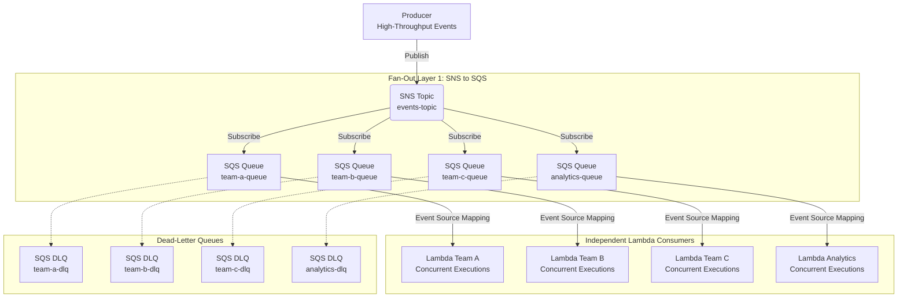
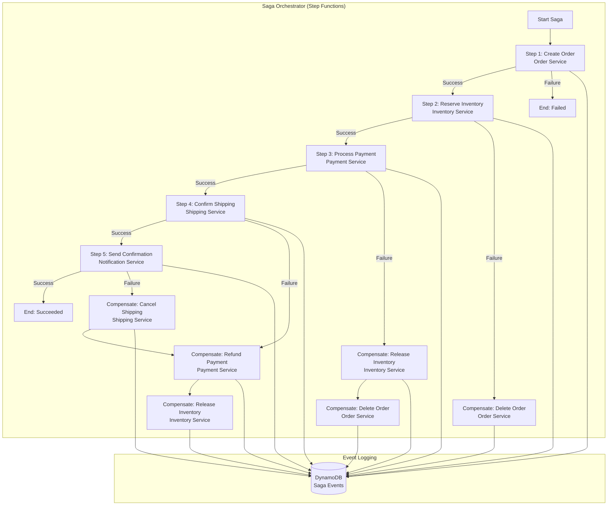
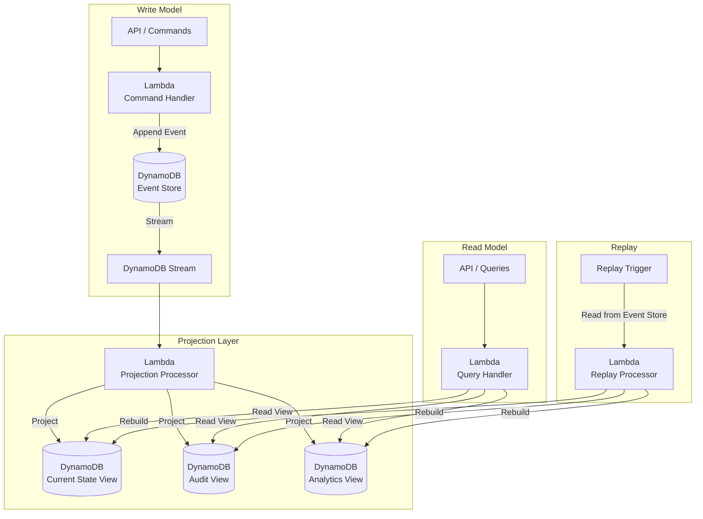
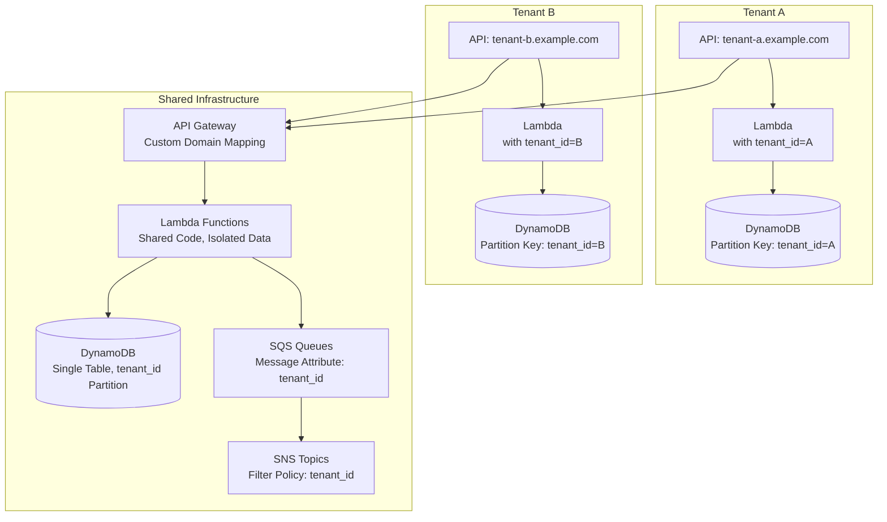
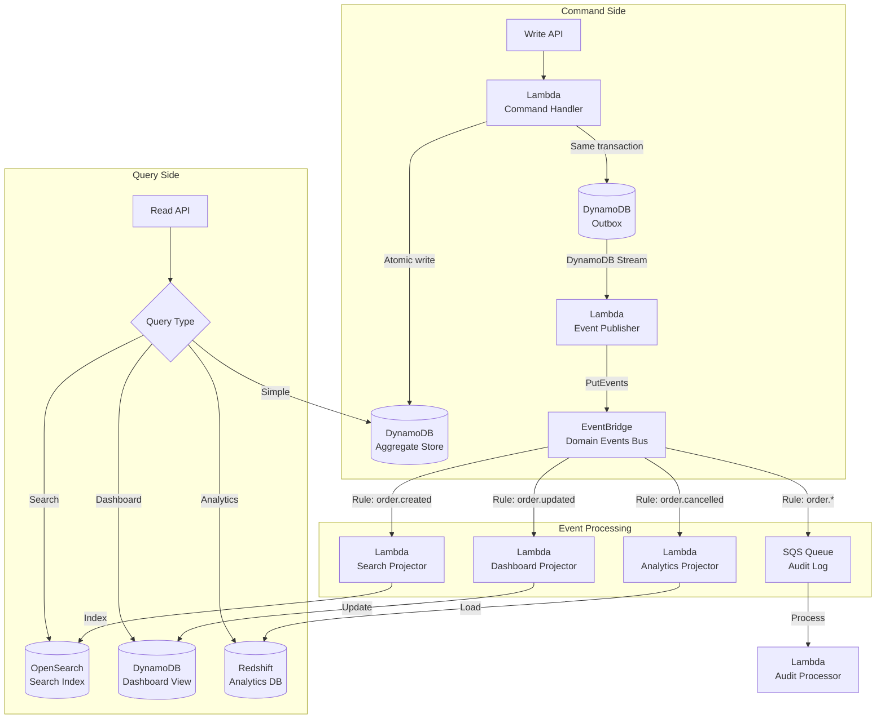
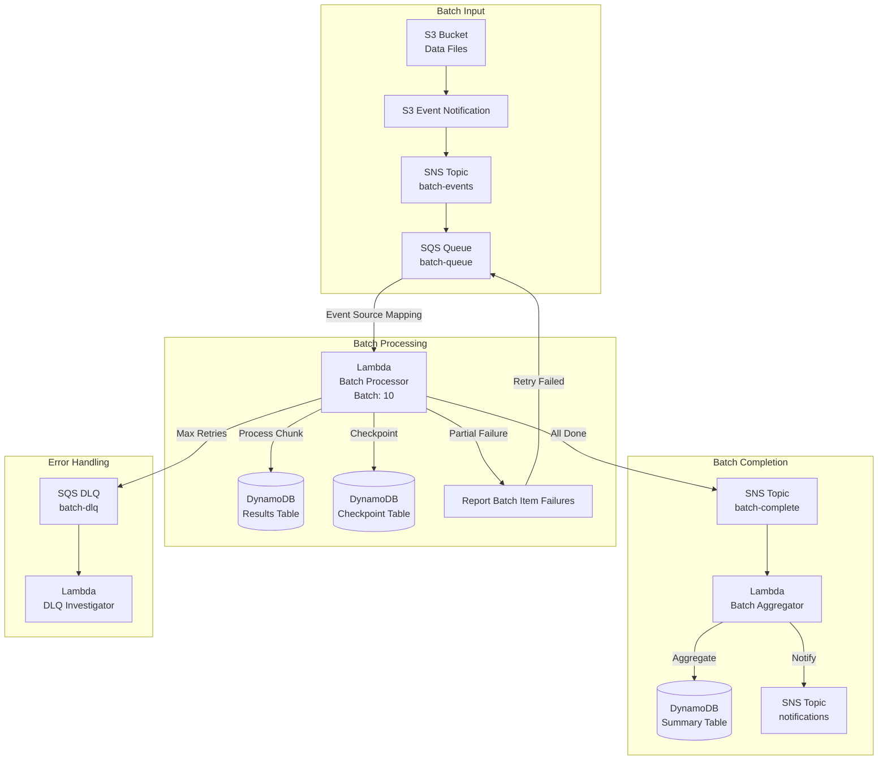
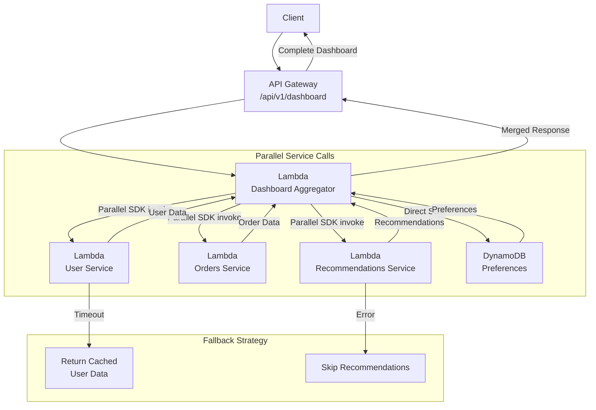
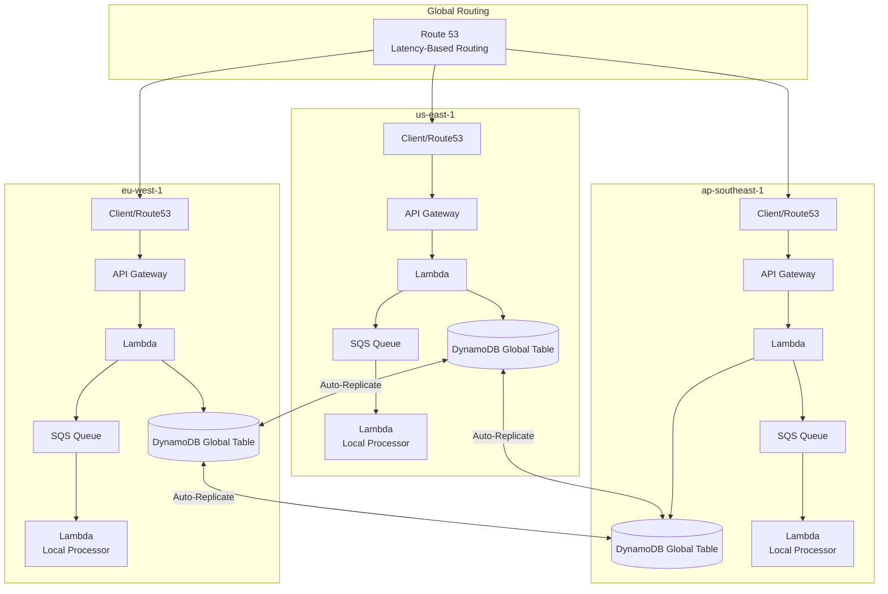

# Cross-Cutting Architecture Patterns

## Overview

Advanced architectural patterns for building complex, distributed serverless systems. These patterns address distributed transactions, event sourcing, multi-tenant architectures, and high-scale processing.

---

## Table of Contents

- [Pattern 1: SNS Fan-Out to SQS Consumer Queues](#pattern-1-sns-fan-out-to-sqs-consumer-queues)
- [Pattern 2: Saga Pattern for Distributed Transactions](#pattern-2-saga-pattern-for-distributed-transactions)
- [Pattern 3: Event Sourcing with DynamoDB](#pattern-3-event-sourcing-with-dynamodb)
- [Pattern 4: Multi-Tenant Serverless Architecture](#pattern-4-multi-tenant-serverless-architecture)
- [Pattern 5: CQRS with EventBridge](#pattern-5-cqrs-with-eventbridge)
- [Pattern 6: Batch Processing with SQS + Lambda](#pattern-6-batch-processing-with-sqs--lambda)
- [Pattern 7: API Aggregation with Lambda](#pattern-7-api-aggregation-with-lambda)
- [Pattern 8: Multi-Region Active-Active with DynamoDB Global Tables](#pattern-8-multi-region-active-active-with-dynamodb-global-tables)
- [Architecture Decision Records (ADRs)](#architecture-decision-records-adrs)
- [Anti-Patterns to Avoid](#anti-patterns-to-avoid)

---

## Pattern 1: SNS Fan-Out to SQS Consumer Queues

Independent consumer buffering and scaling with SNS-to-SQS fan-out.



### Why This Pattern?

SNS isolates delivery attempts per subscription, but a direct Lambda subscription has no consumer-controlled backlog. A burst can make every subscriber scale at once, and a subscriber cannot inspect queue depth or deliberately drain work at a bounded rate. A dedicated SQS queue per consumer adds durable buffering and independent visibility timeout, concurrency, and redrive settings while preserving one-to-many fan-out.

**Trade-off:** every consumer now needs its own SQS queue and (usually) DLQ to manage, which multiplies the number of resources to monitor, tag, and pay for — polling/delivery costs on N queues add up even when the underlying event volume is modest, and message duplication across the two fan-out layers requires each consumer to be idempotent. For a handful of low-volume subscribers this operational overhead outweighs the isolation benefit.

### Throughput Calculation

```
Approximate processing capacity per SQS queue =
    (Lambda Concurrency) × (Batch Size) / (Avg Invocation Time)

Example:
    100 concurrency × 10 batch / 2s = 500 events/second per queue

Total Throughput = Sum of all queue throughputs
    = 500 + 300 + 200 + 100 = 1,100 events/second
```

This is a planning estimate, not a service guarantee. Effective throughput is also bounded by queue backlog, Lambda concurrency quotas and scaling behavior, event-source polling, payload size, downstream capacity, failures, and—for FIFO queues—message-group concurrency. One event source mapping normally invokes one Lambda function at varying concurrency; drawing several functions from one queue would create competing consumers, not another fan-out copy.

### Why Double Fan-Out?

Benefits of layering an SQS fan-out under the SNS fan-out instead of going straight to Lambda.

| Benefit | Description |
|---------|-------------|
| **Independent scaling** | Each team scales Lambda independently |
| **Isolation** | One team's backlog doesn't block the others |
| **Backpressure** | SQS absorbs spikes, Lambda processes at steady rate |
| **Cost optimization** | Each queue tunes batch size and concurrency |
| **Failure isolation** | One DLQ doesn't impact other consumers |

Note: DLQs are configured on the SQS source queues with a `RedrivePolicy` (`maxReceiveCount` and `deadLetterTargetArn`). The DLQ can use a `RedriveAllowPolicy` to restrict which source queues may target it.

### When NOT to Use

- Don't use when a single Lambda can handle all events — direct SNS→Lambda is simpler
- Don't use for low-volume events where SQS cost outweighs buffering benefits

---

## Pattern 2: Saga Pattern for Distributed Transactions

Orchestrating distributed transactions with compensation across multiple services.



### Why This Pattern?

A business transaction that spans multiple services (order, inventory, payment, shipping) has no database-level ACID transaction to fall back on — each service owns its own data store, so a two-phase commit across them isn't available. Without an explicit saga, a failure partway through (e.g., payment declines after inventory is already reserved) leaves the system in an inconsistent state: inventory held with no order to fulfill, or a customer charged with no shipment scheduled. The saga pattern makes that failure handling explicit by defining a compensating action for every forward step, so partial failures unwind deterministically instead of leaking inconsistent state that has to be found and fixed manually.

**Trade-off:** compensations are themselves distributed calls that can fail, so the saga must handle compensation failures too (retry, alert, manual intervention), and the system is only eventually consistent during the saga's execution window — a query mid-saga can see inventory reserved with no confirmed order. Building and testing every compensating action doubles the code paths per step, which is not worth it for transactions that can be scoped to a single service's database transaction instead.

### Saga Orchestration vs Choreography

How the two saga coordination styles compare across control, visibility, and coupling.

| Aspect | Orchestration | Choreography |
|--------|--------------|--------------|
| **Control** | Central coordinator | Distributed, event-driven |
| **Visibility** | Single state machine | Scattered across services |
| **Complexity** | Orchestrator knows all steps | Each service knows its compensations |
| **Coupling** | Orchestrator coupled to all | Loosely coupled via events |
| **Best for** | Complex workflows, compliance | Simple sagas, autonomous services |
| **AWS Implementation** | Step Functions | SNS + EventBridge |

### Saga Event Log Design

DynamoDB schema for tracking each saga step, its compensation, and status.

| Attribute | Type | Purpose |
|-----------|------|---------|
| `saga_id` | String (PK) | Unique saga identifier |
| `step` | Number (SK) | Step sequence number (composite key) |
| `action` | String | Forward action name |
| `compensation` | String | Compensation action name |
| `status` | String | PENDING / DONE / COMPENSATING / COMPENSATED |
| `timestamp` | Number | Step execution time |
| `result` | String (JSON) | Step result data |

### Saga Best Practices

- **Idempotency**: Both forward and compensation actions must be idempotent. Use idempotency keys and conditional writes.
- **Reverse-order compensation**: Compensations run in reverse order of forward steps (last committed, first compensated).
- **Saga timeout**: Set overall saga timeout to prevent indefinite execution.
- **Event logging**: Log every step for auditability and debugging.

### When NOT to Use

- Don't use for single-service transactions — use native database transactions
- Don't use when eventual consistency is unacceptable — consider synchronous processing

---

## Pattern 3: Event Sourcing with DynamoDB

Reconstructing state from a sequence of events.



### Why This Pattern?

Storing only the current state of an aggregate (the typical CRUD approach) throws away the history of how it got there — there's no way to answer "what was this order's status at 3pm yesterday" or reconstruct intermediate states for a dispute or audit, because each write overwrites the previous value. Event sourcing solves this by making the event log itself the source of truth: state is a derived, rebuildable projection, not the primary record. This also decouples the write model from however many read shapes the business needs (search index, dashboard, analytics) — each projection can be rebuilt independently or added later without migrating historical data, since the events that produced past state are still there.

**Trade-off:** every query now depends on a projection being correct and up to date, and reconstructing state means replaying events (or restoring from a snapshot and replaying the remainder), which adds latency and code complexity that a direct read of a current-state table doesn't have. Schema changes to event payloads are also harder to retrofit than changing a mutable row, since old events in the store must still deserialize correctly. For systems where "what changed and when" isn't a real business requirement, this bookkeeping is pure overhead.

### Event Store Table Design

DynamoDB schema for the append-only event store backing event sourcing.

| Attribute | Type | Purpose |
|-----------|------|---------|
| `aggregate_id` | String (PK) | Aggregate root identifier |
| `sequence_number` | Number (SK) | Event sequence within aggregate |
| `event_type` | String | Domain event type |
| `event_data` | String (JSON) | Event payload |
| `occurred_at` | Number | Event timestamp |
| `version` | Number | Optimistic concurrency |

### Projection Strategies

How to build read-model projections from the event store depending on latency tolerance.

| Strategy | When to Use | Implementation |
|----------|------------|----------------|
| **Real-time** | Low latency reads required | DynamoDB Stream trigger |
| **Near-real-time** | Tolerant of seconds lag | SQS buffer + Lambda |
| **Batch** | Analytics, reporting | Scheduled Lambda, Glue |
| **On-demand** | Rarely accessed views | Lambda on query |

### Event Sourcing Best Practices

- **Snapshotting**: For aggregates with long event histories, store periodic snapshots to avoid replaying all events on reconstruction. Keep snapshots in a separate table keyed by `aggregate_id` + `sequence_number`.
- **Replay from Event Store**: Replay reads from the Event Store table (using `aggregate_id`/`sequence_number` composite key), not from DynamoDB Streams (24h retention only).
- **Optimistic concurrency**: Atomically reserve the next aggregate version—for example, update an aggregate metadata item and append the event in one `TransactWriteItems` call—or condition the append on the expected sequence. `attribute_not_exists` on an event key prevents duplicate sequence numbers but does not by itself prevent gaps.

### When NOT to Use

- Don't use for simple CRUD operations — direct database access is simpler
- Don't use when full audit trail isn't needed — CQRS without event sourcing reduces complexity

---

## Pattern 4: Multi-Tenant Serverless Architecture

Serving multiple tenants with proper isolation and cost allocation.



### Why This Pattern?

Running one stack per customer scales linearly in operational cost — every deployment, patch, and monitoring dashboard has to be replicated per tenant, and idle tenants still pay for provisioned infrastructure. Without a deliberate isolation strategy, teams either default to full per-tenant stacks (unsustainable past a few dozen customers) or default to a shared stack with no tenant boundary at all, where a missing `tenant_id` filter in one query becomes a cross-tenant data leak. This pattern exists to make the isolation boundary — whether it's a partition key, a separate table, or a separate account — an explicit, reviewable part of the design rather than something enforced ad hoc in application code.

**Trade-off:** shared-infrastructure tenancy means a noisy or misbehaving tenant can consume DynamoDB capacity or Lambda concurrency that other tenants depend on unless you add application/API throttling or route tiers to separate functions with their own reserved concurrency. Reserved concurrency is configured per Lambda function, not per tenant inside one shared function. A bug in the shared code path also affects every tenant simultaneously instead of one. Moving to stronger isolation (separate tables or accounts) removes that blast radius but reintroduces the per-tenant operational cost this pattern is trying to avoid—the right level is a cost/blast-radius trade rather than a default.

### Isolation Levels

Multi-tenant isolation tiers, ranging from shared tables to fully separate accounts, with their cost and complexity trade-offs.

| Level | Data | Compute | Cost | Complexity |
|-------|------|---------|------|-----------|
| **Shared** | Same table, tenant_id filter | Same Lambda | Shared, tagged | Low |
| **Semi-Isolated** | Same table, tenant-aware keys and GSIs | Shared functions with application throttles, or separate functions per tier for reserved concurrency | Partial separation | Medium |
| **Isolated** | Separate tables | Separate Lambda functions | Fully separated | High |
| **Fully Isolated** | Separate accounts | Separate accounts | Fully separated | Very High |

### Tenant Selection Criteria

Factors that push the isolation choice toward shared, semi-isolated, or fully isolated tenancy.

| Factor | Shared | Semi-Isolated | Fully Isolated |
|--------|--------|--------------|----------------|
| Tenant population | Large and homogeneous | Mixed tiers or a smaller set of higher-value tenants | Small set of tenants requiring dedicated boundaries |
| Data sensitivity | Shared controls satisfy the threat model | Extra data/compute controls needed for selected tenants | Account-level blast-radius isolation required |
| Compliance | Permitted by the assessed control design | Different control sets or residency needs by tier | Dedicated environment required by the verified control design or contract |
| Customization | Configuration only | Per-tier configuration or capacity | Tenant-specific infrastructure/code |
| Service objectives | Shared capacity and SLO | Per-tier throttles/capacity | Dedicated capacity and failure domain |

Compliance frameworks such as PCI DSS or HIPAA do not by themselves prescribe one of these tenancy models. Choose from the workload's documented control requirements, threat model, contracts, and evidence strategy.

---

## Pattern 5: CQRS with EventBridge

Command Query Responsibility Segregation with centralized event routing.



### Why This Pattern?

A single data model optimized for writes (normalized, transactional) is usually a poor fit for reads that need full-text search, denormalized dashboards, or analytical aggregation — forcing all of that through one store either means expensive queries against the write model or bolting ad hoc caching/indexing onto it in an unstructured way. CQRS solves this by letting each read need have its own purpose-built store (OpenSearch for search, a denormalized DynamoDB view for dashboards, Redshift for analytics), fed by the same domain events, so query performance for one use case is never constrained by the schema requirements of another.

**Trade-off:** every read model is only as fresh as its projector has processed, so reads are eventually consistent with writes — a user can create an order and not see it in the dashboard view for the duration of the EventBridge rule match and Lambda projection latency. Each additional read model is also another projector to build, monitor, and keep in sync, and a failed or delayed projection silently produces stale results unless you add explicit lag monitoring. For workloads with a single query shape, this is added infrastructure without a corresponding benefit.

The aggregate update and outbox record must be committed atomically. Publishing directly to EventBridge after a database write is a dual-write failure window: the database can commit while `PutEvents` fails. The outbox publisher is at-least-once, so events need stable IDs and projectors must be idempotent. Also inspect each `PutEvents` result because an HTTP 200 response can contain failed entries.

### CQRS Event Flow

How each domain event fans out to projectors and which read models get updated.

| Event | Command Handler | Projectors Triggered | Read Models Updated |
|-------|----------------|---------------------|-------------------|
| `OrderCreated` | Create aggregate | Search, Dashboard, Analytics | All read models |
| `OrderUpdated` | Update aggregate | Search, Dashboard | Search index, Dashboard |
| `OrderCancelled` | Update aggregate | Dashboard, Analytics | Dashboard, Analytics |
| `PaymentReceived` | Update aggregate | Dashboard | Dashboard view |

Note: a `PutEvents` request can contain up to 10 entries, and the total request must remain under 1 MB. A single entry can consume that total when sent alone. Keep events small and store large payloads in S3 with a reference.

### When NOT to Use

- Don't use for simple read/write workloads — single-table design is simpler
- Don't use when strong consistency between reads and writes is required — eventual consistency is inherent

---

## Pattern 6: Batch Processing with SQS + Lambda

High-throughput batch processing with checkpointing.



### Why This Pattern?

Processing a large file or dataset in a single Lambda invocation is capped by the 15-minute execution limit and by memory — a file with millions of records will time out or OOM before finishing, and a failure at record 900,000 with no checkpoint means restarting from zero. Splitting the work into SQS-buffered batches with a checkpoint table solves both problems: each invocation only has to process one bounded chunk within the time limit, and `ReportBatchItemFailures` plus the checkpoint record let processing resume from the last successful point instead of reprocessing already-completed work or losing track of progress entirely.

**Trade-off:** the checkpoint table itself becomes a piece of state that has to be kept consistent with the actual work done — a checkpoint written before the corresponding record is durably processed (or vice versa) creates gaps or duplicate processing, so writes to the results table and the checkpoint need careful ordering or idempotency keys. This machinery is unnecessary overhead for batches small enough to finish comfortably within a single Lambda invocation's time and memory budget.

### Checkpoint Table Design

DynamoDB schema for tracking batch progress so failed batches can resume.

| Attribute | Type | Purpose |
|-----------|------|---------|
| `batch_id` | String (PK) | Unique batch identifier |
| `file_key` | String | S3 object key |
| `processed_records` | Number | Records processed so far |
| `last_processed_id` | String | Last successfully processed record ID |
| `status` | String | RUNNING / COMPLETED / FAILED |
| `started_at` | Number | Batch start time |
| `completed_at` | Number | Batch completion time |

Note: `ReportBatchItemFailures` enables partial batch failure reporting — failed items are retried while successful items are removed from the queue.

### When NOT to Use

- Don't use for real-time processing — use streaming (Kinesis, DynamoDB Streams) instead
- Don't use for small datasets — direct Lambda invocation is simpler

---

## Pattern 7: API Aggregation with Lambda

Combining multiple microservice responses into a single API response.



### Why This Pattern?

A client that needs data from several microservices to render one screen either has to make several round trips itself (adding client-side latency and complexity, especially over mobile networks) or the backend has to expose a purpose-built endpoint that fans out to each service on the client's behalf. Without an aggregator, that fan-out logic ends up duplicated in every client, and there's no single place to enforce per-call timeouts and fallback behavior — a slow recommendations service would otherwise stall or break the entire page instead of just being omitted.

**Trade-off:** the aggregator becomes a single point of failure and a timeout-budget balancing act — its own timeout has to be smaller than the API Gateway limit while still leaving enough time for every downstream call, and adding a new downstream dependency means re-deriving that budget. It also adds a Lambda invocation and network hop that isn't needed when a single service can already provide everything the client needs directly.

### Aggregation Timeout Budget

```
API Gateway integration: use the configured API-type limit (HTTP APIs: max 30s)
└── Example aggregator Lambda budget: 25s
    ├── User Service: 3s timeout (cached fallback)
    ├── Orders Service: 5s timeout
    ├── Recommendations: 3s timeout (optional)
    ├── Preferences: 1s timeout
    └── Merge & Response: 2s
    └── Buffer: 11s
```

Note: The aggregator Lambda's memory and timeout must accommodate all parallel calls. Lambda-to-Lambda synchronous invocation uses the AWS SDK (`lambda.invoke()`), not direct function calls. HTTP API integrations have a fixed 30-second maximum. REST API defaults and quota options differ—for Regional and private REST APIs, a higher integration timeout can be requested—so verify the deployed API type instead of assuming 29 seconds universally.

### When NOT to Use

- Don't use when a single service can provide all data — direct call is simpler
- Don't use when the downstream fan-out cannot fit a measured latency/error budget or creates an unacceptable correlated-failure surface; there is no universal service-count cutoff

---

## Pattern 8: Multi-Region Active-Active with DynamoDB Global Tables

Global low-latency access with conflict resolution.



### Why This Pattern?

Serving a global user base from a single Region means every request outside that Region pays cross-continent round-trip latency, and a Regional outage leaves no local replica. DynamoDB global tables provide writable replicas in multiple Regions. The default multi-Region eventual consistency (MREC) mode replicates asynchronously and resolves concurrent same-item writes with last-writer-wins. Multi-Region strong consistency (MRSC) is a separate creation-time mode with stricter Region/topology requirements and different latency, availability, and feature trade-offs.

**Trade-off:** conflict resolution is last-writer-wins by default, which silently discards one of the concurrent writes rather than merging them — acceptable for data where "most recent update" is the correct semantic, but wrong for cases like decrementing a counter or appending to a list, where a naive overwrite loses an update instead of combining it. Multi-region writes also mean paying for replicated write capacity in every region regardless of where the traffic actually originates, which is wasted spend for an application that only serves a single region's users.

### Conflict Resolution Strategies

Approaches for resolving concurrent writes to the same item across regions.

| Strategy | Behavior | Use Case |
|----------|----------|----------|
| **MREC: Last-Writer-Wins** | DynamoDB chooses the write with the latest internal timestamp per item | Acceptable where overwrite semantics match the domain |
| **MREC: Conflict avoidance** | Route ownership of a key to one Region or model commutative/append-only updates | Counters, ledgers, and domains where lost updates are unacceptable |
| **MRSC** | Strongly consistent multi-Region writes with zero RPO, subject to supported topology/Region constraints | Workloads that need multi-Region strong consistency |

Choose MREC or MRSC when the table is created; the consistency mode cannot be changed later. MREC is the default and uses last-writer-wins. MRSC requires exactly three participating Regions (three replicas, or two replicas and a witness) and should be validated against current Region and feature support.

### When NOT to Use

- Don't use for single-region applications — single-region DynamoDB is simpler and cheaper
- Don't use MREC when strong cross-Region consistency is required; evaluate MRSC or a single-writer design

---

## Architecture Decision Records (ADRs)

### ADR-001: SQS vs EventBridge for Async Processing

Cost, ordering, and feature comparison behind the choice between the two.

| Criteria | SQS | EventBridge |
|----------|-----|-----------|
| Cost basis | API requests; batching can reduce request count | Custom/partner events, archive/replay, and target-related charges |
| Ordering | FIFO available | No ordering |
| Filtering | Message attributes | Event patterns |
| Replay | Not supported | Archive replay |
| Schema | No enforcement | Schema Registry |
| **Decision** | **Use SQS for processing queues** | **Use EventBridge for event routing** |

### ADR-002: DynamoDB vs Aurora for Lambda Workloads

Cold-start, scaling, and query-complexity trade-offs behind the choice between the two.

| Criteria | DynamoDB | Aurora Serverless |
|----------|----------|------------------|
| Connection startup | No database session; reuse the SDK HTTP client | Direct connection setup, RDS Proxy, or RDS Data API where supported |
| Scaling | Capacity mode and workload dependent | Aurora Serverless v2 scales in ACU increments, but response time and maximum scale rate are workload/configuration dependent |
| Query complexity | Simple queries | Complex SQL, JOINs |
| Transactions | Single-item + transact | Full ACID |
| Connection management | No database connection pool | Direct connection reuse, RDS Proxy, or Data API depending on engine and concurrency |
| **Decision** | **DynamoDB for simple, high-scale** | **Aurora for complex queries, schema** |

### ADR-003: Step Functions vs Lambda Chaining

Cost, duration limits, and error-handling trade-offs behind the choice between the two.

| Criteria | Step Functions | Lambda Chaining |
|----------|---------------|-----------------|
| Cost basis | Standard: transitions; Express: requests, duration, and memory | Lambda requests and duration |
| Duration | Standard: up to 1 year; Express: up to 5 minutes | Each Lambda invocation: up to 15 minutes; caller timeout still bounds a synchronous chain |
| Error handling | Built-in catch/retry | Manual |
| Visibility | Standard execution history; Express requires CloudWatch Logs for history | Application logs/metrics/traces |
| Complexity | Visual workflow | Code-based |
| **Decision** | **Use Step Functions when durable state, branching, retries, callbacks, or execution visibility justify orchestration** | **Use a direct call for a genuinely simple, bounded synchronous dependency** |

---

## Anti-Patterns to Avoid

Common cross-cutting design mistakes and the fix for each.

| Anti-Pattern | Problem | Solution |
|-------------|---------|----------|
| **Monolithic Lambda** | Hard to scale, test, deploy | Split into single-responsibility functions |
| **Cross-region synchronous calls** | High latency, timeouts | Use async replication |
| **No schema evolution plan** | Breaking changes on update | Version events, backward-compatible schemas |
| **Tight coupling in saga** | Hard to modify steps | Use choreography or event-driven saga |
| **Ignoring DynamoDB partition skew** | Hot partitions, throttling | Use randomized sort keys, time-based partitioning |
| **No cost allocation tags** | Can't identify cost drivers | Tag all resources with tenant/service/env |

---

## Authoritative AWS references

- [Lambda with Amazon SQS event source mappings](https://docs.aws.amazon.com/lambda/latest/dg/with-sqs.html)
- [DynamoDB Streams retention and processing](https://docs.aws.amazon.com/amazondynamodb/latest/developerguide/Streams.html)
- [DynamoDB transactional write operations](https://docs.aws.amazon.com/amazondynamodb/latest/developerguide/transaction-apis.html)
- [Amazon EventBridge `PutEvents`](https://docs.aws.amazon.com/eventbridge/latest/APIReference/API_PutEvents.html)
- [API Gateway HTTP API quotas](https://docs.aws.amazon.com/apigateway/latest/developerguide/http-api-quotas.html)
- [DynamoDB global-table consistency modes](https://docs.aws.amazon.com/amazondynamodb/latest/developerguide/HowItWorks.ReadConsistency.html)
