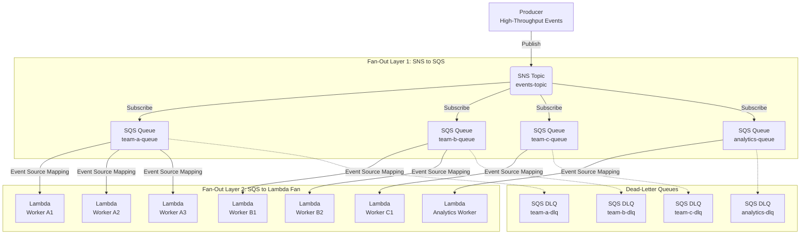
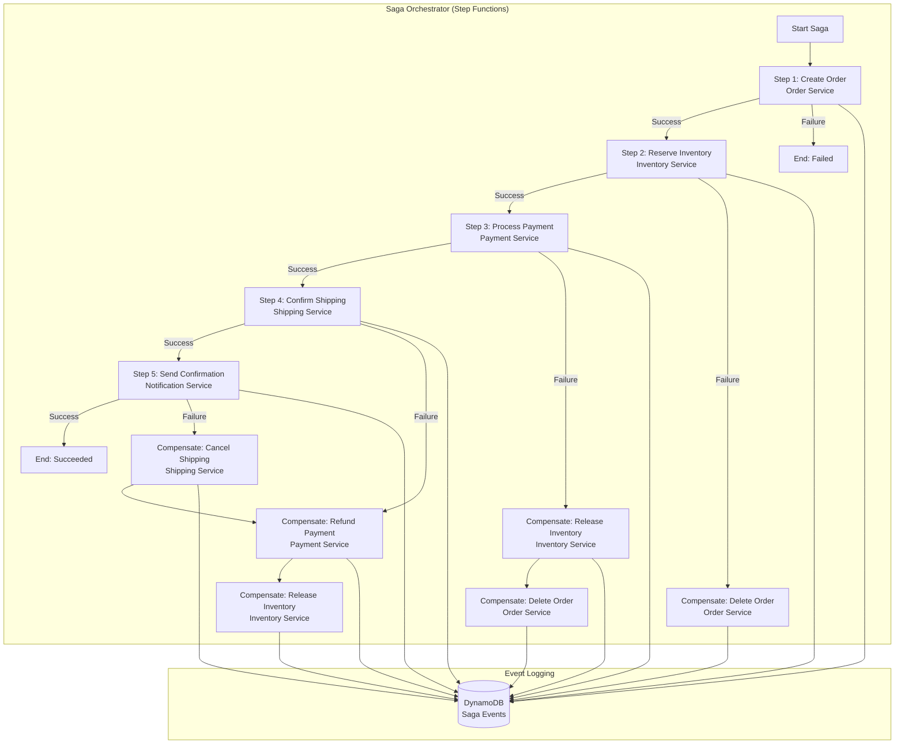
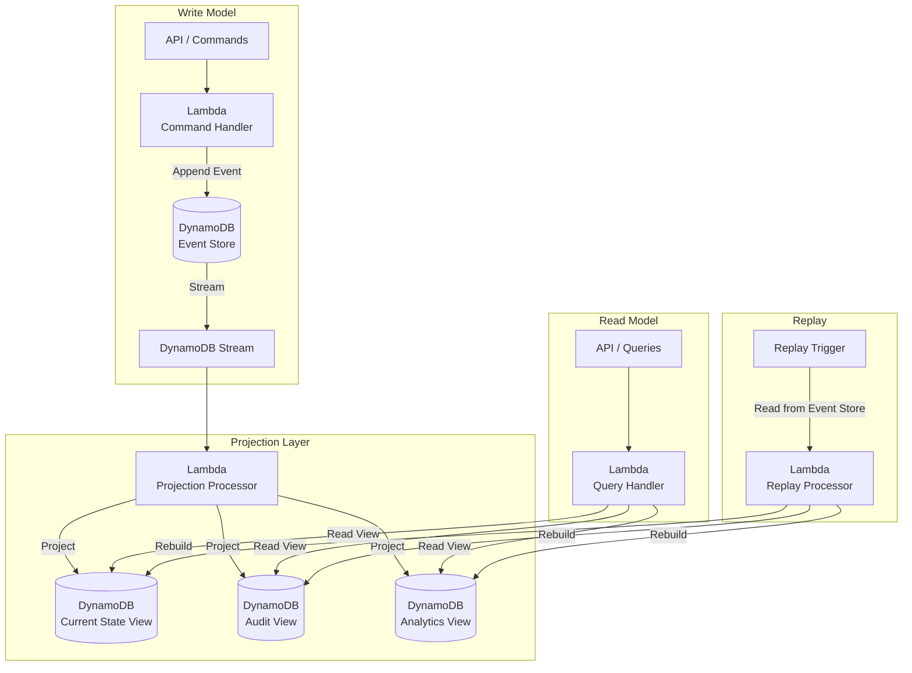
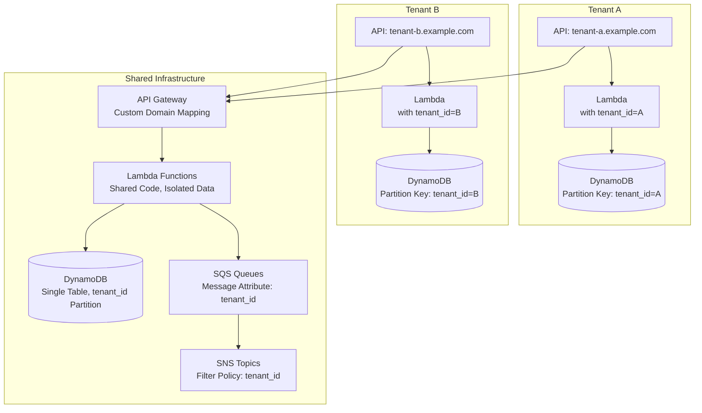
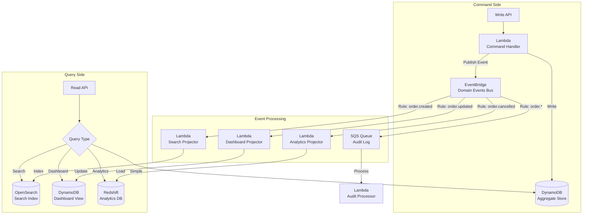
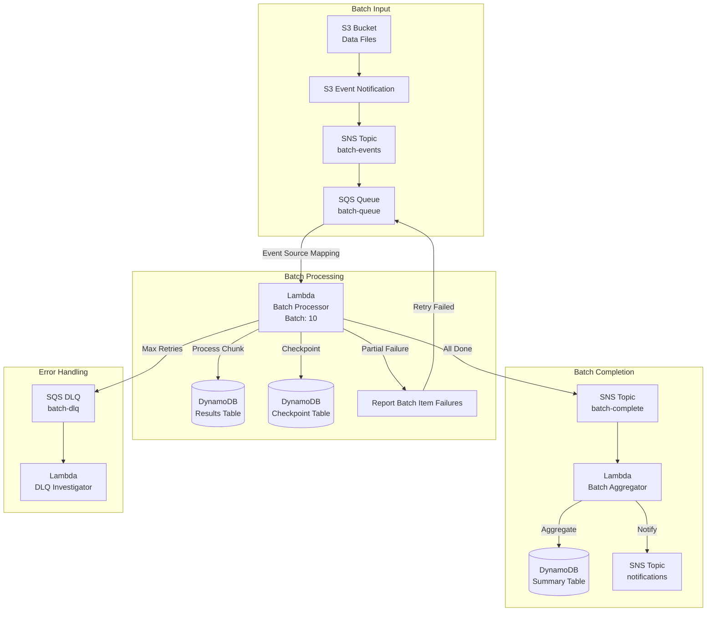
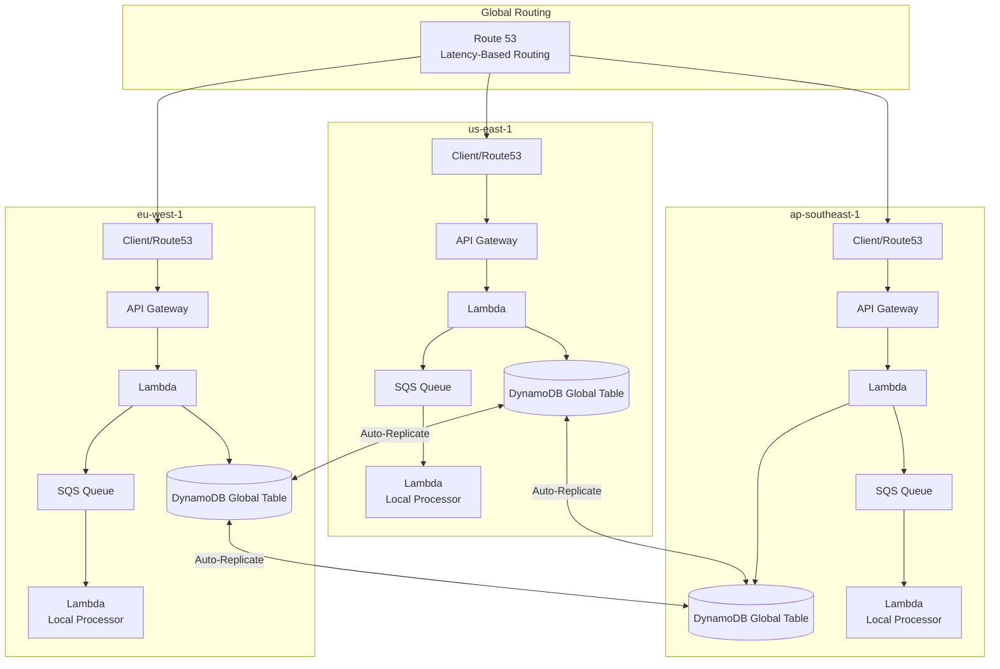

# Cross-Cutting Architecture Patterns

## Overview

Advanced architectural patterns for building complex, distributed serverless systems. These patterns address distributed transactions, event sourcing, multi-tenant architectures, and high-scale processing.

---

## Table of Contents

- [Pattern 1: SNS Fan-Out with SQS Fan-Out](#pattern-1-sns-fan-out-with-sqs-fan-out)
- [Pattern 2: Saga Pattern for Distributed Transactions](#pattern-2-saga-pattern-for-distributed-transactions)
- [Pattern 3: Event Sourcing with DynamoDB](#pattern-3-event-sourcing-with-dynamodb)
- [Pattern 4: Multi-Tenant Serverless Architecture](#pattern-4-multi-tenant-serverless-architecture)
- [Pattern 5: CQRS with EventBridge](#pattern-5-cqrs-with-eventbridge)
- [Pattern 6: Batch Processing with SQS + Lambda](#pattern-6-batch-processing-with-sqs--lambda)
- [Pattern 7: API Aggregation with Lambda](#pattern-7-api-aggregation-with-lambda)
- [Pattern 8: Multi-Region Active-Active with DynamoDB Global Tables](#pattern-8-multi-region-active-active-with-dynamodb-global-tables)
- [Architecture Decision Records (ADRs)](#architecture-decision-records-adrs)
- [Anti-Patterns to Avoid](#anti-patterns-to-avoid)

---

## Pattern 1: SNS Fan-Out with SQS Fan-Out

Maximum throughput and independent consumer scaling through double-buffering.



### Throughput Calculation

```
Throughput per SQS Queue = 
    (Lambda Concurrency) × (Batch Size) / (Avg Invocation Time)

Example:
    100 concurrency × 10 batch / 2s = 500 events/second per queue

Total Throughput = Sum of all queue throughputs
    = 500 + 300 + 200 + 100 = 1,100 events/second
```

### Why Double Fan-Out?

| Benefit | Description |
|---------|-------------|
| **Independent scaling** | Each team scales Lambda independently |
| **Isolation** | One team's backlog doesn't others |
| **Backpressure** | SQS absorbs spikes, Lambda processes at steady rate |
| **Cost optimization** | Each queue tunes batch size and concurrency |
| **Failure isolation** | One DLQ doesn't impact other consumers |

Note: DLQs are configured on the SQS queues via redrive policy (`MaxReceiveCount`), not on Lambda. Each SQS queue has its own `redriveAllowPolicy` and `redriveAllowPolicy`.

### When NOT to Use

- Don't use when a single Lambda can handle all events — direct SNS→Lambda is simpler
- Don't use for low-volume events where SQS cost outweighs buffering benefits

---

## Pattern 2: Saga Pattern for Distributed Transactions

Orchestrating distributed transactions with compensation across multiple services.



### Saga Orchestration vs Choreography

| Aspect | Orchestration | Choreography |
|--------|--------------|--------------|
| **Control** | Central coordinator | Distributed, event-driven |
| **Visibility** | Single state machine | Scattered across services |
| **Complexity** | Orchestrator knows all steps | Each service knows its compensations |
| **Coupling** | Orchestrator coupled to all | Loosely coupled via events |
| **Best for** | Complex workflows, compliance | Simple sagas, autonomous services |
| **AWS Implementation** | Step Functions | SNS + EventBridge |

### Saga Event Log Design

| Attribute | Type | Purpose |
|-----------|------|---------|
| `saga_id` | String (PK) | Unique saga identifier |
| `step` | Number (SK) | Step sequence number (composite key) |
| `action` | String | Forward action name |
| `compensation` | String | Compensation action name |
| `status` | String | PENDING / DONE / COMPENSATING / COMPENSATED |
| `timestamp` | Number | Step execution time |
| `result` | String (JSON) | Step result data |

### Saga Best Practices

- **Idempotency**: Both forward and compensation actions must be idempotent. Use idempotency keys and conditional writes.
- **Reverse-order compensation**: Compensations run in reverse order of forward steps (last committed, first compensated).
- **Saga timeout**: Set overall saga timeout to prevent indefinite execution.
- **Event logging**: Log every step for auditability and debugging.

### When NOT to Use

- Don't use for single-service transactions — use native database transactions
- Don't use when eventual consistency is unacceptable — consider synchronous processing

---

## Pattern 3: Event Sourcing with DynamoDB

Reconstructing state from a sequence of events.



### Event Store Table Design

| Attribute | Type | Purpose |
|-----------|------|---------|
| `aggregate_id` | String (PK) | Aggregate root identifier |
| `sequence_number` | Number (SK) | Event sequence within aggregate |
| `event_type` | String | Domain event type |
| `event_data` | String (JSON) | Event payload |
| `occurred_at` | Number | Event timestamp |
| `version` | Number | Optimistic concurrency |

### Projection Strategies

| Strategy | When to Use | Implementation |
|----------|------------|----------------|
| **Real-time** | Low latency reads required | DynamoDB Stream trigger |
| **Near-real-time** | Tolerant of seconds lag | SQS buffer + Lambda |
| **Batch** | Analytics, reporting | Scheduled Lambda, Glue |
| **On-demand** | Rarely accessed views | Lambda on query |

### Event Sourcing Best Practices

- **Snapshotting**: For aggregates with long event histories, store periodic snapshots to avoid replaying all events on reconstruction. Keep snapshots in a separate table keyed by `aggregate_id` + `sequence_number`.
- **Replay from Event Store**: Replay reads from the Event Store table (using `aggregate_id`/`sequence_number` composite key), not from DynamoDB Streams (24h retention only).
- **Optimistic concurrency**: Use DynamoDB `ConditionExpression` with `version` attribute to prevent concurrent modifications.

### When NOT to Use

- Don't use for simple CRUD operations — direct database access is simpler
- Don't use when full audit trail isn't needed — CQRS without event sourcing reduces complexity

---

## Pattern 4: Multi-Tenant Serverless Architecture

Serving multiple tenants with proper isolation and cost allocation.



### Isolation Levels

| Level | Data | Compute | Cost | Complexity |
|-------|------|---------|------|-----------|
| **Shared** | Same table, tenant_id filter | Same Lambda | Shared, tagged | Low |
| **Semi-Isolated** | Same table, tenant_id filter + GSIs for queries | Same Lambda, separate concurrency | Partial separation | Medium |
| **Isolated** | Separate tables | Separate Lambda functions | Fully separated | High |
| **Fully Isolated** | Separate accounts | Separate accounts | Fully separated | Very High |

### Tenant Selection Criteria

| Factor | Shared | Semi-Isolated | Fully Isolated |
|--------|--------|--------------|----------------|
| Tenant count | 100s-1000s | 10-100 | 1-50 |
| Data sensitivity | Low | Medium | High |
| Compliance needs | None | Standard | Strict (HIPAA, PCI) |
| Customization | None | Configuration | Code-level |
| SLA requirements | Standard | Enhanced | Dedicated |

---

## Pattern 5: CQRS with EventBridge

Command Query Responsibility Segregation with centralized event routing.



### CQRS Event Flow

| Event | Command Handler | Projectors Triggered | Read Models Updated |
|-------|----------------|---------------------|-------------------|
| `OrderCreated` | Create aggregate | Search, Dashboard, Analytics | All read models |
| `OrderUpdated` | Update aggregate | Search, Dashboard | Search index, Dashboard |
| `OrderCancelled` | Update aggregate | Dashboard, Analytics | Dashboard, Analytics |
| `PaymentReceived` | Update aggregate | Dashboard | Dashboard view |

Note: EventBridge events are limited to 1 MB (raised from 256 KB in Jan 2026); `PutEvents` requests can batch up to 10 entries but the total request must stay under 1 MB. Consider this limit for high-throughput CQRS with large event payloads.

### When NOT to Use

- Don't use for simple read/write workloads — single-table design is simpler
- Don't use when strong consistency between reads and writes is required — eventual consistency is inherent

---

## Pattern 6: Batch Processing with SQS + Lambda

High-throughput batch processing with checkpointing.



### Checkpoint Table Design

| Attribute | Type | Purpose |
|-----------|------|---------|
| `batch_id` | String (PK) | Unique batch identifier |
| `file_key` | String | S3 object key |
| `processed_records` | Number | Records processed so far |
| `last_processed_id` | String | Last successfully processed record ID |
| `status` | String | RUNNING / COMPLETED / FAILED |
| `started_at` | Number | Batch start time |
| `completed_at` | Number | Batch completion time |

Note: `ReportBatchItemFailures` enables partial batch failure reporting — failed items are retried while successful items are removed from the queue.

### When NOT to Use

- Don't use for real-time processing — use streaming (Kinesis, DynamoDB Streams) instead
- Don't use for small datasets — direct Lambda invocation is simpler

---

## Pattern 7: API Aggregation with Lambda

Combining multiple microservice responses into a single API response.

```mermaid
graph TB
    A[Client] --> B[API Gateway<br/>/api/v1/dashboard]
    B --> C[Lambda<br/>Dashboard Aggregator]
    
    subgraph "Parallel Service Calls"
        C -->|SDK Invoke (Promise.all)| D[Lambda<br/>User Service]
        C -->|SDK Invoke (Promise.all)| E[Lambda<br/>Orders Service]
        C -->|SDK Invoke (Promise.all)| F[Lambda<br/>Recommendations Service]
        C -->|Direct SDK| G[DynamoDB<br/>Preferences]
    end
    
    D -->|User Data| C
    E -->|Order Data| C
    F -->|Recommendations| C
    G -->|Preferences| C
    
    C -->|Merged Response| B
    B -->|Complete Dashboard| A
    
    subgraph "Fallback Strategy"
        D -->|Timeout| H[Return Cached<br/>User Data]
        F -->|Error| I[Skip Recommendations]
    end
```

### Aggregation Timeout Budget

```
API Gateway: 29s (REST/HTTP API timeout)
└── Aggregator Lambda: 25s
    ├── User Service: 3s timeout (cached fallback)
    ├── Orders Service: 5s timeout
    ├── Recommendations: 3s timeout (optional)
    ├── Preferences: 1s timeout
    └── Merge & Response: 2s
    └── Buffer: 11s
```

Note: The aggregator Lambda's memory and timeout must accommodate all parallel calls. Lambda-to-Lambda synchronous invocation uses the AWS SDK (`lambda.invoke()`), not direct function calls.

### When NOT to Use

- Don't use when a single service can provide all data — direct call is simpler
- Don't use for large aggregations (>10 services) — response assembly becomes fragile

---

## Pattern 8: Multi-Region Active-Active with DynamoDB Global Tables

Global low-latency access with conflict resolution.



### Conflict Resolution Strategies

| Strategy | Behavior | Use Case |
|----------|----------|----------|
| **Last-Writer-Wins** | Latest timestamp wins (version-based ordering) | Most common, simple |
| **Custom via Streams + Lambda** | DynamoDB Streams + Lambda per region for business logic | Complex domains (not native to Global Tables) |
| **Client-Side** | Application handles conflicts | Real-time collaboration |

Note: DynamoDB Global Tables uses multi-master replication with eventual consistency across regions. Modern Global Tables resolve conflicts with last-writer-wins using version-based ordering.

### When NOT to Use

- Don't use for single-region applications — single-region DynamoDB is simpler and cheaper
- Don't use when strong cross-region consistency is required — use single-region writes with read replicas

---

## Architecture Decision Records (ADRs)

### ADR-001: SQS vs EventBridge for Async Processing

| Criteria | SQS | EventBridge |
|----------|-----|-----------|
| Cost | $0.40/M messages (US East, approx) | $1.00/M events (US East, approx) |
| Ordering | FIFO available | No ordering |
| Filtering | Message attributes | Event patterns |
| Replay | Not supported | Archive replay |
| Schema | No enforcement | Schema Registry |
| **Decision** | **Use SQS for processing queues** | **Use EventBridge for event routing** |

### ADR-002: DynamoDB vs Aurora for Lambda Workloads

| Criteria | DynamoDB | Aurora Serverless |
|----------|----------|------------------|
| Cold starts | None (HTTP) | With RDS Proxy: minimal |
| Scaling | Automatic | Scale up/down (seconds) |
| Query complexity | Simple queries | Complex SQL, JOINs |
| Transactions | Single-item + transact | Full ACID |
| Connection management | Not needed | RDS Proxy required |
| **Decision** | **DynamoDB for simple, high-scale** | **Aurora for complex queries, schema** |

### ADR-003: Step Functions vs Lambda Chaining

| Criteria | Step Functions | Lambda Chaining |
|----------|---------------|-----------------|
| Cost | $25/1000 transitions (Standard) / $0.25/1000 (Express) | $0.20/M invocations |
| Max duration | 1 year | 15 minutes |
| Error handling | Built-in catch/retry | Manual |
| Visibility | Execution history | CloudWatch only |
| Complexity | Visual workflow | Code-based |
| **Decision** | **Step Functions for workflows >3 steps** | **Lambda chain for simple sync calls** |

---

## Anti-Patterns to Avoid

| Anti-Pattern | Problem | Solution |
|-------------|---------|----------|
| **Monolithic Lambda** | Hard to scale, test, deploy | Split into single-responsibility functions |
| **Cross-region synchronous calls** | High latency, timeouts | Use async replication |
| **No schema evolution plan** | Breaking changes on update | Version events, backward-compatible schemas |
| **Tight coupling in saga** | Hard to modify steps | Use choreography or event-driven saga |
| **Ignoring DynamoDB partition skew** | Hot partitions, throttling | Use randomized sort keys, time-based partitioning |
| **No cost allocation tags** | Can't identify cost drivers | Tag all resources with tenant/service/env |
