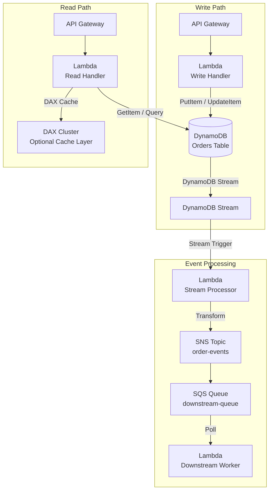
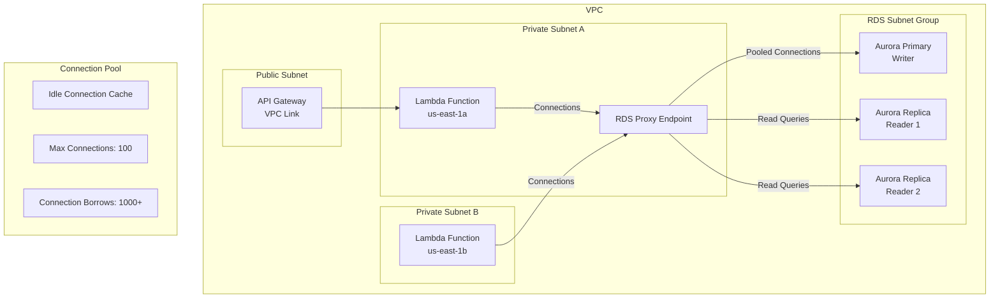
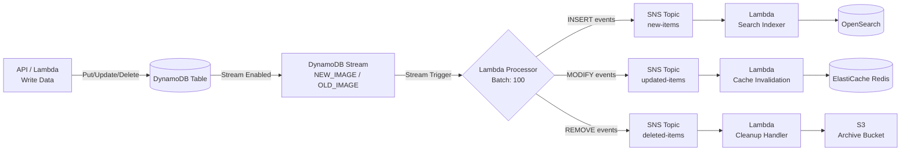
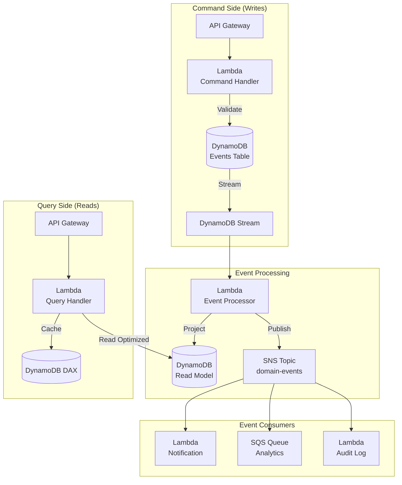
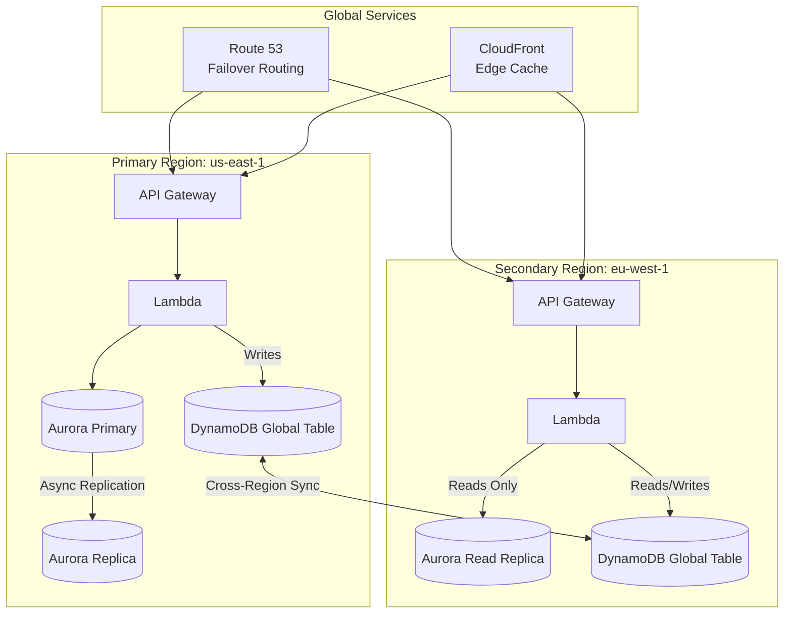
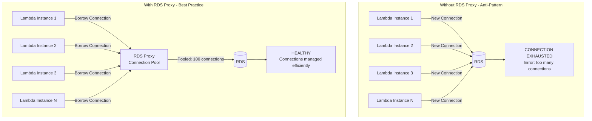
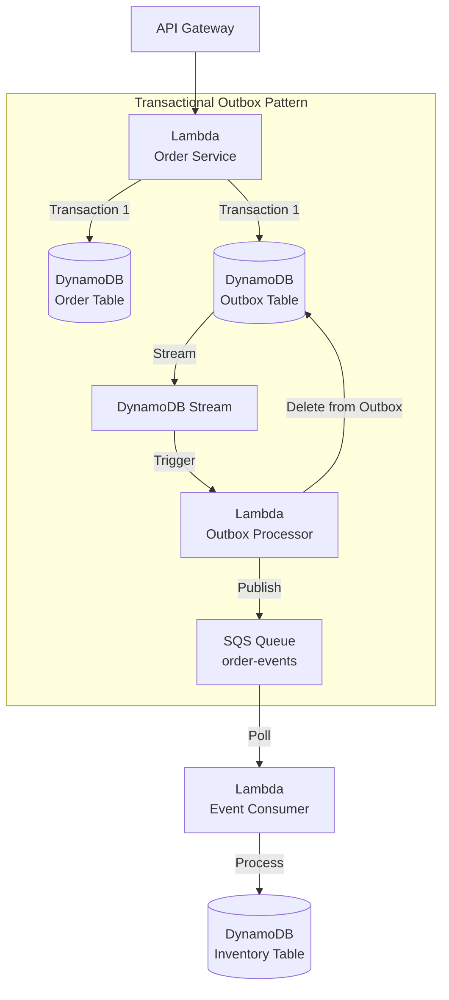

# Database Integration Patterns

## Overview

Database integration with serverless services requires careful consideration of connection management, scaling behavior, and data consistency. This document covers best practices for connecting Lambda, SNS, and SQS with AWS database services.

---

## Database Service Selection Matrix

| Database | Type | Best For | Lambda Integration | Connection Model |
|----------|------|----------|-------------------|-----------------|
| **DynamoDB** | NoSQL Key-Value | Low-latency, high-scale, simple queries | Native trigger, SDK | HTTP (no connections) |
| **Aurora Serverless v2** | Relational (MySQL/PostgreSQL) | Complex queries, transactions, schema | RDS Proxy required | Connection pooling |
| **RDS** | Relational | Known scale, compliance | RDS Proxy required | Connection pooling |
| **Aurora Global DB** | Relational (multi-region) | Global read, disaster recovery | RDS Proxy per region | Connection pooling |
| **DocumentDB** | Document (MongoDB compat) | Document storage, flexible schema | Built-in connection pooling | Enhanced networking |
| **Neptune** | Graph | Relationship queries, graphs | Direct SDK (HTTP) | HTTP connections (Gremlin/SPARQL) |
| **ElastiCache** | In-memory cache | Caching, session store | Direct SDK | Connection pooling |
| **Redshift Serverless** | Data warehouse | Analytics, BI | Direct SDK | Connection pooling |
| **Timestream** | Time-series | IoT, metrics, logs | Direct SDK | HTTP (no connections) |

---

## Pattern 1: Lambda + DynamoDB Direct Integration

The simplest and most performant integration for NoSQL workloads.



### DynamoDB Best Practices with Lambda

| Practice | Detail |
|----------|--------|
| **Use Provisioned + Auto Scaling** | Predictable cost, burst capacity for spikes |
| **Consider On-Demand mode** | Better for unpredictable workloads; pay-per-request, no capacity planning |
| **Enable DynamoDB Streams** | For event-driven downstream processing |
| **Use PartiQL** | SQL-like queries without schema changes |
| **Set TTL** | Automatic expiration for temporary data |
| **Use TransactWriteItems** | Multi-item atomic writes (max 10 items) |
| **Batch Write** | BatchWriteItems for bulk operations (25 items/batch) |
| **Use DAX** | For read-heavy workloads (10x read performance) |

### DynamoDB Stream Trigger Configuration

| Parameter | Value | Purpose |
|-----------|-------|---------|
| `BatchSize` | 1-1000 | Records per invocation |
| `MaximumBatchingWindowInSeconds` | 0-300s | Buffer for larger batches |
| `StartingPosition` | `LATEST` / `TRIM_HORIZON` | Where to start reading |
| `MaximumRetryAttempts` | 0-18,000 | Retries on processing failure (DynamoDB Streams: 0-18,000; SQS: 0-10,000) |
| `FunctionResponseTypes` | `ReportBatchItemFailures` | Partial batch failure reporting |

### DynamoDB Stream Handler Example

```python
import boto3

dynamodb = boto3.resource('dynamodb')

def lambda_handler(event, context):
    for record in event['Records']:
        event_name = record['eventName']  # INSERT, MODIFY, REMOVE
        old_image = record.get('dynamodb', {}).get('OldImage')
        new_image = record.get('dynamodb', {}).get('NewImage')
        
        if event_name == 'INSERT':
            process_new_item(new_image)
        elif event_name == 'MODIFY':
            process_update(old_image, new_image)
        elif event_name == 'REMOVE':
            process_deletion(old_image)
    
    # For partial batch failure:
    # return {
    #     'batchItemFailures': [
    #         {'itemIdentifier': 'failed-record-id'}
    #     ]
    # }
```

---

## Pattern 2: Lambda + RDS via RDS Proxy

RDS Proxy is essential for Lambda-to-RDS connections to prevent connection exhaustion.



### RDS Proxy Configuration

| Setting | Value | Rationale |
|---------|-------|-----------|
| `Idle Timeout` | 10-120s | Balance between reuse and freshness |
| `Max Connections` | 50-200 | Don't exceed RDS `max_connections` |
| `DB Idle Timeout` | 5-30s | Close idle DB connections |
| `TLS` | Required | Encrypt proxy-to-database traffic |
| `Auth Scheme` | Secrets Manager | Automatic password rotation |

### Lambda + RDS Proxy Example

```python
import pg8000
import os

# Reuse connection across invocations (outside handler)
db_pool = None

def get_connection():
    global db_pool
    if db_pool is None:
        db_pool = pg8000.dbapi.connect(
            host=os.environ['RDS_PROXY_ENDPOINT'],
            port=5432,
            database=os.environ['DB_NAME'],
            user=os.environ['DB_USER'],
            password=os.environ['DB_PASSWORD']  # From Secrets Manager
        )
    return db_pool

def lambda_handler(event, context):
    conn = get_connection()
    with conn.cursor() as cur:
        cur.execute("SELECT * FROM orders WHERE id = %s", [event['orderId']])
        return {'order': cur.fetchone()}
```

### Lambda Connection Reuse

In addition to RDS Proxy, reuse connections by keeping the DB client outside the handler function. The execution environment is often reused across invocations, making the connection effectively cached. However, RDS Proxy remains essential for high-concurrency scenarios.

### Lambda VPC Configuration

| Setting | Value | Purpose |
|---------|-------|---------|
| `VPC Subnets` | 2+ AZs | High availability |
| `Security Groups` | Minimal egress | Least privilege |
| `VPC Endpoints` | For S3, DynamoDB | Avoid NAT Gateway costs |
| `Cold Start Mitigation` | Provisioned Concurrency | Keep VPC connections warm |

---

## Pattern 3: DynamoDB Trigger Pipeline

Using DynamoDB Streams to drive event-driven processing pipelines.



### Stream View Types

| View Type | Contents | Use Case |
|-----------|----------|----------|
| `KEYS_ONLY` | Primary key only | Trigger processing, key-based lookup |
| `NEW_IMAGE` | Full record after write | Downstream processing with new data |
| `OLD_IMAGE` | Full record before write | Audit trail, change detection |
| `NEW_AND_OLD_IMAGES` | Both before and after | Diff computation, full audit |

### EventBridge Pipes Alternative

EventBridge Pipes can route DynamoDB Streams directly to SQS, SNS, Lambda, or HTTP endpoints without a Lambda function. Useful for simple routing without compute overhead.

### When to Use DynamoDB Streams

- Use when you need to react to data changes in real-time
- Use for audit trails, cache invalidation, search indexing
- Don't use for high-throughput ordered streaming — consider Kinesis Data Streams

---

## Pattern 4: CQRS with DynamoDB + Event Sourcing

Command Query Responsibility Segregation for complex domains.



### CQRS Table Design

| Table | Purpose | GSI | Access Pattern |
|-------|---------|-----|---------------|
| `Events` | Event store (append-only) | ByAggregateId, ByEventType | Sequential writes, query by aggregate |
| `ReadModel` | Optimized read views | Multiple GSIs | High-read queries |
| `Projections` | Materialized views | ByEntityType | Denormalized reads |

### When to Use CQRS with Event Sourcing

- Use when you need full audit trail of all state changes
- Use when read and write access patterns differ significantly
- Use for complex domains with multiple read views
- Don't use for simple CRUD — direct database access is simpler

---

## Pattern 5: Multi-Region Database Architecture

For global applications requiring low-latency reads and disaster recovery.



### Multi-Region Database Options

| Service | Replication | RPO | RTO | Read Latency | Write Latency |
|---------|------------|-----|-----|-------------|---------------|
| **DynamoDB Global Tables** | Multi-master, active-active | ~0s | ~0s | Local | Local |
| **Aurora Global DB** | Single-master, active-passive | <1s | <1min | Local (read) | Cross-region (write) |
| **Aurora Cross-Region Read Replica** | Async replication | Variable | Manual failover | Local | N/A (read-only) |
| **DocumentDB Global Cluster** | Multi-region, active-passive | <1s | <3min | Local (read) | Primary region (write) |

### Backup & Recovery

| Service | Backup Method | PITR | Cross-Region |
|---------|-------------|------|--------------|
| **DynamoDB** | On-demand + continuous backups | Yes (up to 35 days) | Yes (cross-region backup) |
| **Aurora** | Automated snapshots + binlog | Yes (up to 35 days) | Yes (copy snapshots) |
| **RDS** | Automated + on-demand snapshots | Yes (up to 35 days) | Yes (copy snapshots) |
| **DocumentDB** | Continuous backups | Yes (up to 35 days) | No (manual export) |

### When to Use Multi-Region

- Use for global applications requiring low-latency reads worldwide
- Use for disaster recovery with defined RPO/RTO targets
- Don't use for single-region applications — adds complexity and cost

---

## Pattern 6: Database Connection Management for Lambda

Critical pattern to avoid connection exhaustion under high concurrency.



### Connection Lifecycle Comparison

| Aspect | Without Proxy | With RDS Proxy |
|--------|--------------|----------------|
| Connections per Lambda | 1 (new each invocation) | Shared from pool |
| Cold start impact | Full connection overhead | Minimal (proxy is always on) |
| Max Lambda concurrency | Limited by RDS max_connections | Limited by proxy pool size |
| Connection reuse | No (Lambda ephemeral) | Yes (idle connection cache) |
| Failover support | Manual | Automatic (Aurora Cluster) |

### Lambda SnapStart (Java)

For Java-based Lambda functions connecting to databases, enable SnapStart to reduce cold start times from seconds to milliseconds. SnapStart takes a snapshot of the Lambda execution environment after initialization, replaying it on cold starts.

### When to Use RDS Proxy

- Use when Lambda concurrency > 50 (connection exhaustion risk)
- Use for Aurora failover support
- Use when connection establishment time impacts latency
- Don't use for low-concurrency workloads (<10 concurrent Lambdas) — direct connection is simpler

---

## Pattern 7: SQS + Database Transactional Outbox

Ensuring reliable message delivery with database transactions.



### Outbox Table Design

| Attribute | Type | Purpose |
|-----------|------|---------|
| `id` | String (PK) | Unique outbox record ID |
| `event_type` | String | Event type for routing |
| `event_data` | String (JSON) | Serialized event payload |
| `created_at` | Number | Timestamp for ordering |
| `status` | String | PENDING / PUBLISHED |
| `retry_count` | Number | Retry tracking |

### Why This Pattern?

| Problem | Solution |
|---------|----------|
| Database write succeeds, message publish fails | Outbox record persists, processor retries |
| Message publish succeeds, database write fails | Transaction rolls back, no orphaned message |
| Consumer processes before database commit | Outbox only published after transaction completes |

### Outbox Processor Example

```python
import boto3

sqs = boto3.client('sqs')
dynamodb = boto3.resource('dynamodb')
outbox_table = dynamodb.Table('outbox')

def lambda_handler(event, context):
    published_ids = []
    
    for record in event['Records']:
        outbox_id = record['dynamodb']['NewImage']['id']['S']
        event_data = record['dynamodb']['NewImage']['event_data']['S']
        
        try:
            sqs.send_queue_message(
                QueueUrl=os.environ['QUEUE_URL'],
                MessageBody=event_data
            )
            published_ids.append(outbox_id)
        except Exception as e:
            print(f"Failed to publish {outbox_id}: {e}")
            continue
    
    # Mark as published AFTER confirming SQS receipt
    for outbox_id in published_ids:
        outbox_table.update_item(
            Key={'id': outbox_id},
            UpdateExpression='SET #status = :published',
            ExpressionAttributeNames={'#status': 'status'},
            ExpressionAttributeValues={':published': 'PUBLISHED'}
        )
```

### When to Use Outbox Pattern

- Use when you need exactly-once message delivery with database transactions
- Use for event sourcing with reliable downstream notification
- Don't use for simple fire-and-forget — direct SQS send is simpler

---

## Anti-Patterns to Avoid

| Anti-Pattern | Problem | Solution |
|-------------|---------|----------|
| **Direct Lambda → RDS without proxy** | Connection exhaustion at scale | Always use RDS Proxy |
| **Long Lambda DB connections** | Connection leak on timeout | Set connection timeout < Lambda timeout |
| **Synchronous cross-region DB calls** | High latency, timeout failures | Use async replication |
| **No database retry logic** | Transient failures cause data loss | Implement exponential backoff |
| **Storing secrets in Lambda env vars** | Security risk, rotation difficulty | Use Secrets Manager |
| **Scanning DynamoDB in Lambda** | High cost, slow performance | Use Query with proper indexes |
| **Large DynamoDB items** | 400 KB limit, expensive reads | Store large data in S3, reference in DynamoDB |
