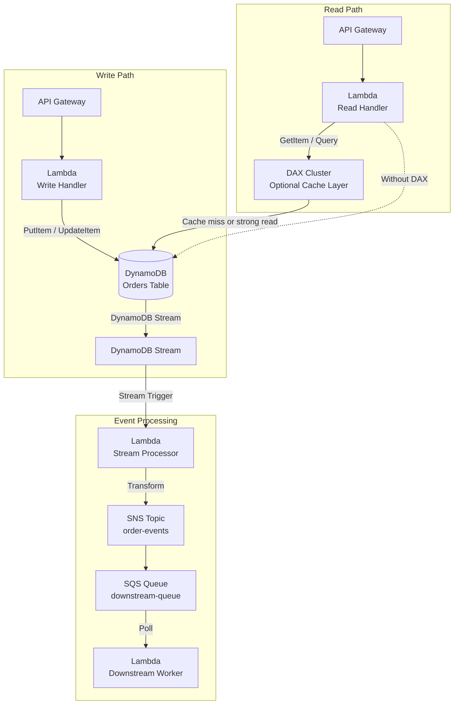
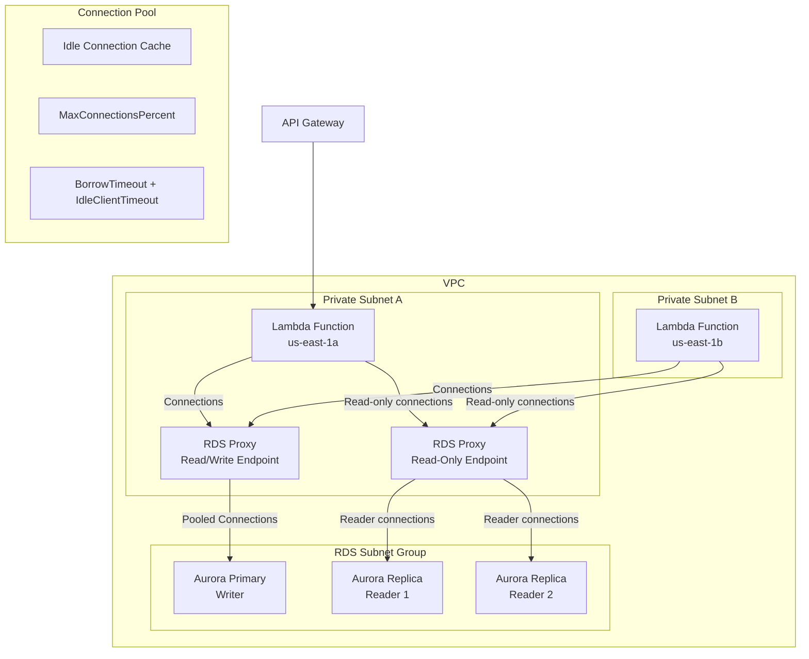
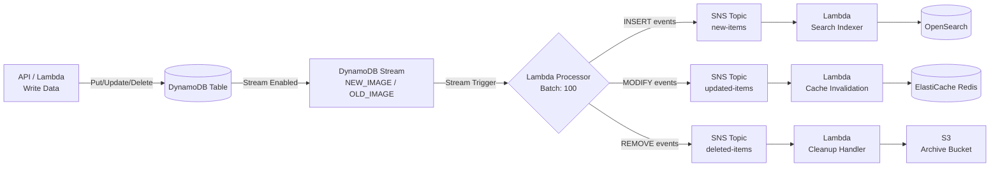
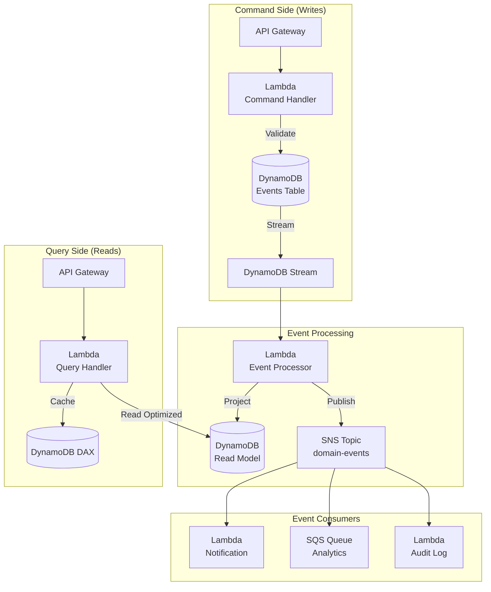
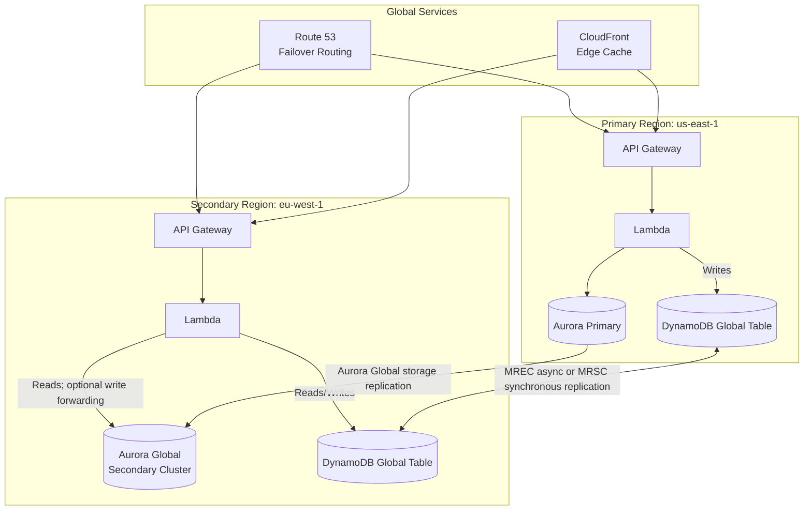
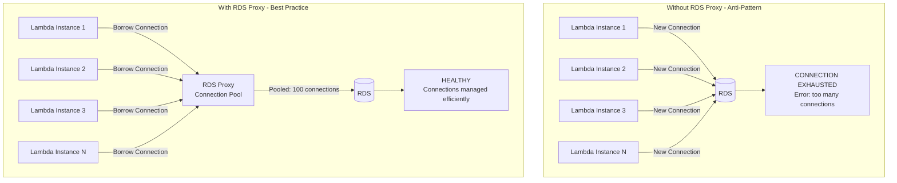
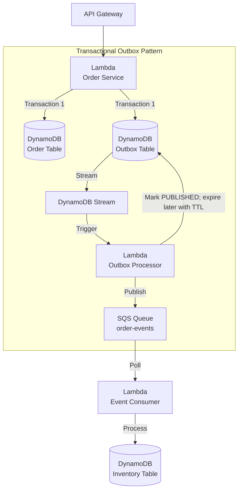

# Database Integration Patterns

## Overview

Database integration with serverless services requires careful consideration of connection management, scaling behavior, and data consistency. This document covers best practices for connecting Lambda, SNS, and SQS with AWS database services.

---

## Table of Contents

- [Database Service Selection Matrix](#database-service-selection-matrix)
- [Pattern 1: Lambda + DynamoDB Direct Integration](#pattern-1-lambda--dynamodb-direct-integration)
- [Pattern 2: Lambda + RDS via RDS Proxy](#pattern-2-lambda--rds-via-rds-proxy)
- [Pattern 3: DynamoDB Trigger Pipeline](#pattern-3-dynamodb-trigger-pipeline)
- [Pattern 4: CQRS with DynamoDB + Event Sourcing](#pattern-4-cqrs-with-dynamodb--event-sourcing)
- [Pattern 5: Multi-Region Database Architecture](#pattern-5-multi-region-database-architecture)
- [Pattern 6: Database Connection Management for Lambda](#pattern-6-database-connection-management-for-lambda)
- [Pattern 7: SQS + Database Transactional Outbox](#pattern-7-sqs--database-transactional-outbox)
- [Anti-Patterns to Avoid](#anti-patterns-to-avoid)

---

## Database Service Selection Matrix

How AWS's database services compare for Lambda integration, connection model, and typical fit.

| Database | Type | Best For | Lambda Integration | Connection Model |
|----------|------|----------|-------------------|-----------------|
| **DynamoDB** | NoSQL key-value/document | Low-latency, high-scale access by designed keys/indexes | Native stream trigger, SDK | HTTPS API; reusable HTTP connections but no persistent database session |
| **Aurora Serverless v2** | Relational (MySQL/PostgreSQL) | Complex queries, transactions, schema | Direct connection, RDS Proxy, or RDS Data API where supported | Stateful connections or HTTP Data API |
| **RDS** | Relational | Known scale, relational integrity | Direct connection or RDS Proxy | Stateful connections; proxy is optional |
| **Aurora Global Database** | Relational (multi-Region) | Global reads and disaster recovery with one writer Region | Direct endpoints or RDS Proxy deployed in each application Region | Stateful connections; secondary write forwarding still executes in the primary Region |
| **DocumentDB** | Document (MongoDB compatibility) | Document storage, flexible schema | MongoDB-compatible driver; reuse its pool | Stateful TLS connections |
| **Neptune** | Graph | Relationship queries, graphs | Gremlin, openCypher, or SPARQL clients | Protocol-specific connections |
| **ElastiCache** | In-memory cache | Caching, session store | Valkey/Redis OSS or Memcached client | Stateful connections/pooling |
| **Redshift Serverless** | Data warehouse | Analytics, BI | Driver or Redshift Data API | Stateful connection or HTTP Data API |
| **Timestream** | Time-series | IoT, metrics, logs | Direct SDK | HTTPS API; no persistent database session |

---

## Pattern 1: Lambda + DynamoDB Direct Integration

The simplest and most performant integration for NoSQL workloads.



### Why This Pattern?

DynamoDB's HTTPS API does not require a persistent database session, so there is no database connection pool to exhaust or relational login handshake for each new Lambda execution environment. SDK clients should still be initialized outside the handler so their HTTP connections can be reused; DNS, TLS, signing, and network latency still exist. A concurrency burst is instead constrained by Lambda concurrency, DynamoDB throughput/quotas, hot partitions, and downstream capacity. DynamoDB Streams also provides a managed item-change feed without table polling.

**Trade-off:** you give up SQL joins, ad hoc query flexibility, and multi-table transactions with arbitrary predicates — every access pattern has to be designed up front around partition/sort keys and GSIs, and retrofitting a new query shape later often means a table redesign or a costly Scan. If the workload needs relational integrity, complex reporting queries, or schema flexibility for evolving query patterns, this pattern forces expensive rework rather than a config change.

### DynamoDB Best Practices with Lambda

Recommended DynamoDB settings and features to use when paired with Lambda.

| Practice | Detail |
|----------|--------|
| **Use Provisioned + Auto Scaling** | Suitable for predictable traffic when capacity control is useful; test scaling headroom |
| **Consider On-Demand mode** | Better for unpredictable workloads; pay-per-request, no capacity planning |
| **Enable DynamoDB Streams** | For event-driven downstream processing |
| **Use PartiQL selectively** | SQL-compatible syntax over DynamoDB operations; it does not remove key-design or scan-cost constraints |
| **Set TTL** | Automatic expiration for temporary data |
| **Use TransactWriteItems** | Multi-item atomic writes with up to 100 actions and an aggregate item size of at most 4 MB |
| **Batch Write** | BatchWriteItems for bulk operations (25 items/batch) |
| **Use DAX selectively** | Microsecond cache hits for repeated eventually consistent reads; strongly consistent reads bypass the cache |

### DynamoDB Stream Trigger Configuration

Key event source mapping parameters for a DynamoDB Streams trigger.

| Parameter | Value | Purpose |
|-----------|-------|---------|
| `BatchSize` | 1-10,000 | Records per invocation, also bounded by Lambda's invocation payload quota |
| `MaximumBatchingWindowInSeconds` | 0-300s | Buffer for larger batches |
| `StartingPosition` | `LATEST` / `TRIM_HORIZON` | Where to start reading |
| `MaximumRetryAttempts` | -1 or 0-10,000 | `-1` (default) retries until the stream record expires; bound retries and configure a failure destination for poison records |
| `FunctionResponseTypes` | `ReportBatchItemFailures` | Partial batch failure reporting |

### DynamoDB Stream Handler Example

```python
import boto3

dynamodb = boto3.resource('dynamodb')

def lambda_handler(event, context):
    for record in event['Records']:
        event_name = record['eventName']  # INSERT, MODIFY, REMOVE
        old_image = record.get('dynamodb', {}).get('OldImage')
        new_image = record.get('dynamodb', {}).get('NewImage')
        
        if event_name == 'INSERT':
            process_new_item(new_image)
        elif event_name == 'MODIFY':
            process_update(old_image, new_image)
        elif event_name == 'REMOVE':
            process_deletion(old_image)
    
    # For partial batch failure:
    # return {
    #     'batchItemFailures': [
    #         {'itemIdentifier': record['dynamodb']['SequenceNumber']}
    #     ]
    # }
```

---

## Pattern 2: Lambda + RDS via RDS Proxy

RDS Proxy is a managed pooling option for bursty or high-concurrency Lambda-to-RDS access; it is not required for every workload.



### Why This Pattern?

Relational databases have a finite, engine- and instance-dependent connection budget, while Lambda can create many concurrent execution environments—each potentially opening a connection. A traffic spike can therefore exceed `max_connections` and affect every database client. RDS Proxy maintains a bounded backend pool and can multiplex client connections when session state does not pin them. It reduces connection churn and protects database headroom, but it does not remove the database's query, CPU, memory, or connection limits.

**Trade-off:** the proxy is an additional managed component billed from the capacity of the associated database instances or clusters, and adds a network hop. It also doesn't eliminate query tuning or database capacity limits—a saturated proxy pool queues or times out connection borrows, so pool percentages and borrow timeouts must be sized against measured peak concurrency.

The default RDS Proxy endpoint is read/write and connects to the writer. For Aurora, create a separate read-only proxy endpoint to route connections to available readers; the proxy does not inspect each SQL statement and automatically split reads from writes through one connection.

### RDS Proxy Configuration

Key RDS Proxy settings and the reasoning behind each.

| Setting | Value | Rationale |
|---------|-------|-----------|
| `IdleClientTimeout` | Workload-specific (default 1,800s) | Close idle client connections without using invented low timeouts |
| `MaxConnectionsPercent` | Percentage of database `max_connections` | Leave headroom for administration and non-proxy clients |
| `MaxIdleConnectionsPercent` | Percentage of the proxy's connection ceiling | Balance warm capacity and database resource use |
| `ConnectionBorrowTimeout` | Must fit inside the caller's timeout budget | Bound how long a request waits for a database connection |
| `RequireTLS` | Enable | Encrypt client-to-proxy traffic |
| Authentication | Secrets Manager and/or end-to-end IAM authentication where supported | Avoid hard-coded credentials and design rotation explicitly |

### Lambda + RDS Proxy Example

```python
import json
import os
import boto3
import pg8000

# Reuse connection across invocations (outside handler)
db_pool = None
secrets = boto3.client('secretsmanager')

def get_connection():
    global db_pool
    if db_pool is None:
        credentials = json.loads(secrets.get_secret_value(
            SecretId=os.environ['DB_SECRET_ARN']
        )['SecretString'])
        db_pool = pg8000.dbapi.connect(
            host=os.environ['RDS_PROXY_ENDPOINT'],
            port=5432,
            database=os.environ['DB_NAME'],
            user=credentials['username'],
            password=credentials['password'],
            ssl_context=True,
        )
    return db_pool

def lambda_handler(event, context):
    conn = get_connection()
    with conn.cursor() as cur:
        cur.execute("SELECT * FROM orders WHERE id = %s", [event['orderId']])
        return {'order': cur.fetchone()}
```

### Lambda Connection Reuse

Whether connecting directly or through RDS Proxy, initialize clients outside the handler and validate/reconnect stale connections. Execution-environment reuse is opportunistic, so this reduces connection churn but is not a substitute for a concurrency and connection-budget calculation.

### Lambda VPC Configuration

Networking settings to configure when a Lambda function needs VPC access to RDS.

| Setting | Value | Purpose |
|---------|-------|---------|
| `VPC Subnets` | 2+ AZs | High availability |
| `Security Groups` | Minimal egress | Least privilege |
| `VPC Endpoints` | For S3, DynamoDB | Avoid NAT Gateway costs |
| `Cold Start Mitigation` | Provisioned Concurrency only when latency measurements justify its cost | Keeps execution environments initialized; it does not guarantee a particular database connection stays alive |

---

## Pattern 3: DynamoDB Trigger Pipeline

Using DynamoDB Streams to drive event-driven processing pipelines.



### Why This Pattern?

Without a change feed, keeping downstream systems (search indexes, caches, archives) in sync with a DynamoDB table means every write path has to remember to also update every consumer, or the application has to poll the table for changes. DynamoDB Streams captures item-level mutations in sequence within each item and lets a Lambda event source mapping process shard batches. Event source mappings are at-least-once, so duplicate processing can occur; cache invalidation, search indexing, and archival handlers must be idempotent.

**Trade-off:** stream records expire after 24 hours, so a consumer that cannot catch up within the retention window needs another recovery source, such as an event store, outbox/archive, export, or table rebuild. The stream and any SNS/SQS fan-out are asynchronous and provide no fixed end-to-end latency guarantee, so this pattern is unsuitable when a downstream read must be immediately consistent with the write.

### Stream View Types

What each DynamoDB Streams view type includes, and when to pick it.

| View Type | Contents | Use Case |
|-----------|----------|----------|
| `KEYS_ONLY` | Primary key only | Trigger processing, key-based lookup |
| `NEW_IMAGE` | Full record after write | Downstream processing with new data |
| `OLD_IMAGE` | Full record before write | Audit trail, change detection |
| `NEW_AND_OLD_IMAGES` | Both before and after | Diff computation, full audit |

### EventBridge Pipes Alternative

EventBridge Pipes can route DynamoDB Streams directly to supported targets such as SQS, SNS, Lambda, or an EventBridge API Destination without a routing Lambda. Use an API Destination for an HTTP endpoint.

### When to Use DynamoDB Streams

- Use when you need asynchronous, near-real-time reactions to data changes
- Use for audit trails, cache invalidation, search indexing
- Don't use for high-throughput ordered streaming — consider Kinesis Data Streams

---

## Pattern 4: CQRS with DynamoDB + Event Sourcing

Command Query Responsibility Segregation for complex domains.



### Why This Pattern?

A single DynamoDB table optimized for writes forces reads to either scan/filter inefficiently or bolt on GSIs that don't match every query shape the application eventually needs, and neither approach preserves a full history of how an item reached its current state — once a write overwrites an attribute, the prior value is gone unless captured separately. CQRS with event sourcing solves both problems by treating the events table as the append-only system of record and letting a stream processor build separate, purpose-built read models for each query pattern; the write path never has to be redesigned to serve a new report or view, and the event log itself is the audit trail.

**Trade-off:** the read models are only eventually consistent with the command side — a client that writes and immediately reads its own write may see stale data until the stream processor catches up — and the system now has two data stores to keep schema-compatible and operationally healthy instead of one. Rebuilding a read model after a bug fix means replaying the entire event history, which for a large `Events` table is a non-trivial batch job, not a quick migration.

### CQRS Table Design

DynamoDB tables used in this CQRS setup, their GSIs, and the access pattern each serves.

| Table | Purpose | GSI | Access Pattern |
|-------|---------|-----|---------------|
| `Events` | Event store (append-only) | ByAggregateId, ByEventType | Sequential writes, query by aggregate |
| `ReadModel` | Optimized read views | Multiple GSIs | High-read queries |
| `Projections` | Materialized views | ByEntityType | Denormalized reads |

### When to Use CQRS with Event Sourcing

- Use when you need full audit trail of all state changes
- Use when read and write access patterns differ significantly
- Use for complex domains with multiple read views
- Don't use for simple CRUD — direct database access is simpler

---

## Pattern 5: Multi-Region Database Architecture

For global applications requiring low-latency reads and disaster recovery.



### Why This Pattern?

A single-region database ties every user's latency to the distance from that region, and a regional outage takes the entire application down with no failover path — for a global user base or an availability SLA that requires surviving a region-level event, that's a single point of failure the business can't accept. Distributing data across regions (via DynamoDB Global Tables' multi-master replication or Aurora Global Database's fast cross-region replicas) lets reads happen close to the user and gives the application a standby region to fail over to, turning a regional AWS event into a bounded RPO/RTO incident instead of a full outage.

**Trade-off:** Aurora Global Database has one writer Region; write forwarding from a secondary still executes the write in the primary, and failover changes the primary. DynamoDB global tables offer multi-Region eventual consistency (MREC, the default) and multi-Region strong consistency (MRSC). MREC can expose stale cross-Region reads and resolves concurrent same-item writes with last-writer-wins; MRSC has stricter topology, Region, latency, and feature constraints. Select the model from measured RPO/RTO and consistency requirements rather than assuming all multi-Region replication is asynchronous.

### Multi-Region Database Options

Replication model and typical RPO/RTO/latency for each multi-region database option.

| Service | Replication | RPO | RTO | Read Latency | Write Latency |
|---------|------------|-----|-----|-------------|---------------|
| **DynamoDB Global Tables (MREC)** | Multi-writer, asynchronous | Workload-dependent; monitor replication latency | Application traffic shift | Local | Local |
| **DynamoDB Global Tables (MRSC)** | Multi-writer, strongly consistent | Zero RPO by design | Application traffic shift; topology constraints apply | Quorum-dependent | Quorum-dependent |
| **Aurora Global Database** | One writer Region, read-only secondaries; optional write forwarding to primary | Usually low but not a hard guarantee; monitor lag | Managed switchover/failover time must be tested | Local secondary reads | Executed in primary Region |
| **Aurora Cross-Region Read Replica** | Asynchronous | Replication-lag dependent | Manual promotion and traffic shift | Local | N/A until promotion |
| **DocumentDB Global Cluster** | One primary Region, read-only secondary clusters | Replication-lag dependent | Managed/manual promotion must be tested | Local secondary reads | Primary Region |

### Backup & Recovery

Backup method, point-in-time recovery, and cross-region support by database service.

| Service | Backup Method | PITR | Cross-Region |
|---------|-------------|------|--------------|
| **DynamoDB** | On-demand + continuous backups | Yes (up to 35 days) | Yes (cross-region backup) |
| **Aurora** | Continuous automated backups plus manual cluster snapshots | Yes (1-35 day retention) | Yes (copy snapshots; continuous cross-Region backup support and constraints vary by configuration) |
| **RDS** | Automated + on-demand snapshots | Yes (up to 35 days) | Yes (copy snapshots) |
| **DocumentDB** | Automated/on-demand snapshots and AWS Backup | Yes (up to 35 days) | Validate snapshot-copy/AWS Backup support for the selected Regions and key configuration |

### When to Use Multi-Region

- Use for global applications requiring low-latency reads worldwide
- Use for disaster recovery with defined RPO/RTO targets
- Don't use for single-region applications — adds complexity and cost

---

## Pattern 6: Database Connection Management for Lambda

Critical pattern to avoid connection exhaustion under high concurrency.



### Why This Pattern?

Lambda can create many short-lived execution environments while a relational database has a finite connection budget. Scale-out can therefore open more simultaneous sessions than `max_connections` permits. A larger database class can increase available resources, but it does not eliminate the need to budget concurrency, reuse valid connections, and bound the backend pool. RDS Proxy can multiplex unpinned client sessions and cap its database connection use; pinned sessions and a saturated database still constrain throughput.

**Trade-off:** connection reuse across invocations is opportunistic, not guaranteed — a connection held in global scope only survives if the execution environment is reused, so under highly variable or spiky traffic a meaningful fraction of invocations still pay the connection-establishment cost, and stale connections held across long idle periods can fail silently on the next query. RDS Proxy closes that gap but becomes another component whose pool size, idle timeout, and failover behavior have to be tuned against the actual concurrency profile — it shifts the problem rather than making connection management a non-issue.

### Connection Lifecycle Comparison

How connection handling differs between Lambda connecting directly to RDS versus through RDS Proxy.

| Aspect | Without Proxy | With RDS Proxy |
|--------|--------------|----------------|
| Connections per Lambda | Can be reused in a warm environment, but scale-out opens more | Client connections are multiplexed onto a managed database pool when sessions are not pinned |
| Cold start impact | New environments may pay connection setup | New client connection still exists; backend database connection reuse can reduce setup |
| Max useful Lambda concurrency | Bounded by connection and database workload capacity | Bounded by proxy/backend pool and database workload capacity; excess borrows can wait or time out |
| Connection reuse | Opportunistic within warm environments | Managed database connection reuse plus optional client reuse |
| Failover support | Driver/application reconnect behavior | RDS Proxy can preserve connections and reduce failover disruption; test engine-specific behavior |

### Lambda SnapStart

For supported Java, Python, and .NET managed Lambda runtimes, SnapStart can reduce initialization latency by restoring a cached snapshot. It is available only for published versions and has feature/runtime constraints. Do not assume a snapshotted database connection remains usable: validate or re-establish network connections after restore, using runtime-specific restore hooks where appropriate. Measure the result; SnapStart does not guarantee a particular millisecond latency.

### When to Use RDS Proxy

- Use when measured Lambda concurrency and database connection demand can exceed the safe database connection budget
- Use for Aurora failover support
- Use when connection establishment time impacts latency
- Don't use when direct, reused connections or the RDS Data API meet the concurrency and latency requirements more simply

---

## Pattern 7: SQS + Database Transactional Outbox

Ensuring reliable at-least-once publication from a database transaction.



### Outbox Table Design

DynamoDB schema for the outbox table that buffers events until they're safely published.

| Attribute | Type | Purpose |
|-----------|------|---------|
| `id` | String (PK) | Unique outbox record ID |
| `event_type` | String | Event type for routing |
| `event_data` | String (JSON) | Serialized event payload |
| `created_at` | Number | Timestamp for ordering |
| `status` | String | PENDING / PUBLISHED |
| `retry_count` | Number | Retry tracking |
| `expires_at` | Number | Optional DynamoDB TTL timestamp for delayed cleanup after publication |

### Why This Pattern?

Failure scenarios the transactional outbox pattern is designed to eliminate.

| Problem | Solution |
|---------|----------|
| Database write succeeds, message publish fails | The atomically written outbox record persists and the stream processor retries |
| Message publish succeeds, database write fails | Transaction rolls back, no orphaned message |
| Consumer processes before database commit | Outbox only published after transaction completes |

### Outbox Processor Example

The order mutation and outbox insert must be one `TransactWriteItems` operation. The publisher below can send the same message more than once if it crashes after SQS accepts the message but before the stream checkpoint advances. Give the event a stable ID in its envelope and make consumers idempotent; the outbox pattern does not create exactly-once delivery. Configure the event source mapping with `ReportBatchItemFailures` and an on-failure destination.

```python
import os
import boto3

sqs = boto3.client('sqs')
dynamodb = boto3.resource('dynamodb')
outbox_table = dynamodb.Table('outbox')

def lambda_handler(event, context):
    failures = []

    for record in event['Records']:
        image = record.get('dynamodb', {}).get('NewImage')
        if record['eventName'] not in ('INSERT', 'MODIFY') or not image:
            continue
        if image.get('status', {}).get('S') != 'PENDING':
            continue

        outbox_id = image['id']['S']
        event_data = image['event_data']['S']

        try:
            sqs.send_message(
                QueueUrl=os.environ['QUEUE_URL'],
                MessageBody=event_data
            )
        except Exception as exc:
            print(f"Failed to publish {outbox_id}: {exc}")
            failures.append({
                'itemIdentifier': record['dynamodb']['SequenceNumber']
            })
            continue

        # Status is useful for operations/TTL cleanup, but the stream checkpoint—not
        # this status update—is what drives source-record retries.
        try:
            outbox_table.update_item(
                Key={'id': outbox_id},
                UpdateExpression='SET #status = :published',
                ConditionExpression='#status = :pending',
                ExpressionAttributeNames={'#status': 'status'},
                ExpressionAttributeValues={
                    ':pending': 'PENDING',
                    ':published': 'PUBLISHED'
                }
            )
        except Exception as exc:
            # The SQS publish already succeeded. Retrying this source record solely
            # for a status-write failure would create another delivery.
            print(f"Published {outbox_id}; status update needs reconciliation: {exc}")

    return {'batchItemFailures': failures}
```

### When to Use Outbox Pattern

- Use when you need atomic business-data/outbox persistence and reliable at-least-once publication
- Use for event sourcing with reliable downstream notification
- Don't use for simple fire-and-forget — direct SQS send is simpler

---

## Anti-Patterns to Avoid

Common database integration mistakes and the fix for each.

| Anti-Pattern | Problem | Solution |
|-------------|---------|----------|
| **Unbounded Lambda → RDS connections** | Connection exhaustion at scale | Budget concurrency and use connection reuse, RDS Proxy, or the Data API as appropriate |
| **Unbounded or stale Lambda DB sessions** | Connection exhaustion or failed reuse after idle periods | Set connect/query/socket timeouts inside the Lambda budget; rollback/close failed sessions and validate reused connections |
| **Synchronous cross-region DB calls** | High latency, timeout failures | Use async replication |
| **Undifferentiated database retries** | Transient failures surface unnecessarily, while retrying non-idempotent work can duplicate side effects | Retry only retryable failures with bounded backoff/jitter and idempotency or transaction semantics |
| **Database passwords in Lambda environment variables** | Anyone able to read function configuration may expose them, and rotation is awkward | Prefer IAM database authentication where suitable or Secrets Manager with tested rotation/caching |
| **Scanning DynamoDB in Lambda** | High cost, slow performance | Use Query with proper indexes |
| **Large DynamoDB items** | 400 KB limit, expensive reads | Store large data in S3, reference in DynamoDB |

---

## Authoritative AWS references

- [Using Lambda with DynamoDB Streams](https://docs.aws.amazon.com/lambda/latest/dg/with-ddb.html)
- [DynamoDB Streams partial batch responses](https://docs.aws.amazon.com/lambda/latest/dg/services-ddb-batchfailurereporting.html)
- [DynamoDB transactional APIs](https://docs.aws.amazon.com/amazondynamodb/latest/developerguide/transaction-apis.html)
- [RDS Proxy endpoints and Aurora reader endpoints](https://docs.aws.amazon.com/AmazonRDS/latest/AuroraUserGuide/rds-proxy-endpoints.html)
- [RDS Proxy connection behavior and pinning](https://docs.aws.amazon.com/AmazonRDS/latest/UserGuide/rds-proxy.howitworks.html)
- [Aurora Global Database write forwarding](https://docs.aws.amazon.com/AmazonRDS/latest/AuroraUserGuide/aurora-global-database-write-forwarding.html)
- [Lambda SnapStart supported runtimes and limitations](https://docs.aws.amazon.com/lambda/latest/dg/snapstart.html)
- [DynamoDB global tables core concepts](https://docs.aws.amazon.com/amazondynamodb/latest/developerguide/globaltables-CoreConcepts.html)
