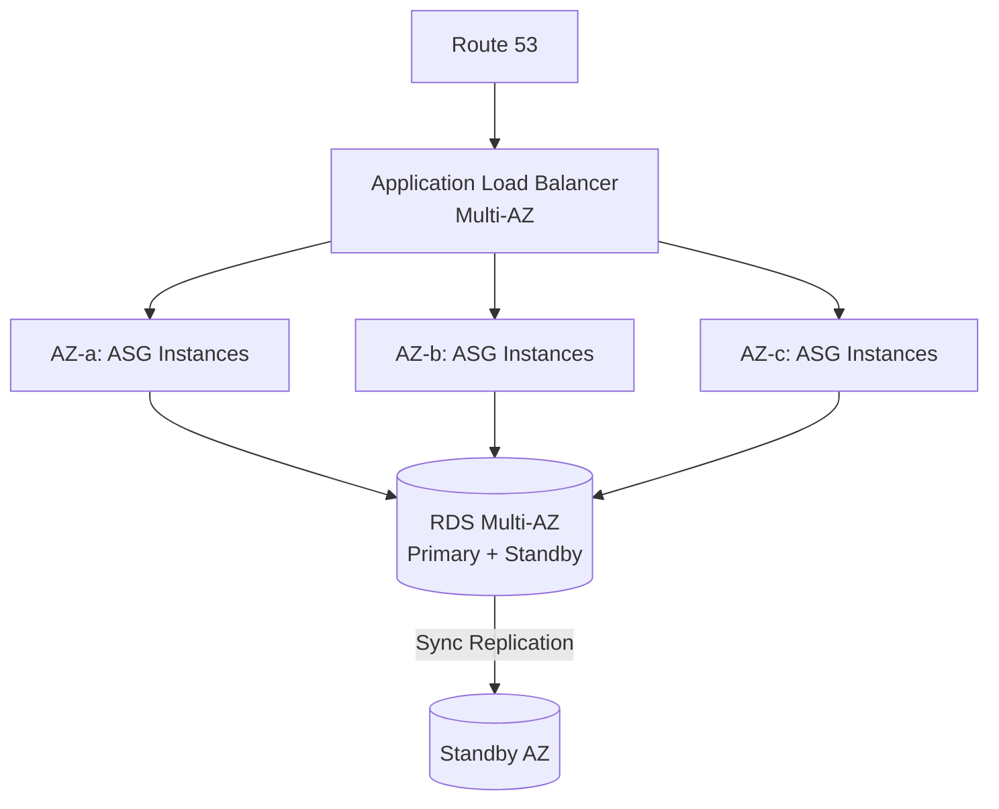
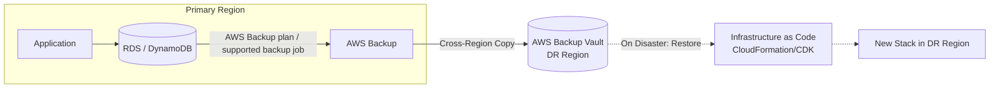
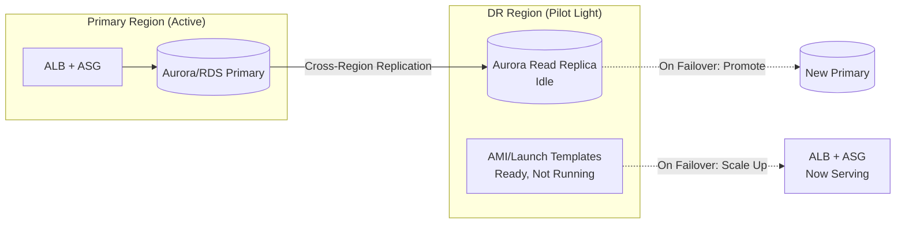
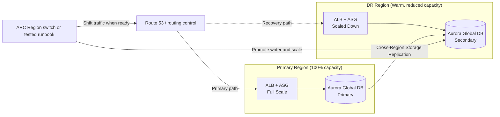
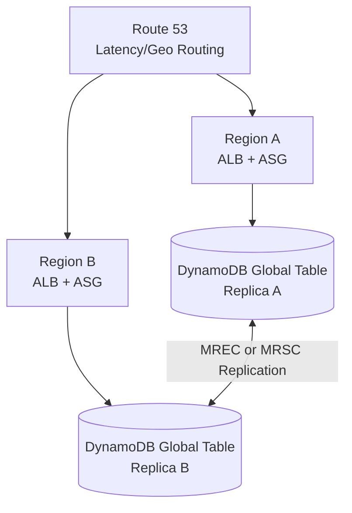

# High-Availability & Disaster Recovery Patterns

## Overview

Patterns for keeping workloads available across AZ and Region failures. Covers the four classic AWS DR strategies (backup & restore, pilot light, warm standby, multi-site active-active) plus the Multi-AZ HA foundation they build on.

---

## Table of Contents

- [Pattern 1: Multi-AZ High Availability](#pattern-1-multi-az-high-availability)
- [Pattern 2: Backup & Restore DR](#pattern-2-backup--restore-dr)
- [Pattern 3: Pilot Light DR](#pattern-3-pilot-light-dr)
- [Pattern 4: Warm Standby DR](#pattern-4-warm-standby-dr)
- [Pattern 5: Multi-Site Active-Active DR](#pattern-5-multi-site-active-active-dr)
- [Pattern 6: Amazon Application Recovery Controller](#pattern-6-amazon-application-recovery-controller)
- [Anti-Patterns to Avoid](#anti-patterns-to-avoid)

---

## Pattern 1: Multi-AZ High Availability

Baseline resilience against AZ failure and a common foundation for Region-level DR designs.

### Why This Pattern?

An Availability Zone consists of one or more discrete data centers with independent infrastructure, but an AZ-level impairment can still remove every instance placed only there. Spreading an Auto Scaling group across AZs and using an RDS/Aurora Multi-AZ design lets healthy capacity continue and protects committed database data through synchronous storage/standby replication. Clients must still retry failed in-flight requests and reconnect during database failover.

**Trade-off:** an RDS Multi-AZ DB instance deployment adds a non-readable standby, while a Multi-AZ DB cluster has two readable standbys; their capacity and pricing differ. Cross-AZ transfer charges also depend on the exact services and traffic path, so model the architecture rather than applying one blanket per-GB assumption. Multi-AZ protects against AZ and instance failures, not every Region-level or application-level failure, so it complements rather than replaces a DR strategy.

### Decision Criteria

How to achieve high availability at each layer of the stack.

| Requirement | Approach |
|---|---|
| Compute HA | ASG spanning ≥2 AZs, target group health checks |
| Database HA | RDS Multi-AZ (sync standby) or Aurora (6 copies across 3 AZs) |
| Storage HA | Choose multi-AZ S3 classes where AZ-loss resilience is required (One Zone classes are explicit exceptions); use tested EBS snapshots for volume recovery |
| Stateless routing | ALB/NLB health checks remove unhealthy targets automatically |

### When NOT to Use

- Use Single-AZ only when the documented availability requirement, recovery plan, and cost trade-off permit it
- Don't rely on Multi-AZ alone for Region-level outages — pair with a DR strategy below

---

## Pattern 2: Backup & Restore DR

Lowest cost, highest RTO/RPO DR strategy — data is backed up to another Region; infrastructure is provisioned only during a disaster.

### Why This Pattern?

Without a recoverable copy outside the primary Region and failure boundary, a Regional impairment leaves the workload dependent on recovery of that Region, while accidental deletion or corruption can also affect the primary data. Backup and restore keeps restorable data in a recovery Region and infrastructure definitions ready to redeploy. Copy cadence and support vary by service: an AWS Backup plan can schedule cross-Region copies for supported resource types, but it should not be described as continuous replication unless the selected service explicitly provides that behavior.

**Trade-off:** because infrastructure in the DR Region is provisioned from scratch on demand, recovery includes stack creation, backup restoration, validation, and traffic cutover. Writes later than the latest recoverable/cross-Region copy point might be unavailable. This strategy minimizes standing application compute, but actual recovery time and data loss depend on backup frequency, copy completion, dataset size, quotas, and rehearsed automation.

Illustrative recovery profile only; derive and verify workload-specific targets with restore drills:

| Metric | Typical Value |
|---|---|
| RTO | Hours |
| RPO | Hours (backup frequency) |
| Cost | Lowest standing compute cost; backup storage, copies, transfer, requests, and KMS usage can still apply |

### When NOT to Use

- Don't select this pattern when tested restore results cannot meet the workload RTO; evaluate Pilot Light or Warm Standby for a shorter activation path
- Don't use for workloads with strict RPO (near-zero data loss) requirements

---

## Pattern 3: Pilot Light DR

Core infrastructure (databases) replicated continuously; compute is provisioned only on failover.

### Why This Pattern?

Backup and restore puts database restoration on the recovery path. Pilot Light instead keeps a live cross-Region replica whose lag is workload- and service-dependent, so recovery can promote or fail over the replica rather than first restoring a backup. Compute and some supporting components still need activation. Whether that is faster than restore, and by how much, must be established in drills with production-scale data and quotas.

**Trade-off:** the DR Region has meaningfully lower RPO/RTO than Backup & Restore but still isn't running production traffic, so scaling ASGs up from zero, warming caches, and re-establishing connections still takes real minutes — this isn't a near-instant failover. It also requires more ongoing operational discipline than Backup & Restore: launch templates, AMIs, and network config in the DR Region drift out of sync with the primary unless failover drills are run regularly, and the idle replica costs money even though it serves no traffic.

Illustrative recovery profile only; derive and verify workload-specific targets with failover drills:

| Metric | Typical Value |
|---|---|
| RTO | 10s of minutes |
| RPO | Minutes (replication lag) |
| Cost | Low — idle replica + minimal standing compute |

### When NOT to Use

- Don't use when failover must be near-instant — scaling compute up still takes minutes
- Don't use if regular DR drills can't be scheduled — pilot light infra rots without testing

---

## Pattern 4: Warm Standby DR

Scaled-down but fully functional replica running in the DR Region at all times; scales up on failover.

### Why This Pattern?

Pilot Light still has a gap: compute must be launched and scaled before it can take production load. Warm Standby keeps a scaled-down but functional copy of the stack running continuously in the recovery Region. Aurora Global Database replication is typically fast, but lag is workload-dependent and must be monitored. Recovery becomes "scale the running stack, change the writer where required, and shift traffic" instead of booting all infrastructure from cold.

**Trade-off:** you're paying for standing compute and storage in the DR Region around the clock. The standby might serve synthetic checks or safe read traffic, but it must retain capacity headroom and a tested scale-up path. Route 53 health checks alone do not order database promotion, fencing, capacity changes, and traffic movement; use an orchestrated plan or runbook when those steps are required.

Illustrative recovery profile only; derive and verify workload-specific targets with failover drills:

| Metric | Typical Value |
|---|---|
| RTO | Minutes |
| RPO | Seconds |
| Cost | Medium — standing compute + storage in both Regions |

### When NOT to Use

- Don't use when cost sensitivity rules out running duplicate infrastructure continuously
- Don't use for workloads tolerant of hours of downtime — Pilot Light is cheaper

---

## Pattern 5: Multi-Site Active-Active DR

Production capacity serves traffic in at least two Regions simultaneously; recovery does not require cold activation, but routing and data behavior during impairment still require automation and testing.

### Why This Pattern?

Every strategy above has an activation and traffic-shift path. Multi-site active-active reduces that activation work by keeping production capacity live in multiple Regions. It does not eliminate detection, client/DNS caching, retries, dependency failures, or the need to remove an impaired Region safely. Remaining Regions must have tested capacity to absorb the redirected load.

**Trade-off:** this is the most expensive and operationally complex pattern in the set—you run production capacity in multiple Regions and need an explicit data-consistency model. DynamoDB global tables can use MREC (asynchronous, last-writer-wins conflicts) or MRSC (strong consistency with topology constraints). Aurora Global Database remains single-writer: write forwarding sends secondary-Region writes back to the primary, so it can support active application tiers but is not a multi-writer database. Reach for multi-site only when its measured business benefit justifies the cost and data-model complexity.

Illustrative recovery profile only; derive and verify workload-specific targets with failover drills:

| Metric | Typical Value |
|---|---|
| RTO | Usually the lowest strategy-level target, but still includes detection, routing convergence, client retry, and dependency recovery |
| RPO | Data-service and consistency-mode dependent; MREC writes not yet replicated can be unavailable, while MRSC provides zero RPO when quorum requirements are met |
| Cost | Highest — full duplicate capacity, active in all Regions |

### When NOT to Use

- Don't use unless the measured business impact justifies the additional multi-Region capacity and operational complexity
- Don't call a workload active-active unless every stateful dependency has a tested multi-Region write/failover design; Aurora write forwarding is still single-writer

---

## Pattern 6: Amazon Application Recovery Controller

Orchestrates and safeguards Region recovery operations.

### Why This Pattern?

A basic Route 53 failover policy can redirect DNS from a health signal, but it does not orchestrate database promotion, capacity changes, or application-specific recovery steps. Amazon Application Recovery Controller (ARC) Region switch provides plans with ordered or parallel execution blocks, evaluates IAM/resource/capacity configuration regularly, and records actual recovery time. ARC routing control remains useful for highly available traffic switches with safety rules. The older ARC readiness-check feature is not open to new customers; new designs should use Region switch plan evaluation and still run recovery exercises.

**Trade-off:** ARC adds another control plane and recovery plan that must be kept aligned with the workload. Plan evaluation detects configuration issues but does not prove the application will recover, so exercises remain required. For a simple, tested DNS-only failover, Route 53 may be sufficient; ARC earns its complexity when recovery has multiple coordinated steps or unsafe routing states must be prevented.

Building blocks of an Application Recovery Controller setup and what each one is for.

| Component | Purpose |
|---|---|
| Region switch plan evaluation | Regularly checks plan IAM permissions, resource configuration, and running capacity; does not replace exercises |
| Region switch workflows | Orchestrate traffic, capacity, automation, and custom recovery steps and report actual recovery time |
| Routing controls and safety rules | Highly available traffic on/off controls with assertions/gating rules to prevent unsafe combinations |

### When NOT to Use

- Don't use for simple two-Region failover where a basic Route 53 health-check failover routing policy is sufficient

---

## Anti-Patterns to Avoid

Common HA/DR mistakes and the fix for each.

| Anti-Pattern | Problem | Solution |
|---|---|---|
| **Untested DR plan** | Runbook fails exactly when needed | Run scheduled failover drills (AWS Resilience Hub, chaos testing) |
| **DR Region without IAM/config parity** | Failover fails on permissions, not just data | Use IaC to deploy identical stacks to both Regions |
| **Single-writer database described as multi-writer** | Incorrect failover and consistency assumptions | Use a true multi-writer design (for example, DynamoDB MREC/MRSC) or document the Aurora single-writer path explicitly |
| **RPO/RTO not tied to business requirements** | Over- or under-investing in DR | Set RTO/RPO per workload tier, choose strategy from the matrix above |
| **No destination-Region key and restore permissions** | Backup copies or restores fail in the recovery Region | Configure and test the destination vault/KMS key policy and restore role; a KMS multi-Region key is optional, not universally required |

---

## Authoritative AWS references

- [AWS Well-Architected disaster recovery options](https://docs.aws.amazon.com/wellarchitected/latest/reliability-pillar/plan-for-disaster-recovery-dr.html)
- [AWS Backup cross-Region backup copies](https://docs.aws.amazon.com/aws-backup/latest/devguide/cross-region-backup.html)
- [Aurora Global Database recovery and failover](https://docs.aws.amazon.com/AmazonRDS/latest/AuroraUserGuide/aurora-global-database-disaster-recovery.html)
- [DynamoDB global-table consistency modes](https://docs.aws.amazon.com/amazondynamodb/latest/developerguide/HowItWorks.ReadConsistency.html)
- [DynamoDB MRSC design constraints](https://docs.aws.amazon.com/amazondynamodb/latest/developerguide/bp-global-table-design.html)
- [Application Recovery Controller Region switch plans](https://docs.aws.amazon.com/r53recovery/latest/dg/region-switch-plans.html)
- [Route 53 DNS failover behavior](https://docs.aws.amazon.com/Route53/latest/DeveloperGuide/dns-failover.html)
