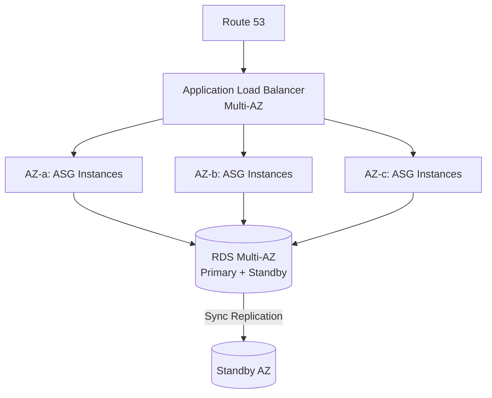
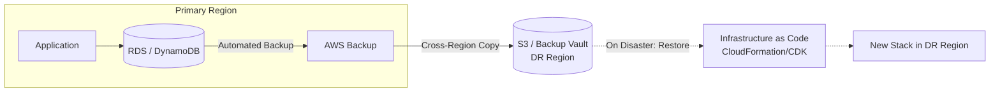
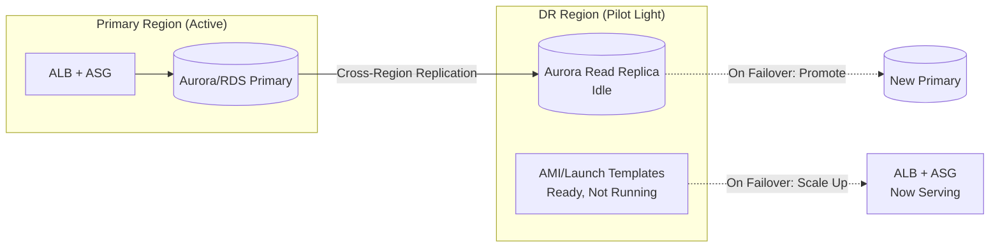
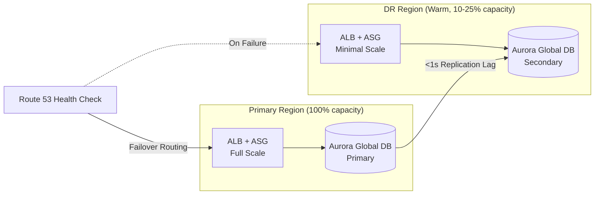
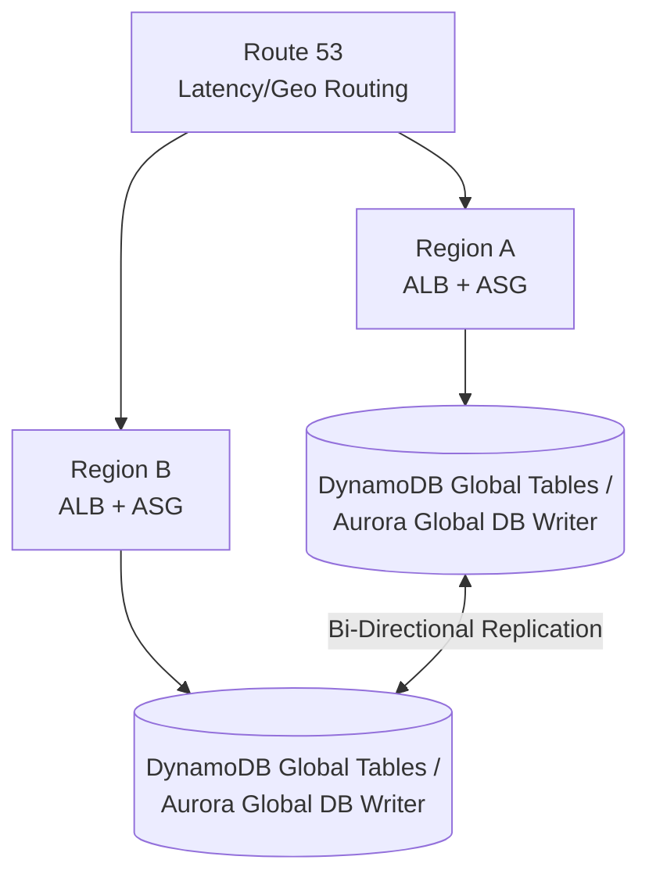

# High-Availability & Disaster Recovery Patterns

## Overview

Patterns for keeping workloads available across AZ and Region failures. Covers the four classic AWS DR strategies (backup & restore, pilot light, warm standby, multi-site active-active) plus the Multi-AZ HA foundation they build on.

---

## Table of Contents

- [Pattern 1: Multi-AZ High Availability](#pattern-1-multi-az-high-availability)
- [Pattern 2: Backup & Restore DR](#pattern-2-backup--restore-dr)
- [Pattern 3: Pilot Light DR](#pattern-3-pilot-light-dr)
- [Pattern 4: Warm Standby DR](#pattern-4-warm-standby-dr)
- [Pattern 5: Multi-Site Active-Active DR](#pattern-5-multi-site-active-active-dr)
- [Pattern 6: Route 53 Application Recovery Controller](#pattern-6-route-53-application-recovery-controller)
- [Anti-Patterns to Avoid](#anti-patterns-to-avoid)

---

## Pattern 1: Multi-AZ High Availability

Baseline resilience against AZ failure — the foundation every DR strategy sits on top of.

### Why This Pattern?

AZs are physically isolated data centers, but a single AZ can still fail wholesale — power loss, network partition, or a botched deployment can take out every instance in it within seconds. If compute and database live in one AZ, that failure is a full outage: the ALB has nothing healthy to route to and there is no standby to promote. Spreading ASG instances across AZs and running RDS/Aurora with a synchronously replicated standby means the loss of any single AZ leaves the application serving traffic from the remaining AZs with no data loss, because the standby already has every committed transaction.

**Trade-off:** Multi-AZ roughly doubles database compute cost (RDS Multi-AZ runs an idle standby you pay for but can't query) and cross-AZ data transfer adds a small but real per-GB charge on top of typical NAT/ALB traffic. It also only protects against AZ-level failure — a Region-wide event (undersea cable cut, control-plane outage, natural disaster) takes down every AZ in that Region simultaneously, which is why this pattern is a prerequisite for, not a substitute for, the DR strategies below.

### Decision Criteria

How to achieve high availability at each layer of the stack.

| Requirement | Approach |
|---|---|
| Compute HA | ASG spanning ≥2 AZs, target group health checks |
| Database HA | RDS Multi-AZ (sync standby) or Aurora (6 copies across 3 AZs) |
| Storage HA | S3 (multi-AZ by default), EBS snapshots for volume recovery |
| Stateless routing | ALB/NLB health checks remove unhealthy targets automatically |

### When NOT to Use

- Single-AZ is acceptable only for non-critical dev/test environments
- Don't rely on Multi-AZ alone for Region-level outages — pair with a DR strategy below

---

## Pattern 2: Backup & Restore DR

Lowest cost, highest RTO/RPO DR strategy — data is backed up to another Region; infrastructure is provisioned only during a disaster.

### Why This Pattern?

Without any cross-Region copy of data, a Regional outage — or a Regional data-loss event like an S3 bucket or RDS instance being corrupted/deleted — means the workload is unrecoverable until AWS restores the Region, which could be hours to days, or permanently unrecoverable if the loss is on the data itself rather than the Region's availability. Backup & Restore solves the narrower but critical problem of "can we get the data and the infrastructure definition back at all," by continuously shipping backups to a second Region and keeping IaC ready to redeploy from them, independent of whatever caused the primary Region to become unusable.

**Trade-off:** because infrastructure in the DR Region is provisioned from scratch on demand, recovery time includes stack creation, backup restoration, and DNS cutover — realistically hours, not minutes — and any writes made after the last backup are gone. This is the cheapest DR strategy precisely because it defers all the compute/failover cost to the moment of disaster; it's the wrong choice for anything where an hour of downtime or an hour of data loss has real business or compliance cost.

Typical recovery targets and cost profile for this strategy:

| Metric | Typical Value |
|---|---|
| RTO | Hours |
| RPO | Hours (backup frequency) |
| Cost | Lowest — pay for backup storage only |

### When NOT to Use

- Don't use when RTO must be under an hour — use Pilot Light or Warm Standby instead
- Don't use for workloads with strict RPO (near-zero data loss) requirements

---

## Pattern 3: Pilot Light DR

Core infrastructure (databases) replicated continuously; compute is provisioned only on failover.

### Why This Pattern?

Backup & Restore's biggest weakness is that restoring a database from a backup can itself take a long time on large datasets, and any writes since the last snapshot are lost. Pilot Light removes the database-restore step from the critical path by keeping a live cross-Region replica continuously caught up via replication (seconds to low minutes of lag) instead of periodic snapshots — so the data half of recovery is just "promote the replica," not "restore a backup and replay logs." Compute is still absent until failover, but that's a much faster operation (launching from pre-baked AMIs/launch templates) than restoring a multi-GB or multi-TB database.

**Trade-off:** the DR Region has meaningfully lower RPO/RTO than Backup & Restore but still isn't running production traffic, so scaling ASGs up from zero, warming caches, and re-establishing connections still takes real minutes — this isn't a near-instant failover. It also requires more ongoing operational discipline than Backup & Restore: launch templates, AMIs, and network config in the DR Region drift out of sync with the primary unless failover drills are run regularly, and the idle replica costs money even though it serves no traffic.

Typical recovery targets and cost profile for this strategy:

| Metric | Typical Value |
|---|---|
| RTO | 10s of minutes |
| RPO | Minutes (replication lag) |
| Cost | Low — idle replica + minimal standing compute |

### When NOT to Use

- Don't use when failover must be near-instant — scaling compute up still takes minutes
- Don't use if regular DR drills can't be scheduled — pilot light infra rots without testing

---

## Pattern 4: Warm Standby DR

Scaled-down but fully functional replica running in the DR Region at all times; scales up on failover.

### Why This Pattern?

Pilot Light still has a gap: compute has to be launched and scaled up from nothing before it can take real production load, and that ramp-up — ASG scaling, warm-up, connection draining on the load balancer — is where most of Pilot Light's minutes-scale RTO is spent. Warm Standby closes that gap by keeping a scaled-down but fully functional copy of the stack running continuously in the DR Region, with Aurora Global Database keeping replication lag under a second. Failover becomes "scale the already-running stack up and shift traffic," not "boot infrastructure from cold," cutting RTO from tens of minutes to minutes and RPO to seconds.

**Trade-off:** you're paying for standing compute and storage in the DR Region around the clock — Route 53 health checks, ALB, and a running (if small) ASG fleet — even though it serves no production traffic outside a failover. That ongoing cost is the reason to skip this pattern for workloads that can tolerate Pilot Light's longer recovery window; Warm Standby is worth the extra spend specifically when minutes of downtime, not tens of minutes, is the requirement.

Typical recovery targets and cost profile for this strategy:

| Metric | Typical Value |
|---|---|
| RTO | Minutes |
| RPO | Seconds |
| Cost | Medium — standing compute + storage in both Regions |

### When NOT to Use

- Don't use when cost sensitivity rules out running duplicate infrastructure continuously
- Don't use for workloads tolerant of hours of downtime — Pilot Light is cheaper

---

## Pattern 5: Multi-Site Active-Active DR

Full production capacity live in ≥2 Regions simultaneously; no failover step required.

### Why This Pattern?

Every strategy above still has a "failover" step — some window, however short, where traffic has to be detected as failing and rerouted, and during which requests can be dropped or delayed. For workloads where even a few minutes of downtime is unacceptable (payment processing, real-time trading, global consumer apps with SLA penalties), that window itself is the problem. Multi-Site Active-Active removes it by keeping full production capacity live and serving real traffic in multiple Regions simultaneously via Route 53 latency/geo routing, so losing a Region just means Route 53 stops sending traffic there — the remaining Region(s) are already warmed up and already serving live requests, not standing by.

**Trade-off:** this is the most expensive and operationally complex pattern in the set — you're running and paying for 2x+ full production capacity all the time, not just during a disaster, and you need a database that supports true multi-writer replication (DynamoDB Global Tables or Aurora Global Database with write-forwarding), which brings eventual-consistency and conflict-resolution concerns that single-writer architectures don't have to deal with. Reach for this only when the cost of downtime clearly exceeds the cost of running duplicate infrastructure continuously — for most workloads, Warm Standby's minutes-scale RTO is a better cost/benefit trade.

Typical recovery targets and cost profile for this strategy:

| Metric | Typical Value |
|---|---|
| RTO | Near-zero (already serving traffic) |
| RPO | Near-zero to seconds |
| Cost | Highest — full duplicate capacity, active in all Regions |

### When NOT to Use

- Don't use unless the business impact of downtime justifies 2x+ infrastructure cost
- Don't use with databases that only support single-writer replication (plain RDS read replicas) — requires DynamoDB Global Tables or Aurora Global Database write-forwarding

---

## Pattern 6: Route 53 Application Recovery Controller

Automates and safeguards Region failover decisions.

### Why This Pattern?

A basic Route 53 health-check failover policy has a blind spot: it only knows what its own health check tells it, and that health check runs through the same Route 53 dependency chain it's supposed to be a safeguard for. It also can't distinguish "the DR Region is unhealthy" from "the DR Region was never actually ready to take production traffic" — a stale AMI, missing capacity, or config drift in the standby Region can pass a shallow health check while still being unable to serve real load. Application Recovery Controller adds readiness checks that continuously verify the DR Region can actually take over, and routing controls that sit outside Route 53's own dependency graph so the failover switch itself doesn't depend on the thing that might be failing.

**Trade-off:** it adds another control plane to configure and keep in sync with the actual infrastructure — readiness checks have to be wired to real capacity/config signals, not just a health endpoint, or they give false confidence. For a straightforward two-Region setup with well-tested failover, a plain Route 53 health-check routing policy is simpler to reason about and sufficient; ARC earns its complexity mainly in multi-Region setups where an uncoordinated failover (e.g., disabling every Region at once) is itself a risk worth guarding against.

Building blocks of an Application Recovery Controller setup and what each one is for.

| Component | Purpose |
|---|---|
| Readiness checks | Continuously validate DR Region has capacity/config to take traffic |
| Routing controls | Manual or automated on/off switches per Region, outside Route 53's own dependency chain |
| Safety rules | Prevent simultaneously disabling all Regions (avoid total outage from a bad failover) |

### When NOT to Use

- Don't use for simple two-Region failover where a basic Route 53 health-check failover routing policy is sufficient

---

## Anti-Patterns to Avoid

Common HA/DR mistakes and the fix for each.

| Anti-Pattern | Problem | Solution |
|---|---|---|
| **Untested DR plan** | Runbook fails exactly when needed | Run scheduled failover drills (AWS Resilience Hub, chaos testing) |
| **DR Region without IAM/config parity** | Failover fails on permissions, not just data | Use IaC to deploy identical stacks to both Regions |
| **Single-writer database in "active-active"** | Silent data loss or write conflicts | Use DynamoDB Global Tables or Aurora Global Database with write-forwarding |
| **RPO/RTO not tied to business requirements** | Over- or under-investing in DR | Set RTO/RPO per workload tier, choose strategy from the matrix above |
| **No cross-Region backup encryption key access** | Restores fail because KMS key isn't available in DR Region | Use multi-Region KMS keys for cross-Region backups |
