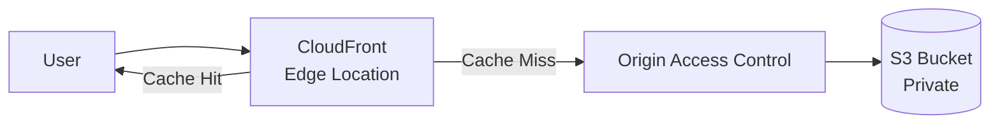
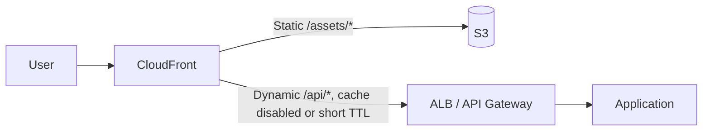
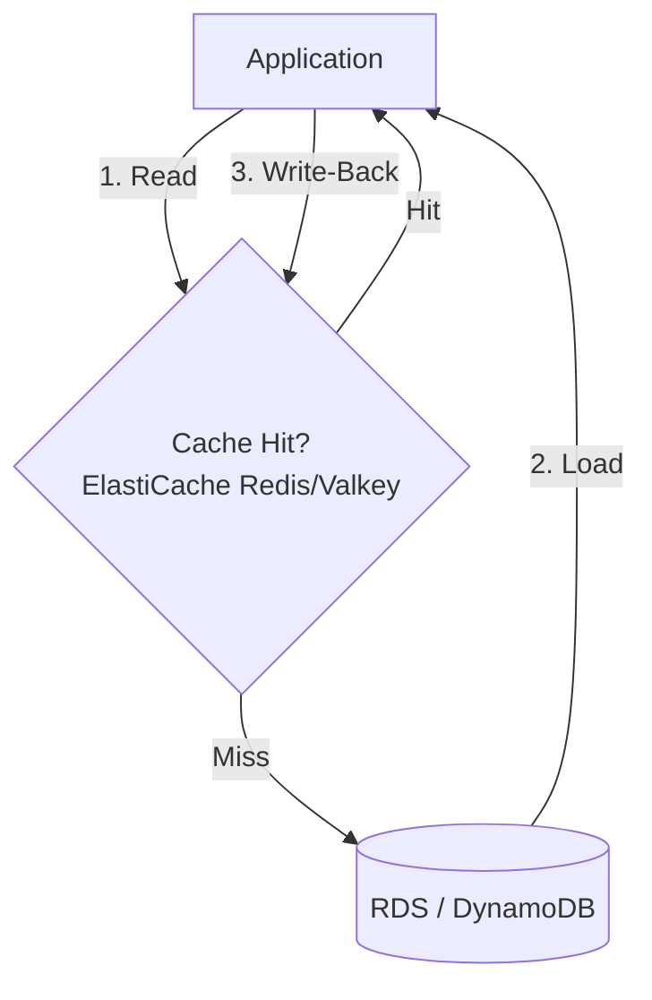
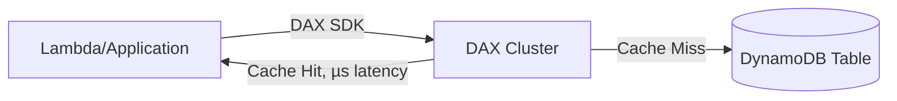

# Caching & Content Delivery Patterns

## Overview

Patterns for reducing latency and origin load using CDN edge caching and in-memory data caching. Complements [Networking/CloudFront-Best-Practices.md](../Networking/CloudFront-Best-Practices.md) with architecture-level decision guidance.

---

## Table of Contents

- [Pattern 1: Static Content Delivery (CloudFront + S3)](#pattern-1-static-content-delivery-cloudfront--s3)
- [Pattern 2: Dynamic Content Acceleration](#pattern-2-dynamic-content-acceleration)
- [Pattern 3: Cache-Aside with ElastiCache](#pattern-3-cache-aside-with-elasticache)
- [Pattern 4: DAX for DynamoDB Acceleration](#pattern-4-dax-for-dynamodb-acceleration)
- [Pattern 5: Edge Compute (Lambda@Edge / CloudFront Functions)](#pattern-5-edge-compute-lambdaedge--cloudfront-functions)
- [Anti-Patterns to Avoid](#anti-patterns-to-avoid)

---

## Pattern 1: Static Content Delivery (CloudFront + S3)

### Why This Pattern?

Serving static assets (images, JS/CSS bundles, video, downloads) directly from S3 means every request — regardless of where the user is — travels to a single regional bucket, and every byte is billed as S3 data transfer. At any real scale that produces high tail latency for distant users and turns popular objects into a repeated read load on the bucket. CloudFront terminates requests at an edge location close to the user and serves cached objects from there, so the origin only sees traffic on cache misses (effectively once per object per edge location, not once per user).

**Trade-off:** adding CloudFront means every static asset now has two possible states (edge cache vs. origin) that can disagree, and cache invalidation is neither instant nor free — `CreateInvalidation` requests are rate-limited, cost money past the free tier, and take time to propagate globally. For assets that change infrequently and can be versioned by filename, this is a non-issue; for a bucket serving content that mutates in place, the cache becomes a source of stale-data bugs unless invalidation is built into the deploy process.

Key decisions to get right when serving static content through CloudFront and S3.

| Decision | Guidance |
|---|---|
| Bucket access | Origin Access Control (OAC), block all public bucket access |
| Cache duration | Long TTL + versioned/hashed filenames for cache-busting on deploy |
| Compression | Enable automatic Brotli/Gzip compression at the edge |
| Invalidation | Prefer new object keys over `CreateInvalidation` (cost + propagation delay) |

### When NOT to Use

- Don't front a bucket with CloudFront if content changes per-request and can't be cached at all

---

## Pattern 2: Dynamic Content Acceleration

Using CloudFront in front of an ALB or API Gateway for TLS termination, connection reuse, and selective caching of dynamic responses.

### Why This Pattern?

Dynamic endpoints behind an ALB or API Gateway pay TLS handshake and TCP connection-setup cost on every new client connection, and each request travels the full path back to the region regardless of how close the user is. At volume this shows up as elevated p99 latency for geographically distant clients and as connection-handling overhead on the origin. Putting CloudFront in front — even with caching disabled for most paths — lets the edge terminate TLS and reuse persistent connections to the origin, and lets the subset of responses that are cacheable (a product catalog page, a computed leaderboard) be served without touching the application at all.

**Trade-off:** dynamic caching only pays off if the cache key is engineered correctly — every header, cookie, and query string forwarded to the origin becomes part of what CloudFront must consider for a "cache hit," and forwarding too much (e.g., a session cookie) collapses the hit ratio to near zero while forwarding too little (missing a locale header) serves the wrong content to the wrong user. This tuning work is ongoing as the API evolves, not a one-time setup cost.

Key decisions for caching dynamic, per-request content without leaking data between users.

| Decision | Guidance |
|---|---|
| Cache policy | Separate cache behaviors per path pattern; short/no TTL for personalized responses |
| Origin request policy | Forward only headers/cookies/query strings the origin needs — improves cache hit ratio |
| Field-level | Use CloudFront Functions to normalize headers before they hit cache key |

### When NOT to Use

- Don't cache authenticated, per-user responses without cache-key normalization — risks serving one user's data to another

---

## Pattern 3: Cache-Aside with ElastiCache

### Why This Pattern?

RDS and DynamoDB are sized and priced around a request rate that a read-heavy application will regularly exceed once it has real traffic — a single popular record read thousands of times per second turns into thousands of redundant round trips to the database instead of one. That drives up database CPU/IOPS cost and, past a point, causes read latency to degrade for every caller, cached or not. ElastiCache (Redis/Valkey) sits in front as a sub-millisecond in-memory layer so repeated reads of the same key are absorbed at the cache and only the first read (or a periodic refresh) touches the database.

**Trade-off:** cache-aside means the application is now responsible for keeping two stores roughly in sync — a write that updates the database but not the cache (or vice versa) produces stale reads until TTL expiry, and a cold cache after a deploy or failover can send a burst of simultaneous misses straight at the database (cache stampede) unless mitigated with jitter or request coalescing. This added consistency and operational surface is only worth it when the read pattern is skewed enough (hot keys, repeated lookups) that a cache actually absorbs meaningful load.

Key aspects to plan for when implementing cache-aside with ElastiCache.

| Aspect | Guidance |
|---|---|
| Eviction | TTL per key type; LRU for general-purpose caches |
| Consistency | Invalidate/update cache key on write path, not just TTL expiry |
| Topology | Cluster mode enabled for horizontal scale; replicas for read scaling |
| Failure mode | Treat cache as best-effort — app must function (slower) if cache is unavailable |

### When NOT to Use

- Don't use for data that changes on every read (no cache benefit) or requires strict consistency across all readers

---

## Pattern 4: DAX for DynamoDB Acceleration

Microsecond-latency read cache purpose-built for DynamoDB, API-compatible with the DynamoDB SDK.

### Why This Pattern?

DynamoDB already serves single-digit-millisecond reads, but that latency floor is a hard limit for use cases like real-time bidding, session lookups in a request hot path, or fan-out reads that each add a few milliseconds — millisecond-level latency adds up when a single user request triggers dozens of table reads. DAX closes that gap by caching item and query results in memory at microsecond latency, and because it's API-compatible with the DynamoDB SDK it removes the item cache without an application-level cache-aside rewrite. It also absorbs repeated reads of hot items so they don't consume DynamoDB read capacity (and cost) on every call.

**Trade-off:** DAX is another cluster to provision, patch (via maintenance windows), and pay for continuously, and it only helps if reads genuinely repeat — a workload dominated by unique, one-off reads or heavy writes gets none of the caching benefit while still paying for the cluster and absorbing the extra network hop if it isn't co-located with compute. It also introduces eventual consistency on cached reads even when the underlying table read was requested as strongly consistent, which matters for correctness-sensitive paths.

Key decisions when placing DAX in front of a DynamoDB table.

| Decision | Guidance |
|---|---|
| Write-through | Writes via DAX populate the cache automatically |
| TTL | Item cache and query cache have independent TTLs |
| Placement | Deploy in same VPC/AZ as compute to avoid added network hop cost |

### When NOT to Use

- Don't use for write-heavy workloads with few repeated reads — DAX adds cost without a caching benefit
- Don't use outside a VPC-connected compute environment (Lambda without VPC config, for example)

---

## Pattern 5: Edge Compute (Lambda@Edge / CloudFront Functions)

Which edge compute option fits a given use case.

### Why This Pattern?

Some request-time logic — redirecting based on country, rewriting a header, routing an A/B test bucket — doesn't need the origin at all, but without an edge compute option every one of those decisions still requires a round trip to the application, adding latency and load for work that's really just string manipulation. CloudFront Functions and Lambda@Edge push that logic to the edge (or regional edge cache) so it executes closer to the user and never touches the origin, and they let teams change routing/redirect/header behavior without a full application deploy.

**Trade-off:** edge compute runs in a constrained execution environment — no persistent connections to a database, tight memory/CPU/duration limits (tighter for CloudFront Functions than Lambda@Edge), and deployment/rollback that's slower than a normal Lambda update since changes propagate globally. Business logic that needs to call another service or read from a database doesn't belong at the edge; using Lambda@Edge for that turns a latency optimization into a distributed-debugging problem.

| Use Case | Choose |
|---|---|
| Sub-millisecond, simple logic (header manipulation, redirects, A/B routing) | CloudFront Functions (JavaScript, runs at all edge locations) |
| Complex logic, network/external calls, larger runtime needs | Lambda@Edge (Node.js/Python, runs at regional edge caches) |

### When NOT to Use

- Don't use Lambda@Edge for simple header rewrites — CloudFront Functions are cheaper and lower-latency
- Don't perform origin-fetching business logic at the edge — keep that in the origin application

---

## Anti-Patterns to Avoid

Common caching and content-delivery mistakes and the fix for each.

| Anti-Pattern | Problem | Solution |
|---|---|---|
| **Caching personalized data with a shared cache key** | Data leaks between users | Include user/session identifier in cache key policy |
| **No cache-stampede protection** | Cache expiry causes thundering herd on origin | Use jittered TTLs, request coalescing, or stale-while-revalidate |
| **Treating cache as source of truth** | Data loss on cache eviction/flush | Always back caches with a durable store |
| **Invalidating CloudFront on every deploy** | Slow, costly, cache-miss storm | Use versioned object keys instead of invalidation |
| **No cache metrics** | Can't tell if cache is helping | Monitor hit/miss ratio (CloudWatch `CacheHitRate`, ElastiCache `CacheHits`/`CacheMisses`) |
