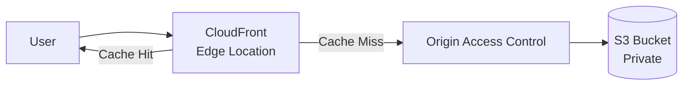
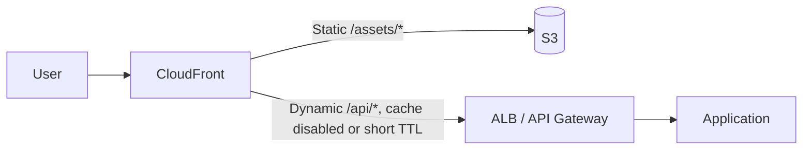
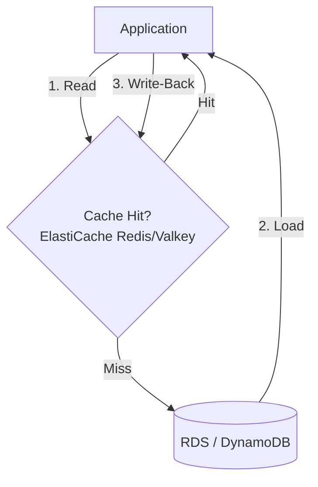
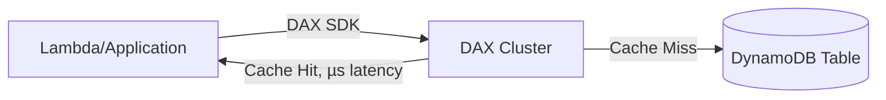

# Caching & Content Delivery Patterns

## Overview

Patterns for reducing latency and origin load using CDN edge caching and in-memory data caching. Complements [Networking/CloudFront-Best-Practices.md](../Networking/CloudFront-Best-Practices.md) with architecture-level decision guidance.

---

## Table of Contents

- [Pattern 1: Static Content Delivery (CloudFront + S3)](#pattern-1-static-content-delivery-cloudfront--s3)
- [Pattern 2: Dynamic Content Acceleration](#pattern-2-dynamic-content-acceleration)
- [Pattern 3: Cache-Aside with ElastiCache](#pattern-3-cache-aside-with-elasticache)
- [Pattern 4: DAX for DynamoDB Acceleration](#pattern-4-dax-for-dynamodb-acceleration)
- [Pattern 5: Edge Compute (Lambda@Edge / CloudFront Functions)](#pattern-5-edge-compute-lambdaedge--cloudfront-functions)
- [Anti-Patterns to Avoid](#anti-patterns-to-avoid)

---

## Pattern 1: Static Content Delivery (CloudFront + S3)

### Why This Pattern?

Serving static assets directly from S3 means every request travels to the bucket's Region and generates origin request/transfer usage. CloudFront serves cache hits near viewers, so the origin sees misses, revalidations, and expired/evicted-object fetches rather than every viewer request. Actual fetch frequency depends on TTLs, cache keys, eviction, and optional Origin Shield—not a guaranteed one fetch per object and edge location.

**Trade-off:** adding CloudFront means every static asset now has two possible states (edge cache vs. origin) that can disagree, and cache invalidation is neither instant nor free — `CreateInvalidation` requests are rate-limited, cost money past the free tier, and take time to propagate globally. For assets that change infrequently and can be versioned by filename, this is a non-issue; for a bucket serving content that mutates in place, the cache becomes a source of stale-data bugs unless invalidation is built into the deploy process.

Key decisions to get right when serving static content through CloudFront and S3.

| Decision | Guidance |
|---|---|
| Bucket access | Origin Access Control (OAC), block all public bucket access |
| Cache duration | Long TTL + versioned/hashed filenames for cache-busting on deploy |
| Compression | Enable automatic Brotli/Gzip compression at the edge |
| Invalidation | Prefer new object keys over `CreateInvalidation` (cost + propagation delay) |

### When NOT to Use

- Don't front a bucket with CloudFront if content changes per-request and can't be cached at all

---

## Pattern 2: Dynamic Content Acceleration

Using CloudFront in front of an ALB or API Gateway for TLS termination, connection reuse, and selective caching of dynamic responses.

### Why This Pattern?

Dynamic endpoints behind an ALB or API Gateway pay TLS handshake and TCP connection-setup cost on every new client connection, and each request travels the full path back to the region regardless of how close the user is. At volume this shows up as elevated p99 latency for geographically distant clients and as connection-handling overhead on the origin. Putting CloudFront in front — even with caching disabled for most paths — lets the edge terminate TLS and reuse persistent connections to the origin, and lets the subset of responses that are cacheable (a product catalog page, a computed leaderboard) be served without touching the application at all.

**Trade-off:** dynamic caching only pays off if the cache key is engineered correctly. Headers, cookies, and query strings included by the cache policy fragment the cache; omit a value that changes the response and CloudFront can serve the wrong content to a user. An origin request policy can forward additional origin-required values without adding them to the cache key, but do that only when those values truly do not vary the response. This tuning work is ongoing as the API evolves, not a one-time setup cost.

Key decisions for caching dynamic, per-request content without leaking data between users.

| Decision | Guidance |
|---|---|
| Cache policy | Separate cache behaviors per path pattern; short/no TTL for personalized responses |
| Origin request policy | Forward origin-required headers/cookies/query strings that are intentionally excluded from the cache key; verify they do not change the response |
| Request normalization | Use CloudFront Functions for lightweight URI/header/cookie normalization before cache lookup; include every variant that changes the response |

### When NOT to Use

- Don't cache authenticated, per-user responses without cache-key normalization — risks serving one user's data to another

---

## Pattern 3: Cache-Aside with ElastiCache

### Why This Pattern?

RDS and DynamoDB are sized and priced around a request rate that a read-heavy application will regularly exceed once it has real traffic — a single popular record read thousands of times per second turns into thousands of redundant round trips to the database instead of one. That drives up database CPU/IOPS cost and, past a point, causes read latency to degrade for every caller, cached or not. ElastiCache (Redis/Valkey) sits in front as a sub-millisecond in-memory layer so repeated reads of the same key are absorbed at the cache and only the first read (or a periodic refresh) touches the database.

**Trade-off:** cache-aside means the application is now responsible for keeping two stores roughly in sync — a write that updates the database but not the cache (or vice versa) produces stale reads until TTL expiry, and a cold cache after a deploy or failover can send a burst of simultaneous misses straight at the database (cache stampede) unless mitigated with jitter or request coalescing. This added consistency and operational surface is only worth it when the read pattern is skewed enough (hot keys, repeated lookups) that a cache actually absorbs meaningful load.

Key aspects to plan for when implementing cache-aside with ElastiCache.

| Aspect | Guidance |
|---|---|
| Eviction | TTL per key type; LRU for general-purpose caches |
| Consistency | Invalidate/update cache key on write path, not just TTL expiry |
| Topology | Cluster mode enabled for horizontal scale; replicas for read scaling |
| Failure mode | Treat cache as best-effort — app must function (slower) if cache is unavailable |

### When NOT to Use

- Don't use for data that changes on every read (no cache benefit) or requires strict consistency across all readers

---

## Pattern 4: DAX for DynamoDB Acceleration

Microsecond-latency read cache purpose-built for DynamoDB, API-compatible with the DynamoDB SDK.

### Why This Pattern?

DynamoDB provides single-digit-millisecond performance for common operations, while DAX can return repeated eventually consistent reads from its item or query caches in microseconds. The DAX client supports a broad DynamoDB-compatible API surface, so applications can add a managed write-through cache without implementing cache-aside logic. Cache misses and strongly consistent/transactional reads still go to DynamoDB.

**Trade-off:** DAX is another cluster to provision and pay for continuously, and it helps only when reads repeat. Cached item/query reads are eventually consistent; when `ConsistentRead=true`, DAX passes the request to DynamoDB and does not cache the response. Writes that bypass DAX can leave cached items stale until TTL/eviction, and item writes do not invalidate DAX query-cache result sets.

Key decisions when placing DAX in front of a DynamoDB table.

| Decision | Guidance |
|---|---|
| Write-through | Writes via DAX populate the cache automatically |
| TTL | Item cache and query cache have independent TTLs |
| Placement and HA | Place clients in the same VPC and deploy at least three DAX nodes across AZs for production HA |

### When NOT to Use

- Don't use for write-heavy workloads with few repeated reads — DAX adds cost without a caching benefit
- Don't use outside a VPC-connected compute environment (Lambda without VPC config, for example)

---

## Pattern 5: Edge Compute (Lambda@Edge / CloudFront Functions)

Which edge compute option fits a given use case.

### Why This Pattern?

Some request-time logic—redirecting based on country, rewriting a header, or assigning an A/B bucket—doesn't need application compute. CloudFront Functions and Lambda@Edge can execute that logic during viewer/origin request or response events, close to the viewer. A function can answer at the edge or transform a request before CloudFront continues to the cache/origin; edge execution does not imply that every request avoids the origin.

**Trade-off:** edge compute runs under product-specific restrictions. CloudFront Functions cannot make network calls and have the tightest execution limits. Lambda@Edge can make network calls but cannot attach to your VPC and does not support features such as environment variables, layers, DLQs, X-Ray, provisioned concurrency, or container images. Globally distributed code is harder to observe and roll back, so keep edge logic small and latency-bounded.

| Use Case | Choose |
|---|---|
| Sub-millisecond, simple logic (header manipulation, redirects, A/B routing) | CloudFront Functions (JavaScript, runs at all edge locations) |
| More complex logic or carefully bounded network calls | Lambda@Edge (Node.js/Python; function version created in `us-east-1`, runs at regional edge locations) |

### When NOT to Use

- Don't use Lambda@Edge for simple header rewrites — CloudFront Functions are cheaper and lower-latency
- Avoid database-dependent or unbounded origin-fetching business logic at the edge; every network call adds distributed latency and failure modes

---

## Anti-Patterns to Avoid

Common caching and content-delivery mistakes and the fix for each.

| Anti-Pattern | Problem | Solution |
|---|---|---|
| **Caching personalized data with a shared cache key** | Data leaks between users | Include user/session identifier in cache key policy |
| **No cache-stampede protection** | Cache expiry causes thundering herd on origin | Use jittered TTLs, request coalescing, or stale-while-revalidate |
| **Treating cache as source of truth** | Data loss on cache eviction/flush | Always back caches with a durable store |
| **Invalidating CloudFront on every deploy** | Slow, costly, cache-miss storm | Use versioned object keys instead of invalidation |
| **No cache metrics** | Can't tell if cache is helping | Monitor hit/miss ratio (CloudWatch `CacheHitRate`, ElastiCache `CacheHits`/`CacheMisses`) |

---

## Authoritative References

- [Restrict access to an Amazon S3 origin with CloudFront Origin Access Control](https://docs.aws.amazon.com/AmazonCloudFront/latest/DeveloperGuide/private-content-restricting-access-to-s3.html)
- [Understand cache policies](https://docs.aws.amazon.com/AmazonCloudFront/latest/DeveloperGuide/controlling-the-cache-key.html)
- [DAX and DynamoDB consistency models](https://docs.aws.amazon.com/amazondynamodb/latest/developerguide/DAX.consistency.html)
- [Restrictions on Lambda@Edge](https://docs.aws.amazon.com/AmazonCloudFront/latest/DeveloperGuide/lambda-at-edge-function-restrictions.html)
- [Restrictions on CloudFront Functions](https://docs.aws.amazon.com/AmazonCloudFront/latest/DeveloperGuide/cloudfront-function-restrictions.html)
