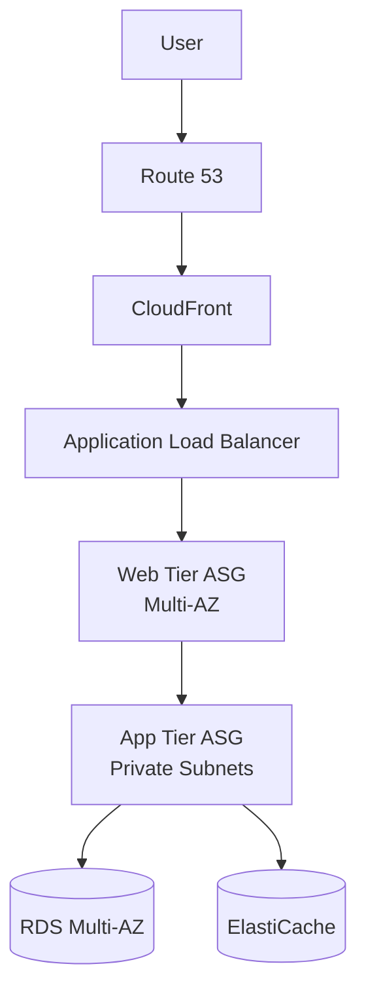
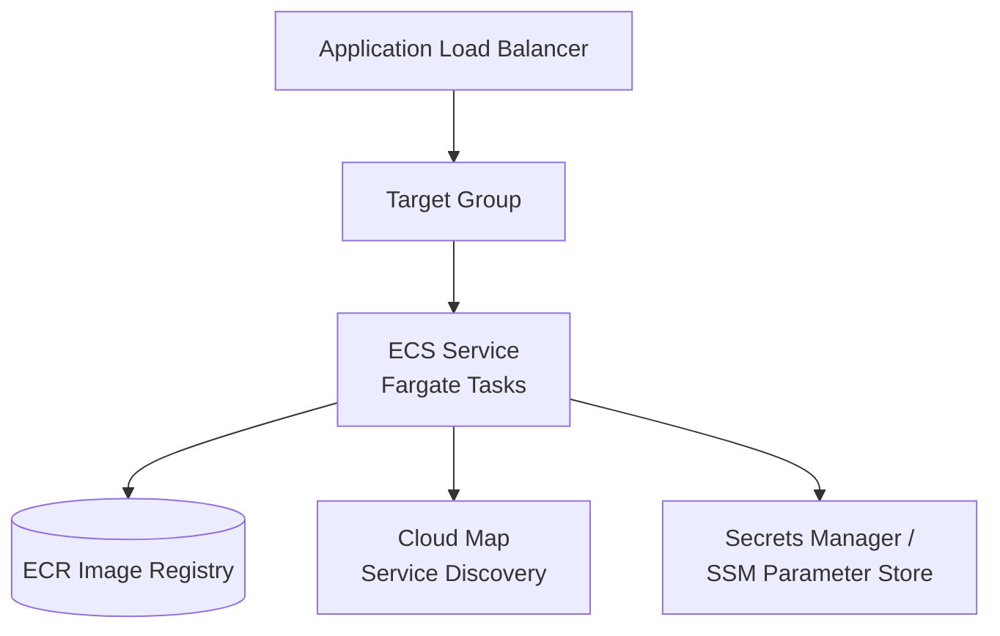
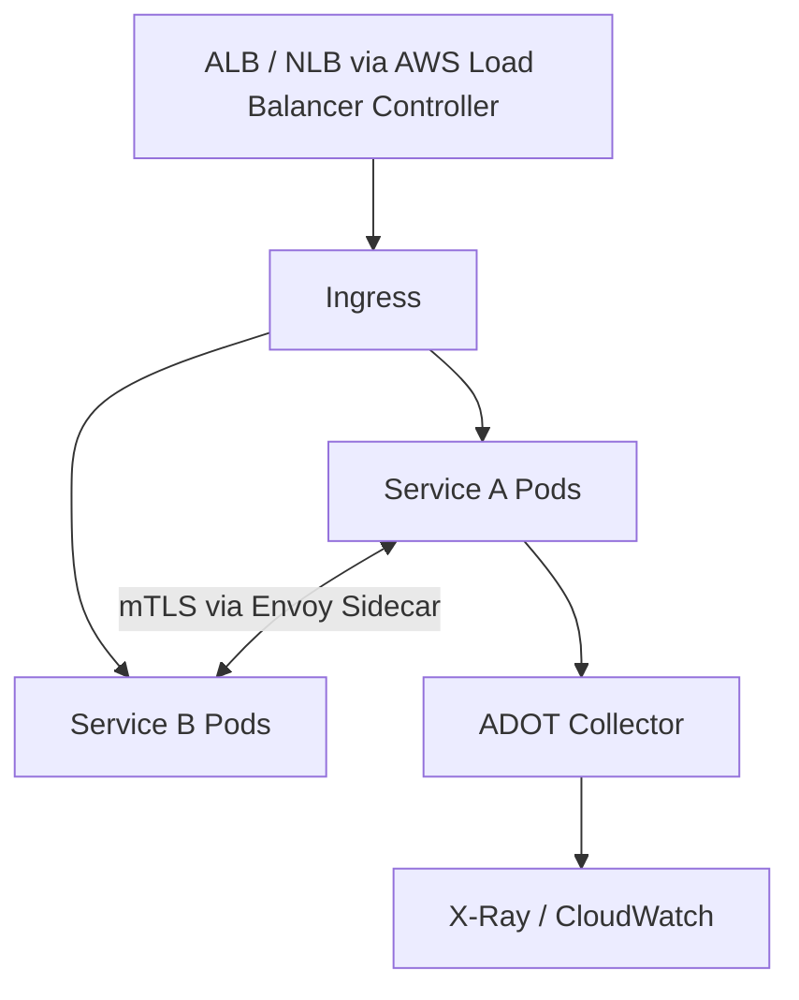
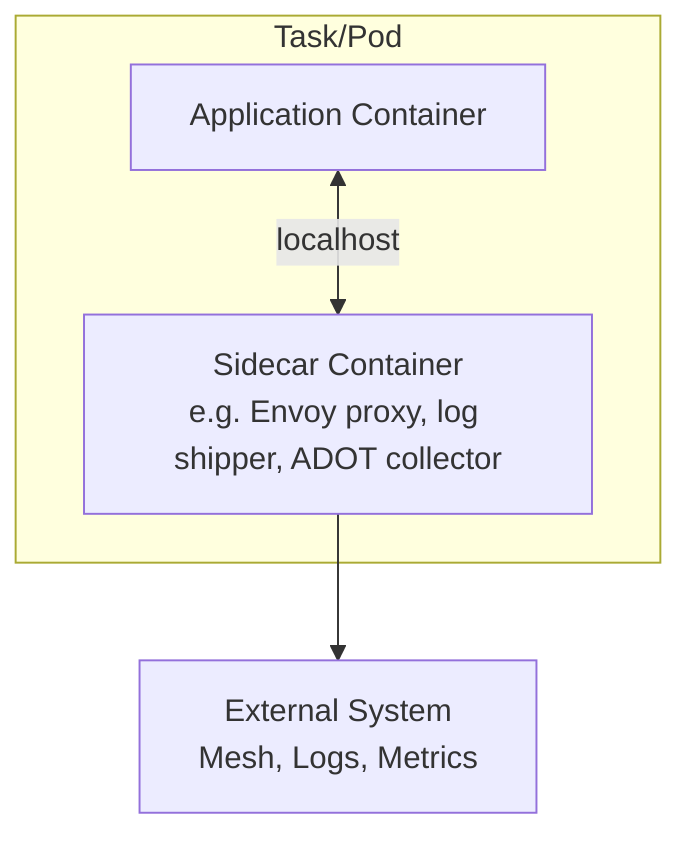
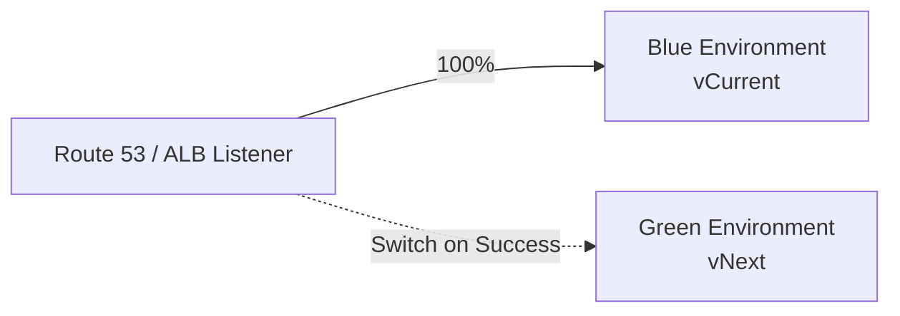
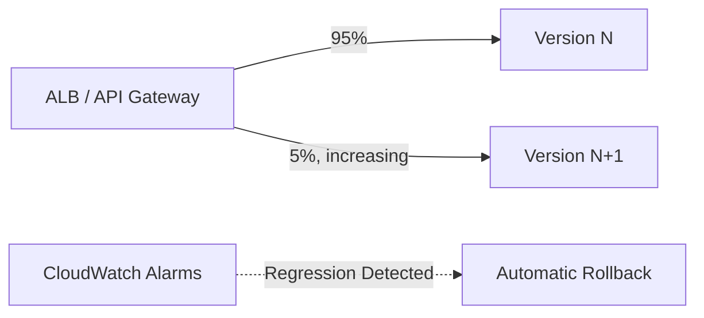
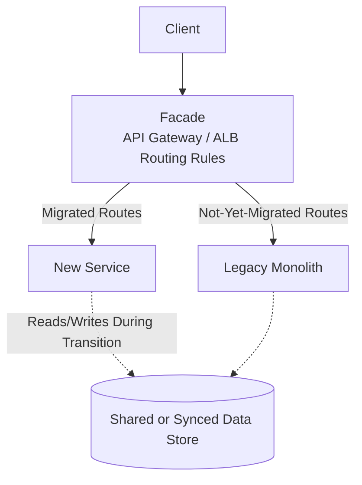

# Compute & Deployment Patterns

## Overview

Architecture patterns for non-serverless and container compute, plus deployment strategies for shipping changes safely. Complements the Serverless-focused patterns in [01](01-event-driven-patterns.md)-[05](05-database-integration-patterns.md) with EC2/ECS/EKS-based architectures.

---

## Table of Contents

- [Pattern 1: Classic Multi-Tier Web Application](#pattern-1-classic-multi-tier-web-application)
- [Pattern 2: Container Orchestration with ECS/Fargate](#pattern-2-container-orchestration-with-ecsfargate)
- [Pattern 3: EKS Microservices with Service Mesh](#pattern-3-eks-microservices-with-service-mesh)
- [Pattern 4: Sidecar Pattern](#pattern-4-sidecar-pattern)
- [Pattern 5: Blue-Green Deployment](#pattern-5-blue-green-deployment)
- [Pattern 6: Canary Deployment](#pattern-6-canary-deployment)
- [Pattern 7: Strangler Fig Migration](#pattern-7-strangler-fig-migration)
- [Anti-Patterns to Avoid](#anti-patterns-to-avoid)

---

## Pattern 1: Classic Multi-Tier Web Application

### Why This Pattern?

A single-tier or ad-hoc deployment — web server and app code colocated on the same instances, database reachable directly from the public subnet — couples unrelated scaling needs and security boundaries: a traffic spike on the web tier forces scaling of app logic that didn't need it, and instances handling both public traffic and data access widen the blast radius of any compromise. Without Multi-AZ RDS and externalized session state, a single AZ failure or instance replacement drops in-flight user sessions and can take the database down with no automatic failover.

**Trade-off:** the added tiers mean more network hops, more subnets/security groups to manage, and more moving parts to monitor — each tier has its own Auto Scaling policies, health checks, and internal load balancers. For a low-traffic internal tool, this is often more infrastructure than needed compared to a single instance or a fully serverless approach.

### Decision Criteria

Design guidance for each tier of a classic multi-tier web application.

| Layer | Guidance |
|---|---|
| Web tier | Stateless, behind ALB, Auto Scaling on CPU/request count target tracking |
| App tier | Private subnets, no direct internet route, communicates via internal ALB or service discovery |
| Data tier | RDS Multi-AZ or Aurora; read replicas for read-heavy workloads |
| Session state | Externalize to ElastiCache/DynamoDB — never rely on sticky sessions for critical state |

### When NOT to Use

- Don't use this pattern for spiky/unpredictable low-baseline traffic where serverless (API Gateway + Lambda) would be cheaper and simpler to operate

---

## Pattern 2: Container Orchestration with ECS/Fargate

### Why This Pattern?

Running containers without an orchestrator means hand-rolling placement, health checking, and restart logic: if a task crashes or the underlying host fails, nothing automatically reschedules it elsewhere, and rolling out a new image version means manually swapping containers with downtime. ECS/Fargate turns task placement, health-check-driven replacement, and rolling/blue-green rollouts into managed primitives wired directly into ALB target groups and Cloud Map service discovery, so a failed task is replaced and a bad deployment is rolled back without custom scripting.

**Trade-off:** Fargate's per-task CPU/memory billing costs more per unit of compute than densely bin-packed EC2 instances, and the ECS service abstraction itself (desired count, deployment circuit breaker, capacity providers) is another layer of scheduling logic to understand — for a handful of always-on, low-traffic containers, that overhead may not pay for itself versus a single EC2 instance.

Key decisions when running services on ECS/Fargate.

| Decision | Guidance |
|---|---|
| Launch type | Fargate for no infrastructure management; EC2 launch type for GPU/specialized instances or bin-packing cost savings at scale |
| Task sizing | Right-size CPU/memory per task; avoid one-size-fits-all task definitions |
| Service discovery | AWS Cloud Map for internal service-to-service DNS |
| Scaling | Target tracking on ALB request count per target or CPU/memory |

### When NOT to Use

- Don't use ECS/Fargate for functions that run for milliseconds/seconds sporadically — Lambda is cheaper
- Don't choose EC2 launch type without a clear cost/bin-packing reason — Fargate removes operational burden

---

## Pattern 3: EKS Microservices with Service Mesh

### Why This Pattern?

As the number of services grows, service-to-service calls need consistent retries, timeouts, mTLS, and traffic shaping — without a mesh, each service team reimplements this logic independently (or skips it), producing inconsistent failure handling and no uniform way to observe cross-service traffic. A service mesh centralizes this via sidecar proxies so application code stays free of networking concerns and policies like retry budgets, circuit breaking, and mTLS are enforced the same way across every service.

**Trade-off:** every request now traverses at least one extra proxy hop per hop, adding latency; every pod carries an extra sidecar container, adding memory/CPU footprint; and the mesh control plane (Istio, Cilium, App Mesh) is itself another distributed system to operate, upgrade, and debug. For a handful of services, this operational tax exceeds the benefit of centralized traffic policy.

Key decisions when running an EKS microservices architecture with a service mesh.

| Decision | Guidance |
|---|---|
| Mesh | App Mesh (legacy) or Istio/Cilium on EKS for mTLS, traffic shaping, retries between services |
| Ingress | AWS Load Balancer Controller for ALB/NLB integration |
| Node strategy | Managed node groups or Fargate profiles depending on workload isolation needs |
| Observability | ADOT Collector → X-Ray/CloudWatch for distributed tracing across mesh |

### When NOT to Use

- Don't adopt a service mesh for fewer than ~5-10 services — the operational overhead outweighs the benefit
- Don't use EKS if the team lacks Kubernetes operational expertise and ECS/Fargate would meet the same needs more simply

---

## Pattern 4: Sidecar Pattern

Attaching a helper container to the main application container for cross-cutting concerns without modifying app code.

### Why This Pattern?

Cross-cutting concerns like mTLS termination, log shipping, and metrics export don't belong embedded in application code — doing so means every service reimplements (and re-patches) the same logic, and upgrading the proxy or logging library requires redeploying every application that uses it. The sidecar pattern isolates these concerns into a separate container attached to the same task/pod, so they can be updated, scaled, and reasoned about independently of the application.

**Trade-off:** every task/pod now runs at least two containers, so CPU/memory reservations and per-task cost increase, and localhost communication between app and sidecar adds a small latency and failure surface — the sidecar itself can crash or lag independently of the app. For logic that's simple and stable enough to embed as a shared library, a sidecar adds process overhead without payoff.

Common sidecar containers and the cross-cutting concern each handles.

| Common Sidecars | Purpose |
|---|---|
| Envoy / App Mesh proxy | mTLS, traffic routing, retries |
| ADOT Collector | Metrics/traces export |
| FireLens / Fluent Bit | Log routing to CloudWatch/OpenSearch |
| Secrets/config agent | Fetch and refresh secrets without app code changes |

### When NOT to Use

- Don't use a sidecar for logic that's cheaper as a shared library — sidecars add per-task resource overhead

---

## Pattern 5: Blue-Green Deployment

Two full environments; traffic cut over atomically, instant rollback by reverting the switch.

### Why This Pattern?

Deploying in place — upgrading servers or tasks one at a time without a full parallel environment — means a bad release is only discovered after it's already serving production traffic, and rolling back requires re-deploying the previous version rather than instantly redirecting traffic; users see errors during that window. Blue-green removes this exposure by keeping a full, already-running standby environment so both cutover and rollback are a routing change, not a redeploy.

**Trade-off:** running two full-scale environments simultaneously, even briefly during cutover, roughly doubles compute cost for the deployment window, and database/schema changes still need careful handling since both environments may share or diverge on data during the switch. This pattern is overkill for low-risk changes where a rolling deployment's gradual replacement is adequate.

How to implement blue-green cutover per compute platform.

| Implementation | Mechanism |
|---|---|
| ECS/Fargate | CodeDeploy blue/green with ALB listener rule swap |
| Lambda | Alias + weighted traffic shifting via CodeDeploy |
| EC2/ASG | Separate ASG behind ALB, swap target group |

### When NOT to Use

- Don't use when running two full-scale environments simultaneously is cost-prohibitive — canary deployment shifts less capacity upfront

---

## Pattern 6: Canary Deployment

Gradual traffic shift to the new version with automated rollback on error-rate/latency regression.

### Why This Pattern?

Shipping a new version to 100% of traffic at once means any regression — elevated latency, error rate, a subtle logic bug — is immediately felt by every user, and catching it depends on someone noticing before manually rolling back. Canary deployment limits exposure by sending only a small, increasing slice of traffic to the new version and wiring CloudWatch alarms to trigger automatic rollback the moment error rate or latency regresses, so the blast radius is capped and recovery happens without a human in the loop.

**Trade-off:** a canary rollout takes materially longer to reach 100% traffic than a blue-green cutover, and it depends on alarms and metrics tuned to catch real regressions without false-positiving on normal variance. If those alarms aren't in place, the pattern's automated safety net doesn't exist and you're effectively just serving two versions with no better detection than an in-place deploy.

How to implement canary traffic shifting per compute platform.

| Implementation | Mechanism |
|---|---|
| Lambda | CodeDeploy canary/linear traffic shifting with CloudWatch alarm rollback |
| ECS | CodeDeploy canary via ALB weighted target groups |
| API Gateway | Stage-level canary deployment with percentage traffic split |

### When NOT to Use

- Don't use canary for changes that need instant, all-or-nothing rollback — blue-green is simpler for that case
- Don't skip automated rollback alarms — manual canary monitoring defeats the purpose

---

## Pattern 7: Strangler Fig Migration

Incrementally replacing a legacy system by routing an increasing share of functionality to a new implementation behind a stable facade.

### Why This Pattern?

Rewriting a legacy monolith in one shot means the business runs zero new code until the entire rewrite ships, which for anything beyond a small system is months or years of risk concentrated into a single cutover — a missed edge case surfaces only after the full switch, with no incremental path back. The Strangler Fig pattern avoids this by routing individual routes or features to the new implementation behind a stable facade while the rest still points at the legacy system, so each migrated slice is validated in production independently and a failed migration only affects the routes just cut over.

**Trade-off:** running two systems side by side for the duration of the migration means maintaining data consistency between them (dual-write or CDC sync) and operating both codebases concurrently, and the facade routing layer itself becomes a long-lived piece of infrastructure that must be maintained until the last route is migrated. For small systems where a full rewrite can be validated and cut over in a short maintenance window, this incremental machinery costs more than it saves.

Key considerations for routing, data sync, and cutover during a Strangler Fig migration.

| Guidance | Detail |
|---|---|
| Routing | Path-based or header-based rules at the facade decide legacy vs. new |
| Data | Dual-write or CDC-based sync while both systems are live; plan explicit cutover of data ownership |
| Exit criteria | Define per-route "done" criteria and decommission legacy code path once traffic is fully migrated |

### When NOT to Use

- Don't use for a full rewrite with no need for incremental cutover — a scheduled big-bang migration may be simpler for small systems

---

## Anti-Patterns to Avoid

Common compute and deployment mistakes and the fix for each.

| Anti-Pattern | Problem | Solution |
|---|---|---|
| **Stateful app tier with sticky sessions** | Breaks Auto Scaling and rolling deploys | Externalize session state to ElastiCache/DynamoDB |
| **One giant ECS task definition for everything** | Can't scale or deploy components independently | Split into per-service task definitions |
| **Manual, undocumented deployment steps** | Slow, error-prone releases | Codify via CodeDeploy/CodePipeline with automated rollback |
| **No health checks gating deployment** | Bad version gets full traffic before detection | Attach CloudWatch alarms to blue-green/canary rollback triggers |
| **Big-bang legacy replacement** | High-risk, hard-to-reverse cutover | Prefer Strangler Fig for large/critical legacy systems |
