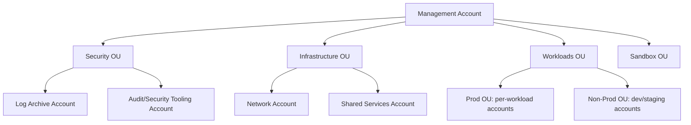
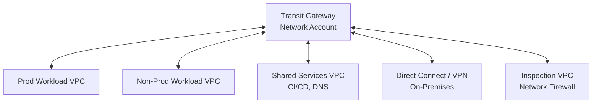
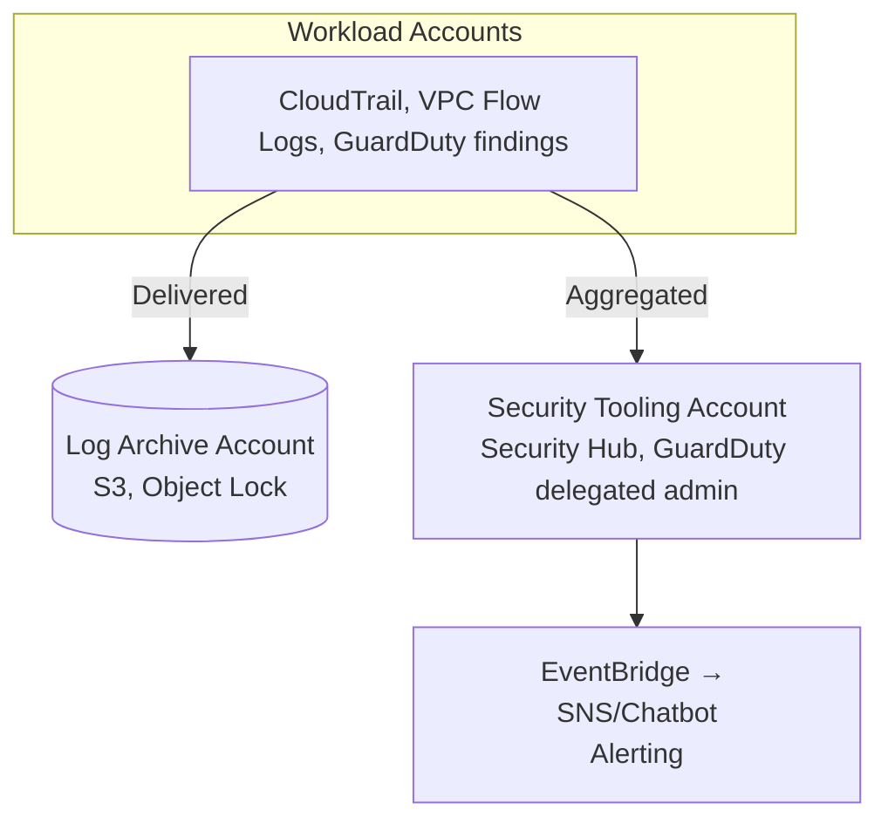
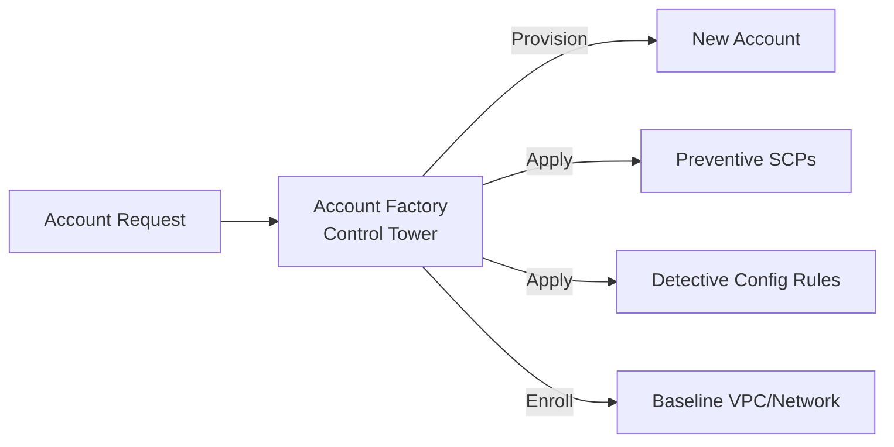
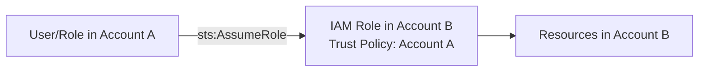

# Multi-Account & Landing Zone Patterns

## Overview

Account-level architecture patterns for organizations running multiple AWS accounts: structure, networking, centralized security/logging, and account provisioning. Complements per-service guidance in [Core-Services/IAM-Best-Practices.md](../Core-Services/IAM-Best-Practices.md) and [Core-Services/VPC-Best-Practices.md](../Core-Services/VPC-Best-Practices.md).

---

## Table of Contents

- [Pattern 1: AWS Organizations Multi-Account Structure](#pattern-1-aws-organizations-multi-account-structure)
- [Pattern 2: Hub-and-Spoke Networking with Transit Gateway](#pattern-2-hub-and-spoke-networking-with-transit-gateway)
- [Pattern 3: Centralized Logging & Security Tooling](#pattern-3-centralized-logging--security-tooling)
- [Pattern 4: Account Vending with Control Tower](#pattern-4-account-vending-with-control-tower)
- [Pattern 5: Cross-Account Access via IAM Roles](#pattern-5-cross-account-access-via-iam-roles)
- [Anti-Patterns to Avoid](#anti-patterns-to-avoid)

---

## Pattern 1: AWS Organizations Multi-Account Structure

### Why This Pattern?

A single AWS account with IAM-only separation has a weaker blast-radius boundary between workloads. AWS Organizations makes accounts the primary isolation and billing boundary and lets SCPs, resource control policies, tag policies, and Control Tower controls inherit through roots/OUs. SCPs set the maximum available permissions but do not grant access, do not constrain principals in the management account, and do not affect service-linked roles. Budgets are configured against accounts, tags, or other cost dimensions rather than attached to an OU as an Organizations policy.

**Trade-off:** every account adds operational work—budgets, policy attachments, Config/control status, IAM Identity Center assignments, and cross-account resource sharing/networking. Small, low-risk workloads may reasonably use fewer accounts, but production and non-production separation and centralized logging/security should still be decided from the threat model and operating requirements rather than team size alone.

Purpose of each top-level organizational unit in a typical AWS Organizations structure.

| OU | Purpose |
|---|---|
| Security | Log Archive (immutable, write-once), Audit/Security Tooling (GuardDuty, Security Hub delegated admin) |
| Infrastructure | Network account (Transit Gateway, VPN/Direct Connect), Shared Services (CI/CD, artifact repos) |
| Workloads | One account per application/team per environment — isolates blast radius and billing |
| Sandbox | Isolated, auto-expiring accounts for experimentation |

### When NOT to Use

- Don't fragment into per-microservice accounts for small teams — the management overhead (SCPs, budgets, guardrails per account) outweighs isolation benefits at low account counts

---

## Pattern 2: Hub-and-Spoke Networking with Transit Gateway

### Why This Pattern?

Without a hub, connectivity can grow into many peering relationships and duplicate on-premises, internet-egress, or inspection paths where each VPC needs them. That makes consistent network policy and routing harder to operate across accounts, although simple environments can intentionally use peering and decentralized egress. Transit Gateway provides a hub-and-spoke option: one attachment per connected VPC, centralized routing and inspection paths where required, and route tables that can segment environments. Treat that segmentation as a control to test alongside VPC route tables, appliance behavior, and security policies—not as an automatic guarantee of non-reachability.

**Trade-off:** Transit Gateway is a highly available Regional managed service, but the centralized routing design, inspection VPC, NAT gateways, and appliances become shared dependencies. Transit Gateway attachment/data processing and centralized inspection/egress charges apply to traffic paths, and an incorrectly designed or undersized inspection tier can affect many workloads. For a handful of VPCs with simple connectivity, peering can be cheaper and easier.

Key decisions when centralizing network egress and inspection through Transit Gateway.

| Decision | Guidance |
|---|---|
| Centralized egress | Compare NAT gateway, Transit Gateway, cross-AZ, inspection, and operational costs; centralization can reduce NAT count but does not always reduce total cost |
| Inspection | Route inter-VPC and egress traffic through an inspection VPC with AWS Network Firewall for centralized policy |
| Route isolation | Use separate Transit Gateway route tables per environment (prod/non-prod) to prevent unintended reachability |

### When NOT to Use

- Don't use Transit Gateway for just 2-3 VPCs with simple connectivity needs — VPC Peering is cheaper and simpler
- Don't route all traffic through one inspection VPC without capacity planning — it becomes a throughput bottleneck

---

## Pattern 3: Centralized Logging & Security Tooling

### Why This Pattern?

If CloudTrail, Config, and VPC Flow Logs are stored in the same account that generates them, an attacker (or a careless admin) with sufficient privilege in that account can disable logging, delete the trail, or purge the S3 bucket before the intrusion is detected — the evidence trail and the thing it's supposed to hold accountable share the same failure domain. Similarly, running GuardDuty, Security Hub, and Macie independently per account produces N disconnected dashboards with no org-wide view of findings, making it easy to miss a pattern that only shows up across accounts. Centralizing logs to a dedicated Log Archive account with no human write access, and delegating security tooling administration to a separate Security Tooling account, separates "generate and act on findings" from "custodian of the evidence," so a compromised workload account can't erase its own trail.

**Trade-off:** this adds a permanent cross-account data pipeline (log delivery, resource shares, delegated admin relationships) that must be verified continuously — a broken CloudTrail organization trail or a misconfigured resource policy can silently stop log delivery from a subset of accounts, and troubleshooting "why don't I see logs from account X" now spans two accounts instead of one. For a single-account setup or a proof-of-concept with no compliance requirement, this is more centralized infrastructure to maintain than the risk currently warrants.

Key decisions for centralizing logs and security tooling across accounts.

| Decision | Guidance |
|---|---|
| Log Archive account | Receives organization trails and selected logs; use S3 versioning/Object Lock retention and tightly scoped roles when immutability is required |
| Delegated admin | GuardDuty, Security Hub, Macie delegated to the Security Tooling account for org-wide visibility |
| Alerting | Security Hub findings → EventBridge → SNS/ChatOps for real-time triage |

### When NOT to Use

- Don't skip a dedicated Log Archive account "to save cost" — commingling logs with workload accounts undermines tamper-evidence and audit trust

---

## Pattern 4: Account Vending with Control Tower

Standardized, automated account provisioning with baseline guardrails applied at creation.

### Why This Pattern?

Accounts created outside the governed workflow can miss the organization's baseline until they are enrolled. Control Tower Account Factory automates account creation/enrollment and baselining in a registered OU, including mandatory and enabled controls. Provisioning and auto-enrollment are workflows with eventual consistency—not an atomic guarantee—so automation must wait for a successful governed/enrolled state before deploying workloads.

**Trade-off:** adopting Control Tower means accepting its landing-zone structure and mandatory controls, which can interact with existing SCPs or OU layouts. Retrofitting it onto an established organization requires prerequisite checks, enrollment, and drift remediation. For a small, stable account estate, a different automated baseline may be sufficient, but a manual checklist alone provides weak drift prevention and evidence.

Control Tower calls these **controls**. Control behavior (preventive, detective, proactive) is separate from control guidance (mandatory, strongly recommended, elective).

| Guardrail Type | Example |
|---|---|
| Preventive | Blocks actions, implemented with SCPs or resource control policies |
| Detective | Detects noncompliant resources, generally with AWS Config rules |
| Proactive | Blocks noncompliant resources before CloudFormation provisions them, using CloudFormation hooks |
| Mandatory guidance | Always applied and cannot be disabled; other controls are strongly recommended or elective |

### When NOT to Use

- Don't use an arbitrary account-count threshold; adopt Account Factory, AFT, or another tested vending pipeline when repeatability and governance justify it

---

## Pattern 5: Cross-Account Access via IAM Roles

### Why This Pattern?

Once workloads are split across accounts (Pattern 1), something still needs to legitimately reach across the account boundary — a CI/CD pipeline deploying to prod, a shared-services team troubleshooting a workload account, a SaaS vendor accessing a customer's resources. The naive fix is IAM users with long-lived access keys per target account, but that recreates exactly the risk multi-account isolation was meant to prevent: a leaked key grants standing access with no expiry, no MFA step, and often no per-account scoping, and it has to be manually rotated and revoked in every account it was copied to. `sts:AssumeRole` with a scoped trust policy makes access temporary and auditable (every assumption is a distinct CloudTrail event with a session name). Removing the trust or source role prevents new assumptions, but already issued role sessions continue until expiry unless they are explicitly revoked; plan for credential and IAM Identity Center session revocation in incident procedures.

**Trade-off:** cross-account role chains add a layer of indirection that makes permissions harder to reason about — "who can actually touch this resource" now requires tracing a trust policy in account B back to a role or permission set in account A, and short session durations or MFA conditions on sensitive roles introduce friction (re-authentication, session expiry mid-task) that a standing IAM user never had. For infrequent, low-risk one-off access, the setup cost of a dedicated cross-account role can exceed the risk it's mitigating.

Key decisions for setting up secure cross-account IAM role access.

| Decision | Guidance |
|---|---|
| Federation | Use IAM Identity Center (SSO) permission sets over long-lived IAM users with cross-account keys |
| Trust scope | Trust policies should name specific principals/roles, not entire accounts, where feasible |
| Session duration | Set short `MaxSessionDuration` for sensitive roles; require MFA condition for break-glass roles |
| Automation | CI/CD pipelines assume a deployment role per target account rather than holding per-account static credentials |

### When NOT to Use

- Don't create cross-account IAM users with long-lived access keys — always prefer role assumption

---

## Anti-Patterns to Avoid

Common multi-account and landing zone mistakes and the fix for each.

| Anti-Pattern | Problem | Solution |
|---|---|---|
| **Single flat account for all workloads/environments** | No blast-radius isolation, one SCP set for everything | Split by environment and workload per Pattern 1 |
| **Root user used for daily operations** | Unnecessary unrestricted privilege and poor operational control | Secure root access with MFA (or centrally remove member-account root credentials where applicable) and use IAM Identity Center for human access |
| **Logs stored in the account that generates them** | Attacker who compromises the account can erase evidence | Centralize logs to a separate Log Archive account with Object Lock |
| **Broad `*` trust policies for cross-account roles** | Any account can assume the role | Scope trust policy to specific account IDs/roles, add `ExternalId` for third parties |
| **No SCP guardrails on new accounts** | New accounts default to fully permissive | Use Control Tower/Account Factory to apply baseline SCPs at vend time |

---

## Authoritative References

- [AWS Organizations service control policies](https://docs.aws.amazon.com/organizations/latest/userguide/orgs_manage_policies_scps.html)
- [AWS Control Tower controls](https://docs.aws.amazon.com/controltower/latest/userguide/how-controls-work.html)
- [Provision accounts with AWS Control Tower](https://docs.aws.amazon.com/controltower/latest/userguide/methods-of-provisioning.html)
- [Organizing your AWS environment using multiple accounts](https://docs.aws.amazon.com/whitepapers/latest/organizing-your-aws-environment/organizing-your-aws-environment.html)
- [Centralized deployment models for AWS Network Firewall](https://docs.aws.amazon.com/network-firewall/latest/developerguide/architectures.html)
