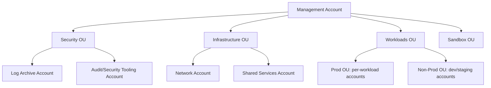
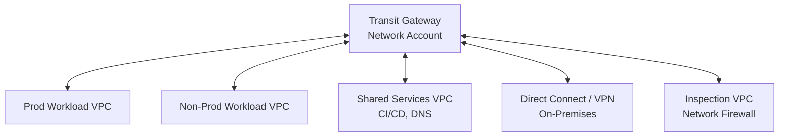
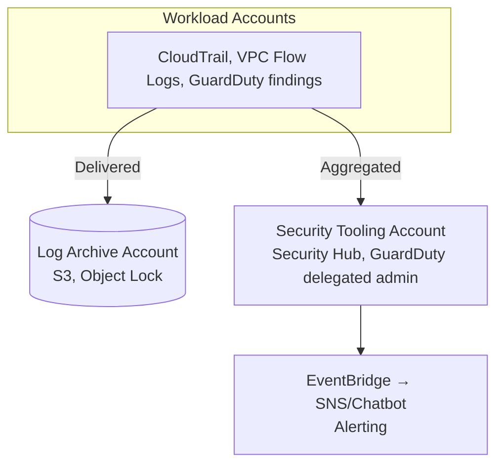
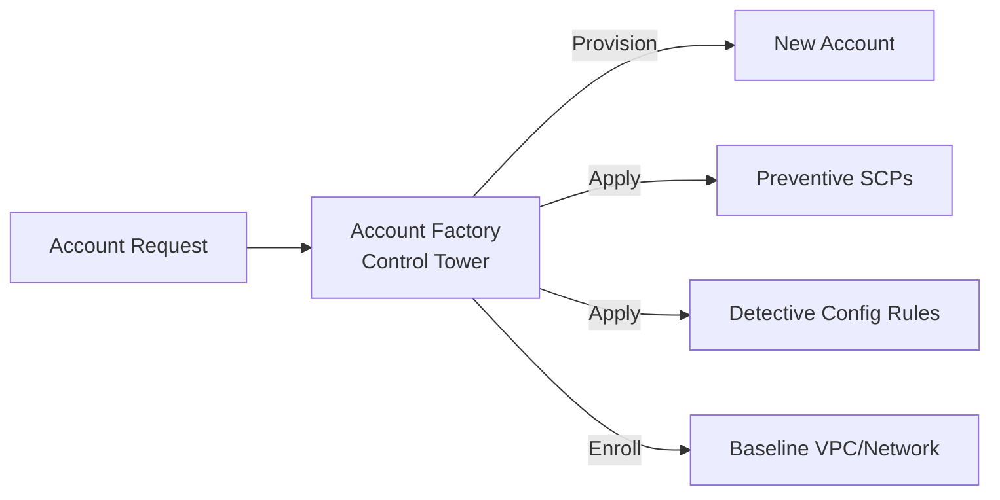
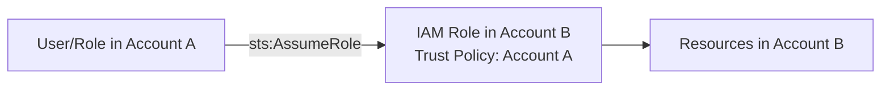

# Multi-Account & Landing Zone Patterns

## Overview

Account-level architecture patterns for organizations running multiple AWS accounts: structure, networking, centralized security/logging, and account provisioning. Complements per-service guidance in [Core-Services/IAM-Best-Practices.md](../Core-Services/IAM-Best-Practices.md) and [Core-Services/VPC-Best-Practices.md](../Core-Services/VPC-Best-Practices.md).

---

## Table of Contents

- [Pattern 1: AWS Organizations Multi-Account Structure](#pattern-1-aws-organizations-multi-account-structure)
- [Pattern 2: Hub-and-Spoke Networking with Transit Gateway](#pattern-2-hub-and-spoke-networking-with-transit-gateway)
- [Pattern 3: Centralized Logging & Security Tooling](#pattern-3-centralized-logging--security-tooling)
- [Pattern 4: Account Vending with Control Tower](#pattern-4-account-vending-with-control-tower)
- [Pattern 5: Cross-Account Access via IAM Roles](#pattern-5-cross-account-access-via-iam-roles)
- [Anti-Patterns to Avoid](#anti-patterns-to-avoid)

---

## Pattern 1: AWS Organizations Multi-Account Structure

### Why This Pattern?

A single AWS account with IAM-only separation has no hard boundary between workloads: a misconfigured resource policy, a compromised credential, or a runaway script in one application can reach the billing, IAM, and resources of every other application sharing the account. There is also no way to apply different guardrails to prod vs. dev, or to give a team admin rights over their own resources without also giving them admin rights over everyone else's. AWS Organizations with OUs fixes this by making the account itself the isolation boundary — SCPs, budgets, and guardrails apply per-OU, so a sandbox account can be wide open for experimentation while a prod OU enforces region locks and deny-CloudTrail-disable policies, and a breach in one workload account cannot pivot to another without an explicit, auditable cross-account trust.

**Trade-off:** every account is a unit of operational overhead — its own budgets, SCP attachments, Config rules, IAM Identity Center permission set assignments, and support case history to track — and cross-account operations (shared AMIs, VPC connectivity, centralized billing views) require extra plumbing that a single account never needed. For a two-person team running one low-risk application, this overhead is pure cost with no realized isolation benefit.

Purpose of each top-level organizational unit in a typical AWS Organizations structure.

| OU | Purpose |
|---|---|
| Security | Log Archive (immutable, write-once), Audit/Security Tooling (GuardDuty, Security Hub delegated admin) |
| Infrastructure | Network account (Transit Gateway, VPN/Direct Connect), Shared Services (CI/CD, artifact repos) |
| Workloads | One account per application/team per environment — isolates blast radius and billing |
| Sandbox | Isolated, auto-expiring accounts for experimentation |

### When NOT to Use

- Don't fragment into per-microservice accounts for small teams — the management overhead (SCPs, budgets, guardrails per account) outweighs isolation benefits at low account counts

---

## Pattern 2: Hub-and-Spoke Networking with Transit Gateway

### Why This Pattern?

Without a hub, every VPC that needs to reach another VPC, on-premises, or a shared service needs its own peering connection, NAT Gateway, and VPN/Direct Connect attachment — connectivity grows as a full mesh (N² peering connections) and each VPC duplicates internet egress and inspection infrastructure. That means no single place to apply network-level policy (firewalling, IDS/IPS) across accounts, no consistent point to enforce that prod traffic can never reach non-prod, and NAT/Direct Connect costs multiply per VPC. Transit Gateway collapses this into a hub-and-spoke: one attachment per VPC, one place to route and inspect traffic, and route tables that can be scoped per environment to guarantee non-reachability rather than relying on security groups alone.

**Trade-off:** the Transit Gateway and inspection VPC become a shared dependency and a potential single point of failure/bottleneck for all inter-VPC and egress traffic — its data processing charges apply per GB across every spoke, and undersized Network Firewall or NAT capacity in the hub throttles every workload behind it, not just one. For a handful of VPCs with simple, static connectivity needs, the added routing complexity and per-GB cost outweigh the centralization benefit.

Key decisions when centralizing network egress and inspection through Transit Gateway.

| Decision | Guidance |
|---|---|
| Centralized egress | Route all internet-bound traffic through a shared egress VPC with NAT Gateways to cut cost vs. per-VPC NAT |
| Inspection | Route inter-VPC and egress traffic through an inspection VPC with AWS Network Firewall for centralized policy |
| Route isolation | Use separate Transit Gateway route tables per environment (prod/non-prod) to prevent unintended reachability |

### When NOT to Use

- Don't use Transit Gateway for just 2-3 VPCs with simple connectivity needs — VPC Peering is cheaper and simpler
- Don't route all traffic through one inspection VPC without capacity planning — it becomes a throughput bottleneck

---

## Pattern 3: Centralized Logging & Security Tooling

### Why This Pattern?

If CloudTrail, Config, and VPC Flow Logs are stored in the same account that generates them, an attacker (or a careless admin) with sufficient privilege in that account can disable logging, delete the trail, or purge the S3 bucket before the intrusion is detected — the evidence trail and the thing it's supposed to hold accountable share the same failure domain. Similarly, running GuardDuty, Security Hub, and Macie independently per account produces N disconnected dashboards with no org-wide view of findings, making it easy to miss a pattern that only shows up across accounts. Centralizing logs to a dedicated Log Archive account with no human write access, and delegating security tooling administration to a separate Security Tooling account, separates "generate and act on findings" from "custodian of the evidence," so a compromised workload account can't erase its own trail.

**Trade-off:** this adds a permanent cross-account data pipeline (log delivery, resource shares, delegated admin relationships) that must be verified continuously — a broken CloudTrail organization trail or a misconfigured resource policy can silently stop log delivery from a subset of accounts, and troubleshooting "why don't I see logs from account X" now spans two accounts instead of one. For a single-account setup or a proof-of-concept with no compliance requirement, this is more centralized infrastructure to maintain than the risk currently warrants.

Key decisions for centralizing logs and security tooling across accounts.

| Decision | Guidance |
|---|---|
| Log Archive account | Receives CloudTrail/Config/Flow Logs from all accounts; write-once via S3 Object Lock; no human write access |
| Delegated admin | GuardDuty, Security Hub, Macie delegated to the Security Tooling account for org-wide visibility |
| Alerting | Security Hub findings → EventBridge → SNS/ChatOps for real-time triage |

### When NOT to Use

- Don't skip a dedicated Log Archive account "to save cost" — commingling logs with workload accounts undermines tamper-evidence and audit trust

---

## Pattern 4: Account Vending with Control Tower

Standardized, automated account provisioning with baseline guardrails applied at creation.

### Why This Pattern?

A manually created AWS account starts with none of an organization's guardrails applied — no baseline SCPs, no Config rules, no CloudTrail delivery to the Log Archive account — until someone remembers to apply them, and that gap is exactly the window where a public S3 bucket or a disabled CloudTrail goes unnoticed. At any real scale, manual provisioning also drifts: the tenth account gets a slightly different baseline than the first because a step was skipped or a template was hand-edited. Control Tower's Account Factory fixes both problems by making guardrail application part of account creation itself — preventive SCPs and detective Config rules are attached atomically as the account is vended, so there is no account that ever exists in an unguarded state.

**Trade-off:** adopting Control Tower means accepting its opinionated account structure and its own set of mandatory guardrails, which can conflict with existing SCPs or OU layouts built before Control Tower was introduced, and retrofitting it onto an already-sprawling Organization requires reconciling existing accounts into its model. For small organizations provisioning a handful of accounts by hand, the setup and ongoing landing-zone governance cost exceeds what manual account creation with a checklist would take.

Types of guardrails Control Tower applies to vended accounts, with examples of each.

| Guardrail Type | Example |
|---|---|
| Preventive (SCP) | Deny disabling CloudTrail, deny leaving the Organization, region restriction |
| Detective (Config) | Flag public S3 buckets, unencrypted EBS volumes, root account usage |
| Mandatory | Enabled by Control Tower by default (cannot be disabled) |

### When NOT to Use

- Don't hand-roll account provisioning at scale (>10-20 accounts) — Control Tower/Account Factory for Terraform reduces drift and human error

---

## Pattern 5: Cross-Account Access via IAM Roles

### Why This Pattern?

Once workloads are split across accounts (Pattern 1), something still needs to legitimately reach across the account boundary — a CI/CD pipeline deploying to prod, a shared-services team troubleshooting a workload account, a SaaS vendor accessing a customer's resources. The naive fix is IAM users with long-lived access keys per target account, but that recreates exactly the risk multi-account isolation was meant to prevent: a leaked key grants standing access with no expiry, no MFA step, and often no per-account scoping, and it has to be manually rotated and revoked in every account it was copied to. `sts:AssumeRole` with a scoped trust policy solves this by making access temporary, auditable (every assumption is a distinct CloudTrail event with a session name), and revocable in one place — remove the trust policy or the source role, and access to every account it could reach is cut off immediately.

**Trade-off:** cross-account role chains add a layer of indirection that makes permissions harder to reason about — "who can actually touch this resource" now requires tracing a trust policy in account B back to a role or permission set in account A, and short session durations or MFA conditions on sensitive roles introduce friction (re-authentication, session expiry mid-task) that a standing IAM user never had. For infrequent, low-risk one-off access, the setup cost of a dedicated cross-account role can exceed the risk it's mitigating.

Key decisions for setting up secure cross-account IAM role access.

| Decision | Guidance |
|---|---|
| Federation | Use IAM Identity Center (SSO) permission sets over long-lived IAM users with cross-account keys |
| Trust scope | Trust policies should name specific principals/roles, not entire accounts, where feasible |
| Session duration | Set short `MaxSessionDuration` for sensitive roles; require MFA condition for break-glass roles |
| Automation | CI/CD pipelines assume a deployment role per target account rather than holding per-account static credentials |

### When NOT to Use

- Don't create cross-account IAM users with long-lived access keys — always prefer role assumption

---

## Anti-Patterns to Avoid

Common multi-account and landing zone mistakes and the fix for each.

| Anti-Pattern | Problem | Solution |
|---|---|---|
| **Single flat account for all workloads/environments** | No blast-radius isolation, one SCP set for everything | Split by environment and workload per Pattern 1 |
| **Root user used for daily operations** | No auditability, no MFA enforcement gap | Lock root credentials away, use IAM Identity Center for all human access |
| **Logs stored in the account that generates them** | Attacker who compromises the account can erase evidence | Centralize logs to a separate Log Archive account with Object Lock |
| **Broad `*` trust policies for cross-account roles** | Any account can assume the role | Scope trust policy to specific account IDs/roles, add `ExternalId` for third parties |
| **No SCP guardrails on new accounts** | New accounts default to fully permissive | Use Control Tower/Account Factory to apply baseline SCPs at vend time |
