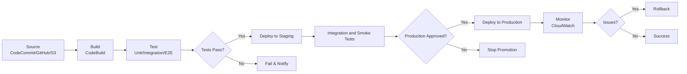
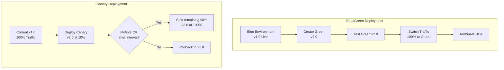

# CI/CD Best Practices

## Pipeline Architecture

### CodePipeline Stages

| Stage | Action | Description |
|-------|--------|-------------|
| **Source** | CodeCommit, S3, ECR, or CodeConnections for GitHub/GitLab/Bitbucket | Source revision or image |
| **Build** | CodeBuild | Compile, test, package |
| **Test** | CodeBuild, AWS Device Farm, third-party tools | Automated testing |
| **Deploy** | CodeDeploy, ECS, CloudFormation, Elastic Beanstalk, S3, or third-party deploy actions | Application/infrastructure deployment |
| **Approve** | Manual approval | Human gate before production |

### Pipeline Strategy

| Environment | Pipeline | Promotion |
|-------------|----------|-----------|
| **Development** | Automatic on commit | Every commit |
| **Staging** | Automatic from dev | After dev success |
| **Production** | Manual approval | After staging success |

---

## CodeBuild Configuration

### Build Environment

| Setting | Recommendation | Reason |
|---------|---------------|--------|
| **Image** | Managed image matching runtime | Pre-configured tools |
| **Compute type** | Match build complexity | Cost vs speed |
| **Timeout** | Minimum needed | Cost optimization |
| **Environment variables** | Use CodeBuild `secrets-manager` or `parameter-store` mappings; never store plaintext secrets in the project or buildspec | Security |
| **Cache** | Enable dependency caching | Build speed |
| **Logs** | CloudWatch Logs | Build visibility |

### Build Spec Best Practices

| Practice | Implementation | Benefit |
|----------|----------------|---------|
| **Phased build** | install, pre_build, build, post_build | Organized build (no reports phase) |
| **Cache dependencies** | npm, pip, maven cache | Faster builds |
| **Parallel tests** | Split test suites | Faster feedback |
| **Artifact management** | Versioned artifacts | Traceability |
| **Report generation** | Test reports, code coverage | Quality metrics |

---

## Deployment Strategies

### CodeDeploy Strategies

| Strategy | Downtime | Risk | Rollback | Use Case |
|----------|----------|------|----------|----------|
| **EC2/on-premises in-place** | Depends on minimum healthy hosts | Medium | Optional automatic rollback | Update existing instances |
| **EC2/on-premises blue/green** | Can avoid downtime with a load balancer | Lower blast radius | Optional automatic rollback | Replacement instances or Auto Scaling group |
| **Lambda/ECS canary** | No planned downtime | Low initial blast radius | Alarm-driven automatic rollback when configured | Shift one percentage, wait, then shift the remainder |
| **Lambda/ECS linear** | No planned downtime | Gradual blast radius | Alarm-driven automatic rollback when configured | Equal increments at fixed intervals |
| **Lambda/ECS all-at-once** | No planned downtime, but immediate full exposure | Highest blast radius | Alarm-driven automatic rollback when configured | Fast deployment |

### Blue/Green Deployment

| Phase | Action | Description |
|-------|--------|-------------|
| 1 | Create green environment | New deployment |
| 2 | Run tests on green | Validate deployment |
| 3 | Shift traffic | Gradual or full switch |
| 4 | Monitor green | Verify stability |
| 5 | Terminate blue | Clean up old environment |
| 6 | Swap on failure | Quick rollback |

### Canary Deployment

| Setting | Recommendation |
|---------|---------------|
| **Percentage** | Choose from a predefined or custom CodeDeploy configuration based on acceptable blast radius |
| **Interval** | Long enough to observe representative traffic and alarm evaluation periods |
| **Failure threshold** | Configure deployment-group CloudWatch alarms and automatic rollback |
| **Metrics** | CloudWatch alarms for rollback criteria |
| **Duration** | Match traffic volume and the time needed to detect regressions |

### GitOps Deployments

| Tool | Target | Description |
|------|--------|-------------|
| **Argo CD** | EKS | Declarative, Git-sourced continuous delivery for Kubernetes |
| **Flux** | EKS | GitOps toolkit reconciling cluster state from Git |
| **CodePipeline + CodeDeploy** | ECS, Lambda, EC2 | AWS-native push-based CD (non-GitOps) |

Use GitOps for Kubernetes workloads where the Git repository is the single source of truth and an in-cluster controller reconciles drift; use CodePipeline/CodeDeploy for AWS-native push-based deployments to ECS, Lambda, or EC2.

---

## Environment Management

### Parameter Store Integration

| Entry/organization | Use Case | Example |
|--------------------|----------|---------|
| **String** | Configuration values | DB endpoint, API URLs |
| **StringList** | Multiple values | Allowed origins, IPs |
| **SecureString** | Secrets | Passwords, API keys |
| **Hierarchy** | Organized parameters | /app/env/component |

### Environment Promotion

| Stage | Automation | Approval | Testing |
|-------|-----------|----------|---------|
| Dev | Full | None | Unit tests |
| Staging | Full | None | Integration tests |
| Pre-prod | Full | Optional | E2E tests |
| Production | Full | Required | Smoke tests |

---

## Security

### Pipeline Security

| Control | Implementation |
|---------|---------------|
| **Secrets management** | Secrets Manager or Parameter Store secret references; never plaintext pipeline/build environment variables |
| **IAM roles** | Least privilege for pipeline roles |
| **Scan for vulnerabilities** | Dependency/SAST tooling in the build; Amazon Inspector for supported ECR images and deployed compute |
| **Container scanning** | Push immutable images to ECR, evaluate scan findings, and promote by digest |
| **Infrastructure scanning** | Checkov, cfn-nag for IaC |
| **Approval gates** | Manual approval for production |
| **Audit trail** | CloudTrail for pipeline actions |

### Secrets Management

| Method | Description | Use Case |
|--------|-------------|----------|
| **Secrets Manager** | Managed secrets with rotation | Database passwords, API keys |
| **Parameter Store (SecureString)** | Encrypted parameters | Configuration secrets |
| **SSM GetParameters** | Runtime retrieval | Application secrets |
| **CodeBuild secrets** | Parameter Store integration | Build-time secrets |

---

## Testing Strategy

### Test Pyramid

| Level | Tools | Frequency | Duration |
|-------|-------|-----------|----------|
| **Unit tests** | Jest, pytest, JUnit | Every commit | Seconds |
| **Integration tests** | Test containers, localstack | Every build | Minutes |
| **E2E tests** | Selenium, Cypress | Every staging deploy | Minutes |
| **Performance tests** | k6, JMeter | Before production | Hours |
| **Security tests** | SAST/dependency/IaC scanners; Inspector evaluates supported ECR/deployed resources | Every build plus continuous/post-push scanning | Varies |

### Test Automation

| Test Type | Pipeline Stage | Failure Action |
|-----------|---------------|----------------|
| Unit tests | Build | Fail pipeline |
| Integration tests | Build/Test | Fail pipeline |
| Linting | Build | Fail pipeline |
| Security scan | Build/Promotion | Fail on an explicitly defined severity and exception policy |
| E2E tests | Post-deploy (staging) | Fail pipeline |
| Smoke tests | Post-deploy (prod) | Trigger rollback |

---

## Monitoring

### Pipeline Metrics

| Metric | Description | Alert Threshold |
|--------|-------------|----------------|
| Pipeline execution time | Total duration | > baseline + 2 sigma |
| Build duration | Build stage time | > baseline + 2 sigma |
| Test failure rate | Failed tests / total | Significant baseline change or quality objective breach |
| Deployment success rate | Successful / total | Team reliability objective breach |
| Rollback frequency | Rollbacks / deployments | Trend or release-quality objective breach |
| Pipeline failures | Failed executions | Any |

---

## Cost Optimization

| Strategy | Description | Potential Savings |
|----------|-------------|-------------------|
| **Right-size build instances** | Match CPU, memory, and architecture to measured build needs | Lower compute cost |
| **Enable caching** | Cache safe, reusable dependencies; invalidate keys when lockfiles change | Shorter build time |
| **Parallel builds** | Multiple builds concurrently | Time savings |
| **Cleanup artifacts** | Lifecycle policies on S3 | Storage reduction |
| **Scheduled builds** | Only build when needed | Build cost reduction |
| **Shared build images** | Reuse custom images | Build time reduction |

---

## Cross-Service Integration

| Service | Integration | Purpose |
|---------|------------|---------|
| CodeCommit | Source control | Git repository |
| CodeBuild | Build and test | CI |
| CodeDeploy | Application deployment | CD |
| CodePipeline | Orchestration | Pipeline management |
| CloudWatch | Metrics, logs | Monitoring |
| Secrets Manager | Secret management | Security |
| SSM Parameter Store | Configuration | Environment config |
| SNS | Notifications | Alerts |
| Lambda | Custom actions | Extensibility |
| ECS/EKS | Container deployment | Container orchestration |

---

## Additional Best Practices

- Use separate artifact, deployment, and administration roles; restrict `iam:PassRole` to the exact service roles each pipeline needs.
- Encrypt artifact stores, block public access, enable versioning where rollback depends on prior artifacts, and apply lifecycle policies.
- Make artifacts immutable and promote the same tested artifact between environments instead of rebuilding it.
- Prefer short-lived identity federation for external CI systems and pin third-party actions and dependencies.
- Add deployment timeouts, rollback criteria, and post-deployment verification as code. A manual approval is an authorization gate, not a substitute for automated tests.

## AWS References

- [Valid action providers in CodePipeline](https://docs.aws.amazon.com/codepipeline/latest/userguide/actions-valid-providers.html)
- [CodeBuild buildspec reference](https://docs.aws.amazon.com/codebuild/latest/userguide/build-spec-ref.html)
- [CodeDeploy deployment configurations](https://docs.aws.amazon.com/codedeploy/latest/userguide/deployment-configurations.html)
- [Configure automatic rollbacks for CodeDeploy](https://docs.aws.amazon.com/codedeploy/latest/userguide/deployments-rollback-and-redeploy.html)
