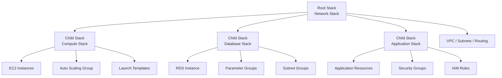
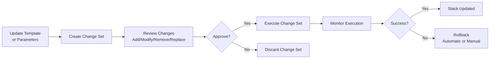

# CloudFormation Best Practices

## Template Design

### Structure

| Element | Description | Best Practice |
|---------|-------------|---------------|
| **AWSTemplateFormatVersion** | Template format version | Optional — omit for latest default behavior |
| **Description** | Template description | Clear, concise |
| **Parameters** | User inputs | Validate with AllowedValues, Constraints |
| **Mappings** | Static lookups | Region-to-AMI mappings |
| **Conditions** | Conditional creation | Use Fn::If for conditional resources |
| **Resources** | AWS resources | Modular, logical IDs |
| **Outputs** | Return values | Export for cross-stack references |
| **Metadata** | Additional info | AWS::CloudFormation::Interface |

### Naming Conventions

| Element | Convention | Example |
|---------|-----------|---------|
| **Logical ID** | PascalCase, descriptive | WebServerInstance |
| **Physical name** | Prefix-env-name | myapp-prod-web-server |
| **Parameters** | PascalCase | InstanceType |
| **Outputs** | PascalCase | WebsiteURL |
| **Stack name** | kebab-case, prefixed | myapp-prod-vpc |

---

## Modular Design

### Stack Hierarchy

| Level | Stack | Responsibility |
|-------|-------|---------------|
| **Root** | Network stack | VPC, subnets, routing |
| **Child** | Compute stack | EC2, ASG, launch templates |
| **Child** | Database stack | RDS, parameter groups |
| **Child** | Application stack | App-specific resources |

### Nested Stacks

| Approach | Description | Use Case |
|----------|-------------|----------|
| **AWS::CloudFormation::Stack** | Nested stack resource | Reusable components |
| **Separate template files** | S3-hosted templates | Large templates |
| **Macro expansion** | Custom transformations | Code generation |
| **Custom Resources** | Lambda-backed extensions | Runtime config, complex logic |

### Shared Modules

| Module | Resources | Reuse Level |
|--------|-----------|-------------|
| **VPC module** | VPC, subnets, IGW, NAT | Cross-project |
| **EKS module** | Cluster, node groups | Cross-project |
| **RDS module** | DB instance, subnet group | Cross-project |
| **IAM module** | Roles, policies | Cross-project |
| **ALB module** | Load balancer, listeners | Cross-project |

---

## Parameters & Conditions

### Parameter Types

| Type | Description | Use Case |
|------|-------------|----------|
| **String** | Text values | Names, URLs |
| **Number** | Numeric values | Counts, sizes |
| **CommaDelimitedList** | Multiple values | Security group IDs |
| **AWS::EC2::Image::Id** | AMI IDs | Instance AMI |
| **AWS::EC2::Subnet::Id** | Subnet IDs | Subnet selection |
| **AWS::EC2::SecurityGroup::Id** | SG IDs | Security groups |
| **AWS::EC2::VPC::Id** | VPC IDs | VPC selection |
| **List<String>** | String list | Multiple strings |

### Parameter Validation

| Constraint | Description | Example |
|------------|-------------|---------|
| **AllowedValues** | Specific values | t3.micro, t3.small |
| **AllowedPattern** | Regex pattern | ^[a-zA-Z0-9-]+$ |
| **MinValue / MaxValue** | Numeric range | 1 to 10 |
| **MinLength / MaxLength** | String length | 1 to 64 |
| **Default** | Default value | t3.micro |
| **Description** | Parameter description | Clear user guidance |

### Conditions

| Function | Description | Use Case |
|----------|-------------|----------|
| **Fn::If** | Conditional value | Create resource or not |
| **Fn::Equals** | Equality check | Condition evaluation |
| **Fn::And** | Logical AND | Multiple conditions |
| **Fn::Or** | Logical OR | Alternative conditions |
| **Fn::Not** | Logical NOT | Negation |
| **Fn::Contains** | List contains value | Value in list |

---

## Drift Detection

### Drift Management

| Action | Description | Frequency |
|--------|-------------|-----------|
| **Detect drift** | Compare stack vs actual | Weekly |
| **Detect drift (scheduled)** | Automated detection | Daily |
| **Update stack** | Fix drifted resources | As needed |
| **Import resources** | Add existing resources | Migration |
| **Export templates** | Generate from existing | Documentation |

### Drift Causes

| Cause | Prevention | Resolution |
|-------|-----------|------------|
| Manual console changes | SCPs to deny changes | Update template |
| Auto-scaling changes | Manage via template | Import or update |
| Cross-stack changes | Update all stacks | Coordinated update |
| AWS service updates | Monitor for changes | Update template |

---

## Change Sets

### Change Set Workflow

| Step | Action | Description |
|------|--------|-------------|
| 1 | Create change set | Define changes |
| 2 | Review changes | Evaluate impact |
| 3 | Approve changes | Manual or automated |
| 4 | Execute change set | Apply changes |
| 5 | Monitor execution | Track progress |
| 6 | Rollback on failure | Automatic or manual |

### Change Types

| Type | Description | Risk |
|------|-------------|------|
| **Add** | New resources | Low |
| **Modify** | Changed properties | Medium |
| **Remove** | Deleted resources | High |
| **Replace** | New resource, same logical ID | High |
| **Import** | Existing resource into stack | Medium |

---

## Stack Policies

### Protection

| Resource | UpdateReplacePolicy | DeletionPolicy | Reason |
|----------|-------------------|----------------|--------|
| **RDS Instance** | Snapshot | Snapshot | Data preservation |
| **DynamoDB Table** | Retain | Retain | Data preservation |
| **S3 Bucket** | Retain | Retain | Data preservation |
| **EFS File System** | Retain | Retain | Data preservation |
| **EC2 Instance** | Delete | Delete | No data preservation |
| **Security Group** | Delete | Delete | No data preservation |

### Stack Policy Example

| Resource Type | Allow | Deny |
|--------------|-------|------|
| AWS::RDS::DBInstance | Update: All | Replace, Delete |
| AWS::DynamoDB::Table | Update: All | Replace, Delete |
| AWS::S3::Bucket | Update: All | Replace, Delete |
| * | All | — |

---

## Macros & Transform

### AWS Macros

| Macro | Description | Use Case |
|-------|-------------|----------|
| **AWS::Include** | Include external YAML/JSON (limited support, prefer !Sub) | Template reuse |
| **AWS::Serverless** | SAM template transformation | Serverless apps |
| **Custom macros** | Lambda-based transformations | Custom logic |

### Transform Section

| Transform | Description | Use Case |
|-----------|-------------|----------|
| **AWS::Serverless-2016-10-31** | SAM transformation | Lambda, API Gateway |
| **AWS::Include** | External includes | Template modularity |
| **Custom** | Lambda-backed macros | Custom transformations |

---

## Monitoring

### Stack Events

| Event Type | Meaning | Action |
|------------|---------|--------|
| CREATE_IN_PROGRESS | Stack creation started | Monitor |
| CREATE_COMPLETE | Stack created successfully | Verify |
| CREATE_FAILED | Stack creation failed | Investigate, fix |
| UPDATE_IN_PROGRESS | Stack update started | Monitor |
| UPDATE_COMPLETE | Stack updated successfully | Verify |
| UPDATE_ROLLBACK_IN_PROGRESS | Update failed, rolling back | Investigate |
| DELETE_IN_PROGRESS | Stack deletion started | Verify backups |
| DELETE_COMPLETE | Stack deleted successfully | Clean up |

### CloudWatch Integration

| Metric | Description | Alert |
|--------|-------------|-------|
| Stack creation time | Duration of CREATE | > baseline |
| Stack update time | Duration of UPDATE | > baseline |
| Stack failures | Failed operations | Any |
| Drift status | Drifted resources | Any drift |

---

## Cost Optimization

| Strategy | Description | Potential Savings |
|----------|-------------|-------------------|
| **Terminate on failure** | Delete on CREATE failure | Prevent orphaned resources |
| **DeletionPolicy** | Snapshot vs retain | Storage cost management |
| **Nested stacks** | Reuse common resources | Avoid duplication |
| **Conditional resources** | Create only when needed | Resource cost reduction |
| **Tagging** | Cost allocation tags | Cost tracking |
| **Cleanup stacks** | Delete unused stacks | Eliminate costs |

---

## Cross-Service Integration

| Service | Integration | Purpose |
|---------|------------|---------|
| CloudFormation StackSets | Multi-account, multi-region | Enterprise deployments |
| Service Catalog | Product deployment | Self-service |
| CodePipeline | Automated deployments | CI/CD |
| CloudWatch | Stack events, metrics | Monitoring |
| Config | Compliance rules | Governance |
| Systems Manager | Parameter integration | Configuration |
| Lambda | Custom resources | Extension |
| SNS | Stack event notifications | Alerts |
