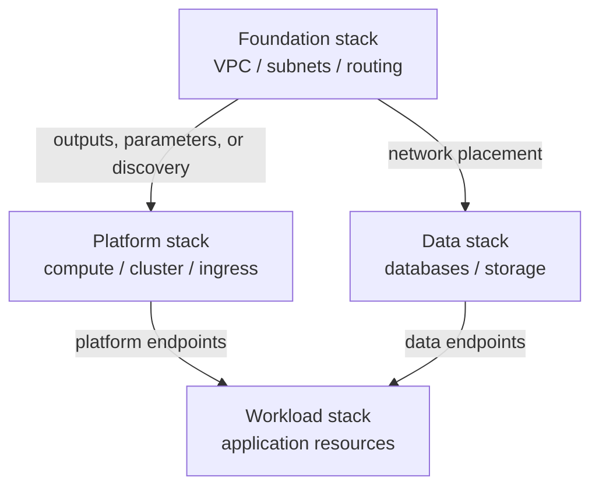
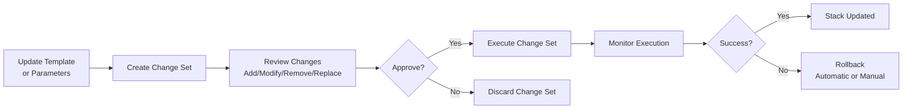

# CloudFormation Best Practices

## Template Design

### Structure

| Element | Description | Best Practice |
|---------|-------------|---------------|
| **AWSTemplateFormatVersion** | Template format version | Optional; if present, use the only supported value, `2010-09-09` |
| **Description** | Template description | Clear, concise |
| **Parameters** | User inputs | Validate with AllowedValues, Constraints |
| **Mappings** | Static lookups | Region-to-AMI mappings |
| **Conditions** | Conditional creation/configuration | Use a resource `Condition` attribute to include a resource; use `Fn::If` for conditional property values |
| **Resources** | AWS resources | Modular, logical IDs |
| **Outputs** | Return values | Export for cross-stack references |
| **Metadata** | Additional info | AWS::CloudFormation::Interface |

### Naming Conventions

| Element | Convention | Example |
|---------|-----------|---------|
| **Logical ID** | PascalCase, descriptive | WebServerInstance |
| **Physical name** | Prefix-env-name | myapp-prod-web-server |
| **Parameters** | PascalCase | InstanceType |
| **Outputs** | PascalCase | WebsiteURL |
| **Stack name** | kebab-case, prefixed | myapp-prod-vpc |

---

## Modular Design

### Stack Hierarchy

| Level | Stack | Responsibility |
|-------|-------|---------------|
| **Foundation** | Network stack | VPC, subnets, routing |
| **Platform** | Compute stack | EC2, Auto Scaling groups, launch templates |
| **Data** | Database stack | RDS, parameter groups |
| **Workload** | Application stack | App-specific resources |

### Nested Stacks

| Approach | Description | Use Case |
|----------|-------------|----------|
| **AWS::CloudFormation::Stack** | Nested stack resource | Reusable components |
| **Separate template files** | S3-hosted templates | Large templates |
| **Macro expansion** | Custom transformations | Code generation |
| **Custom Resources** | Lambda-backed extensions | Runtime config, complex logic |

### Shared Modules

| Module | Resources | Reuse Level |
|--------|-----------|-------------|
| **VPC module** | VPC, subnets, IGW, NAT | Cross-project |
| **EKS module** | Cluster, node groups | Cross-project |
| **RDS module** | DB instance, subnet group | Cross-project |
| **IAM module** | Roles, policies | Cross-project |
| **ALB module** | Load balancer, listeners | Cross-project |

### CloudFormation Modules

CloudFormation Modules package resources as reusable, versioned building blocks in the CloudFormation registry. A template references the registered module type name in its `Resources` section; `AWS::CloudFormation::ModuleVersion` is the resource used to register a module version, not the type consumers normally place in workload templates.

| Approach | Deployment Unit | Versioning | Use Case |
|----------|-----------------|------------|----------|
| **Modules** | Inline resource type in same stack | Registry-versioned | Reusable resource patterns (e.g., standard S3 bucket + policy) |
| **Nested Stacks** | Separate child stack | Template-versioned | Larger, independently manageable components |

### Multi-Account/Region Deployment

| Approach | Description | Use Case |
|----------|-------------|----------|
| **StackSets** | Deploy stacks across accounts/regions from one operation | Centralized governance, org-wide baselines |
| **Service-managed permissions** | StackSets via AWS Organizations | Automatic deployment to new accounts/OUs |
| **Self-managed permissions** | IAM roles per account | Non-Organizations multi-account setups |

---

## Parameters & Conditions

### Parameter Types

| Type | Description | Use Case |
|------|-------------|----------|
| **String** | Text values | Names, URLs |
| **Number** | Numeric values | Counts, sizes |
| **CommaDelimitedList** | Multiple values | Security group IDs |
| **AWS::EC2::Image::Id** | AMI IDs | Instance AMI |
| **AWS::EC2::Subnet::Id** | Subnet IDs | Subnet selection |
| **AWS::EC2::SecurityGroup::Id** | SG IDs | Security groups |
| **AWS::EC2::VPC::Id** | VPC IDs | VPC selection |
| **List<Number>** | Comma-separated numbers | Numeric lists |
| **List<AWS-specific type>** | Existing AWS resources | Multiple subnets, security groups, and similar resources |

### Parameter Validation

| Constraint | Description | Example |
|------------|-------------|---------|
| **AllowedValues** | Specific values | t3.micro, t3.small |
| **AllowedPattern** | Regex pattern | ^[a-zA-Z0-9-]+$ |
| **MinValue / MaxValue** | Numeric range | 1 to 10 |
| **MinLength / MaxLength** | String length | 1 to 64 |
| **Default** | Default value | t3.micro |
| **Description** | Parameter description | Clear user guidance |

### Conditions

| Function | Description | Use Case |
|----------|-------------|----------|
| **Fn::If** | Conditional value | Create resource or not |
| **Fn::Equals** | Equality check | Condition evaluation |
| **Fn::And** | Logical AND | Multiple conditions |
| **Fn::Or** | Logical OR | Alternative conditions |
| **Fn::Not** | Logical NOT | Negation |

The separate `Rules` section supports rule functions such as `Fn::Contains` for validating parameter combinations before resource creation.

---

## Drift Detection

### Drift Management

| Action | Description | Frequency |
|--------|-------------|-----------|
| **Detect drift** | Compare supported resources with expected configuration | Based on change risk |
| **Schedule drift detection** | Use EventBridge Scheduler with Lambda/Step Functions or another automation; CloudFormation does not schedule it itself | Periodic governance |
| **Update stack** | Fix drifted resources | As needed |
| **Import resources** | Add existing resources | Migration |
| **IaC generator** | Scan supported existing resources and generate/import a template | Migration starting point; review before deployment |

### Drift Causes

| Cause | Prevention | Resolution |
|-------|-----------|------------|
| Manual console changes | SCPs to deny changes | Update template |
| Expected service-managed changes | Avoid treating runtime state such as Auto Scaling membership as template-owned configuration | Review resource-specific drift semantics |
| Cross-stack changes | Update all stacks | Coordinated update |
| AWS service updates | Monitor for changes | Update template |

---

## Change Sets

### Change Set Workflow

| Step | Action | Description |
|------|--------|-------------|
| 1 | Create change set | Define changes |
| 2 | Review changes | Evaluate impact |
| 3 | Approve changes | Manual or automated |
| 4 | Execute change set | Apply changes |
| 5 | Monitor execution | Track progress |
| 6 | Rollback on failure | Automatic or manual |

### Change Types

| Type | Description | Risk |
|------|-------------|------|
| **Add** | New resources | Low |
| **Modify** | Changed properties | Medium |
| **Remove** | Deleted resources | High |
| **Replace** | New resource, same logical ID | High |
| **Import** | Existing resource into stack | Medium |

Change sets improve review but do not guarantee that an update will succeed. They can also omit the resolved values of dynamic references. Review replacements, IAM changes, macros, and downstream service effects before execution.

---

## CloudFormation Hooks

### Proactive Compliance

| Component | Description | Use Case |
|-----------|-------------|----------|
| **Hook** | Evaluates resource, stack, change-set, or Cloud Control operations at supported invocation points | Block or warn on non-compliant changes |
| **Guard-based Hook** | Hook logic authored in CloudFormation Guard DSL, no Lambda needed | Policy-as-code checks (tagging, encryption, sizing) |
| **Lambda-based Hook** | Custom logic via the CloudFormation Hooks CLI/SDK | Complex or external validation |
| **Target actions** | CREATE, UPDATE, DELETE | Scope enforcement to specific operations |
| **Failure mode** | FAIL (block) or WARN (allow with notice) | Rollout without breaking existing pipelines |

Hooks run before drift can occur, complementing drift detection (which is reactive) with proactive, pre-provisioning compliance checks.

---

## Resource and Stack Protection

### Protection

| Resource | UpdateReplacePolicy | DeletionPolicy | Reason |
|----------|-------------------|----------------|--------|
| **RDS Instance** | Snapshot | Snapshot | Data preservation |
| **DynamoDB Table** | Retain | Retain | Data preservation |
| **S3 Bucket** | Retain | Retain | Data preservation |
| **EFS File System** | Retain | Retain | Data preservation |
| **EC2 Instance** | Delete | Delete | No data preservation |
| **Security Group** | Delete | Delete | No data preservation |

### Stack Policy Example

Stack policies apply only to stack **updates**. They do not prevent deletion of the stack. Use termination protection for that, and use `DeletionPolicy`/`UpdateReplacePolicy` to control what happens to individual resources.

The table shows the intended effect by resource class. In an actual stack policy, scope statements to logical resource IDs or use a `ResourceType` condition.

| Resource Type | Allow | Deny |
|--------------|-------|------|
| AWS::RDS::DBInstance | `Update:Modify` | `Update:Replace`, `Update:Delete` |
| AWS::DynamoDB::Table | `Update:Modify` | `Update:Replace`, `Update:Delete` |
| AWS::S3::Bucket | `Update:Modify` | `Update:Replace`, `Update:Delete` |
| Other resources | `Update:*` | — |

---

## Macros & Transform

### AWS Macros

| Macro | Description | Use Case |
|-------|-------------|----------|
| **AWS::Include** | Insert a valid key-value snippet from an S3 URI | Reuse boilerplate snippets |
| **AWS::Serverless** | SAM template transformation | Serverless apps |
| **Custom macros** | Lambda-based transformations | Custom logic |

### Transform Section

| Transform | Description | Use Case |
|-----------|-------------|----------|
| **AWS::Serverless-2016-10-31** | SAM transformation | Lambda, API Gateway |
| **AWS::Include** | External includes | Template modularity |
| **Custom** | Lambda-backed macros | Custom transformations |

---

## Monitoring

### Stack Events

| Event Type | Meaning | Action |
|------------|---------|--------|
| CREATE_IN_PROGRESS | Stack creation started | Monitor |
| CREATE_COMPLETE | Stack created successfully | Verify |
| CREATE_FAILED | Stack creation failed | Investigate, fix |
| UPDATE_IN_PROGRESS | Stack update started | Monitor |
| UPDATE_COMPLETE | Stack updated successfully | Verify |
| UPDATE_ROLLBACK_IN_PROGRESS | Update failed, rolling back | Investigate |
| DELETE_IN_PROGRESS | Stack deletion started | Verify backups |
| DELETE_COMPLETE | Stack deleted successfully | Clean up |

### Event Monitoring

| Signal | Source | Action |
|--------|--------|--------|
| Stack/resource status changes | EventBridge | Notify or automate remediation for failure and rollback states |
| Drift-detection status changes | EventBridge | Review `DRIFTED` resources |
| Stack events | CloudFormation API/console | Diagnose the first failed resource |
| API activity | CloudTrail | Audit who changed stacks, templates, and protection settings |

---

## Cost Optimization

| Strategy | Description | Potential Savings |
|----------|-------------|-------------------|
| **Terminate on failure** | Delete on CREATE failure | Prevent orphaned resources |
| **DeletionPolicy** | Snapshot vs retain | Storage cost management |
| **Reusable templates/modules** | Standardize patterns without assuming resources are shared at runtime | Reduce maintenance duplication |
| **Conditional resources** | Create only when needed | Resource cost reduction |
| **Tagging** | Cost allocation tags | Cost tracking |
| **Cleanup stacks** | Delete unused stacks | Eliminate costs |

---

## Cross-Service Integration

| Service | Integration | Purpose |
|---------|------------|---------|
| CloudFormation StackSets | Multi-account, multi-region | Enterprise deployments |
| Service Catalog | Product deployment | Self-service |
| CodePipeline | Automated deployments | CI/CD |
| CloudWatch | Rollback-trigger alarms | Automated rollback protection |
| Config | Compliance rules | Governance |
| Systems Manager | Parameter integration | Configuration |
| Lambda | Custom resources | Extension |
| SNS | Stack event notifications | Alerts |

---

## Additional Best Practices

- Enable termination protection for critical stacks and set explicit `DeletionPolicy` and `UpdateReplacePolicy` values for stateful resources.
- Use rollback triggers tied to CloudWatch alarms for high-risk updates, and retain enough monitoring time to detect regressions.
- Validate templates with `cfn-lint`; use CloudFormation Guard or Hooks for organizational policy enforcement.
- Avoid hard-coding secrets or sensitive parameter defaults. Use Secrets Manager or Parameter Store dynamic references and mark sensitive parameters `NoEcho` (while recognizing that `NoEcho` does not redact values placed in metadata or outputs).
- Pin nested templates and modules to immutable, versioned artifacts; review macro-expanded templates because macros can transform the entire template.

## AWS References

- [CloudFormation template anatomy](https://docs.aws.amazon.com/AWSCloudFormation/latest/UserGuide/template-anatomy.html)
- [CloudFormation parameter types](https://docs.aws.amazon.com/AWSCloudFormation/latest/UserGuide/parameters-section-structure.html)
- [Monitoring CloudFormation events with EventBridge](https://docs.aws.amazon.com/AWSCloudFormation/latest/UserGuide/eventbridge-integration.html)
- [CloudFormation Hooks concepts](https://docs.aws.amazon.com/cloudformation-cli/latest/hooks-userguide/hooks-concepts.html)
- [Protecting resources during stack updates](https://docs.aws.amazon.com/AWSCloudFormation/latest/UserGuide/protect-stack-resources.html)
