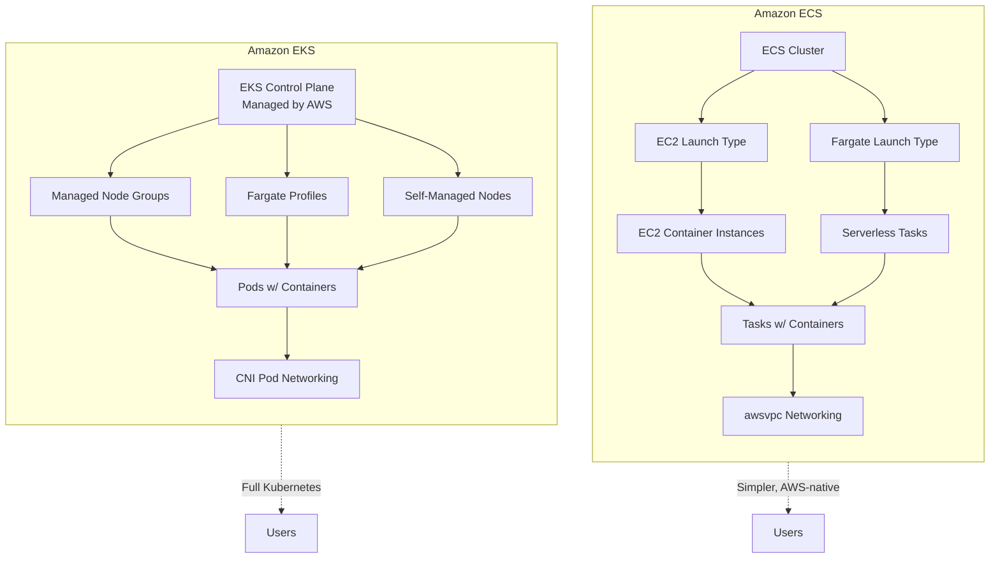
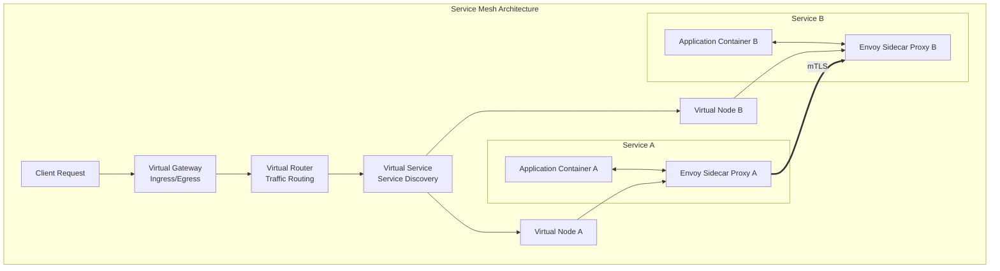

# ECS/EKS Best Practices

## ECS vs EKS Selection

### Comparison

| Feature | ECS | EKS |
|---------|-----|-----|
| **Control plane** | Fully managed | Fully managed (no self-managed option) |
| **Kubernetes** | No (ECS native) | Yes (full Kubernetes) |
| **Learning curve** | Lower | Higher |
| **Cost** | Lower (Fargate or EC2) | Higher (control plane fee) |
| **Ecosystem** | AWS-native | Kubernetes ecosystem |
| **Networking** | Bridge, awsvpc, host | CNI (pod networking) |
| **Service mesh** | App Mesh | Istio, Linkerd, App Mesh |
| **Auto-scaling** | ECS Service, Cluster | HPA, VPA, Cluster Autoscaler |
| **Portability** | AWS-only | Multi-cloud |
| **Best for** | AWS-centric, simplicity | Kubernetes expertise, multi-cloud |

### Recommendation Matrix

| Requirement | Recommended |
|-------------|-------------|
| AWS-only deployment | ECS |
| Kubernetes expertise exists | EKS |
| Multi-cloud strategy | EKS |
| Simplicity preferred | ECS |
| Cost optimization | ECS |
| Kubernetes ecosystem tools | EKS |
| Fast time-to-market | ECS |
| Helm charts, operators | EKS |

---

## ECS Architecture

### Launch Types

| Type | Description | Use Case |
|------|-------------|----------|
| **EC2 Launch Type** | Self-managed EC2 cluster (legacy, use Capacity Providers) | Cost control, dedicated hosts |
| **Fargate** | Serverless, AWS-managed | Simplicity, variable workloads |
| **ECS on AWS Fargate Spot** | Discounted Fargate | Fault-tolerant workloads |

### Networking Modes

| Mode | Description | Use Case |
|------|-------------|----------|
| **awsvpc** | Task gets ENI, own IP | **Recommended**, security groups |
| **Bridge** | Shared container network | Legacy, port mapping |
| **Host** | Host network stack | Performance, legacy apps |

### Capacity Providers

| Type | Description | Use Case |
|------|-------------|----------|
| **FARGATE_SPOT** | Spot-priced Fargate | Cost-optimized, fault-tolerant |
| **FARGATE** | On-demand Fargate | Production, reliability |
| **Auto (EC2)** | Auto-scaling EC2 | EC2 launch type |
| **Custom (EC2)** | Custom ASG | Specific instance needs |

---

## EKS Architecture

### Node Groups

| Type | Description | Use Case |
|------|-------------|----------|
| **Managed Node Group** | AWS-managed EC2 nodes | Standard workloads |
| **Self-Managed Node Group** | User-managed EC2 nodes | Custom AMI, configuration |
| **Fargate Profile** | Serverless pods | Variable workloads |
| **Spot Instances** | Spot-priced nodes | Cost-optimized, fault-tolerant |

### Cluster Autoscaler

| Setting | Recommendation |
|---------|---------------|
| **Enable Cluster Autoscaler** | For managed node groups |
| **Minimum nodes** | Match baseline load |
| **Maximum nodes** | Match peak capacity plan |
| **Scale-down delay** | 10 minutes (default) |
| **Spot instances** | Mix with on-demand for resilience |

---

## Auto-Scaling

### ECS Scaling

| Strategy | Description | Use Case |
|----------|-------------|----------|
| **Target Tracking** | Maintain target metric | CPU, memory, ALB requests |
| **Step Scaling** | Threshold-based adjustments | Variable patterns |
| **Scheduled Scaling** | Time-based scaling | Predictable patterns |
| **Custom Metrics** | Application-specific metrics | Business metrics |

### EKS Scaling

| Strategy | Description | Use Case |
|----------|-------------|----------|
| **HPA (Horizontal Pod Autoscaler)** | Pod count based on metrics | CPU, memory, custom |
| **VPA (Vertical Pod Autoscaler)** | Resource requests/limits | Right-sizing pods |
| **Cluster Autoscaler** | Node count based on pending pods | Cluster scaling |
| **KEDA** | Event-driven autoscaling | Queue length, events |

### Scaling Metrics

| Metric | Source | Use Case |
|--------|--------|----------|
| CPU Utilization | Container Insights | General scaling |
| Memory Utilization | Container Insights | Memory-bound apps |
| ALB Request Count | Application LB | Request-based scaling |
| HTTP 5XX Errors | Application LB | Error-based scaling |
| Custom Metrics | CloudWatch | Business-specific |
| Queue Depth | SQS, Kinesis | Event-driven scaling |

---

## Service Mesh

### App Mesh

| Component | Description |
|-----------|-------------|
| **Virtual Node** | Represents a service version |
| **Virtual Service** | Abstracts service discovery |
| **Virtual Router** | Routes traffic between services |
| **Virtual Gateway** | Ingress/egress gateway |
| **Envoy Proxy** | Sidecar proxy for each task/pod |

### Features

| Feature | Description | Use Case |
|---------|-------------|----------|
| **Traffic splitting** | Canary, blue/green deployments | Gradual rollouts |
| **Retry policies** | Automatic retries | Resilience |
| **Circuit breaker** | Fail fast on errors | Fault isolation |
| **Timeouts** | Request timeouts | Latency control |
| **mTLS** | Mutual TLS between services | Security |
| **Observability** | Distributed tracing | Debugging |

---

## Security

### ECS Security

| Control | Implementation |
|---------|---------------|
| **Task IAM roles** | Least privilege per task |
| **Execution role** | Pull images, write logs |
| **Network mode** | awsvpc with security groups |
| **Container images** | Scan in ECR |
| **Secrets** | Secrets Manager, SSM Parameter Store |
| **Logging** | FireLens for advanced logging |
| **Encryption** | EFS encrypted, secrets encrypted |

### EKS Security

| Control | Implementation |
|---------|---------------|
| **IAM Roles for Service Accounts (IRSA)** | Pod-level IAM permissions |
| **Pod Identity** | Native EKS pod identity |
| **Network Policies** | Calico, Cilium for pod networking |
| **Pod Security Standards** | Restricted, baseline, privileged |
| **Secrets encryption** | KMS encryption for etcd |
| **RBAC** | Kubernetes role-based access |
| **Image scanning** | ECR scan, Trivy |
| **SPIFFE/SPIRE** | Workload identity |

---

## Logging

### Logging Drivers

| Driver | Description | Use Case |
|--------|-------------|----------|
| **awslogs** | CloudWatch Logs | Default, simple |
| **fluentd** | Fluentd agent | Advanced processing |
| **fluent-bit** | Lightweight Fluent | Performance |
| **firelens** | Log router (Fluentd/Fluent Bit) | Multi-destination, advanced routing |
| **splunk** | Direct to Splunk | Splunk integration |

### Log Management

| Practice | Description |
|----------|-------------|
| **Centralized logging** | CloudWatch Logs, OpenSearch |
| **Log retention** | Match compliance requirements |
| **Log grouping** | By service, environment |
| **Log metrics** | CloudWatch Logs Insights |
| **Cost management** | Log rotation, compression |

---

## Monitoring

### Container Insights

| Metric | Description | Alert |
|--------|-------------|-------|
| CPU Utilization | Container CPU usage | > 80% |
| Memory Utilization | Container memory usage | > 80% |
| Network RX/TX | Container network traffic | Baseline deviation |
| Disk Read/Write | Container disk I/O | Baseline deviation |
| Pod/Task Restarts | Restart count | > 3/hour |
| Pull Image Latency | Image pull time | > 30s |

### X-Ray Integration

| Feature | Description |
|---------|-------------|
| **Tracing** | Distributed request tracing |
| **Service map** | Visualize service dependencies |
| **Latency analysis** | Identify slow services |
| **Error tracking** | Track exceptions and errors |

---

## Cost Optimization

| Strategy | Description | Potential Savings |
|----------|-------------|-------------------|
| **Fargate Spot** | Spot-priced serverless | Up to 70% |
| **EC2 Spot** | Spot instances for tasks | Up to 90% |
| **Right-size tasks** | Match CPU/memory to needs | 20-50% |
| **Auto-scaling** | Scale to demand | Variable workloads |
| **Graviton instances** | ARM-based, better price/performance | 20% |
| **Reserved capacity** | EC2 launch type reservations | Up to 70% |
| **Image optimization** | Smaller images, faster pulls | Time and bandwidth |
| **Cleanup** | Remove unused tasks, clusters | Eliminate waste |

---

## Cross-Service Integration

| Service | Integration | Purpose |
|---------|------------|---------|
| ALB/NLB | Container ingress | Load balancing |
| CloudMap | Service discovery | DNS-based discovery |
| App Mesh | Service mesh | Traffic management |
| CloudWatch | Container Insights | Monitoring |
| X-Ray | Distributed tracing | Debugging |
| Secrets Manager | Secret injection | Secure credentials |
| ECR | Container registry | Image storage |
| CloudTrail | API activity logging | Audit trail |
| Config | Compliance rules | Governance |
