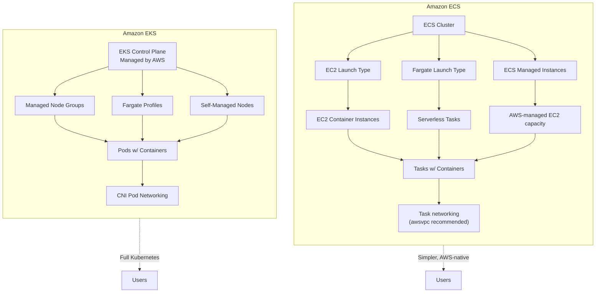
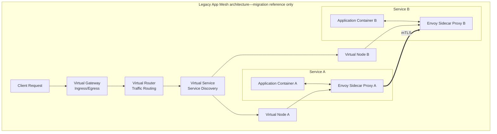

# ECS/EKS Best Practices

## ECS vs EKS Selection

### Comparison

| Feature | ECS | EKS |
|---------|-----|-----|
| **Control plane** | Fully managed | Fully managed (no self-managed option) |
| **Kubernetes** | No (ECS native) | Yes (full Kubernetes) |
| **Learning curve** | Lower | Higher |
| **Cost model** | No ECS control-plane charge; pay for compute and supporting services | Per-cluster control-plane charge plus compute and supporting services |
| **Ecosystem** | AWS-native | Kubernetes ecosystem |
| **Networking** | Bridge, awsvpc, host | CNI (pod networking) |
| **Service-to-service traffic** | ECS Service Connect; App Mesh only for migration of existing deployments | Supported Kubernetes service-mesh or networking projects such as Istio, Linkerd, or Cilium |
| **Auto-scaling** | ECS Service, Cluster | HPA, VPA, Cluster Autoscaler, Karpenter, EKS Auto Mode |
| **Portability** | ECS APIs and task definitions are AWS-specific | Kubernetes APIs improve workload portability, but AWS integrations and operations still require migration work |
| **Best for** | AWS-centric teams that want a simpler orchestrator | Teams that require Kubernetes APIs and ecosystem |

### Recommendation Matrix

| Requirement | Recommended |
|-------------|-------------|
| AWS-only deployment | ECS |
| Kubernetes expertise exists | EKS |
| Multi-cloud strategy | EKS |
| Simplicity preferred | ECS |
| Avoiding a per-cluster control-plane fee | ECS |
| Kubernetes ecosystem tools | EKS |
| Fast time-to-market | ECS |
| Helm charts, operators | EKS |

---

## ECS Architecture

### Launch Types

| Type | Description | Use Case |
|------|-------------|----------|
| **EC2 launch type** | ECS tasks run on EC2 container instances you manage | Specialized instances, host access, or capacity commitments |
| **Fargate** | Serverless, AWS-managed | Simplicity, variable workloads |
| **ECS on AWS Fargate Spot** | Discounted Fargate | Fault-tolerant workloads |
| **ECS Managed Instances** | AWS manages EC2 instance selection, provisioning, patching, scaling, and lifecycle while retaining broader EC2 capabilities | Lower host operations with more EC2 flexibility than Fargate |

### Networking Modes

| Mode | Description | Use Case |
|------|-------------|----------|
| **awsvpc** | Task gets ENI, own IP | **Recommended**, security groups |
| **Bridge** | Shared container network | Legacy, port mapping |
| **Host** | Host network stack | Performance, legacy apps |

### Capacity Providers

| Type | Description | Use Case |
|------|-------------|----------|
| **FARGATE_SPOT** | Spot-priced Fargate | Cost-optimized, fault-tolerant |
| **FARGATE** | On-demand Fargate | Production, reliability |
| **ECS Managed Instances capacity provider** | AWS-managed EC2-based capacity | Broad EC2 capabilities without self-managing hosts |
| **Auto Scaling group capacity provider** | Connects an EC2 Auto Scaling group to ECS managed scaling and termination protection | Recommended way to manage ECS EC2 capacity |

---

## EKS Architecture

### Node Groups

| Type | Description | Use Case |
|------|-------------|----------|
| **Managed Node Group** | AWS-managed EC2 nodes | Standard workloads |
| **Self-Managed Node Group** | User-managed EC2 nodes | Custom AMI, configuration |
| **Fargate Profile** | Serverless pods | Variable workloads |
| **Spot Instances** | Spot-priced nodes | Cost-optimized, fault-tolerant |
| **EKS Auto Mode** | AWS manages compute, scaling, networking, load balancing, and storage capabilities within the Auto Mode operating model | Minimal operational overhead |

### Kubernetes Version Support

| Support Tier | Duration | Coverage |
|--------------|----------|----------|
| **Standard support** | 14 months from release | Control plane, EKS-published AMIs, add-ons |
| **Extended support** | Next 12 months (26 months total) | Control plane patches, critical AMI/add-on patches (additional cost) |

Upgrade clusters before standard support ends to avoid the extended-support surcharge. If extended support is disabled, EKS automatically upgrades the control plane when standard support ends; after extended support ends, EKS also automatically upgrades unsupported control planes.

### Node/Cluster Autoscaling

| Tool | Approach | Recommendation |
|------|----------|----------------|
| **Karpenter** | Provisions and consolidates EC2 capacity directly from pod requirements | Flexible, AWS-optimized node provisioning |
| **Cluster Autoscaler** | Scales existing Auto Scaling Groups/node groups | Simpler multi-cloud-portable option; slower scale-up |
| **EKS Auto Mode** | AWS-managed compute and integrated infrastructure capabilities | Lowest operational overhead, with less low-level control |

| Setting | Recommendation |
|---------|---------------|
| **Minimum nodes** | Match baseline load |
| **Maximum nodes** | Match peak capacity plan |
| **Disruption settings** | Tune consolidation, PodDisruptionBudgets, and termination grace periods together |
| **Spot instances** | Mix with on-demand for resilience |

---

## Auto-Scaling

### ECS Scaling

| Strategy | Description | Use Case |
|----------|-------------|----------|
| **Target Tracking** | Maintain target metric | CPU, memory, ALB requests |
| **Step Scaling** | Threshold-based adjustments | Variable patterns |
| **Scheduled Scaling** | Time-based scaling | Predictable patterns |
| **Custom Metrics** | Application-specific metrics | Business metrics |

### EKS Scaling

| Strategy | Description | Use Case |
|----------|-------------|----------|
| **HPA (Horizontal Pod Autoscaler)** | Pod count based on metrics | CPU, memory, custom |
| **VPA (Vertical Pod Autoscaler)** | Resource requests/limits | Right-sizing pods |
| **Karpenter** | Node provisioning/consolidation via direct EC2 API calls | Flexible AWS-native node scaling |
| **Cluster Autoscaler** | Node count based on pending pods, via ASGs | Multi-cloud-portable node scaling |
| **KEDA** | Event-driven autoscaling | Queue length, events |

### Scaling Metrics

| Metric | Source | Use Case |
|--------|--------|----------|
| CPU utilization | CloudWatch/Container Insights for ECS; Kubernetes resource metrics pipeline for HPA | General scaling |
| Memory utilization | CloudWatch/Container Insights for ECS; Kubernetes resource/custom metrics pipeline for HPA | Memory-bound apps |
| ALB Request Count | Application LB | Request-based scaling |
| HTTP 5XX errors | Application Load Balancer | Reliability signal; diagnose before treating it as a scaling input |
| Custom Metrics | CloudWatch | Business-specific |
| Queue depth / consumer lag | SQS queue metrics or Kinesis iterator-age/lag metrics | Event-driven scaling |

---

## Service Mesh

> **AWS App Mesh reaches end of support on September 30, 2026.** After that date the console and App Mesh resources are no longer accessible. For new ECS workloads, evaluate **ECS Service Connect**; for EKS, evaluate a supported Kubernetes service-mesh or networking project. Existing App Mesh users should migrate before the end-of-support date.

### Legacy App Mesh migration reference (do not select for new workloads)

The following inventory is retained only to help teams identify existing App Mesh resources during migration. It is not a recommendation to deploy or expand App Mesh.

| Component | Description |
|-----------|-------------|
| **Virtual Node** | Represents a service version |
| **Virtual Service** | Abstracts service discovery |
| **Virtual Router** | Routes traffic between services |
| **Virtual Gateway** | Ingress/egress gateway |
| **Envoy Proxy** | Sidecar proxy for each task/pod |

### Legacy capabilities to map during migration

| Feature | Description | Use Case |
|---------|-------------|----------|
| **Traffic splitting** | Canary, blue/green deployments | Gradual rollouts |
| **Retry policies** | Automatic retries | Resilience |
| **Circuit breaker** | Fail fast on errors | Fault isolation |
| **Timeouts** | Request timeouts | Latency control |
| **mTLS** | Mutual TLS between services | Security |
| **Observability** | Distributed tracing | Debugging |

---

## Security

### ECS Security

| Control | Implementation |
|---------|---------------|
| **Task IAM roles** | Least privilege per task |
| **Execution role** | Pull images, write logs |
| **Network mode** | awsvpc with security groups |
| **Container images** | Scan in ECR |
| **Secrets** | Secrets Manager, SSM Parameter Store |
| **Logging** | FireLens for advanced logging |
| **Encryption** | EFS encrypted, secrets encrypted |

### EKS Security

| Control | Implementation |
|---------|---------------|
| **IAM Roles for Service Accounts (IRSA)** | Pod-level IAM permissions |
| **Pod Identity** | Native EKS pod identity |
| **Network Policies** | Amazon VPC CNI network policy or a compatible policy engine such as Calico/Cilium |
| **Pod Security Standards** | Restricted, baseline, privileged |
| **Secrets encryption** | Encrypt Kubernetes API data at rest and use Secrets Manager/Parameter Store through a supported CSI/provider integration when appropriate |
| **RBAC** | Kubernetes role-based access |
| **Image scanning** | ECR scan, Trivy |
| **SPIFFE/SPIRE** | Workload identity |

---

## Logging

### Logging Drivers

| Driver | Description | Use Case |
|--------|-------------|----------|
| **awslogs** | CloudWatch Logs | Simple AWS-native delivery |
| **awsfirelens** | ECS log router backed by Fluent Bit or Fluentd | Multi-destination, advanced routing |
| **splunk** | Direct to Splunk | Splunk integration |

### Log Management

| Practice | Description |
|----------|-------------|
| **Centralized logging** | CloudWatch Logs, OpenSearch |
| **Log retention** | Match compliance requirements |
| **Log grouping** | By service, environment |
| **Log analysis/metrics** | Logs Insights for queries; metric filters or EMF for metrics |
| **Cost management** | Log rotation, compression |

---

## Monitoring

### Container Insights

| Metric | Description | Alert |
|--------|-------------|-------|
| CPU Utilization | Container CPU usage | Sustained saturation or insufficient headroom for the workload |
| Memory Utilization | Container memory usage | Approaching task/pod limits or eviction/OOM risk |
| Network RX/TX | Container network traffic | Baseline deviation |
| Disk Read/Write | Container disk I/O | Baseline deviation |
| Pod/container restarts or ECS task replacement events | Restart/replacement behavior | Significant deviation from the workload baseline |
| Deployment/task events | ECS service events or Kubernetes events | Image-pull and scheduling failures |

### Distributed Tracing

Prefer OpenTelemetry/ADOT for new instrumentation. X-Ray SDKs and the X-Ray daemon entered maintenance mode on February 25, 2026.

| Feature | Description |
|---------|-------------|
| **Tracing** | Distributed request tracing |
| **Service map** | Visualize service dependencies |
| **Latency analysis** | Identify slow services |
| **Error tracking** | Track exceptions and errors |

---

## Cost Optimization

| Strategy | Description | Potential Savings |
|----------|-------------|-------------------|
| **Fargate Spot** | Interruptible Fargate capacity for fault-tolerant tasks | Discount relative to Fargate On-Demand; verify current pricing |
| **EC2 Spot** | Diversified Spot capacity for interruption-tolerant tasks | Discount relative to On-Demand; verify current pricing |
| **Right-size tasks** | Match requested CPU/memory to measured use | Lower idle capacity |
| **Auto-scaling** | Scale to demand | Variable workloads |
| **Graviton instances** | ARM-based capacity when images and dependencies support it | Often better price/performance; benchmark the workload |
| **Commitment discounts** | Compute Savings Plans or applicable EC2 commitments | Lower steady-state compute cost in exchange for commitment |
| **Image optimization** | Smaller images, faster pulls | Time and bandwidth |
| **Cleanup** | Remove unused load balancers, volumes, excessive log retention, and idle EKS clusters/compute | Eliminate waste |

---

## Cross-Service Integration

| Service | Integration | Purpose |
|---------|------------|---------|
| ALB/NLB | Container ingress | Load balancing |
| AWS Cloud Map | Service discovery | DNS/API-based discovery |
| ECS Service Connect | Service discovery + traffic management | Built-in ECS service-to-service networking |
| App Mesh (end of support September 30, 2026) | Legacy service mesh | Migration inventory only; do not adopt or expand for new workloads |
| CloudWatch | Container Insights | Monitoring |
| X-Ray | Distributed tracing | Debugging |
| Secrets Manager | Secret injection | Secure credentials |
| ECR | Container registry | Image storage |
| CloudTrail | API activity logging | Audit trail |
| Config | Compliance rules | Governance |

---

## Reliability and Deployment Practices

- Spread replicas across Availability Zones and use topology-spread constraints or anti-affinity where a zonal failure must not remove all capacity.
- Configure readiness, liveness, and startup checks for their distinct purposes. Avoid making a shallow liveness check depend on every downstream service, which can amplify an outage.
- For ECS rolling deployments, configure the deployment circuit breaker and rollback; for EKS, combine rollout health with PodDisruptionBudgets and sensible surge/unavailable settings.
- Run more than one task or pod for highly available services, drain connections on termination, and allow enough stop/termination grace time.
- Use immutable image tags or digests, scan images, run as a non-root user where possible, use read-only filesystems, and drop unnecessary Linux capabilities.
- Prefer EKS access entries for cluster access and EKS Pod Identity or IRSA for workload credentials; do not distribute static AWS keys to containers.

## AWS References

- [Amazon ECS launch types and capacity providers](https://docs.aws.amazon.com/AmazonECS/latest/developerguide/capacity-launch-type-comparison.html)
- [Amazon ECS Managed Instances capacity providers](https://docs.aws.amazon.com/AmazonECS/latest/developerguide/managed-instances-capacity-providers-concept.html)
- [Amazon ECS deployment circuit breaker](https://docs.aws.amazon.com/AmazonECS/latest/developerguide/deployment-circuit-breaker.html)
- [Amazon EKS Kubernetes version lifecycle](https://docs.aws.amazon.com/eks/latest/userguide/kubernetes-versions.html)
- [Amazon EKS Auto Mode](https://docs.aws.amazon.com/eks/latest/userguide/automode.html)
- [AWS App Mesh end-of-support notice](https://docs.aws.amazon.com/app-mesh/latest/userguide/meshes.html)
