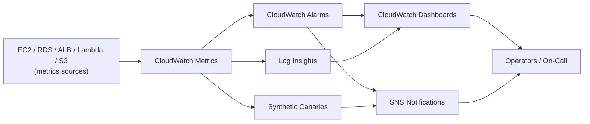

# CloudWatch Best Practices

## Metrics

### Standard vs Custom Metrics

| Type | Source | Cost | Use Case |
|------|--------|------|----------|
| **Standard** | AWS services | Included | Basic monitoring |
| **Custom** | Application published | Per metric | Application-specific |
| **High-resolution** | 1-second granularity | Extra cost | Detailed analysis |
| **1-minute resolution** | 1-minute granularity | Extra cost (EC2 "Detailed Monitoring") | Standard for most services |

### Metric Resolution

| Resolution | Granularity | Retention | Cost |
|------------|-------------|-----------|------|
| Standard | 5 minutes | 15 months | Included |
| Detailed | 1 minute | 3 months | Extra (EC2) |
| High-resolution | 1 second | 3 months | Extra |

### Key Metrics by Service

| Service | Critical Metrics | Warning | Critical |
|---------|-----------------|---------|----------|
| EC2 | CPUUtilization, StatusCheckFailed | > 70% | > 90% |
| RDS | CPUUtilization, FreeableMemory, ReplicaLag | > 70% | > 90% |
| ALB | RequestCount, 5XXErrorCount, Latency | > 1% 5XX | > 5% 5XX |
| S3 | 4XXErrorRate, 5XXErrorRate, BucketSizeBytes | > 1% error rate | > 5% error rate |
| Lambda | Errors, Duration, Throttles | > 1% errors | > 5% errors |
| DynamoDB | ConsumedReadCapacity, ThrottleEvents | > 70% | > 90% |
| ElastiCache | GetHitRate (Memcached) / CacheHits+CacheMisses (Redis), CurrConnections | < 80% hit | < 50% hit |

---

## Alarms

### Alarm Configuration

| Setting | Recommendation | Reason |
|---------|---------------|--------|
| **Evaluation periods** | 2-3 periods | Avoid false positives |
| **Threshold** | Based on baseline + 2 sigma | Statistical significance |
| **Treat missing data** | Not an alarm or breaching | Data gaps handling |
| **Actions** | SNS notification + automation | Response |
| **Alarm state actions** | OK, ALARM, INSUFFICIENT_DATA | All states |
| **Dimensions** | Specific resource identification | Targeted alerts |

### Alarm Best Practices

| Practice | Description |
|----------|-------------|
| **Hierarchical alarms** | Resource -> Service -> Account levels |
| **Composite alarms** | Combine multiple conditions | Reduce alert fatigue |
| **Alarm limits** | Monitor alarm count (100 per metric) | Avoid limits |
| **Action diversification** | SNS, Lambda, SNS topic, EC2 actions | Flexible response |
| **Annotation** | Document alarm purpose | Operational clarity |

### Composite Alarms

| Operator | Description | Use Case |
|----------|-------------|----------|
| **ALL** | All alarms must be in state | Multi-condition alert |
| **ANY** | Any alarm in state triggers | Any condition alert |
| **NONE** | No alarms in state | All-clear condition |

---

## Dashboards

### Dashboard Design

| Element | Recommendation |
|---------|---------------|
| **Widgets** | Metrics, logs, alarms, text, alarms |
| **Layout** | Group by service or application |
| **Time range** | 24 hours default, configurable |
| **Sharing** | Cross-account sharing for teams |
| **Embedding** | External dashboards via URL |
| **Cost** | $3/month per dashboard |

### Dashboard Templates

| Dashboard | Purpose | Key Widgets |
|-----------|---------|-------------|
| **Executive** | High-level overview | Cost, errors, uptime |
| **Application** | App-specific monitoring | Latency, errors, throughput |
| **Infrastructure** | Resource utilization | CPU, memory, disk, network |
| **Security** | Security monitoring | Failed logins, API errors |
| **Cost** | Cost tracking | Daily spend, budget alerts |

---

## Logs

### Log Groups

| Setting | Recommendation |
|---------|---------------|
| **Retention** | Match compliance (1-3653 days) |
| **Encryption** | KMS encryption for sensitive logs |
| **Tiering** | Adaptive or explicit to Cold |
| **Metric filters** | Extract metrics from log patterns |
| **Subscription filters** | Stream logs to Lambda, Kinesis |
| **Cross-account** | Centralized log aggregation |

### Log Insights

| Feature | Description | Use Case |
|---------|-------------|----------|
| **Query language** | SQL-like log queries | Ad-hoc analysis |
| **Saved queries** | Reusable query templates | Regular analysis |
| **Dashboards** | Log-based visualizations | Monitoring |
| **Live tail** | Real-time log streaming | Debugging |
| **Statistics** | Aggregation functions | Trend analysis |

### Log Queries

| Function | Description | Example |
|----------|-------------|---------|
| filter | Filter by pattern | filter @message like /ERROR/ |
| sort | Sort results | sort @timestamp desc |
| limit | Limit results | limit 100 |
| stats | Aggregation | stats count() by bin(1h) |
| parse | Parse fields | parse @message /key=(? <value>)/ |
| display | Select columns | display @timestamp, value |

---

## Synthetic Canaries

### Canary Configuration

| Setting | Recommendation |
|---------|---------------|
| **Schedule** | Every 1-5 minutes for critical paths |
| **Runtime** | Match application stack |
| **Success criteria** | HTTP 200, response time < threshold |
| **Failure actions** | SNS notification, Lambda invocation |
| **VPC configuration** | VPC endpoints for internal endpoints |
| **Custom scripts** | Multi-step validation |

### Use Cases

| Use Case | Description |
|----------|-------------|
| **Endpoint monitoring** | HTTP/HTTPS endpoint health |
| **Workflow monitoring** | Multi-step business process |
| **Performance baseline** | Track response time trends |
| **Geographic monitoring** | Multiple region execution |
| **SSL certificate** | Certificate expiry monitoring |

---

## Log Anomaly Detection

### Machine Learning Detection

| Feature | Description |
|---------|-------------|
| **Anomaly detection** | ML-based log pattern analysis |
| **Metric math** | Statistical functions on metrics |
| **Predictions** | Forecast-based alerting |
| **Baselines** | Dynamic threshold calculation |

### Configuration

| Setting | Recommendation |
|---------|---------------|
| **Training period** | Minimum 14 days |
| **Metric** | Select key metrics |
| **Seasonality** | Daily, weekly, or monthly |
| **Sensitivity** | Adjust based on false positive rate |

---

## Cost Optimization

| Strategy | Description | Potential Savings |
|----------|-------------|-------------------|
| **Log retention** | Right-size retention period | Storage cost |
| **Log tiering** | Adaptive tiering to Cold | 50% storage reduction |
| **Metric consolidation** | Reduce custom metrics | Per-metric cost |
| **Dashboard cleanup** | Remove unused dashboards | $3/dashboard/month |
| **Alarm optimization** | Right-size evaluation periods | Evaluation cost |
| **Canary scheduling** | Match to business hours | Execution cost |
| **Export to S3** | Long-term storage in S3 | CloudWatch cost reduction |

---

## Cross-Service Integration

| Service | Integration | Purpose |
|---------|------------|---------|
| SNS | Alarm notifications | Alerting |
| Lambda | Log processing, alarm actions | Automation |
| S3 | Log export, long-term storage | Archive |
| Kinesis | Real-time log streaming | Processing |
| EventBridge | Log-based events | Event-driven |
| X-Ray | Trace correlation | Debugging |
| Config | Log-based compliance | Governance |
| GuardDuty | Log-based threat detection | Security |
