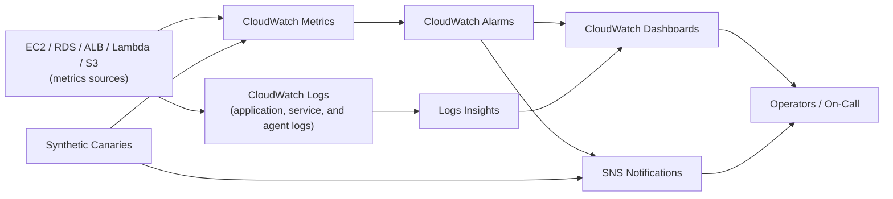

# CloudWatch Best Practices

## Metrics

### Standard vs Custom Metrics

| Type | Source | Cost | Use Case |
|------|--------|------|----------|
| **AWS service metrics** | AWS services | Many basic metrics have no additional CloudWatch metric charge; optional detailed/request metrics can be billed | Resource monitoring |
| **Custom** | Application, agent, EMF, or OpenTelemetry | Per custom metric and API/log ingestion as applicable | Application-specific telemetry |
| **High-resolution custom** | 1-second storage resolution | Custom metric charges; 10/30-second alarms cost more than standard alarms | Sub-minute analysis |
| **Standard-resolution custom** | 1-minute storage resolution | Custom metric charges | Most application metrics |

### Metric Resolution

CloudWatch retains all metric data, but the queryable *resolution* degrades over time as data ages (it is aggregated to coarser periods, not deleted):

| Data point period | Available at that resolution for | Cost |
|--------------------|-----------------------------------|------|
| < 60 seconds (high-resolution) | 3 hours | Custom metric/API charges apply |
| 60 seconds (1 minute) | 15 days | Depends on the metric source |
| 300 seconds (5 minutes) | 63 days | Depends on the metric source |
| 3600 seconds (1 hour) | 455 days (15 months) | Depends on the metric source |

After each window, data is automatically aggregated to the next coarser period rather than discarded — total retention is 15 months, but only at 1-hour resolution.

### Key Metrics by Service

| Service | Useful signals | Alarm design |
|---------|----------------|--------------|
| EC2 | CPUUtilization, StatusCheckFailed, network/EBS metrics, memory/disk from the agent | Capacity boundary, failed status check, or workload SLO |
| RDS | CPUUtilization, FreeableMemory, storage, connections, ReplicaLag | Engine-specific capacity limits and replication/recovery objectives |
| ALB | RequestCount, HTTPCode_ELB_5XX_Count, HTTPCode_Target_5XX_Count, TargetResponseTime | Availability/latency SLO and error-budget burn |
| S3 | 4xxErrors, 5xxErrors, FirstByteLatency (opt-in request metrics); BucketSizeBytes (daily storage metric) | Application SLO; distinguish expected 4xx responses |
| Lambda | Errors, Duration, Throttles, ConcurrentExecutions, IteratorAge where applicable | Error rate, timeout headroom, throttling, and event-age SLO |
| DynamoDB | ConsumedReadCapacityUnits, ConsumedWriteCapacityUnits, ReadThrottleEvents, WriteThrottleEvents | Sustained throttling, capacity risk, or user-visible failure |
| ElastiCache | CacheHits/CacheMisses, CurrConnections, engine CPU/memory/evictions | Workload-specific hit-rate and resource-pressure thresholds |

---

## Alarms

### Alarm Configuration

| Setting | Recommendation | Reason |
|---------|---------------|--------|
| **Evaluation periods** | Use M-of-N evaluation matched to signal frequency and recovery objective | Reduce noise without delaying detection excessively |
| **Threshold** | Tie to an SLO, capacity boundary, or anomaly-detection band | Actionable signal |
| **Treat missing data** | Choose per metric semantics: `breaching`, `notBreaching`, `ignore`, or `missing` | Prevent false clears and false pages |
| **Actions** | SNS notification + automation | Response |
| **Alarm state actions** | OK, ALARM, INSUFFICIENT_DATA | All states |
| **Dimensions** | Specific resource identification | Targeted alerts |

### Alarm Best Practices

| Practice | Description | Benefit |
|----------|-------------|---------|
| **Hierarchical alarms** | Resource -> Service -> Account levels | Clear ownership and escalation |
| **Composite alarms** | Combine multiple conditions | Reduce alert fatigue |
| **Alarm quotas** | Total alarms per account/Region is an adjustable service quota (not a small fixed number); still avoid alarm sprawl for manageability and cost | Avoid limits |
| **Action diversification** | SNS, Lambda, SSM, EC2 actions | Flexible response |
| **Annotation** | Document alarm purpose | Operational clarity |

### Composite Alarms

| Operator | Description | Use Case |
|----------|-------------|----------|
| **AND** | All referenced alarm expressions must be true | Multi-condition alert |
| **OR** | Any referenced alarm expression is true | Any-condition alert |
| **NOT** | Negate an alarm expression | Suppression or maintenance logic |

---

## Dashboards

### Dashboard Design

| Element | Recommendation |
|---------|---------------|
| **Widgets** | Metrics, logs, alarms, text, and supported service widgets |
| **Layout** | Group by service or application |
| **Time range** | Choose a relative or absolute range appropriate to the operational question; keep enough resolution to expose short spikes |
| **Cross-account views** | Use cross-account observability or approved dashboard sharing for teams |
| **Sharing** | Share through CloudWatch dashboard sharing with the required authentication/public-access controls |
| **Cost** | Pricing and free-tier allowances vary; verify the current CloudWatch pricing page |

### Dashboard Templates

| Dashboard | Purpose | Key Widgets |
|-----------|---------|-------------|
| **Executive** | High-level overview | Cost, errors, uptime |
| **Application** | App-specific monitoring | Latency, errors, throughput |
| **Infrastructure** | Resource utilization | CPU, memory, disk, network |
| **Security** | Security monitoring | Failed logins, API errors |
| **Cost** | Cost tracking | Daily spend, budget alerts |

---

## Logs

### Log Groups

| Setting | Recommendation |
|---------|---------------|
| **Retention** | Select an explicit supported period from one day through 10 years, or retain indefinitely only when required |
| **Encryption** | KMS encryption for sensitive logs |
| **Log class/tiering** | Choose Standard, Infrequent Access, or Intelligent Tiering based on feature and access needs; feature support differs |
| **Metric filters** | Extract metrics from log patterns |
| **Embedded Metric Format (EMF)** | Emit structured JSON logs that CloudWatch extracts as custom metrics; it avoids direct `PutMetricData` calls but still incurs log and custom-metric charges |
| **Subscription filters** | Stream logs to Lambda, Kinesis |
| **Cross-account** | Centralized log aggregation |

### Log Insights

| Feature | Description | Use Case |
|---------|-------------|----------|
| **Query language** | Purpose-built Logs Insights QL (also supports OpenSearch PPL and standard SQL syntax) | Ad-hoc analysis |
| **Saved queries** | Reusable query templates | Regular analysis |
| **Dashboards** | Log-based visualizations | Monitoring |
| **Live tail** | Real-time log streaming | Debugging |
| **Statistics** | Aggregation functions | Trend analysis |

### Log Queries

| Function | Description | Example |
|----------|-------------|---------|
| filter | Filter by pattern | filter @message like /ERROR/ |
| sort | Sort results | sort @timestamp desc |
| limit | Limit results | limit 100 |
| stats | Aggregation | stats count() by bin(1h) |
| parse | Parse fields | `parse @message /key=(?<value>\S+)/` |
| display | Select columns | display @timestamp, value |

---

## Synthetic Canaries

### Canary Configuration

| Setting | Recommendation |
|---------|---------------|
| **Schedule** | Every 1-5 minutes for critical paths |
| **Runtime** | Use a currently supported Synthetics runtime and update it before deprecation |
| **Success criteria** | HTTP 200, response time < threshold |
| **Failure actions** | Alarm on canary metrics, then route through SNS or approved automation |
| **VPC configuration** | Attach the canary to the VPC for private targets and provide routes/endpoints needed for CloudWatch and S3 |
| **Custom scripts** | Multi-step validation |

### Use Cases

| Use Case | Description |
|----------|-------------|
| **Endpoint monitoring** | HTTP/HTTPS endpoint health |
| **Workflow monitoring** | Multi-step business process |
| **Performance baseline** | Track response time trends |
| **Geographic monitoring** | Multiple region execution |
| **SSL certificate** | Certificate expiry monitoring |

---

## Log Anomaly Detection

### Machine Learning Detection

| Feature | Description |
|---------|-------------|
| **Anomaly detection** | ML-based log pattern analysis |
| **Pattern extraction** | Groups static and variable portions of log messages |
| **Continuous detector** | Evaluates incoming logs after model training |
| **Logs Insights command** | Performs on-demand anomaly analysis for a query range |

### Configuration

| Setting | Recommendation |
|---------|---------------|
| **Training data** | A detector uses up to the prior two weeks of events; initial training can take about 15 minutes |
| **Scope** | Use log groups with stable application patterns; the feature is not intended as a network/access anomaly detector |
| **Visibility** | Set how long detected anomalies remain visible (21 days by default) |
| **Log class** | Requires the Standard log class |

---

## Application-Centric and Multi-Account Observability

| Capability | Best Practice |
|------------|---------------|
| **Application Signals** | Use supported OpenTelemetry-based instrumentation to discover services/dependencies, track latency/availability/errors, and define service-level objectives |
| **Service-level objectives** | Set objective and warning windows from user expectations; page on actionable burn-rate conditions rather than every single error |
| **Cross-account observability** | Use Observability Access Manager sinks in monitoring accounts and links in source accounts; links and sinks are Regional |
| **Organization onboarding** | Use AWS Organizations integration so new accounts/OUs are linked consistently |
| **Telemetry ownership** | Keep collection configuration, retention, access policies, dashboards, alarms, and runbooks in version control |

---

## Cost Optimization

| Strategy | Description | Potential Savings |
|----------|-------------|-------------------|
| **Log retention** | Right-size retention period | Storage cost |
| **Log class/tiering** | Select a lower-cost class/tiering model only when required features remain available | Lower ingestion/storage cost depending on the option |
| **Metric consolidation** | Reduce custom metrics | Per-metric cost |
| **Dashboard cleanup** | Remove unused paid dashboards and widgets | Lower dashboard/API cost |
| **Alarm optimization** | Right-size evaluation periods | Evaluation cost |
| **Canary scheduling** | Reduce frequency or use business-hour schedules only for noncritical journeys; continuously test critical paths | Execution cost |
| **Export to S3** | Use export tasks for archival, not as a continuous real-time stream | CloudWatch storage reduction |

---

## Cross-Service Integration

| Service | Integration | Purpose |
|---------|------------|---------|
| SNS | Alarm notifications | Alerting |
| Lambda | Log processing, alarm actions | Automation |
| S3 | Log export, long-term storage | Archive |
| Kinesis | Real-time log streaming | Processing |
| EventBridge | Alarm and service state-change events | Event-driven automation |
| X-Ray | Trace correlation | Debugging |
| Config | Resource configuration and compliance | Governance |
| GuardDuty | Managed threat detection from supported AWS data sources | Security |

---

## Additional Best Practices

- Standardize account/Region, environment, service, and resource dimensions, but avoid unbounded high-cardinality dimensions such as request IDs in custom metrics.
- Alarm on symptoms that affect users and on imminent capacity exhaustion. Route notifications through an owned, tested escalation path and document the response in alarm descriptions or runbook links.
- Use cross-account observability or centralized telemetry accounts for multi-account environments; protect centralized log destinations with least-privilege resource policies.
- Encrypt sensitive logs, apply data-protection policies where useful, and never emit credentials, authorization headers, or unnecessary personal data.
- Set explicit retention on every log group and query only the required time range/fields to reduce Logs Insights scan cost.

## AWS References

- [CloudWatch metric retention](https://docs.aws.amazon.com/AmazonCloudWatch/latest/monitoring/cloudwatch_concepts.html#Metric)
- [Publishing custom and high-resolution metrics](https://docs.aws.amazon.com/AmazonCloudWatch/latest/monitoring/publishingMetrics.html)
- [CloudWatch Logs classes](https://docs.aws.amazon.com/AmazonCloudWatch/latest/logs/CloudWatch_Logs_Log_Classes.html)
- [Embedded metric format](https://docs.aws.amazon.com/AmazonCloudWatch/latest/monitoring/CloudWatch_Embedded_Metric_Format.html)
- [CloudWatch Logs anomaly detection](https://docs.aws.amazon.com/AmazonCloudWatch/latest/logs/LogsAnomalyDetection.html)
- [CloudWatch Application Signals](https://docs.aws.amazon.com/AmazonCloudWatch/latest/monitoring/CloudWatch-Application-Signals-Enable.html)
- [CloudWatch cross-account observability](https://docs.aws.amazon.com/AmazonCloudWatch/latest/monitoring/CloudWatch-Unified-Cross-Account.html)
