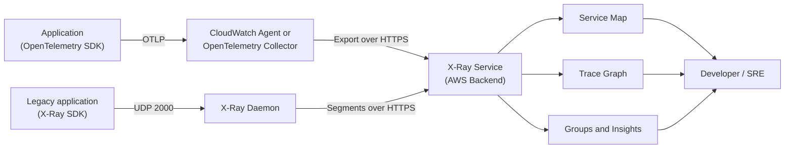
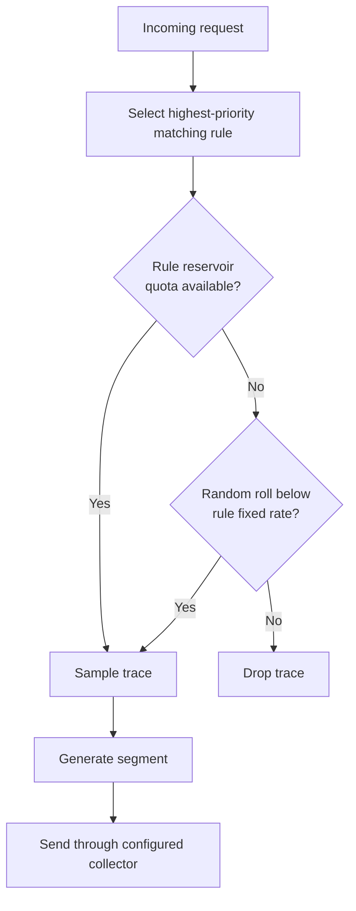

# X-Ray Best Practices

## Architecture

> **IMPORTANT (2026):** AWS X-Ray SDKs and Daemon are in **maintenance mode** (security fixes only). For new projects, use **AWS Distro for OpenTelemetry (ADOT)** / OpenTelemetry as the recommended instrumentation approach. Existing X-Ray deployments should plan migration to OpenTelemetry.

### Components

| Component | Description | Purpose |
|-----------|-------------|---------|
| **OpenTelemetry SDK / ADOT** | Recommended instrumentation for new and migrated applications | Generate spans and propagate context |
| **CloudWatch agent or OpenTelemetry Collector** | Receive OTLP or X-Ray telemetry and export traces to X-Ray | Collection and routing |
| **X-Ray SDK / daemon** | Maintenance-mode legacy instrumentation and UDP segment collector | Existing deployments only |
| **X-Ray Service** | Store and analyze traces | Backend service |
| **CloudWatch Console (X-Ray section)** | Visualize traces | Analysis UI |
| **SDK** | Programmatic access | Integration |

### Deployment Options

| Option | Description | Use Case |
|--------|-------------|----------|
| **EC2/on-premises** | CloudWatch agent or OpenTelemetry Collector | Hosts and traditional deployments |
| **ECS** | Collector sidecar or CloudWatch agent where supported | Container deployments |
| **EKS** | ADOT add-on/collector deployment | Kubernetes clusters |
| **Lambda** | Active tracing plus supported OpenTelemetry/ADOT instrumentation | Serverless functions |
| **AWS Services** | Native X-Ray support | Supported services |

---

## Instrumentation

### Instrumentation Choices

| Choice | Status | Recommendation |
|--------|--------|----------------|
| OpenTelemetry SDKs and auto-instrumentation | Active ecosystem and AWS-recommended direction | Use for new instrumentation and migrations |
| AWS Distro for OpenTelemetry | AWS-supported OpenTelemetry distribution | Use when AWS-tested components and exporters fit the workload |
| X-Ray SDKs | Maintenance mode from February 25, 2026 | Maintain existing workloads while planning migration; do not expect feature enhancements |
| X-Ray daemon | Maintenance mode from February 25, 2026 | Replace with CloudWatch agent or an OpenTelemetry Collector where practical |

### Instrumentation Levels

| Level | Description | Effort | Coverage |
|-------|-------------|--------|----------|
| **Service-level** | AWS service calls | Low | AWS services only |
| **Subsegment-level** | Custom code sections | Medium | Application logic |
| **Full tracing** | All HTTP calls, DB queries | High | Complete coverage |
| **Auto-instrumentation** | Agent-based or library-assisted instrumentation | Low, but requires configuration and validation | Framework-dependent |

### Subsegment Best Practices

| Practice | Description |
|----------|-------------|
| **Name subsegments** | Descriptive, consistent naming |
| **Add metadata** | Relevant request/response data |
| **Add annotations** | Queryable key-value pairs |
| **Add SQL metadata** | Trace database operations without recording credentials, bind values, or sensitive query text |
| **Add HTTP calls** | External service calls |
| **Error handling** | Capture exceptions and errors |

---

## Service Map

### Map Features

| Feature | Description | Use Case |
|---------|-------------|----------|
| **Service dependencies** | Visualize service graph | Architecture understanding |
| **Throttling indicators** | Show throttled services | Capacity issues |
| **Error indicators** | Show error rates | Problem identification |
| **Latency indicators** | Show slow services | Performance issues |
| **Correlated logs and alarms** | Open supported CloudWatch telemetry from a node | Faster investigation |

### Map Interpretation

| Indicator | Meaning | Action |
|-----------|---------|--------|
| **Green** | Successful calls | No action |
| **Yellow** | Client errors (4xx) | Investigate callers and request validation |
| **Red** | Server faults (5xx) | Investigate the service or dependency |
| **Purple** | Throttling (429) | Review quotas, capacity, and retry behavior |

---

## Trace Analysis

### Trace Details

| Section | Description | Use Case |
|---------|-------------|----------|
| **Service graph** | Visual dependency map | Architecture overview |
| **Timeline** | Sequential subsegment view | Latency analysis |
| **Statistics** | Aggregated metrics | Performance trends |
| **Raw JSON** | Complete trace data | Detailed debugging |

### Trace Sampling

| Setting | Recommendation | Reason |
|---------|---------------|--------|
| **Default rate** | First request/sec (reservoir) + 5% of additional requests | Balance cost and coverage |
| **Reservoir size** | 1 request/sec (default) | Sets the sampling quota before the additional percentage rate; it is not a traffic-independent guarantee |
| **Custom rules** | Per-service rates | Focus on critical paths |
| **Production** | Set rates per route from traffic volume, incident-detection needs, and trace budget | Cost and coverage control |
| **Debugging** | 100% temporarily | Full visibility |

The default rule is a baseline, not a universal production target. With centralized sampling, X-Ray coordinates reservoir allocation across clients; local sampling rules can apply a reservoir per process and therefore sample more traffic as the fleet grows.

### Sampling Rules

| Rule | Description | Use Case |
|------|-------------|----------|
| **Default rule** | All services, default rate | Baseline sampling |
| **Service rule** | Specific service, custom rate | Focus on critical services |
| **URL rule** | Specific URL pattern | API endpoint focus |
| **Host rule** | Specific host | Service-specific sampling |

---

## Groups & Insights

### Trace Groups

An X-Ray group is a named filter expression, not a separate trace copy. Filter criteria can combine service/resource fields, annotations, HTTP attributes, response time, and error/fault flags.

| Filter criterion | Use Case |
|------------------|----------|
| **Service/resource** | Service-level analysis |
| **Annotation** | Business or tenant grouping using indexed, low-cardinality values |
| **HTTP URL path** | API analysis |
| **Fault/error/response time** | Incident-focused analysis |

### Insights

| Feature | Description | Use Case |
|---------|-------------|----------|
| **Automatic insights** | Statistical modeling detects fault rates outside the expected range | Problem detection |
| **Per-group enablement** | Enable insights only on the X-Ray groups that need analysis | Scope and cost control |
| **Notifications** | Best-effort insight updates go to EventBridge and can route to SNS/SQS/Lambda | Alerting |
| **Root-cause and impact graphs** | Correlate the anomalous downstream service with affected upstream requests | Incident prioritization |

---

## Data Retention

### Retention Options

> **Note:** X-Ray trace and service-graph data is retained for **30 days** (fixed, non-configurable). If longer retention is required, design a separate telemetry export/archive path; X-Ray does not provide a retention setting that extends this window.

| Duration | Description | Use Case |
|----------|-------------|----------|
| 30 days | Default and only retention period | Standard monitoring, trend analysis |
| Custom retrieval/export before expiry | Use X-Ray APIs or an observability pipeline designed for the required destination | Long-term archival |
| Parallel OpenTelemetry export | Send spans to additional approved backends through a collector | Search or retention requirements beyond X-Ray |

### Cost Considerations

| Factor | Impact | Optimization |
|--------|--------|--------------|
| **Retention period** | Fixed at 30 days in X-Ray | Design external retention only when required |
| **Sampling rate** | Higher = more data | Adjust by environment |
| **Trace retrieval/scanning** | More analysis and retrieval can increase cost | Scope queries and analytics to the incident window |
| **Segment/trace size and annotations** | Subject to fixed service quotas and cardinality limits | Keep metadata useful, bounded, and non-sensitive |

---

## Monitoring

### Key Signals

| Signal | Description | Alerting approach |
|--------|-------------|-------------------|
| Request rate and latency | Trace-map/service response behavior | Prefer Application Signals or service-native CloudWatch metrics tied to SLOs |
| Error and fault rate | 4xx errors and 5xx faults represented in traces | Alarm on service metrics; use traces for diagnosis |
| Throttling | 429/throttle status in the trace map | Alarm on the throttled service's native metrics |
| Trace continuity | Expected requests have trace IDs and downstream context | Add telemetry pipeline health checks and collector/agent log alarms |

### CloudWatch Integration

| Integration | Description |
|-------------|-------------|
| **Trace-derived metrics** | Some SDK/agent configurations can publish service metrics; do not assume a universal default X-Ray metric set |
| **Alarms** | Use Application Signals or service/custom CloudWatch metrics for paging |
| **Dashboards** | X-Ray widgets in CloudWatch |
| **Logs** | Correlate traces with logs |

---

## Cross-Service Integration

| Service | Integration | Purpose |
|---------|------------|---------|
| Lambda | Native X-Ray support | Serverless tracing |
| API Gateway | HTTP tracing | API traceability |
| DynamoDB | Instrumented AWS SDK calls | Downstream latency and error analysis |
| SQS/SNS | Trace-header propagation in supported flows; queues/topics do not necessarily emit their own X-Ray segments | Asynchronous context propagation |
| ECS/EKS | ADOT/OpenTelemetry Collector (legacy X-Ray daemon only while migrating) | Container tracing |
| CloudWatch | Metrics, dashboards | Monitoring |
| EventBridge | Insights notifications | Alerting |
| Step Functions | Workflow tracing | Workflow analysis |

---

## Additional Best Practices

- Propagate W3C trace context across synchronous and asynchronous boundaries, and verify propagation during integration tests.
- Put searchable, low-cardinality business attributes in annotations; put diagnostic detail in metadata. Never record secrets, tokens, full request bodies, or unnecessary personal data.
- Tailor sampling rules by service and route. Keep enough baseline sampling for low-volume critical paths and temporarily raise sampling during a bounded investigation.
- Monitor collector/agent health, rejected spans, exporter failures, and IAM/network access. A healthy application with a broken telemetry pipeline can otherwise look like a traffic drop.
- Correlate logs with trace and span IDs and use CloudWatch Application Signals when service-level objectives and service discovery are required.

## AWS References

- [X-Ray SDK and daemon support timeline](https://docs.aws.amazon.com/xray/latest/devguide/xray-sdk-daemon-timeline.html)
- [Migrating X-Ray instrumentation to OpenTelemetry](https://docs.aws.amazon.com/xray/latest/devguide/xray-sdk-migration.html)
- [X-Ray quotas and 30-day retention](https://docs.aws.amazon.com/general/latest/gr/xray.html)
- [Using the X-Ray trace map](https://docs.aws.amazon.com/xray/latest/devguide/xray-console-servicemap.html)
- [CloudWatch integration with X-Ray](https://docs.aws.amazon.com/xray/latest/devguide/xray-services-cloudwatch.html)
