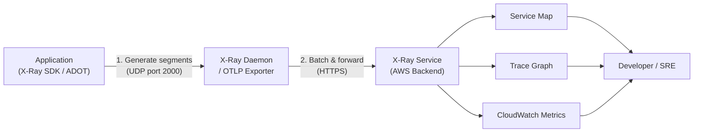
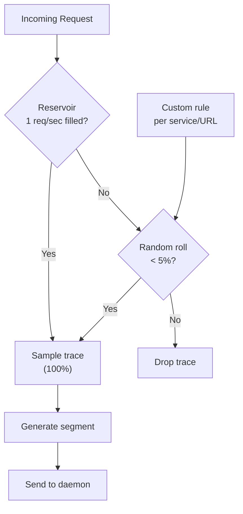

# X-Ray Best Practices

## Architecture

> **IMPORTANT (2026):** AWS X-Ray SDKs and Daemon are in **maintenance mode** (security fixes only). For new projects, use **AWS Distro for OpenTelemetry (ADOT)** / OpenTelemetry as the recommended instrumentation approach. Existing X-Ray deployments should plan migration to OpenTelemetry.

### Components

| Component | Description | Purpose |
|-----------|-------------|---------|
| **X-Ray SDK / OpenTelemetry** | Instrument application code | Generate traces |
| **X-Ray Daemon / OTLP Exporter** | Collect and forward segments | Data collection |
| **X-Ray Service** | Store and analyze traces | Backend service |
| **CloudWatch Console (X-Ray section)** | Visualize traces | Analysis UI |
| **SDK** | Programmatic access | Integration |

### Deployment Options

| Option | Description | Use Case |
|--------|-------------|----------|
| **EC2 Instance** | Daemon on EC2 | Traditional deployments |
| **ECS Task** | Sidecar container | Container deployments |
| **EKS DaemonSet** | Kubernetes daemon | Kubernetes clusters |
| **Lambda Layer** | X-Ray layer for Lambda | Serverless functions |
| **AWS Services** | Native X-Ray support | Supported services |

---

## Instrumentation

### Supported Languages

| Language | SDK | Auto-Instrumentation |
|----------|-----|---------------------|
| Java | AWS X-Ray SDK for Java | Yes (Spring Boot) |
| Python | AWS X-Ray SDK for Python | Yes (boto3) |
| Node.js | AWS X-Ray SDK for Node.js | Yes (AWS SDK) |
| .NET | AWS X-Ray SDK for .NET | Yes (AWS SDK) |
| Go | AWS X-Ray SDK for Go | Partial |
| Ruby | AWS X-Ray SDK for Ruby | Yes (AWS SDK) |

### Instrumentation Levels

| Level | Description | Effort | Coverage |
|-------|-------------|--------|----------|
| **Service-level** | AWS service calls | Low | AWS services only |
| **Subsegment-level** | Custom code sections | Medium | Application logic |
| **Full tracing** | All HTTP calls, DB queries | High | Complete coverage |
| **Auto-instrumentation** | Zero-code instrumentation | None | Framework-dependent |

### Subsegment Best Practices

| Practice | Description |
|----------|-------------|
| **Name subsegments** | Descriptive, consistent naming |
| **Add metadata** | Relevant request/response data |
| **Add annotations** | Queryable key-value pairs |
| **Add SQL queries** | Database query tracing |
| **Add HTTP calls** | External service calls |
| **Error handling** | Capture exceptions and errors |

---

## Service Map

### Map Features

| Feature | Description | Use Case |
|---------|-------------|----------|
| **Service dependencies** | Visualize service graph | Architecture understanding |
| **Throttling indicators** | Show throttled services | Capacity issues |
| **Error indicators** | Show error rates | Problem identification |
| **Latency indicators** | Show slow services | Performance issues |
| **Documented services** | Add service documentation | Knowledge sharing |

### Map Interpretation

| Indicator | Meaning | Action |
|-----------|---------|--------|
| **Green** | Healthy service | No action |
| Yellow | Elevated errors/latency | Investigate |
| **Red** | High errors/latency | Immediate action |
| **Throttle icon** | Service throttling | Scale or optimize |
| **Error icon** | High error rate | Debug errors |

---

## Trace Analysis

### Trace Details

| Section | Description | Use Case |
|---------|-------------|----------|
| **Service graph** | Visual dependency map | Architecture overview |
| **Timeline** | Sequential subsegment view | Latency analysis |
| **Statistics** | Aggregated metrics | Performance trends |
| **Raw JSON** | Complete trace data | Detailed debugging |

### Trace Sampling

| Setting | Recommendation | Reason |
|---------|---------------|--------|
| **Default rate** | First request/sec (reservoir) + 5% of additional requests | Balance cost and coverage |
| **Reservoir size** | 1 request/sec (default) | Guarantee minimum traces per second |
| **Custom rules** | Per-service rates | Focus on critical paths |
| **Production** | Lower rate (1-5%) | Cost control |
| **Debugging** | 100% temporarily | Full visibility |

### Sampling Rules

| Rule | Description | Use Case |
|------|-------------|----------|
| **Default rule** | All services, default rate | Baseline sampling |
| **Service rule** | Specific service, custom rate | Focus on critical services |
| **URL rule** | Specific URL pattern | API endpoint focus |
| **Host rule** | Specific host | Service-specific sampling |

---

## Groups & Insights

### Trace Groups

| Type | Description | Use Case |
|------|-------------|----------|
| **Resource ARN** | Group by service | Service-level analysis |
| **Name** | Custom group name | Application-level |
| **Annotation** | Group by annotation | Custom grouping |
| **HTTP URL path** | Group by URL | API analysis |

### Insights

| Feature | Description | Use Case |
|---------|-------------|----------|
| **Automatic insights** | Detect anomalies automatically | Problem detection |
| **Thresholds** | Custom threshold configuration | Tailored alerts |
| **Notifications** | EventBridge rules for issues (can route to SNS/SQS/Lambda) | Alerting |
| **Duration threshold** | Slow trace detection | Performance issues |
| **Fault threshold** | Error rate detection | Reliability issues |
| **Throttle threshold** | Throttling detection | Capacity issues |

---

## Data Retention

### Retention Options

> **Note:** X-Ray trace data is retained for **30 days** (fixed, non-configurable). For longer retention, export traces to S3 or OpenSearch.

| Duration | Description | Use Case |
|----------|-------------|----------|
| 30 days | Default and only retention period | Standard monitoring, trend analysis |
| S3 Export | Long-term archival | Compliance, extended analysis |
| OpenSearch Export | Searchable trace history | Deep debugging, audits |

### Cost Considerations

| Factor | Impact | Optimization |
|--------|--------|--------------|
| **Retention period** | Longer = more expensive | Right-size retention |
| **Sampling rate** | Higher = more data | Adjust by environment |
| **Trace size** | Larger traces = more cost | Minimize metadata |
| **Number of services** | More services = more traces | Focus on critical paths |

---

## Monitoring

### Key Metrics

| Metric | Description | Alert |
|--------|-------------|-------|
| TotalTraceCount | Total traces collected | Sudden drop |
| FaultCount | Traces with faults | > threshold |
| ErrorCount | Traces with errors | > threshold |
| ThrottleCount | Throttled requests | > 0 |
| TotalSegmentCount | Total segments | Baseline tracking |
| TotalDocumentedSegmentCount | Documented segments | Coverage tracking |

### CloudWatch Integration

| Integration | Description |
|-------------|-------------|
| **X-Ray metrics** | Published to CloudWatch |
| **Alarms** | CloudWatch alarms on X-Ray metrics |
| **Dashboards** | X-Ray widgets in CloudWatch |
| **Logs** | Correlate traces with logs |

---

## Cross-Service Integration

| Service | Integration | Purpose |
|---------|------------|---------|
| Lambda | Native X-Ray support | Serverless tracing |
| API Gateway | HTTP tracing | API traceability |
| DynamoDB | Database tracing | Query analysis |
| SQS/SNS | Message tracing | Message flow |
| ECS/EKS | Daemon integration | Container tracing |
| CloudWatch | Metrics, dashboards | Monitoring |
| EventBridge | Insights notifications | Alerting |
| Step Functions | Workflow tracing | Workflow analysis |
