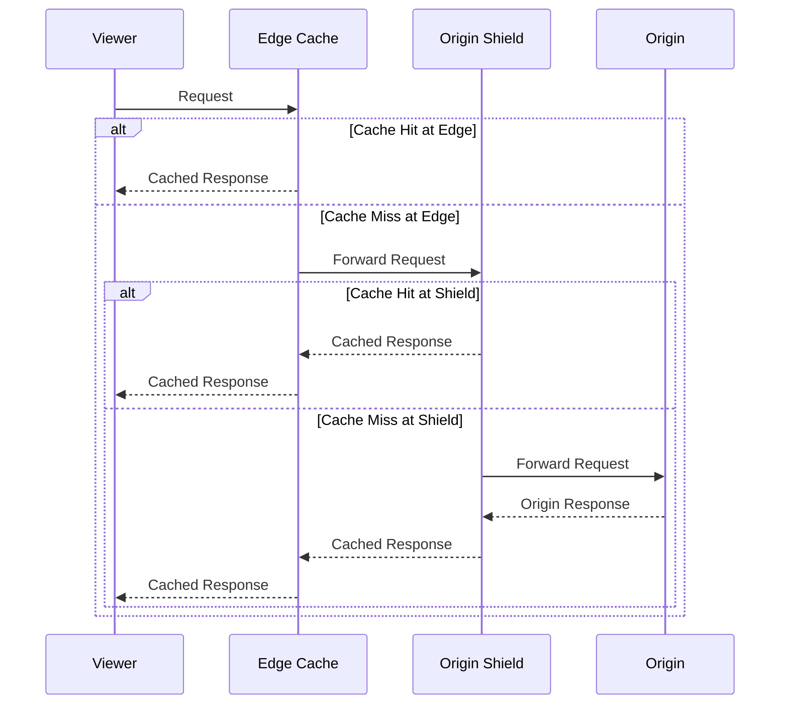
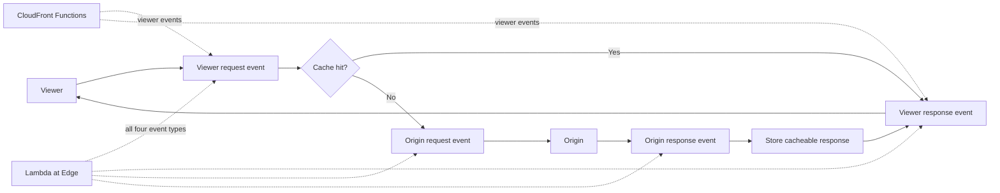

# CloudFront Best Practices

## Distribution Configuration

### Origin Types

| Origin Type | Description | Use Case |
|-------------|-------------|----------|
| **S3 Bucket** | Static content hosting | Websites, assets |
| **Custom Origin** | Any HTTP/HTTPS endpoint | Application servers |
| **Load Balancer** | ALB/NLB as origin | Dynamic content, apps |
| **VPC Origins** | Private ALB/NLB/EC2 in a VPC, reached via AWS-managed private tunnel | Serve private-subnet origins without exposing them publicly |
| **Origin Access Control** | SigV4-signed access to supported AWS origins, including S3 and Lambda function URLs | Keep supported origins private |
| **MediaStore** | Media content | Video, images |
| **Origin group** | Primary and secondary origins with failover criteria | Origin failover |

### Origin Access Control

| Method | Description | Recommendation |
|--------|-------------|----------------|
| **OAC (Origin Access Control)** | SigV4 signing for supported origin types; support and setup vary by origin | **Preferred for supported origins** |
| **OAI (Origin Access Identity)** | Legacy, S3 only | Migrate to OAC |
| **Signed URLs** | Time-limited access | Premium content |
| **Signed Cookies** | Session-based access | Member-only content |

---

## Cache Behavior

### Cache Settings

| Setting | Recommendation | Reason |
|---------|---------------|--------|
| **Cache TTL** | Match content freshness needs | Balance freshness and hits |
| **Min TTL** | Override origin Cache-Control minimum | Enforce minimum caching |
| **Max TTL** | Override origin Cache-Control maximum | Enforce maximum caching |
| **Default TTL** | When origin sends no caching headers | Standard caching |
| **Cache Key** | Include only relevant headers | Maximize cache hits |
| **Forward cookies** | Only if needed for variation | Reduce cache fragmentation |
| **Forward headers** | Only if needed for variation | Reduce cache fragmentation |
| **Forward query strings** | Only if needed for variation | Reduce cache fragmentation |

If a cache policy has a minimum TTL greater than zero, CloudFront can cache for at least that duration even when the origin sends `Cache-Control: no-cache`, `no-store`, or `private`. Use a zero minimum TTL for responses whose origin directives must prevent caching.

### Cache Key Optimization

| Element | Forward? | When to Include |
|---------|----------|----------------|
| **Distribution domain and URL path** | Always | Default cache key components |
| **Viewer `Host` header** | No | Include only when different hostnames intentionally produce different objects and the origin design supports it |
| **Query strings** | Whitelist only | When content varies by param |
| **Cookies** | Whitelist only | When content is personalized |
| **Headers** | Specific only | When content varies by header |

---

## Performance Optimization

### Compression

| Setting | Recommendation |
|---------|---------------|
| **Compress automatically** | Enable for text-based content |
| **Content types** | Add all text-based MIME types |
| **Origin compression** | Enable if origin supports it |

### HTTP Settings

| Setting | Recommendation | Reason |
|---------|---------------|--------|
| **HTTP version** | HTTP2 or HTTP3 | Better performance |
| **IPv6** | Enable | Global reach |
| **SSL/TLS** | TLS 1.2 minimum | Security |
| **Security policy** | TLS 1.2_2021 or higher | Modern ciphers |
| **Minimum protocol** | TLSv1.2 | Drop TLS 1.0/1.1 |

### Field-Level Encryption

| Feature | Description | Use Case |
|---------|-------------|----------|
| **Encryption configs** | Encrypt named fields in supported POST form requests | Protect selected sensitive fields end to end |
| **Public key** | Uploaded to CloudFront | Field encryption |
| **Private key** | Held by origin | Field decryption |
| **Use case** | Credit cards, SSN, etc. | PCI compliance |

---

## Origin Shield

### Origin Shield Configuration

| Setting | Recommendation |
|---------|---------------|
| **Enable Origin Shield** | For high-traffic distributions |
| **Region** | Choose region closest to origin |
| **Purpose** | Reduce origin load, aggregate cache |
| **Cost** | Additional Origin Shield request charges and potentially data-transfer charges; model by Region and origin |

### Benefits

| Benefit | Description |
|---------|-------------|
| **Origin protection** | Adds a centralized cache layer that can reduce duplicate origin requests; measure the actual effect |
| **Cache aggregation** | Single cache layer between edges and origin |
| **Cost reduction** | Less data transfer to origin |
| **Performance** | Reduced origin latency impact |

---

## Security

### WAF Integration

| Feature | Description |
|---------|-------------|
| **AWS WAF** | Web Application Firewall |
| **Managed rules** | AWS-managed rule groups |
| **Custom rules** | Application-specific rules |
| **Rate-based rules** | Limit abusive or excessive layer-7 request rates; combine with Shield and resilient origin design for DDoS protection |
| **Geo-match** | Country-based blocking |

### Security Headers

| Header | Value | Purpose |
|--------|-------|---------|
| Strict-Transport-Security | Choose an appropriate `max-age`; add `includeSubDomains` only when every subdomain is HTTPS-ready | HSTS |
| X-Content-Type-Options | nosniff | MIME sniffing prevention |
| X-Frame-Options | DENY | Clickjacking prevention |
| X-XSS-Protection | (deprecated, browsers ignore) | Remove — use CSP instead |
| Content-Security-Policy | Custom policy | CSP |
| Referrer-Policy | strict-origin-when-cross-origin | Referrer control |

### Response Headers Policy

| Header | Recommendation |
|--------|---------------|
| **Strict-Transport-Security** | Enable for production HTTPS domains after confirming the chosen scope and subdomains are HTTPS-ready |
| **X-Content-Type-Options** | nosniff |
| **X-Frame-Options** | DENY or SAMEORIGIN |
| **Content-Security-Policy** | Application-specific |
| **Cache-Control** | Based on content type |

---

## Edge Functions

### Lambda@Edge vs CloudFront Functions

| Feature | Lambda@Edge | CloudFront Functions |
|---------|-------------|---------------------|
| **Runtime** | Supported Node.js and Python Lambda runtimes | CloudFront JavaScript runtime |
| **Execution time** | Up to 30 seconds | Submillisecond execution target |
| **Memory** | 128 MB for viewer events; up to 10,240 MB for origin events | 2 MB |
| **Request body / generated response** | Request body available with event-specific truncation limits; generated response is 40 KB (viewer) or 1 MB (origin) | No request-body access; function code is limited to 10 KB |
| **Cold starts** | Yes | No |
| **Cost** | Lambda@Edge request and duration pricing | CloudFront Functions invocation pricing; verify current rates |
| **Use case** | Complex logic | Simple header/query manipulation |
| **Key-value data** | No CloudFront KeyValueStore integration | CloudFront KeyValueStore is available with supported JavaScript runtime versions |

### Use Cases

| Function Type | Use Case | Example |
|--------------|----------|---------|
| **Viewer Request** | Modify incoming requests | A/B testing, geo-redirect |
| **Viewer Response** | Modify outgoing responses | Add security headers |
| **Origin Request** | Modify requests to origin | Header transformation |
| **Origin Response** | Modify responses from origin | Error page customization |

---

## Monitoring

### Key Metrics

| Metric | Description | Alert Threshold |
|--------|-------------|----------------|
| Requests | Total requests | Workload baseline/anomaly |
| 4xxErrorRate / 5xxErrorRate / TotalErrorRate | Error percentages | SLO/error-budget threshold |
| Bytes Downloaded | Data transfer | Baseline tracking |
| OriginLatency (additional metric) | Time from CloudFront request to origin response | Workload SLO/baseline |
| CacheHitRate (additional metric) | Cacheable-request hit ratio | Content-specific target |
| Status/result types in access logs | Includes detailed outcomes such as client disconnects | Query logs; there is no dedicated standard `499 Errors` metric |

### Real-Time Logs

| Feature | Description |
|---------|-------------|
| **Kinesis Data Streams** | Real-time logs are delivered to a Kinesis data stream within seconds (not directly to CloudWatch Logs); fan out from there to S3/OpenSearch/Lambda via Kinesis Data Firehose |
| **Standard logs v2** | Deliver configurable fields and formats to CloudWatch Logs, Firehose, or S3; legacy standard logging is S3-only |
| **Fields** | Customizable log fields, with a configurable sampling rate |
| **Cost** | Additional cost for real-time (Kinesis) delivery |

---

## Cost Optimization

| Strategy | Description | Potential Savings |
|----------|-------------|-------------------|
| **Increase cache hit rate** | Optimize cache keys, TTLs | Data transfer reduction |
| **Origin Shield** | Reduce origin transfer | Origin cost reduction |
| **Compression** | Enable automatic compression | Transfer reduction |
| **Price class** | Choose appropriate class | Edge location cost |
| **HTTP/2 and HTTP/3** | Connection multiplexing and modern transport behavior | Performance; not a direct byte-cost guarantee |
| **Field-level encryption** | Only encrypt sensitive fields | Processing cost |

### Price Classes

| Class | Coverage | Regions | Cost |
|-------|----------|---------|------|
| **Price Class 100** | Major cities, US/EU/UK | Fewest | Lowest |
| **Price Class 200** | P100 + Asia Pacific, etc. | More | Medium |
| **Price Class All** | All edge locations | All | Highest |

### Data Transfer Costs

CloudFront pricing varies by viewer geography, usage tier or flat-rate plan, request type, origin, and optional features. Do not encode a single per-GB figure as an architectural constant. Review the current pricing page and model viewer transfer, origin transfer, invalidations, logs, Origin Shield, and edge-compute charges together.

---

## Cross-Service Integration

| Service | Integration | Purpose |
|---------|------------|---------|
| S3 | Bucket REST origin for private static content, or website endpoint as a public custom origin | Static applications and assets |
| WAF | Security rules | DDoS, SQL injection protection |
| Lambda@Edge | Edge computation | Dynamic content |
| CloudWatch | Logging, metrics | Monitoring |
| ACM | SSL/TLS certificates | HTTPS termination |
| Route 53 | DNS routing | Domain management |
| Shield | DDoS protection | Advanced DDoS mitigation |
| AWS Config / CloudTrail | Configuration checks and API audit | Governance |

---

## Additional Best Practices

- Redirect viewers to HTTPS and use an ACM viewer certificate in `us-east-1`; origin certificates follow the origin service/Region requirements.
- Keep S3 bucket origins private with OAC and an explicit bucket policy scoped to the distribution. An S3 website endpoint is a custom origin and cannot use OAC/OAI.
- Use managed cache and origin-request policies where they fit. Forward values to the origin without adding them to the cache key when they do not change the response.
- Prefer content-addressed or versioned object names for releases. Use invalidations for urgent removals, not as the routine cache-busting mechanism.
- Configure origin groups for eligible failure modes, and test that the secondary origin has equivalent content, capacity, and security controls.
- Protect origins from direct access with VPC origins, OAC where supported, or an origin-verification control such as a secret custom header plus WAF; rotate shared secrets.

## AWS References

- [CloudFront origins and VPC origins](https://docs.aws.amazon.com/AmazonCloudFront/latest/DeveloperGuide/DownloadDistS3AndCustomOrigins.html)
- [Understanding the CloudFront cache key](https://docs.aws.amazon.com/AmazonCloudFront/latest/DeveloperGuide/understanding-the-cache-key.html)
- [CloudFront Functions and Lambda@Edge comparison](https://docs.aws.amazon.com/AmazonCloudFront/latest/DeveloperGuide/edge-functions-choosing.html)
- [CloudFront standard logging v2](https://docs.aws.amazon.com/AmazonCloudFront/latest/DeveloperGuide/standard-logging.html)
- [CloudFront certificate requirements](https://docs.aws.amazon.com/AmazonCloudFront/latest/DeveloperGuide/cnames-and-https-requirements.html)
