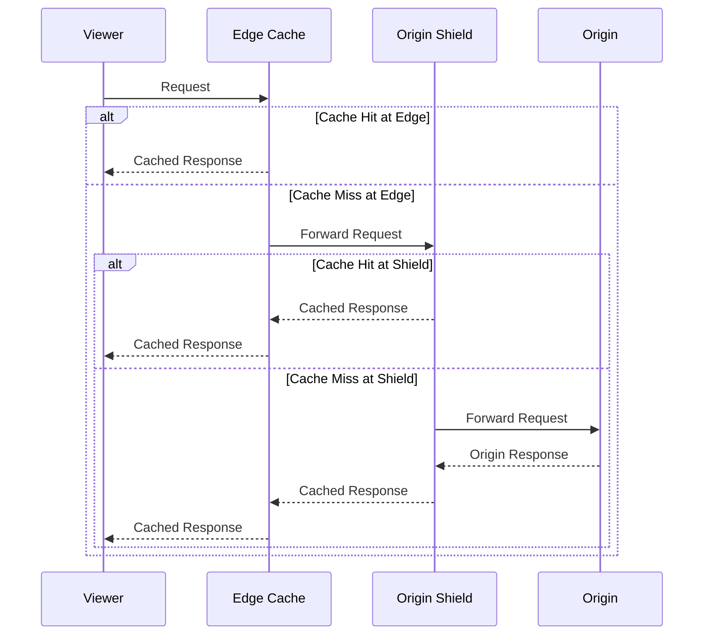

# CloudFront Best Practices

## Distribution Configuration

### Origin Types

| Origin Type | Description | Use Case |
|-------------|-------------|----------|
| **S3 Bucket** | Static content hosting | Websites, assets |
| **Custom Origin** | Any HTTP/HTTPS endpoint | Application servers |
| **Load Balancer** | ALB/NLB as origin | Dynamic content, apps |
| **VPC Origins** | Private ALB/NLB/EC2 in a VPC, reached via AWS-managed private tunnel | Serve private-subnet origins without exposing them publicly |
| **CloudFront Origin Access** | OAC/OAI for S3 | Secure S3 access |
| **MediaStore** | Media content | Video, images |
| **Lambda@Edge** | Edge computation | Dynamic content |

### Origin Access Control

| Method | Description | Recommendation |
|--------|-------------|----------------|
| **OAC (Origin Access Control)** | New, supports S3 and custom origins | **Preferred** |
| **OAI (Origin Access Identity)** | Legacy, S3 only | Migrate to OAC |
| **Signed URLs** | Time-limited access | Premium content |
| **Signed Cookies** | Session-based access | Member-only content |

---

## Cache Behavior

### Cache Settings

| Setting | Recommendation | Reason |
|---------|---------------|--------|
| **Cache TTL** | Match content freshness needs | Balance freshness and hits |
| **Min TTL** | Override origin Cache-Control minimum | Enforce minimum caching |
| **Max TTL** | Override origin Cache-Control maximum | Enforce maximum caching |
| **Default TTL** | When origin sends no caching headers | Standard caching |
| **Cache Key** | Include only relevant headers | Maximize cache hits |
| **Forward cookies** | Only if needed for variation | Reduce cache fragmentation |
| **Forward headers** | Only if needed for variation | Reduce cache fragmentation |
| **Forward query strings** | Only if needed for variation | Reduce cache fragmentation |

### Cache Key Optimization

| Element | Forward? | When to Include |
|---------|----------|----------------|
| **Host header** | Yes (default) | Always needed |
| **Path** | Yes (default) | Always needed |
| **Query strings** | Whitelist only | When content varies by param |
| **Cookies** | Whitelist only | When content is personalized |
| **Headers** | Specific only | When content varies by header |

---

## Performance Optimization

### Compression

| Setting | Recommendation |
|---------|---------------|
| **Compress automatically** | Enable for text-based content |
| **Content types** | Add all text-based MIME types |
| **Origin compression** | Enable if origin supports it |

### HTTP Settings

| Setting | Recommendation | Reason |
|---------|---------------|--------|
| **HTTP version** | HTTP2 or HTTP3 | Better performance |
| **IPv6** | Enable | Global reach |
| **SSL/TLS** | TLS 1.2 minimum | Security |
| **Security policy** | TLS 1.2_2021 or higher | Modern ciphers |
| **Minimum protocol** | TLSv1.2 | Drop TLS 1.0/1.1 |

### Field-Level Encryption

| Feature | Description | Use Case |
|---------|-------------|----------|
| **Encryption configs** | Encrypt specific headers/fields | PII protection |
| **Public key** | Uploaded to CloudFront | Field encryption |
| **Private key** | Held by origin | Field decryption |
| **Use case** | Credit cards, SSN, etc. | PCI compliance |

---

## Origin Shield

### Origin Shield Configuration

| Setting | Recommendation |
|---------|---------------|
| **Enable Origin Shield** | For high-traffic distributions |
| **Region** | Choose region closest to origin |
| **Purpose** | Reduce origin load, aggregate cache |
| **Cost** | Additional data transfer cost |

### Benefits

| Benefit | Description |
|---------|-------------|
| **Origin protection** | Reduces origin requests by 50-90% |
| **Cache aggregation** | Single cache layer between edges and origin |
| **Cost reduction** | Less data transfer to origin |
| **Performance** | Reduced origin latency impact |



---

## Security

### WAF Integration

| Feature | Description |
|---------|-------------|
| **AWS WAF** | Web Application Firewall |
| **Managed rules** | AWS-managed rule groups |
| **Custom rules** | Application-specific rules |
| **Rate-based rules** | DDoS protection |
| **Geo-match** | Country-based blocking |

### Security Headers

| Header | Value | Purpose |
|--------|-------|---------|
| Strict-Transport-Security | max-age=31536000; includeSubDomains | HSTS |
| X-Content-Type-Options | nosniff | MIME sniffing prevention |
| X-Frame-Options | DENY | Clickjacking prevention |
| X-XSS-Protection | (deprecated, browsers ignore) | Remove — use CSP instead |
| Content-Security-Policy | Custom policy | CSP |
| Referrer-Policy | strict-origin-when-cross-origin | Referrer control |

### Response Headers Policy

| Header | Recommendation |
|--------|---------------|
| **Strict-Transport-Security** | Always enable |
| **X-Content-Type-Options** | nosniff |
| **X-Frame-Options** | DENY or SAMEORIGIN |
| **Content-Security-Policy** | Application-specific |
| **Cache-Control** | Based on content type |

---

## Edge Functions

### Lambda@Edge vs CloudFront Functions

| Feature | Lambda@Edge | CloudFront Functions |
|---------|-------------|---------------------|
| **Runtime** | Node.js, Python, Ruby | Custom JavaScript (subset) |
| **Execution time** | Up to 30 seconds (25s in some regions) | Milliseconds (sub-ms typical) |
| **Memory** | Up to 3,008 MB | 1 MB |
| **Payload** | Up to 1 MB request/response | 128 KB |
| **Cold starts** | Yes | No |
| **Cost** | Lambda pricing | $0.40 per M invocations |
| **Use case** | Complex logic | Simple header/query manipulation |

### Use Cases

| Function Type | Use Case | Example |
|--------------|----------|---------|
| **Viewer Request** | Modify incoming requests | A/B testing, geo-redirect |
| **Viewer Response** | Modify outgoing responses | Add security headers |
| **Origin Request** | Modify requests to origin | Header transformation |
| **Origin Response** | Modify responses from origin | Error page customization |

```mermaid
graph LR
    subgraph Viewer
        A[Viewer Request]
        B[Viewer Response]
    end
    subgraph Edge
        A --> B
    end
    subgraph Origin
        C[Origin Request]
        D[Origin Response]
    end
    B --> C
    C --> D
    D --> B

    style A fill:#4ade80,color:#000
    style B fill:#4ade80,color:#000
    style C fill:#f87171,color:#000
    style D fill:#f87171,color:#000

    note1[CloudFront Functions] --> A
    note1 --> B
    note2[Lambda@Edge] --> A
    note2 --> B
    note2 --> C
    note2 --> D

    style note1 fill:#93c5fd,color:#000
    style note2 fill:#fbbf24,color:#000
```

---

## Monitoring

### Key Metrics

| Metric | Description | Alert Threshold |
|--------|-------------|----------------|
| Requests | Total requests | Baseline + 3σ |
| 4XX/5XX Errors | Error rate | > 1% of requests |
| Bytes Downloaded | Data transfer | Baseline tracking |
| Latency | Response time | > 500ms p99 |
| Origin Latency | Origin response time | > 1s p99 |
| Cache Hit Rate | Cache efficiency | < 80% for static content |
| 499 Errors | Client aborts | > 1% of requests |

### Real-Time Logs

| Feature | Description |
|---------|-------------|
| **Kinesis Data Streams** | Real-time logs are delivered to a Kinesis data stream within seconds (not directly to CloudWatch Logs); fan out from there to S3/OpenSearch/Lambda via Kinesis Data Firehose |
| **S3 logs** | Standard (non-real-time) access logs delivered to S3 |
| **Fields** | Customizable log fields, with a configurable sampling rate |
| **Cost** | Additional cost for real-time (Kinesis) delivery |

---

## Cost Optimization

| Strategy | Description | Potential Savings |
|----------|-------------|-------------------|
| **Increase cache hit rate** | Optimize cache keys, TTLs | Data transfer reduction |
| **Origin Shield** | Reduce origin transfer | Origin cost reduction |
| **Compression** | Enable automatic compression | Transfer reduction |
| **Price class** | Choose appropriate class | Edge location cost |
| **HTTP/2 and HTTP/3** | Better compression | Transfer reduction |
| **Field-level encryption** | Only encrypt sensitive fields | Processing cost |

### Price Classes

| Class | Coverage | Regions | Cost |
|-------|----------|---------|------|
| **Price Class 100** | Major cities, US/EU/UK | Fewest | Lowest |
| **Price Class 200** | P100 + Asia Pacific, etc. | More | Medium |
| **Price Class All** | All edge locations | All | Highest |

### Data Transfer Costs

| Direction | Price (per GB, US East) |
|-----------|------------------------|
| **To viewer** | $0.085/GB (first 10 TB, Price Class All) |
| **To S3 origin** | $0.00/GB (AWS backbone) |
| **To custom origin** | Varies by region (data transfer out from origin) |
| **From origin** | $0.00/GB (AWS backbone, S3 only) |

---

## Cross-Service Integration

| Service | Integration | Purpose |
|---------|------------|---------|
| S3 | Static content origin | Website hosting |
| WAF | Security rules | DDoS, SQL injection protection |
| Lambda@Edge | Edge computation | Dynamic content |
| CloudWatch | Logging, metrics | Monitoring |
| ACM | SSL/TLS certificates | HTTPS termination |
| Route 53 | DNS routing | Domain management |
| Shield | DDoS protection | Advanced DDoS mitigation |
| Inspector | Web application scanning | Security assessment |
