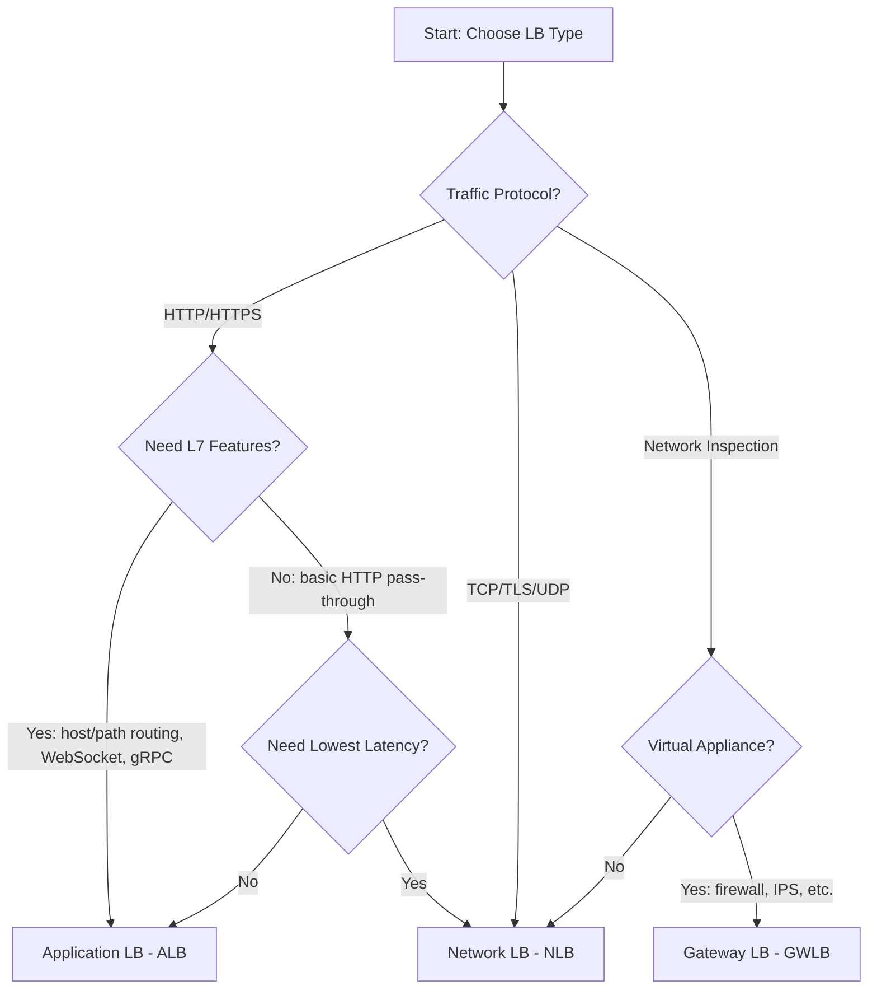
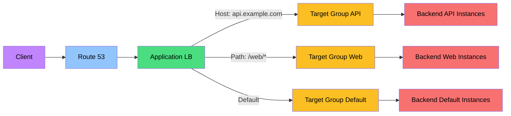

# Load Balancing Best Practices

Load balancing is a foundational capability for building resilient, highly available, and scalable applications on AWS. By distributing incoming traffic across multiple targets, load balancers eliminate single points of failure, improve response times, and enable seamless horizontal scaling. Proper load balancer configuration directly impacts application reliability, security posture, and cost efficiency.

## Load Balancer Types

### Comparison

Choosing the right load balancer type depends on your traffic protocol, routing needs, and performance requirements. The following comparison highlights the key differences to guide your selection.

| Feature | Application LB (ALB) | Network LB (NLB) | Gateway LB (GWLB) | Classic LB (CLB) |
|---------|---------------------|-----------------|-------------------|-----------------|
| **Layer** | Layer 7 (HTTP/HTTPS) | Layer 4 (TCP/UDP) | Layer 3/4 (GENEVE) | Layer 4/7 |
| **Protocols** | HTTP, HTTPS | TCP, TLS, UDP, TCP_UDP, QUIC, TCP_QUIC | GENEVE | HTTP, HTTPS, TCP, SSL/TLS |
| **Host-based routing** | Yes | No | No | Limited |
| **Path-based routing** | Yes | No | No | No |
| **WebSocket** | Native layer-7 support | Pass-through as TCP/TLS traffic | No | Limited HTTP upgrade support; prefer ALB |
| **HTTP/2** | Native front-end and target protocol support | Pass-through over a compatible TCP/TLS path | Transparent appliance path | No native layer-7 support; TCP pass-through is possible |
| **gRPC** | Native routing and health-check support | Pass-through over a compatible TCP/TLS path | Transparent appliance path | No native support |
| **Design goal** | Content-aware HTTP routing | Very high-performance connection/flow routing | Transparent virtual-appliance insertion | Previous-generation load balancing |
| **Static IP** | No (use NLB) | Yes (Elastic IP) | No | No |
| **Targets outside LB VPC** | Private IP targets over supported connectivity | Private IP targets over supported connectivity | Appliance targets in the target-group VPC | Instances only |
| **Status** | **Current generation** | **Current generation** | **Current generation** | **Previous generation; migrate where practical** |

### Selection Matrix

This matrix maps common application requirements to the most suitable load balancer type, helping you quickly narrow down your choice.

| Requirement | Recommended LB |
|-------------|---------------|
| HTTP/HTTPS traffic | ALB |
| TCP/UDP traffic | NLB |
| Lowest latency | NLB |
| Host/path-based routing | ALB |
| Static IP address | NLB (or Global Accelerator in front of ALB) |
| WebSocket support | ALB |
| gRPC services | ALB |
| Network virtual appliances | GWLB |
| TLS termination | ALB or NLB |
| Private targets in a peered VPC/on premises | ALB or NLB with supported private IP targets and routing |

---

## Target Groups

### Target Types

Selecting the correct target type determines which resources your load balancer can route traffic to and how it manages connections. Understanding these options is essential for designing flexible backend architectures.

| Type | Description | Use Case |
|------|-------------|----------|
| **instance** | EC2 instance ID | ALB, NLB, GWLB |
| **ip** | Supported private IPv4/IPv6 addresses; publicly routable IPs are not valid targets | ALB, NLB, GWLB; containers and hybrid targets commonly register this way |
| **lambda** | One Lambda function | ALB only |
| **alb** | One Application Load Balancer in the same VPC/account | NLB only, for static IP/PrivateLink plus ALB layer-7 features |

### Target Group Configuration

Proper target group configuration ensures traffic reaches healthy backends efficiently while maintaining application-specific behavior.

| Setting | Recommendation | Reason |
|---------|---------------|--------|
| **Protocol** | Match backend capability | HTTP for apps, TCP for raw |
| **Port** | Application port | Backend service port |
| **VPC** | Correct VPC | Target reachability |
| **Health check** | Application-specific | Accurate health detection |
| **Sticky sessions** | Only if necessary | Stateful applications |
| **Load balancing algorithm** | Choose among algorithms supported by the LB and target group (for example ALB round robin, least outstanding requests, or weighted random) | Traffic distribution |

---

## Health Checks

### Health Check Configuration

Health checks are the mechanism by which load balancers determine whether targets can receive traffic. Correct configuration balances fast failure detection against the risk of false positives and unnecessary load.

| Setting | Recommendation | Reason |
|---------|---------------|--------|
| **Protocol** | Match target protocol | HTTP for web, TCP for raw |
| **Port** | Application port or traffic port | Check actual service |
| **Path** | Dedicated health endpoint | Lightweight, fast check |
| **Interval/timeout** | Start from the protocol-specific defaults, then tune to recovery objectives and endpoint cost | Detection speed versus false failures/load |
| **Healthy/unhealthy thresholds** | Tune separately and test flapping behavior | Recovery confidence versus detection speed |
| **Success codes** | 200, 204, or custom | Match application responses |

### Health Check Best Practices

These practices ensure health checks accurately reflect application state without introducing instability or cascading failures.

| Practice | Description |
|----------|-------------|
| **Dedicated endpoint** | /health or /ping endpoint |
| **Lightweight check** | Minimal processing |
| **Check dependencies** | Use a shallow liveness endpoint for process health and a carefully designed readiness endpoint for essential dependencies; avoid cascading eviction |
| **Graceful degradation** | Mark unhealthy before crash |
| **Drain connections** | Deregistration delay for graceful shutdown |

---

## SSL/TLS Configuration

### Listener Configuration

Listener settings control how the load balancer accepts and processes incoming connections. Proper SSL/TLS configuration is critical for security compliance and cryptographic performance.

| Setting | Recommendation | Reason |
|---------|---------------|--------|
| **Security policy** | Select a current predefined ELB policy that meets client compatibility and compliance requirements | Modern protocols and ciphers |
| **Certificate** | ACM-managed certificates | Managed issuance and renewal when eligibility requirements are met; verify certificate pricing |
| **TLS termination** | At the load balancer when centralized certificate management and cryptographic offload are desired | Offloads TLS processing from targets; use backend TLS when end-to-end encryption is required |
| **Backend protocol** | HTTP or HTTPS | Use HTTPS when end-to-end encryption is required; use HTTP only after accepting the trust-boundary risk |
| **Private certificate** | For internal services | Internal PKI |

### SSL Policies

SSL policies define the TLS versions and cipher suites your load balancer supports. Selecting the right policy balances security strength with client compatibility.

| Policy | TLS Versions | Use Case |
|--------|-------------|----------|
| **`ELBSecurityPolicy-TLS13-1-2-2021-06`** | TLS 1.2 and 1.3 | Modern compatibility example |
| **TLS 1.3-only predefined policies** | TLS 1.3 | Controlled clients that all support TLS 1.3 |
| **Legacy predefined policies** | Older protocols/ciphers vary | Use only for a documented compatibility need and migration plan |
| **Custom policy** | Not supported by ALB/NLB listeners | Choose an AWS predefined policy |

---

## Routing Rules

### ALB Routing

ALB routing rules enable content-based traffic distribution, allowing a single load balancer to serve multiple services or versions based on request attributes.

| Rule Type | Description | Example |
|-----------|-------------|---------|
| **Host-based** | Route by hostname | api.example.com to API |
| **Path-based** | Route by URL path | /api/* to API backend |
| **Header-based** | Route by HTTP header | Custom-App: v2 to v2 backend |
| **Query string** | Route by query params | ?version=2 to v2 backend |
| **HTTP method** | Route by method | POST to write backend |

### Sticky Sessions

Sticky sessions bind a client to a specific target for a duration. They should be used sparingly since they reduce load distribution effectiveness and complicate scaling.

| Setting | Recommendation |
|---------|---------------|
| **Cookie-based** | Application or LB-generated |
| **Duration** | Minimum needed |
| **When to use** | Stateful applications only |
| **Alternative** | External session store (ElastiCache) |

---

## Auto Scaling Integration

### Integration Settings

Integrating load balancers with Auto Scaling enables automatic capacity adjustment based on real-time demand, ensuring availability while controlling costs.

| Setting | Recommendation | Reason |
|---------|---------------|--------|
| **Target tracking** | CPU, request count, or custom | Automatic scaling |
| **Scaling metrics** | Choose a metric correlated with demand; `ALBRequestCountPerTarget` is a predefined target-tracking metric for supported Auto Scaling scenarios | Scale on actual workload pressure |
| **Instance warmup / cooldown** | Measure application startup and configure the Auto Scaling group's default instance warmup; use policy-specific cooldowns only where the scaling policy supports and needs them | Prevent new capacity from distorting metrics or causing repeated scaling |
| **Health check** | ELB health check type | More accurate than EC2 |
| **Health-check grace period** | Set from measured startup and target-registration time, not a universal fixed value | Avoid replacing instances before they can become healthy |

### Observability Metrics

These load balancer-specific metrics provide actionable signals for scaling decisions, SLO monitoring, and failure diagnosis.

| Metric | Description | Use Case |
|--------|-------------|----------|
| **RequestCountPerTarget** | Requests per target | Request-based scaling |
| **ActiveFlowCount** | Concurrent flows through an NLB | Connection pressure and anomaly detection |
| **TargetResponseTime** | Time until an ALB target begins response headers | Latency/SLO monitoring; publish a custom scaling metric if needed |
| **HTTPCode_ELB_5XX_Count** | 5XX responses generated by ALB | Load-balancer-side failure diagnosis |

---

## Monitoring

### Key Metrics

Monitoring these metrics with defined warning and critical thresholds enables proactive incident response and capacity planning.

| Metric | Warning | Critical | Description |
|--------|---------|----------|-------------|
| ELB/target 5XX rates | Above normal but within error budget | SLO/error-budget breach | Separate LB-generated and target-generated errors |
| 4XX rate | Significant baseline deviation | User/business impact | Client errors; not all are service failures |
| UnHealthyHostCount / HealthyHostCount | Any unexpected unhealthy target | Insufficient healthy capacity | Target health |
| RequestCount / NewFlowCount | Baseline deviation | Capacity-plan boundary | Traffic volume |
| TargetResponseTime | SLO burn | SLO breach | ALB target response latency |
| ActiveFlowCount | Baseline/capacity plan | Tested capacity boundary | NLB/GWLB flow count |
| RejectedConnectionCount | Any unexplained nonzero value | Sustained user impact | NLB rejected connections |

### Access Logs

Access logs provide a detailed record of every request processed by the load balancer, supporting security audits, troubleshooting, and compliance requirements.

| Setting | Recommendation |
|---------|---------------|
| **Enable access logs** | ALB logs HTTP requests; NLB access logs apply to TLS listeners; use VPC Flow Logs and service metrics where LB access logs do not cover the traffic |
| **S3 bucket** | Dedicated bucket for logs |
| **Prefix** | Per-LB-name and date |
| **Retention** | Match compliance requirements |
| **Analysis** | Query S3 logs with Athena or another approved analytics pipeline; ingest them first if CloudWatch Logs Insights is required |

---

## Cost Optimization

Load balancer costs scale with traffic volume, capacity utilization, and feature usage. Applying these strategies helps align spending with actual demand.

| Strategy | Description | Potential Savings |
|----------|-------------|-------------------|
| **Right-size LB type** | Use NLB for TCP, ALB for HTTP | Appropriate pricing |
| **LCU monitoring** | Track Load Balancer Capacity Units | Right-size processing |
| **Cross-zone load balancing** | Enable for even distribution | Better target utilization |
| **Consolidate LBs** | Merge underutilized LBs | Per-LB cost reduction |
| **ACM certificates** | Use integrated, non-exportable public certificates where appropriate | Managed lifecycle; verify current ACM pricing |
| **Access logs** | Enable where security, troubleshooting, or compliance value justifies storage | Govern retention and analysis cost |

### Capacity-unit Billing

ALB, NLB, and GWLB capacity-unit formulas use different dimensions, and allowances can vary by protocol, certificate/key size, and feature. Billing uses the highest applicable dimension for the hour rather than summing all dimensions. Use the current ELB pricing page and CloudWatch consumed-capacity metrics instead of hard-coding LCU/NLCU/GLCU allowances in designs.

---

## Cross-Zone Load Balancing

Cross-zone load balancing controls whether traffic is distributed evenly across targets in all Availability Zones or only within the same zone. The default behavior and cost implications differ by load balancer type.

| Setting | ALB | NLB | CLB |
|---------|-----|-----|-----|
| **Load-balancer-level default** | Enabled and cannot be disabled at this level | Disabled | Depends on creation method (console versus API/CLI) |
| **Target-group override** | Can disable for eligible instance/IP target groups | Can override for eligible instance/IP target groups | Not applicable |
| **Cost consideration** | Review current regional data-transfer rules | Cross-AZ EC2 data-transfer charges apply | Review current regional data-transfer rules |
| **Recommendation** | Keep enabled unless zonal isolation is intentional and capacity is balanced per AZ | Enable only after evaluating per-AZ capacity, zonal isolation, latency, and cross-AZ cost | Migrate to a current-generation LB where practical |

---

## Cross-Service Integration

Load balancers integrate with multiple AWS services to form a complete traffic management, security, and observability stack. Understanding these integrations enables cohesive architecture design.

| Service | Integration | Purpose |
|---------|------------|---------|
| Auto Scaling | Target group registration | Automatic scaling |
| CloudWatch | Metrics, logs, alarms | Monitoring |
| ACM | SSL/TLS certificates | HTTPS termination |
| Route 53 | Alias records | DNS routing |
| WAF | Web application firewall | Security |
| Shield | DDoS protection | Advanced DDoS mitigation |
| VPC | Subnet placement | Network isolation |
| CloudTrail | API activity logging | Audit trail |
| Global Accelerator | Static anycast IPs, cross-region failover | Static entry point in front of ALB/NLB |

---

## Additional Best Practices

- Enable at least two Availability Zones and maintain enough healthy target capacity in each zone for the selected cross-zone behavior.
- Set deregistration delay and application shutdown handling together so deployments and scale-in drain requests cleanly.
- Preserve the client IP only when required and understand the NLB protocol/target-type defaults; otherwise use Proxy Protocol v2 only when the target explicitly supports it.
- Protect internet-facing ALBs with AWS WAF where appropriate, restrict security groups, and use Shield protections according to the threat model.
- Use zonal shift/autoshift only for supported resources and rehearse the capacity impact of evacuating an Availability Zone.

## AWS References

- [Elastic Load Balancing features and types](https://docs.aws.amazon.com/elasticloadbalancing/latest/userguide/what-is-load-balancing.html)
- [ALB target groups](https://docs.aws.amazon.com/elasticloadbalancing/latest/application/load-balancer-target-groups.html)
- [NLB target groups and protocols](https://docs.aws.amazon.com/elasticloadbalancing/latest/network/load-balancer-target-groups.html)
- [ALB TLS security policies](https://docs.aws.amazon.com/elasticloadbalancing/latest/application/describe-ssl-policies.html)
- [Cross-zone load balancing](https://docs.aws.amazon.com/elasticloadbalancing/latest/userguide/how-elastic-load-balancing-works.html#cross-zone-load-balancing)
