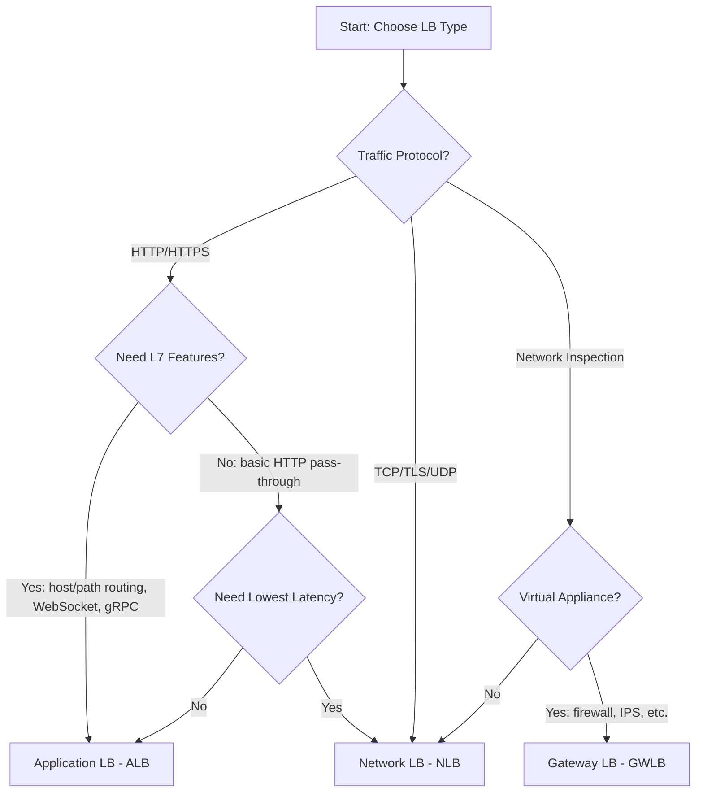
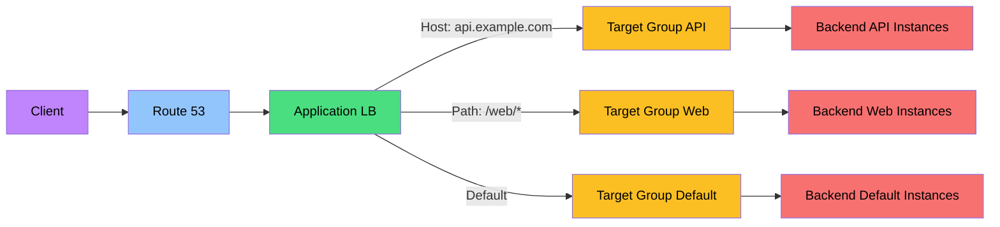

# Load Balancing Best Practices

## Load Balancer Types

### Comparison

| Feature | Application LB (ALB) | Network LB (NLB) | Gateway LB (GWLB) | Classic LB (CLB) |
|---------|---------------------|-----------------|-------------------|-----------------|
| **Layer** | Layer 7 (HTTP/HTTPS) | Layer 4 (TCP/UDP) | Layer 3/4 (GENEVE) | Layer 4/7 |
| **Protocols** | HTTP, HTTPS | TCP, TLS, UDP, TCP_UDP | GENEVE | HTTP, HTTPS, TCP, SSL |
| **Host-based routing** | Yes | No | No | Limited |
| **Path-based routing** | Yes | No | No | No |
| **WebSocket** | Yes | No | No | No |
| **HTTP/2** | Yes | No | No | No |
| **gRPC** | Yes | No | No | No |
| **Latency** | Higher | Lowest | Low | Medium |
| **Static IP** | No (use NLB) | Yes (Elastic IP) | No | No |
| **Cross-VPC** | No | Yes (with VPC peering) | Yes | No |
| **Status** | **Current** | **Current** | **Current** | **Deprecated** |

### Selection Matrix

| Requirement | Recommended LB |
|-------------|---------------|
| HTTP/HTTPS traffic | ALB |
| TCP/UDP traffic | NLB |
| Lowest latency | NLB |
| Host/path-based routing | ALB |
| Static IP address | NLB |
| WebSocket support | ALB |
| gRPC services | ALB |
| Network virtual appliances | GWLB |
| SSL termination | ALB or NLB |
| Cross-VPC routing | NLB |

---

## Target Groups

### Target Types

| Type | Description | Use Case |
|------|-------------|----------|
| **Instances** | EC2 instances | Traditional deployments |
| **IP addresses** | Any IP (on-prem, containers) | Hybrid, containers |
| **Lambda** | Lambda function | Serverless backends |
| **Containers** | ECS/EKS containers | Container deployments |

### Target Group Configuration

| Setting | Recommendation | Reason |
|---------|---------------|--------|
| **Protocol** | Match backend capability | HTTP for apps, TCP for raw |
| **Port** | Application port | Backend service port |
| **VPC** | Correct VPC | Target reachability |
| **Health check** | Application-specific | Accurate health detection |
| **Sticky sessions** | Only if necessary | Stateful applications |
| **Load balancing algorithm** | Round robin (default) or least outstanding | Traffic distribution |

---

## Health Checks

### Health Check Configuration

| Setting | Recommendation | Reason |
|---------|---------------|--------|
| **Protocol** | Match target protocol | HTTP for web, TCP for raw |
| **Port** | Application port or traffic port | Check actual service |
| **Path** | Dedicated health endpoint | Lightweight, fast check |
| **Interval** | 30 seconds (default) | Balance detection and load |
| **Timeout** | 5-10 seconds | Fast failure detection |
| **Healthy threshold** | 3 (default) | Confirm health |
| **Unhealthy threshold** | 3-5 | Confirm failure |
| **Success codes** | 200, 204, or custom | Match application responses |

### Health Check Best Practices

| Practice | Description |
|----------|-------------|
| **Dedicated endpoint** | /health or /ping endpoint |
| **Lightweight check** | Minimal processing |
| **Check dependencies** | Verify DB, cache connectivity |
| **Graceful degradation** | Mark unhealthy before crash |
| **Drain connections** | Deregistration delay for graceful shutdown |

---

## SSL/TLS Configuration

### Listener Configuration

| Setting | Recommendation | Reason |
|---------|---------------|--------|
| **Security policy** | TLS 1.2_2021 or higher | Modern ciphers |
| **Certificate** | ACM-managed certificates | Free, auto-renewal |
| **SSL termination** | At LB (recommended) | Offload from backend |
| **Backend protocol** | HTTP or HTTPS | HTTP if LB terminates SSL |
| **Private certificate** | For internal services | Internal PKI |

### SSL Policies

| Policy | TLS Versions | Use Case |
|--------|-------------|----------|
| **TLS 1.2_2021** | TLS 1.2, 1.3 | **Recommended default** |
| **TLS 1.2-2017-03** | TLS 1.2 | Legacy compatibility |
| **TLS 1.1-2017-03** | TLS 1.1, 1.2 | Legacy clients |
| **Forward Secrecy** | ECDHE ciphers | Enhanced security |
| **Custom policy** | Custom cipher suite | Specific requirements |

---

## Routing Rules

### ALB Routing

| Rule Type | Description | Example |
|-----------|-------------|---------|
| **Host-based** | Route by hostname | api.example.com to API |
| **Path-based** | Route by URL path | /api/* to API backend |
| **Header-based** | Route by HTTP header | Custom-App: v2 to v2 backend |
| **Query string** | Route by query params | ?version=2 to v2 backend |
| **HTTP method** | Route by method | POST to write backend |
| **HTTP version** | Route by HTTP version | HTTP/2 to modern backend |

### Sticky Sessions

| Setting | Recommendation |
|---------|---------------|
| **Cookie-based** | Application or LB-generated |
| **Duration** | Minimum needed |
| **When to use** | Stateful applications only |
| **Alternative** | External session store (ElastiCache) |

---

## Auto Scaling Integration

### Integration Settings

| Setting | Recommendation | Reason |
|---------|---------------|--------|
| **Target tracking** | CPU, request count, or custom | Automatic scaling |
| **Scaling metrics** | ALB Request Count per Target | More accurate than CPU |
| **Cooldown period** | 60-300 seconds | Prevent rapid scaling |
| **Health check** | ELB health check type | More accurate than EC2 |
| **Grace period** | 300 seconds | Allow startup |

### Custom Metrics

| Metric | Description | Use Case |
|--------|-------------|----------|
| **RequestCountPerTarget** | Requests per target | Request-based scaling |
| **ActiveFlowCount** | Active flows per target | Connection-based scaling |
| **TargetResponseTime** | Response time per target | Latency-based scaling |
| **HTTPCode_ELB_5XXX** | 5XX errors from LB | Error-based scaling |

---

## Monitoring

### Key Metrics

| Metric | Warning | Critical | Description |
|--------|---------|----------|-------------|
| HTTP 5XX Error Count | > 1% of requests | > 5% of requests | Server errors |
| HTTP 4XX Error Count | > 5% of requests | > 10% of requests | Client errors |
| UnHealthyHostCount | > 0 | > 50% of targets | Target health |
| RequestCount | Baseline + 3 sigma | Baseline + 5 sigma | Traffic volume |
| Latency | > 200ms p99 | > 500ms p99 | Response time |
| ActiveFlowCount | > 80% capacity | > 95% capacity | Connection count |
| NewConnectionCount | Baseline + 3 sigma | Baseline + 5 sigma | New connections |
| RejectedConnectionCount | > 0 | > 10/min | Rejected connections |

### Access Logs

| Setting | Recommendation |
|---------|---------------|
| **Enable access logs** | For all production LBs |
| **S3 bucket** | Dedicated bucket for logs |
| **Prefix** | Per-LB-name and date |
| **Retention** | Match compliance requirements |
| **Analysis** | Athena or CloudWatch Logs Insights |

---

## Cost Optimization

| Strategy | Description | Potential Savings |
|----------|-------------|-------------------|
| **Right-size LB type** | Use NLB for TCP, ALB for HTTP | Appropriate pricing |
| **LCU monitoring** | Track Load Balancer Capacity Units | Right-size processing |
| **Cross-zone load balancing** | Enable for even distribution | Better target utilization |
| **Consolidate LBs** | Merge underutilized LBs | Per-LB cost reduction |
| **ACM certificates** | Free SSL certificates | Certificate cost elimination |
| **Access logs** | Enable only for production | S3 storage cost |

### LCU (Load Balancer Capacity Units)

| Component | LCU Calculation | Description |
|-----------|----------------|-------------|
| **New connections** | Per 350 new connections/sec (ALB/NLB) | Connection establishment |
| **Active connections** | Per 10,000 active connections | Maintained connections |
| **Rule evaluations** | Per 2,000 rule evaluations/sec | Routing rules processed |
| **Data processed** | Per 1 GB of data processed | Traffic volume |
| **NAT** | Per 5 NAT connections/sec (NLB only) | Network address translation |

---

## Cross-Zone Load Balancing

| Setting | ALB | NLB | CLB |
|---------|-----|-----|-----|
| **Default** | Enabled | Disabled | Enabled |
| **Cost** | No extra charge | Extra data transfer charge | No extra charge |
| **Recommendation** | Keep enabled | Enable only if needed | Keep enabled |

---

## Cross-Service Integration

| Service | Integration | Purpose |
|---------|------------|---------|
| Auto Scaling | Target group registration | Automatic scaling |
| CloudWatch | Metrics, logs, alarms | Monitoring |
| ACM | SSL/TLS certificates | HTTPS termination |
| Route 53 | Alias records | DNS routing |
| WAF | Web application firewall | Security |
| Shield | DDoS protection | Advanced DDoS mitigation |
| VPC | Subnet placement | Network isolation |
| CloudTrail | API activity logging | Audit trail |
