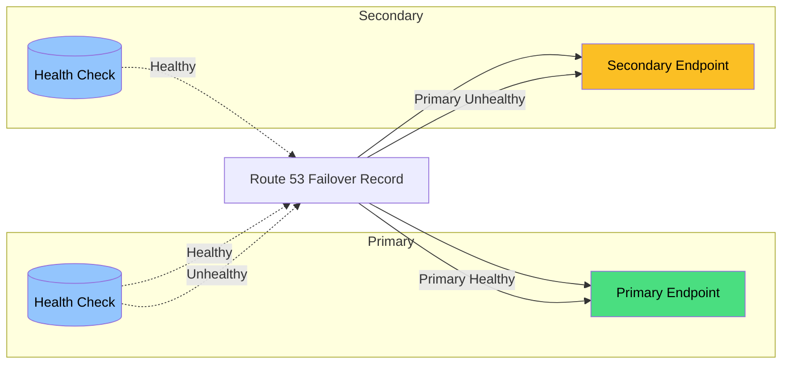

# Route 53 Best Practices

## Routing Policies

### Policy Comparison

| Policy | Description | Failover | Latency-Based | Weight | Use Case |
|--------|-------------|----------|---------------|--------|----------|
| **Simple** | Single record, random from multiple | No | No | No | Single resource, non-critical |
| **Failover** | Primary + secondary | Yes | No | No | Active-passive HA |
| **Latency** | Route to lowest latency region | No | Yes | No | Global low-latency |
| **Multi-Value** | Return multiple values, health-checked | Partial | No | No | Simple HA (up to 8 values) |
| **Weighted** | Distribute traffic by weight | No | No | Yes | A/B testing, migration |
| **Geolocation** | Route by user location | No | No | No | Geo-restrict, localize |
| **Geoproximity** | Route by location + bias | No | No | No | Custom geo-distribution |

### Policy Selection Matrix

| Requirement | Recommended Policy |
|-------------|-------------------|
| Single endpoint, no HA | Simple |
| Active-passive failover | Failover |
| Global low-latency | Latency |
| A/B testing | Weighted |
| Geographic restriction | Geolocation |
| Simple multi-endpoint HA | Multi-Value |
| Custom geo-distribution | Geoproximity |

---

## Health Checks

### Health Check Types

| Type | Description | Use Case |
|------|-------------|----------|
| **Endpoint** | HTTP/HTTPS, TCP, HTTPS with string matching | Application health |
| **CloudWatch Alarm** | Based on CloudWatch metric | Custom health criteria |
| **Calculated Health Check** | Combine multiple child health checks with AND/OR/NOT logic | Complex health logic |

### Health Check Configuration

| Setting | Recommendation | Reason |
|---------|---------------|--------|
| **Interval** | 30 seconds (default) or 10 seconds | Faster detection vs cost |
| **Failed thresholds** | 3 (default) | Balance false positives/negatives |
| **Regions** | At least 3 | Global health assessment |
| **Protocol** | HTTPS preferred | Security, full stack check |
| **Port** | Application port | Check actual service |
| **Resource path** | Health endpoint | Lightweight check |
| **Search string** | Expected response | Validate response content |

### Health Check Best Practices

| Practice | Description |
|----------|-------------|
| **Dedicated health endpoint** | Lightweight, fast response |
| **Multiple regions** | At least 3 for accuracy |
| **Alarm integration** | CloudWatch alarms for notification |
| **Failover testing** | Regular failover drills |
| **Cost awareness** | ~$0.50/check/month (AWS endpoints); higher for non-AWS endpoints and optional features (fast interval, latency, string matching) |

---

## Record Types

### Supported Record Types

| Type | Description | Use Case |
|------|-------------|----------|
| **A** | IPv4 address | Standard web hosting |
| **AAAA** | IPv6 address | IPv6 support |
| **CNAME** | Alias to another name | Subdomain routing |
| **Alias** | AWS resource alias | Cost-free, works at zone apex |
| **MX** | Mail server | Email routing |
| **NAPTR** | Naming authority pointer | SIP, telephony |
| **NS** | Name server | Delegation |
| **PTR** | Reverse DNS | Reverse lookups |
| **SOA** | Start of authority | Zone info |
| **SPF** | Sender Policy Framework | Email authentication |
| **SRV** | Service locator | Service discovery |
| **TXT** | Text record | Domain verification, DKIM |
| **CAA** | Certificate Authority Authorization | Certificate issuance control |

### Alias vs CNAME

| Feature | Alias | CNAME |
|---------|-------|-------|
| **Zone apex** | Supported | Not supported |
| **Additional queries** | No (resolved by Route 53) | Yes (additional DNS query) |
| **Cost** | Free (no additional queries) | Charged per query |
| **Health checks** | Supported | Not directly |
| **AWS resources** | ELB, CloudFront, S3, etc. | Any hostname |
| **Recommendation** | **Prefer Alias for AWS resources** | Use for non-AWS targets |

---

## Private Hosted Zones

### VPC Association

| Feature | Description |
|---------|-------------|
| **Private zone** | Resolves only in associated VPCs |
| **VPC association** | Associate with multiple VPCs |
| **Region-specific** | Per-region private zones |
| **Resolver endpoints** | Share with on-premises |
| **Inbound endpoint** | On-premises to VPC resolution |
| **Outbound endpoint** | VPC to on-premises resolution |

### Use Cases

| Use Case | Configuration |
|----------|--------------|
| **Internal DNS** | Private zone for internal services |
| **Split-horizon DNS** | Different records for public/private |
| **On-premises integration** | Resolver endpoints for hybrid DNS |
| **Multi-VPC** | Associate zone with multiple VPCs |

---

## DNSSEC

### DNSSEC Configuration

| Setting | Recommendation |
|---------|---------------|
| **Enable DNSSEC** | For all public zones |
| **Key signing key (KSK)** | AWS-managed or customer-managed |
| **Zone signing key (ZSK)** | AWS-managed or customer-managed |
| **Key rollover** | Automatic or manual |
| **Trust anchor** | DS record at registrar |

### Benefits

| Benefit | Description |
|---------|-------------|
| **Authenticity** | Verify response source |
| **Integrity** | Detect tampered responses |
| **Denial of existence** | Prove record doesn't exist |
| **Compliance** | Meet security requirements |

---

## Application Recovery Controller (ARC)

Route 53 ARC is a separate set of capabilities (beyond DNS health checks/failover) for building and testing recovery across AZs, Regions, and on-premises:

| Component | Description | Use Case |
|-----------|-------------|----------|
| **Readiness checks** | Continuously audit resource configuration/capacity/quota parity across replicas | Catch drift before a failover is needed |
| **Routing controls** | Highly available on/off switches (backed by a 5-endpoint redundant cluster) that gate traffic shifting | Deterministic, low-latency failover trigger |
| **Recovery groups / cells** | Model application recovery scope and dependencies | Structure multi-region DR |
| **Zonal shift / zonal autoshift** | Shift traffic away from an impaired AZ (via ELB/ASG) in minutes, with optional automatic shift | Fast AZ-level mitigation without a full DR failover |

| Practice | Description |
|----------|-------------|
| **Use routing controls, not DNS TTLs, for time-critical failover** | Routing control state changes propagate faster and more reliably than relying on DNS caching behavior |
| **Run readiness checks continuously** | Confirms standby region/AZ can actually absorb failover traffic |
| **Test zonal shift regularly** | Validates AZ-level mitigation without waiting for a real incident |

---

## Traffic Flow

### Traffic Flow Features

| Feature | Description |
|---------|-------------|
| **Visual editor** | Drag-and-drop traffic policies |
| **Calculators** | Combine health checks logically |
| **Policies** | Reusable traffic routing policies |
| **Split** | Weighted traffic distribution |
| **Failover** | Primary/secondary with health checks |
| **Latency** | Route by lowest latency |

### Traffic Policy Example

| Component | Configuration |
|-----------|--------------|
| **Split** | 90% primary, 10% canary |
| **Failover** | Primary health check, secondary fallback |
| **Latency** | Multiple regions, lowest latency wins |
| **Geolocation** | Continent/continent group routing |

---

## Monitoring

### Key Metrics

| Metric | Description | Alert Threshold |
|--------|-------------|----------------|
| DNSQueryCount | Total DNS queries | Baseline tracking |
| HealthCheckStatus | Health check state | State change |
| DNSQueryEnqueued | Queries processed | Baseline tracking |
| DNSQueryDropped | Queries dropped | > 0 |
| DNSQueryAnswered | Queries answered | Match enqueued |

### Best Practices

| Practice | Description |
|----------|-------------|
| **Monitor health checks** | Alert on state changes |
| **Track query volume** | Detect anomalies |
| **Failover testing** | Regular drills |
| **TTL management** | Balance propagation and freshness |

---

## Cost Optimization

| Strategy | Description | Potential Savings |
|----------|-------------|-------------------|
| **Alias records** | Free for AWS resources | No additional query costs |
| **Health check optimization** | Right-size check count | $0.50/check/month |
| **TTL optimization** | Higher TTL = fewer queries | Reduced query volume |
| **Zone consolidation** | Fewer zones | Per-zone costs |
| **Remove unused records** | Clean up old records | Query cost reduction |

### Pricing

| Component | Price |
|-----------|-------|
| **Hosted zone** | $0.50/month |
| **Health check** | $0.50/month (AWS endpoints) or $0.75/month (non-AWS endpoints); optional features (fast interval, string matching, latency measurement) add extra per-feature cost |
| **DNS queries** | $0.40 per M queries (first 1B) |
| **Resource record sets** | $0.50/month per 1,000 (above included 1,000) |

---

## Cross-Service Integration

| Service | Integration | Purpose |
|---------|------------|---------|
| CloudFront | Alias to distribution | Global CDN |
| ELB | Alias to load balancer | Load-balanced routing |
| S3 | Alias to website endpoint | Static website hosting |
| VPC | Private hosted zones | Internal DNS |
| CloudWatch | Health check alarms | Monitoring |
| Shield | DDoS protection | DNS DDoS mitigation |
| ACM | SSL certificate validation | Domain ownership |
| Transfer Family | SFTP endpoint routing | File transfer |
| Application Recovery Controller | Readiness checks, routing controls, zonal shift | Multi-AZ/Region failover orchestration |
