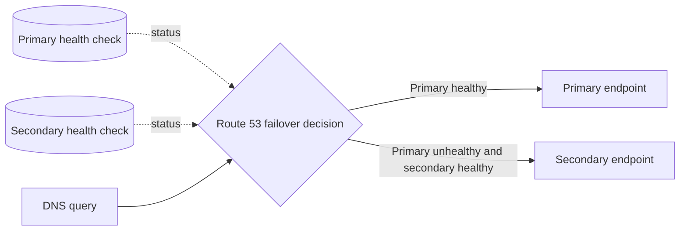

# Route 53 Best Practices

## Routing Policies

### Policy Comparison

| Policy | Core behavior | Health-check aware | Use Case |
|--------|---------------|--------------------|----------|
| **Simple** | Return one or more values without policy-specific selection | No | Single resource or basic multi-answer DNS |
| **Failover** | Return primary unless unhealthy, then secondary | Yes | Active-passive HA |
| **Latency** | Select the record for the AWS Region with lowest measured network latency | Yes | Global low-latency |
| **Multi-value answer** | Return up to eight healthy values selected from a larger set | Yes | DNS-level availability across multiple endpoints; not a load-balancer replacement |
| **Weighted** | Select records in proportion to configured weights | Yes | A/B testing, migration |
| **Geolocation** | Select by the request's geographic origin, with a default fallback record | Yes | Localization and geographic routing |
| **Geoproximity** | Select by resource/user location and optional bias | Yes | Shift geographic boundaries between resources |
| **IP-based** | Select by configured CIDR collection | Yes | Route known client networks differently |

### Policy Selection Matrix

| Requirement | Recommended Policy |
|-------------|-------------------|
| Single endpoint, no HA | Simple |
| Active-passive failover | Failover |
| Global low-latency | Latency |
| A/B testing | Weighted |
| Geographic restriction | Geolocation |
| Simple multi-endpoint HA | Multi-Value |
| Custom geo-distribution | Geoproximity |

---

## Health Checks

### Health Check Types

| Type | Description | Use Case |
|------|-------------|----------|
| **Endpoint** | HTTP/HTTPS, TCP, HTTPS with string matching | Application health |
| **CloudWatch Alarm** | Based on CloudWatch metric | Custom health criteria |
| **Calculated Health Check** | Combine multiple child health checks with AND/OR/NOT logic | Complex health logic |

### Health Check Configuration

| Setting | Recommendation | Reason |
|---------|---------------|--------|
| **Interval** | 30 seconds (default) or 10 seconds | Faster detection vs cost |
| **Failed thresholds** | 3 (default) | Balance false positives/negatives |
| **Regions** | At least 3 | Global health assessment |
| **Protocol** | Match the endpoint and failure mode being tested; use HTTPS when the TLS path must be exercised | Test the actual serving path (Route 53 health checks do not validate the endpoint certificate) |
| **Port** | Application port | Check actual service |
| **Resource path** | Health endpoint | Lightweight check |
| **Search string** | Expected response | Validate response content |

### Health Check Best Practices

| Practice | Description |
|----------|-------------|
| **Dedicated health endpoint** | Lightweight, fast response |
| **Multiple regions** | At least 3 for accuracy |
| **Alarm integration** | CloudWatch alarms for notification |
| **Failover testing** | Regular failover drills |
| **Cost awareness** | Health-check pricing varies by endpoint type and optional features; verify current pricing before multiplying checks across records/Regions |

---

## Record Types

### Supported Record Types

| Type | Description | Use Case |
|------|-------------|----------|
| **A** | IPv4 address | Standard web hosting |
| **AAAA** | IPv6 address | IPv6 support |
| **CNAME** | Alias to another name | Subdomain routing |
| **DS** | Delegation signer | DNSSEC chain of trust |
| **HTTPS** | HTTPS service binding information | HTTP endpoint connection hints |
| **MX** | Mail server | Email routing |
| **NAPTR** | Naming authority pointer | SIP, telephony |
| **NS** | Name server | Delegation |
| **PTR** | Reverse DNS | Reverse lookups |
| **SOA** | Start of authority | Zone info |
| **SPF** | Legacy SPF record type | Do not create for SPFv1; publish SPF policy in TXT instead |
| **SRV** | Service locator | Service discovery |
| **SSHFP** | SSH public-key fingerprint | SSH host-key verification with DNSSEC |
| **SVCB** | General service binding | Connection parameters and aliases |
| **TLSA** | TLS certificate/key association | DANE with DNSSEC |
| **TXT** | Text record | Domain verification, DKIM |
| **CAA** | Certificate Authority Authorization | Certificate issuance control |

### Alias vs CNAME

An alias is a Route 53 record feature on supported record types (usually A/AAAA), not a DNS record type of its own.

| Feature | Alias | CNAME |
|---------|-------|-------|
| **Zone apex** | Supported | Not supported |
| **Additional queries** | No (resolved by Route 53) | Yes (additional DNS query) |
| **Cost** | Route 53 does not charge for alias queries to eligible AWS resources; target-service charges can still apply | Standard Route 53 query charges apply |
| **Health checks** | Can evaluate target health for supported alias targets, or use an explicit health check where supported | Use routing-policy records and health checks rather than relying on the CNAME itself |
| **AWS resources** | ELB, CloudFront, S3, etc. | Any hostname |
| **Recommendation** | **Prefer Alias for AWS resources** | Use for non-AWS targets |

---

## Private Hosted Zones

### VPC Association

| Feature | Description |
|---------|-------------|
| **Private zone** | Resolves only in associated VPCs |
| **VPC association** | Associate with multiple VPCs |
| **Region scope** | A private hosted zone is not Region-bound and can be associated with VPCs in multiple Regions |
| **Resolver endpoints** | Share with on-premises |
| **Inbound endpoint** | On-premises to VPC resolution |
| **Outbound endpoint** | VPC to on-premises resolution |

### Use Cases

| Use Case | Configuration |
|----------|--------------|
| **Internal DNS** | Private zone for internal services |
| **Split-horizon DNS** | Different records for public/private |
| **On-premises integration** | Resolver endpoints for hybrid DNS |
| **Multi-VPC** | Associate zone with multiple VPCs |

---

## DNSSEC

### DNSSEC Configuration

| Setting | Recommendation |
|---------|---------------|
| **Enable DNSSEC** | For public zones when the registrar/parent-zone chain of trust and operations are ready; test rollover and failure recovery |
| **Key signing key (KSK)** | Backed by a customer-managed asymmetric KMS key in `us-east-1`; you manage KSK lifecycle |
| **Zone signing key (ZSK)** | Managed by Route 53 |
| **Key rollover** | Plan KSK rollover; Route 53 manages ZSK rotation |
| **Trust anchor** | DS record at registrar |
| **VPC resolver validation** | Enable Route 53 Resolver DNSSEC validation separately for VPCs that require validation; authoritative signing and recursive validation are different controls |

### Benefits

| Benefit | Description |
|---------|-------------|
| **Authenticity** | Verify response source |
| **Integrity** | Detect tampered responses |
| **Denial of existence** | Prove record doesn't exist |
| **Compliance** | Meet security requirements |

---

## Amazon Application Recovery Controller (ARC)

ARC is a separate AWS service for recovering applications across Availability Zones and Regions. Routing controls integrate with a special Route 53 health check, but ARC also includes non-DNS recovery capabilities:

| Component | Description | Use Case |
|-----------|-------------|----------|
| **Region switch** | Orchestrate and monitor multi-Region recovery plans with plan evaluation and execution safety controls | Managed regional failover workflow |
| **Routing controls** | Highly available on/off switches (backed by a 5-endpoint redundant cluster) that gate traffic shifting | Deterministic, low-latency failover trigger |
| **Readiness checks (existing customers)** | Audit resource configuration/capacity/quota parity across replicas; this feature is no longer open to new customers | Existing recovery-group/cell designs |
| **Zonal shift / zonal autoshift** | Shift traffic away from an impaired AZ (via ELB/ASG) in minutes, with optional automatic shift | Fast AZ-level mitigation without a full DR failover |

| Practice | Description |
|----------|-------------|
| **Use routing controls for operator-controlled regional failover** | Routing controls provide a highly available control plane and safety rules, but DNS caching and record TTLs still affect when clients observe DNS changes |
| **Evaluate recovery plans continuously** | For new designs, use Region switch plan evaluation; existing readiness-check customers can continue using readiness checks |
| **Test zonal shift regularly** | Validates AZ-level mitigation without waiting for a real incident |

---

## Traffic Flow

### Traffic Flow Features

| Feature | Description |
|---------|-------------|
| **Visual editor** | Drag-and-drop traffic policies |
| **Calculators** | Combine health checks logically |
| **Policies** | Reusable traffic routing policies |
| **Split** | Weighted traffic distribution |
| **Failover** | Primary/secondary with health checks |
| **Latency** | Route by lowest latency |

### Traffic Policy Example

| Component | Configuration |
|-----------|--------------|
| **Split** | 90% primary, 10% canary |
| **Failover** | Primary health check, secondary fallback |
| **Latency** | Multiple regions, lowest latency wins |
| **Geolocation** | Continent/continent group routing |

---

## Monitoring

### Key Signals

| Signal | Source | Alert/Analysis |
|--------|--------|----------------|
| HealthCheckStatus | Route 53 health-check CloudWatch metrics | Alarm on an unexpected unhealthy state |
| HealthCheckPercentageHealthy / ChildHealthCheckHealthyCount | Route 53 calculated/endpoint health checks | Alarm on loss of checker or child-check quorum appropriate to the design |
| ConnectionTime / SSLHandshakeTime / TimeToFirstByte | Endpoint health-check metrics where applicable | Compare with endpoint SLO/baseline |
| Public DNS queries | Route 53 public query logging to CloudWatch Logs | Investigate names, types, response codes, and source networks |
| Resolver queries | Route 53 Resolver query logging | Security and hybrid-DNS troubleshooting |

### Best Practices

| Practice | Description |
|----------|-------------|
| **Monitor health checks** | Alert on state changes |
| **Track query volume** | Detect anomalies |
| **Failover testing** | Regular drills |
| **TTL management** | Balance propagation and freshness |

---

## Cost Optimization

| Strategy | Description | Potential Savings |
|----------|-------------|-------------------|
| **Alias records** | Use aliases for eligible AWS resources | Route 53 does not charge for eligible alias queries |
| **Health check optimization** | Right-size check count and optional features | Lower recurring check cost |
| **TTL optimization** | Higher TTL = fewer queries | Reduced query volume |
| **Zone consolidation** | Fewer zones | Per-zone costs |
| **Remove unused records** | Clean up old records | Query cost reduction |

### Pricing

Route 53 pricing varies by hosted-zone count, query volume and routing policy, health-check type/options, Resolver endpoints and query logs, ARC features, and domain registration. Use the current pricing page rather than embedding rates that can change or vary by tier.

---

## Cross-Service Integration

| Service | Integration | Purpose |
|---------|------------|---------|
| CloudFront | Alias to distribution | Global CDN |
| ELB | Alias to load balancer | Load-balanced routing |
| S3 | Alias to website endpoint | Static website hosting |
| VPC | Private hosted zones | Internal DNS |
| CloudWatch | Health check alarms | Monitoring |
| Shield | DDoS protection | DNS DDoS mitigation |
| ACM | SSL certificate validation | Domain ownership |
| Transfer Family | SFTP endpoint routing | File transfer |
| Amazon Application Recovery Controller | Region switch, routing controls, readiness checks for existing customers, and zonal shift | Multi-AZ/Region failover orchestration |

---

## Additional Best Practices

- Use alias A and AAAA records for supported dual-stack AWS targets and keep IPv4/IPv6 health and routing behavior consistent.
- For failover records, understand the "all records unhealthy" behavior and avoid attaching a health check to an alias when `EvaluateTargetHealth` already represents the same target state.
- Keep TTLs low enough for the recovery objective before a planned migration, then raise them when stability and cache efficiency matter. Existing cached answers remain until their TTL expires.
- Protect hosted-zone and registrar changes with least privilege, MFA for human access, CloudTrail alerts, and registry/registrar lock where available.
- Enable DNSSEC alarms for `DNSSECInternalFailure` and `DNSSECKeySigningKeysNeedingAction`; do not enable signing without completing the parent-zone DS chain.
- Use Resolver endpoints and rules for hybrid DNS; do not forward private DNS through an internet NAT path.

## AWS References

- [Route 53 routing policies](https://docs.aws.amazon.com/Route53/latest/DeveloperGuide/routing-policy.html)
- [Supported Route 53 record types](https://docs.aws.amazon.com/Route53/latest/DeveloperGuide/ResourceRecordTypes.html)
- [Choosing between alias and non-alias records](https://docs.aws.amazon.com/Route53/latest/DeveloperGuide/resource-record-sets-choosing-alias-non-alias.html)
- [Working with private hosted zones](https://docs.aws.amazon.com/Route53/latest/DeveloperGuide/hosted-zones-private.html)
- [Configuring DNSSEC signing](https://docs.aws.amazon.com/Route53/latest/DeveloperGuide/dns-configuring-dnssec.html)
- [What is Amazon Application Recovery Controller?](https://docs.aws.amazon.com/r53recovery/latest/dg/what-is-route53-recovery.html)
- [ARC readiness-check availability change](https://docs.aws.amazon.com/r53recovery/latest/dg/arc-readiness-availability-change.html)
