# AWS Best Practices Documentation

A comprehensive, structured reference guide covering best practices across all major AWS services.

---

## Table of Contents

### Core Services
| Document | Description |
|----------|-------------|
| [EC2 Best Practices](Core-Services/EC2-Best-Practices.md) | Compute optimization, instance selection, security hardening, and lifecycle management |
| [S3 Best Practices](Core-Services/S3-Best-Practices.md) | Storage classes, data lifecycle, security, performance tuning, and cost optimization |
| [IAM Best Practices](Core-Services/IAM-Best-Practices.md) | Identity management, least privilege, MFA, role design, and access auditing |
| [VPC Best Practices](Core-Services/VPC-Best-Practices.md) | Network architecture, subnet design, security groups, NACLs, and peering strategies |

### Database
| Document | Description |
|----------|-------------|
| [RDS Best Practices](Database/RDS-Best-Practices.md) | Relational database provisioning, backups, scaling, multi-AZ, and engine selection |
| [DynamoDB Best Practices](Database/DynamoDB-Best-Practices.md) | NoSQL design patterns, capacity modes, partition keys, GSIs, and cost optimization |
| [ElastiCache Best Practices](Database/ElastiCache-Best-Practices.md) | Caching strategies, Redis vs Memcached, clustering, failover, and data consistency |

### Serverless
| Document | Description |
|----------|-------------|
| [Lambda Best Practices](Serverless/Lambda-Best-Practices.md) | Function design, cold starts, memory sizing, timeouts, and error handling |
| [API Gateway Best Practices](Serverless/API-Gateway-Best-Practices.md) | API design, throttling, caching, authorization, and stage management |
| [EventBridge Best Practices](Serverless/EventBridge-Best-Practices.md) | Event-driven architecture, bus design, rule patterns, and error handling |

### Networking
| Document | Description |
|----------|-------------|
| [CloudFront Best Practices](Networking/CloudFront-Best-Practices.md) | CDN configuration, cache behavior, origin shielding, and security |
| [Route 53 Best Practices](Networking/Route53-Best-Practices.md) | DNS routing policies, health checks, failover, and latency-based routing |
| [Load Balancing Best Practices](Networking/Load-Balancing-Best-Practices.md) | ALB/NLB/GALB selection, target groups, health checks, and SSL termination |

### DevOps
| Document | Description |
|----------|-------------|
| [CI/CD Best Practices](DevOps/CI-CD-Best-Practices.md) | CodePipeline, CodeBuild, deployment strategies, and environment promotion |
| [CloudFormation Best Practices](DevOps/CloudFormation-Best-Practices.md) | Template design, modular stacks, drift detection, and change sets |
| [ECS/EKS Best Practices](DevOps/ECS-EKS-Best-Practices.md) | Container orchestration, auto-scaling, service mesh, and cluster management |

### Monitoring
| Document | Description |
|----------|-------------|
| [CloudWatch Best Practices](Monitoring/CloudWatch-Best-Practices.md) | Metrics, alarms, dashboards, log insights, and synthetic canaries |
| [X-Ray Best Practices](Monitoring/X-Ray-Best-Practices.md) | Distributed tracing, service maps, latency analysis, and error tracking |

### Security
| Document | Description |
|----------|-------------|
| [WAF Best Practices](Security/WAF-Best-Practices.md) | Web ACL rules, rate limiting, bot management, and managed rule groups |
| [KMS Best Practices](Security/KMS-Best-Practices.md) | Key management, encryption strategies, key rotation, and access policies |
| [Shield Best Practices](Security/Shield-Best-Practices.md) | DDoS protection, traffic mitigation, attack response, and cost considerations |

### Cost Optimization
| Document | Description |
|----------|-------------|
| [Cost Optimization Guide](Cost-Optimization/Cost-Optimization.md) | Reserved Instances, Savings Plans, right-sizing, tagging, and budgeting |

---

## How to Use This Documentation

1. **Navigate by service category** using the links above
2. **Search for specific topics** using your editor's search functionality
3. **Cross-reference related services** — each document links to complementary best practices
4. **Apply progressively** — start with critical security practices, then optimize for cost and performance

---

## AWS Well-Architected Framework Pillars

This documentation aligns with the six pillars of the AWS Well-Architected Framework:

| Pillar | Focus Area |
|--------|-----------|
| **Operational Excellence** | Running and monitoring systems to deliver business value |
| **Security** | Protecting information and systems |
| **Reliability** | Workload performance and resilience |
| **Performance Efficiency** | Using IT resources efficiently |
| **Cost Optimization** | Avoiding unnecessary costs |
| **Sustainability** | Minimizing environmental impact |

```mermaid
graph LR
    subgraph OperationalExcellence["Operational Excellence"]
        O1["CI/CD"]
        O2["CloudFormation"]
        O3["ECS/EKS"]
        O4["CloudWatch"]
        O5["X-Ray"]
    end

    subgraph Security["Security"]
        S1["IAM"]
        S2["VPC"]
        S3["WAF"]
        S4["KMS"]
        S5["Shield"]
    end

    subgraph Reliability["Reliability"]
        R1["EC2"]
        R2["RDS"]
        R3["DynamoDB"]
        R4["ElastiCache"]
        R5["Load Balancing"]
        R6["Route 53"]
    end

    subgraph PerformanceEfficiency["Performance Efficiency"]
        P1["Lambda"]
        P2["API Gateway"]
        P3["EventBridge"]
        P4["CloudFront"]
        P5["ECS/EKS"]
    end

    subgraph CostOptimization["Cost Optimization"]
        C1["Cost Optimization Guide"]
        C2["S3"]
    end

    subgraph Sustainability["Sustainability"]
        SU1["Right-Sizing"]
        SU2["Compute Optimizer"]
    end

    Security -.-> Reliability
    Reliability -.-> OperationalExcellence
    PerformanceEfficiency -.-> CostOptimization
    CostOptimization -.-> Sustainability
    OperationalExcellence -.-> PerformanceEfficiency
```

