# AWS Best Practices Documentation

A curated, structured reference guide covering commonly used AWS services and architecture patterns. It is not an exhaustive catalog of AWS services.

> **Scope and freshness:** AWS features, quotas, pricing, and regional availability change frequently. Treat example values as starting points, verify workload-specific settings in the linked AWS documentation and Service Quotas, and validate prices for your Region with the [AWS Pricing Calculator](https://calculator.aws/).

---

## Table of Contents

### Core Services

| Document | Description |
|----------|-------------|
| [EC2 Best Practices](Core-Services/EC2-Best-Practices.md) | Compute optimization, instance selection, security hardening, and lifecycle management |
| [S3 Best Practices](Core-Services/S3-Best-Practices.md) | Storage classes, data lifecycle, security, performance tuning, and cost optimization |
| [IAM Best Practices](Core-Services/IAM-Best-Practices.md) | Identity management, least privilege, MFA, role design, and access auditing |
| [VPC Best Practices](Core-Services/VPC-Best-Practices.md) | Network architecture, subnet design, security groups, NACLs, and peering strategies |

### Database

| Document | Description |
|----------|-------------|
| [RDS Best Practices](Database/RDS-Best-Practices.md) | Relational database provisioning, backups, scaling, multi-AZ, and engine selection |
| [DynamoDB Best Practices](Database/DynamoDB-Best-Practices.md) | NoSQL design patterns, capacity modes, partition keys, GSIs, and cost optimization |
| [ElastiCache Best Practices](Database/ElastiCache-Best-Practices.md) | Caching strategies, Redis vs Memcached, clustering, failover, and data consistency |

### Architecture Design Patterns

| Document | Description |
|----------|-------------|
| [Event-Driven Patterns](Design/01-event-driven-patterns.md) | Lambda + SNS + SQS patterns: pub-sub fan-out, work queues, FIFO pipelines, async invocation, DLQ strategies |
| [Communication Patterns](Design/02-communication-patterns.md) | Sync/async invocation, API Gateway, WebSocket, Step Functions orchestration, service-to-service |
| [Error Handling Patterns](Design/03-error-handling-patterns.md) | Retry strategies, circuit breakers, idempotency, bulkhead, graceful degradation, chaos engineering |
| [Cross-Cutting Patterns](Design/04-cross-cutting-patterns.md) | Saga, CQRS, event sourcing, multi-tenant, batch processing, multi-region active-active |
| [Database Integration Patterns](Design/05-database-integration-patterns.md) | Lambda + DynamoDB/RDS patterns: RDS Proxy, Streams, CQRS, multi-region, transactional outbox |
| [High Availability & DR Patterns](Design/06-high-availability-dr-patterns.md) | Multi-AZ foundations, backup and restore, pilot light, warm standby, multi-site, and ARC |
| [Caching & Content Delivery Patterns](Design/07-caching-content-delivery-patterns.md) | CloudFront, cache-aside, DAX, and edge-compute patterns |
| [Compute & Deployment Patterns](Design/08-compute-deployment-patterns.md) | EC2/ECS/EKS architectures, sidecars, blue-green, canary, and migration patterns |
| [Multi-Account & Landing Zone Patterns](Design/09-multi-account-landing-zone-patterns.md) | Organizations, Control Tower, centralized networking/logging, and cross-account access |

### Serverless

| Document | Description |
|----------|-------------|
| [Lambda Best Practices](Serverless/Lambda-Best-Practices.md) | Function design, cold starts, memory sizing, timeouts, and error handling |
| [API Gateway Best Practices](Serverless/API-Gateway-Best-Practices.md) | API design, throttling, caching, authorization, and stage management |
| [EventBridge Best Practices](Serverless/EventBridge-Best-Practices.md) | Event-driven architecture, bus design, rule patterns, and error handling |

### Networking

| Document | Description |
|----------|-------------|
| [CloudFront Best Practices](Networking/CloudFront-Best-Practices.md) | CDN configuration, cache behavior, origin shielding, and security |
| [Route 53 Best Practices](Networking/Route53-Best-Practices.md) | DNS routing policies, health checks, failover, and latency-based routing |
| [Load Balancing Best Practices](Networking/Load-Balancing-Best-Practices.md) | ALB/NLB/GWLB selection, target groups, health checks, and TLS termination |

### DevOps

| Document | Description |
|----------|-------------|
| [CI/CD Best Practices](DevOps/CI-CD-Best-Practices.md) | CodePipeline, CodeBuild, deployment strategies, and environment promotion |
| [CloudFormation Best Practices](DevOps/CloudFormation-Best-Practices.md) | Template design, modular stacks, drift detection, and change sets |
| [ECS/EKS Best Practices](DevOps/ECS-EKS-Best-Practices.md) | Container orchestration, auto-scaling, service mesh, and cluster management |

### Monitoring

| Document | Description |
|----------|-------------|
| [CloudWatch Best Practices](Monitoring/CloudWatch-Best-Practices.md) | Metrics, alarms, dashboards, log insights, and synthetic canaries |
| [X-Ray Best Practices](Monitoring/X-Ray-Best-Practices.md) | Distributed tracing, service maps, latency analysis, and error tracking |

### Security

| Document | Description |
|----------|-------------|
| [WAF Best Practices](Security/WAF-Best-Practices.md) | Web ACL rules, rate limiting, bot management, and managed rule groups |
| [KMS Best Practices](Security/KMS-Best-Practices.md) | Key management, encryption strategies, key rotation, and access policies |
| [Shield Best Practices](Security/Shield-Best-Practices.md) | DDoS protection, traffic mitigation, attack response, and cost considerations |

### Cost Optimization

| Document | Description |
|----------|-------------|
| [Cost Optimization Guide](Cost-Optimization/Cost-Optimization.md) | Reserved Instances, Savings Plans, right-sizing, tagging, and budgeting |

---

## How to Use This Documentation

1. **Navigate by service category** using the links above
2. **Search for specific topics** using your editor's search functionality
3. **Cross-reference related services** — each document links to complementary best practices
4. **Apply progressively** — start with critical security practices, then optimize for cost and performance

---

## AWS Well-Architected Framework Pillars

This documentation aligns with the six pillars of the AWS Well-Architected Framework:

| Pillar | Focus Area |
|--------|-----------|
| **Operational Excellence** | Running and monitoring systems to deliver business value |
| **Security** | Protecting information and systems |
| **Reliability** | Workload performance and resilience |
| **Performance Efficiency** | Using IT resources efficiently |
| **Cost Optimization** | Avoiding unnecessary costs |
| **Sustainability** | Minimizing environmental impact |

```mermaid
graph LR
    subgraph OperationalExcellence["Operational Excellence"]
        O1["CI/CD"]
        O2["CloudFormation"]
        O3["ECS/EKS"]
        O4["CloudWatch"]
        O5["X-Ray"]
    end

    subgraph Security["Security"]
        S1["IAM"]
        S2["VPC"]
        S3["WAF"]
        S4["KMS"]
        S5["Shield"]
    end

    subgraph Reliability["Reliability"]
        R1["EC2"]
        R2["RDS"]
        R3["DynamoDB"]
        R4["ElastiCache"]
        R5["Load Balancing"]
        R6["Route 53"]
    end

    subgraph PerformanceEfficiency["Performance Efficiency"]
        P1["Lambda"]
        P2["API Gateway"]
        P3["EventBridge"]
        P4["CloudFront"]
        P5["ECS/EKS"]
        P6["Event-Driven Patterns"]
        P7["Communication Patterns"]
        P8["Cross-Cutting Patterns"]
    end

    subgraph CostOptimization["Cost Optimization"]
        C1["Cost Optimization Guide"]
        C2["S3"]
    end

    subgraph Sustainability["Sustainability"]
        SU1["Right-Sizing"]
        SU2["Compute Optimizer"]
    end

    Security -.-> Reliability
    Reliability -.-> OperationalExcellence
    PerformanceEfficiency -.-> CostOptimization
    CostOptimization -.-> Sustainability
    OperationalExcellence -.-> PerformanceEfficiency
```

---

## Deploying the Documentation Site

The repository includes a GitHub Pages workflow at `.github/workflows/pages.yml`. It builds the Markdown with Jekyll and deploys the result whenever a commit is pushed to `main`.

To enable the first deployment:

1. Push these files to GitHub.
2. Open **Settings → Pages** in the repository.
3. Under **Build and deployment**, set **Source** to **GitHub Actions**.
4. Open **Actions** and follow the **Deploy documentation to GitHub Pages** run.

For the current repository name, the default site URL will be `https://alexanderbesss.github.io/AWS_best_praactices/`. GitHub will also show the final URL in the deployment summary.
